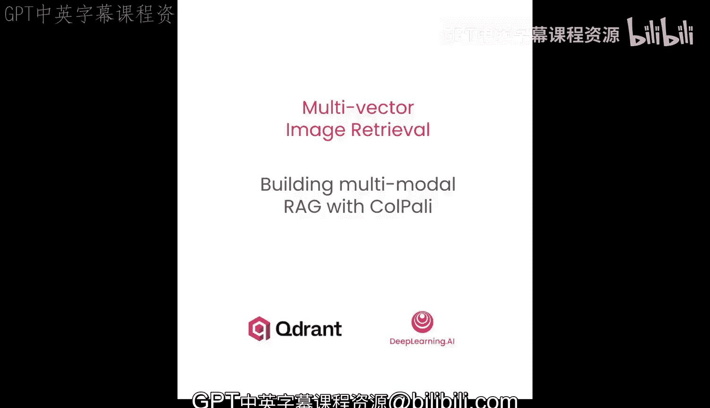
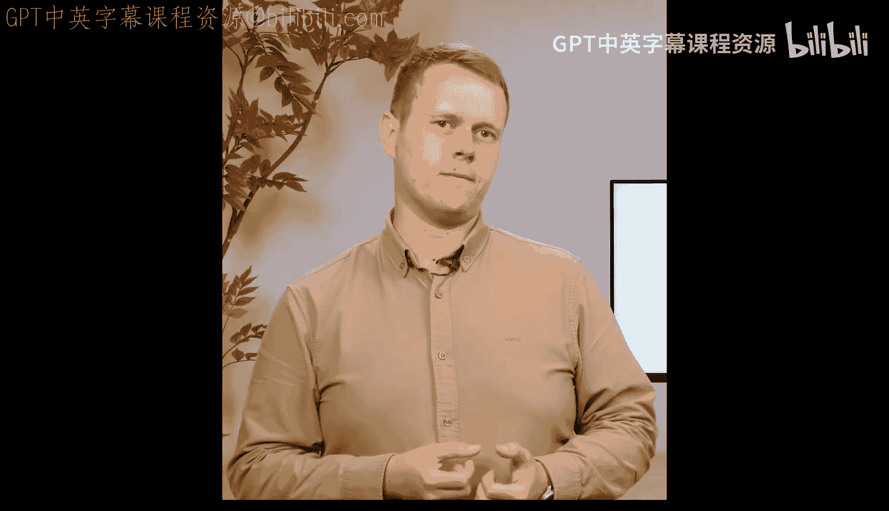
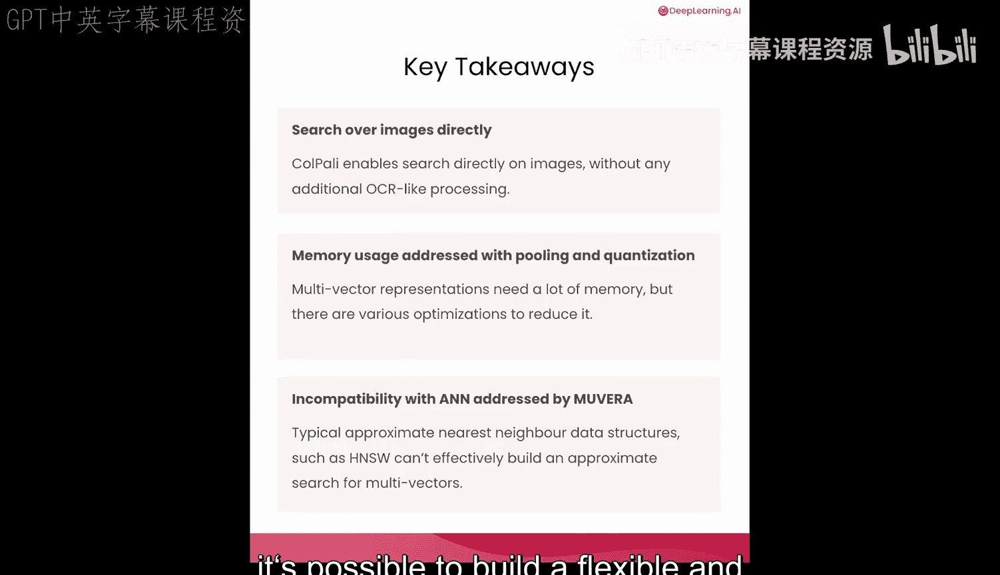

# 吴恩达《多向量图像检索｜Multi-Vector Image Retrieval》中英字幕 - P6：6.building-multi-modal-rag-with-colpali.zh_en - GPT中英字幕课程资源 - BV1HjmrBzE2L

You now know how Co poly works， how its memory footprint can be optimized and how move a speeds up multi vector surge。

Let's put all these different pieces together and build a functioning multimodal rack system based on Copa。

Let's build something In previous lessons， we've seen how Copi enables visual documents which well through multi vector embeddings。

Now you will build a complete rack system that combines coalpi's retrieval with open AI's vision models for generation。

This approach lets you answer questions about documents by retrieving relevant pages and having a vision capable language model read them directly。

 No， OCR needed。You will start by loading the open AI API key from the environment file and creating an openaiI client。

 You will recreate a collection from lesson 3 that contains Co poly embeddings with a various optimizations。

 This ensures you can run this lesson independently without completing lesson 3 first。

 The collection includes multiple optimizations strategies。

 Original embeddings binary and sc quantization and different kinds of pooling。

 In the previous lesson you explore Movea， which compresses C poly's variable length multi vector embeddings into fixed dimensional encodings。

 This enables H ands W indexing for faster search at scale。😊。

You will add Movera embeddings to the same collection to demonstrate two stage retrieval using Movera for fast candidate retrieval。

 Then reranking with call party for maximum accuracy。

 Let's create a movera instance with the same configuration， like in the previous lesson。

As a next step， you will recreate the quadrant collection with all the memory optimizations。

 including Povera embeddings， you have another helper function to achieve exactly this。

The reccreate called poly optimizations collection。

 Hoer function imported all the memory optimizations we discussed in one of the previous lessons and also created Moeller presentations for the original call poly multives。

It's time for queries， this helper function will retrieve precomputed vector embeddings for a list of interesting queries that you can use to test your rack system。

You can now test the helper function with a sample question about the documents in the collection。

Instead of embedding queryries separately and passing them to search functions。

 you will create a unified retriever that handles query embedding internally and returns a list of image path and score tops。

The retrieve function takes a textual query。And sets using parameter of the query points method of quadrants as decay。

To a specific vector name that we want to use for retrieval in that particular case。

Because some of the optimization methods we discussed earlier are quantization methods and query has a rescor function built in。

 we specifically say that we don't want to use the re mechanism because otherwise we could get better results than cha with quantized vectors another helper function we run search with two stage retrieval it will use movera embeddings。

As an initial prefech mechanism。And then it will rewrnk with the vectors that you want to use at that stage。

 Obviously， we could re with the original co embeddings。 However， if we are able to use pool vectors。

 we could also save the memory and still get decent results out of this two stage retrieval。

 So we are actually going to test both Movea for faster retrieval and different kinds of memory optimizations to get the best out of both routes。

Let's test our retriever function with a sample query。

 The retrier will handle the query embedding generation internally and we will return the top results。

Here are the top PDF pages for the query， how does the human brain work？

Now let's focus on the generation part， you will send the retrieve document pages to GT40 along with the user's question。

DPT 40 can read text diagrams and formulas directly from the images to generate accurate answers。

There are different parts of that process。 First of all， we are sending a system prompt。

 telling the model to answer our questions based only on the provided document images。

 we also want to have an answer generated as a markdown so can just render that properly。

Then we'll pass the original prompt sent to the system。 Finally。

 you will attach all the images provided to this particular function。At the variant。

 this entire interaction will be sent to the Open AI service to get the LLM output。

Let's test the generation with the previously retrieved documents and see how GPT 40 answers our question。

Nice， you've just implemented a re augmented generation that works directly on visual documents。

Let's test our complete rock work flow with several different questions。First of all。

 you will retrieve documents for all the queries using the original callul retriever。

 extract the image partss and generate the answer using GPT4 o's vision capabilities。

 this two step approach， retrieve and generate using separate function mix process explicit and give us full control over each stage。

You are not only displaying the answer as generated by the LLM。

 but also the input images that we sent。Along with the prompt。

The same goes for the second query from our dataset set。And the last query。At this point。

 it shouldn't be surprising that original co vectors did a pretty good job。 however， in practice。

 you will typically try to optimize that process using all the techniques that we and for that you start multiple optimized vectors in the same collection so you can just test different optimization methods。

Let's test some of the techniques we used in one of the previous lessons。

 You will specifically use binary quant vectors and hierarchical token pulling with pull factors set to2。

 if you now test the same receiverr， but using different optimization techniques。

You should see some different outputs because the input documents will be obviously slightly different。

Here is the answer generated for the binary quantized version of our embes。

Even though it didn't use the same set of images。It still provided a pretty response to the input prompt hierarchical token pulling was doing even a better job in our experiments。

And not surprisingly， it also did a good job。However， member optimization is typically not enough。

 as we saw in the previous lesson。Muvera alone can have lower precision compared to the original cow poly multives。

But it offers significantly faster search through HLSW indexingnc。

 The optimal production approach combines both Use Movera to quickly retrieve a broader set of candidates and then rewr those candidates with any optimization method for the final results。

That's why you created a retrieve with two stage function that implements this pattern using Quadrant's prefech mechanism with a flexible re ranking strategy to control it。

Let's see de actionuction。Let's test the two stage retrieval and compare it with the original co pi retriever。

For this comparison， you will use the defaultory rankinging strategy with original full call pattern embeddings。

After Muvea's fast perfect， that should hopefully maintain higher accuracycurura C well benefiting from Muvera's H andSW search。

 which is especially important when scaling to larger document collections。

Let's see how the Movera two stage Victoria results look like。

The original coul poly retriever does a really good job。 but this is our baseline。

And two stage retrieval with Mora and Cpiri ranking is actually using。

A very good set of input images， so。The output of the L M is grounded in the knowledge we have。

And while Mouve handles fast prefech with HNSW indexing。

 the re rankingking stage can use any optimization method， not necessarily the original vectors。

As a last step， let's compare how these different reworking strategies affect retrieval quality and performance。

 When we run this experiment， the documents retrieved by Movea will be reraned using original copi vectors。

 binary quantized ones and hierarchical token pulling。

Each ranking strategy offers different tradeoffs。Original Copali provides the highest accuracy with full max computation across all multi vectors。

However， binary quantization offers faster reranking by using compressed representation and it also significantly reduces the amount of memory needed to keep all the vectors。

 though with slightly reduced precision。Hiererarchical to and pulling。

Reduces the number of vectors to compare to during tree rankingking。

 providing another speed accuracy balance point。In production。

 you may choose binary quantization for cost sensitiveensitive applications or stick with originals that two state retrieval pattern using Movea is particularly powerful for production systems。

 it combines the speed of H andsW indexes while ranking is quite flexible as we can use any optimization method Through the entire course。

 you learn how to build a retrieval system， working directly on scan documents， Pdfs or images。

 There are two key issues related to multivectors。 The first is highme usage thanks to all those vectors。

 You can mitigate this issue by using quantization or pulling techniques。

 or even by combining multiple methods together。 The second problem is the fact that multi vector representations are not compatible with the most popular approximate nearest neighbors techniques such as H andsW。

 So by default， they require a full scan that doesn't scale。

 Movea is a promising method of converting variable length。

Sequences of vectors into fixed dimensional representations， enabling approximate search。Typically。

 original vectors are still used for re rankingking to achieve both speed and high quality。

 Putting all these tools together。 It's possible to build a flexible and high performing multimodal rack system。

 as you just saw。

