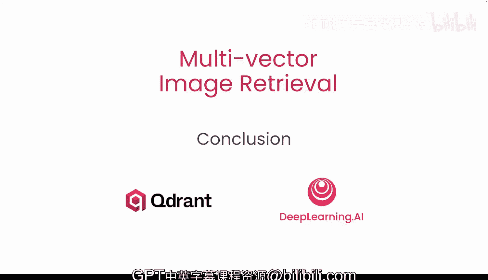

# 吴恩达《多向量图像检索｜Multi-Vector Image Retrieval》中英字幕 - P7：7.conclusion.zh_en - GPT中英字幕课程资源 - BV1HjmrBzE2L

In this course， you learned about the foundational concepts of multi vector retrieval。

 starting with text retrieval with Colberg。 Next， you saw how those same concepts can be used to power multive image retrieval with Co polyli。

 Since multive techniques generate a lot of vector data。

 You then explore some optimization techniques to reduce Copi's memory footprint。

 Then you saw how Movea allows Copi to be used with H and SW search。 Finally。

 you explored where a working a application built around all these techniques look like。

 I hope you are leaving this course feeling confident with their concepts underlying multi vector retrieval and with new ideas of applications you wantna built。

I can't wait to see what you come up with。😊。