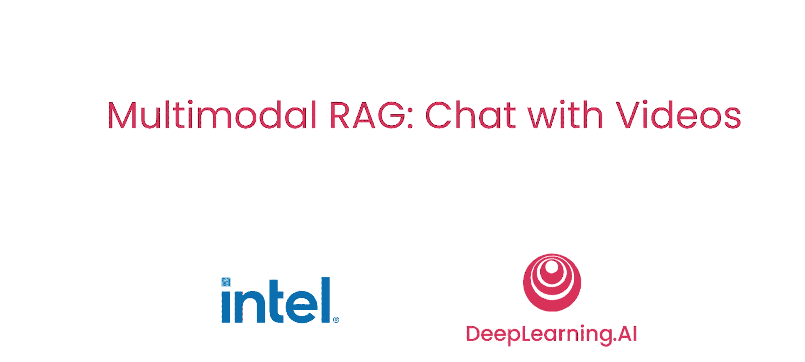
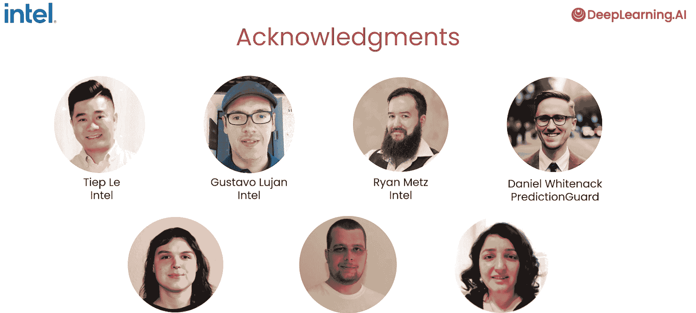

# 吴恩达《多模态RAG：与视频对话｜Multimodal RAG： Chat with Videos》中英字幕（豆包 - P1：1.intro - GPT中英字幕课程资源 - BV1mUtTehEsy

欢迎来到本课程《多模态RAG聊天系统与视频》，由Intel，合作创建。在本课程中，你将学习如何为多模态数据（特别是一组视频，）构建一个问答系统。你将探索多模态编码转换器模型，这些模型将视觉和文本。

数据合并到一个统一的语义空间中，你还将学习如何创建，一个能够与视频集合进行交互的系统。首先，你将从BridgeTower模型开始，该模型嵌入了文本和，图像，你会生成嵌入并将它们存储在向量数据库中。

接下来，你将开发一个RAG管道，以从这个数据库中提取相，关的多模态内容，并将其作为输入上下文传递给下游的大，规模视觉语言模型，为用户生成响应。到课程结束时，你将构建一个交互式AI系统，允许你与视频。

语料库进行对话。我很高兴为本课程授课的是Vasnev Lau，他是Intel Labs，多模态认知AI团队的首席AI研究科学家。Vasnev和他的团队进行大量关于多模态基础模型的研究。

特别是模型规模扩大如何使视觉和文本表示相互对齐的研，究。为了进一步支持研究和开发者社区，他们经常开源他们的，工作，并在主要AI会议上展示详细的技术论文。

谢谢，Andrew。在本课程中，你将学习多模态嵌入模型，如BridgeTower模，型，以及如何为图像和字幕对创建联合嵌入。这些嵌入能够在一个共同的多模态语义空间中表示视觉和。

语言模态。你将学习如何处理多模态应用中的视频数据，包括使用，whisper模型进行转录，以及使用大规模视觉语言模型生成字，幕，并学习如何开发能够处理复杂查询（涉及文本和图像），的强大检索系统。

利用工具如向量存储和langchain进行，数据检索和相似性搜索。你还将学习如何使用大规模视觉语言模型执行任务，例如，图像字幕生成、基于视觉和文本线索回答问题，以及保持，对话流程。

本课程使用的API基于PredictionGuard的多模态模型，PredictionGuard是一家在Intel云上托管模型的初创公，司。你将学习如何实现一个完整的多模态检索增强生成（RAG），系统。

该系统接受复杂的用户查询，检索相关的视频片段，并提供基于特定视频帧的全面响应。Vasudev将指导你了解这些概念、工具和方法，包括。

BridgeTower模型、whisper模型、向量存储、langchain工。

作流和PredictionGuard API。多模态AI这个主题让我感到非常兴奋，出于实际原因。世界上大部分数据以视频和其他多模态文档形式存在，如，你将在本课程中观看的视频，或我每天审阅的幻灯片和论。

文。拥有能够利用所有这些模态数据的AI助手是非常有用的。这一能力对于客户支持、教育和娱乐等应用至关重要，在，这些领域，多模态交互增强了用户体验。本课程使用的模型是开源的，可以很容易地与其他开源或。

专有模型进行替换。许多人为创建本课程做出了贡献。我想感谢来自Intel的Diep Le、Gustavo Lujan和Ryan ，Metz。

来自PredictionGuard的Daniel Weitknecht、Jacob， Manstorfer和Florian Paton，以及来自DeepLearning。ai。

的Diala Ezzedine。

在第一节课中，您将与多模态RAG系统进行互动，通过一个，交互式的Gradio应用与视频聊天。听起来很棒。

