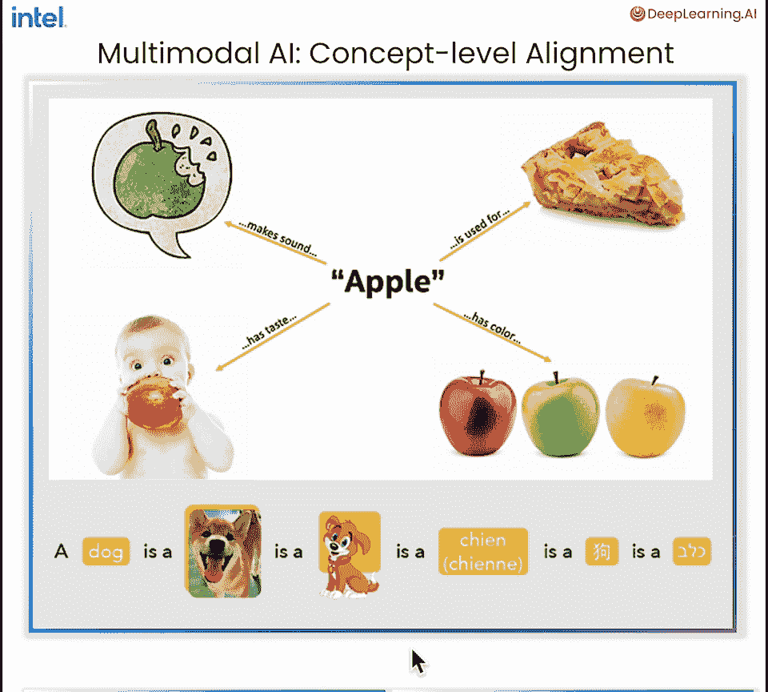
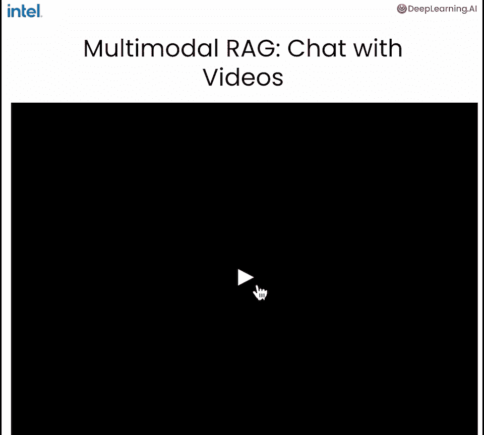
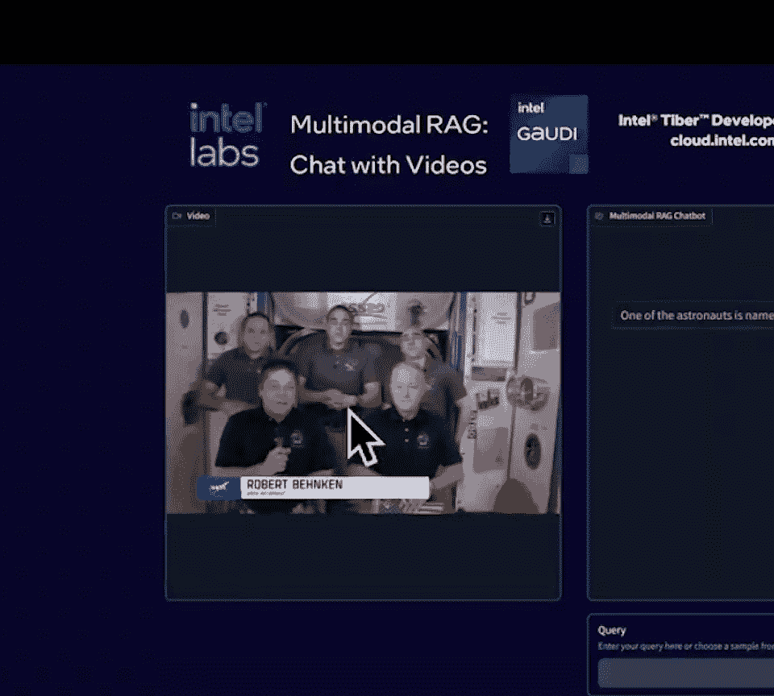
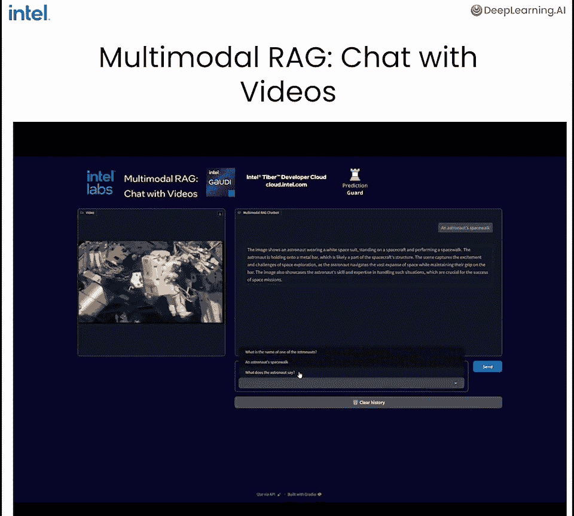
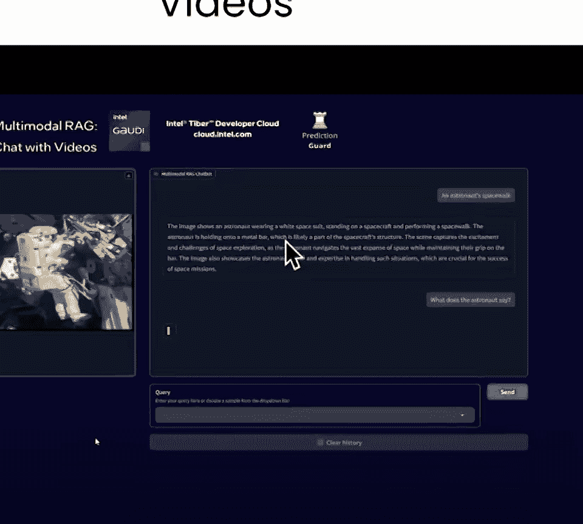
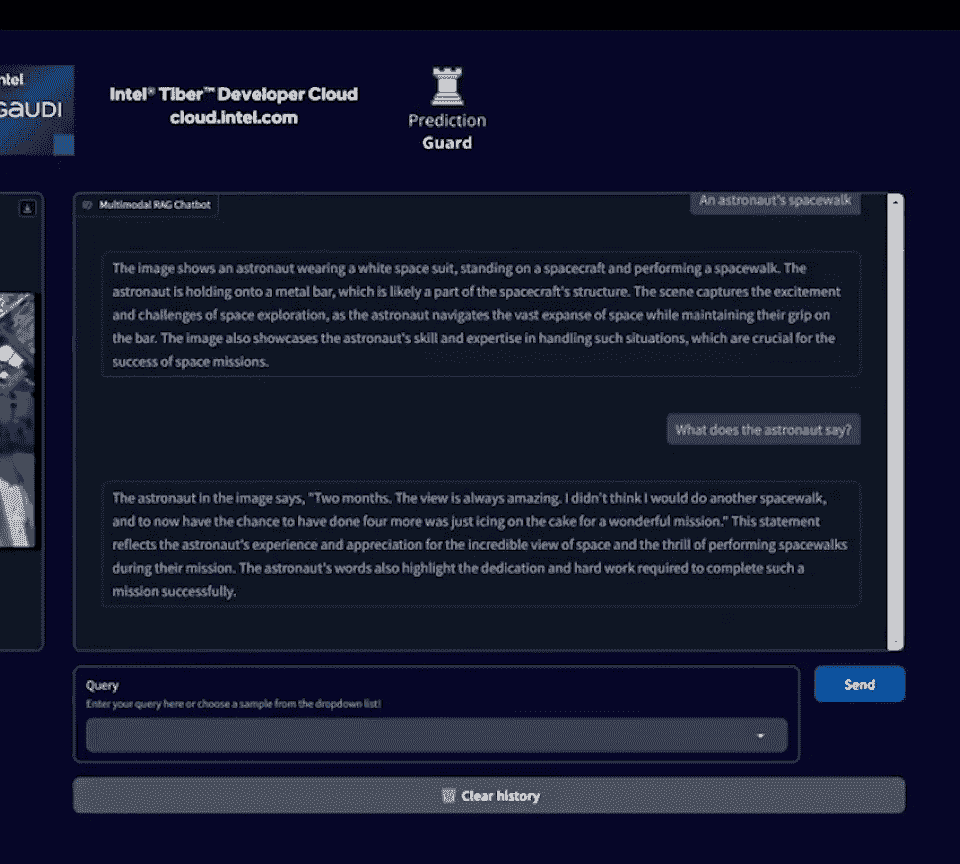
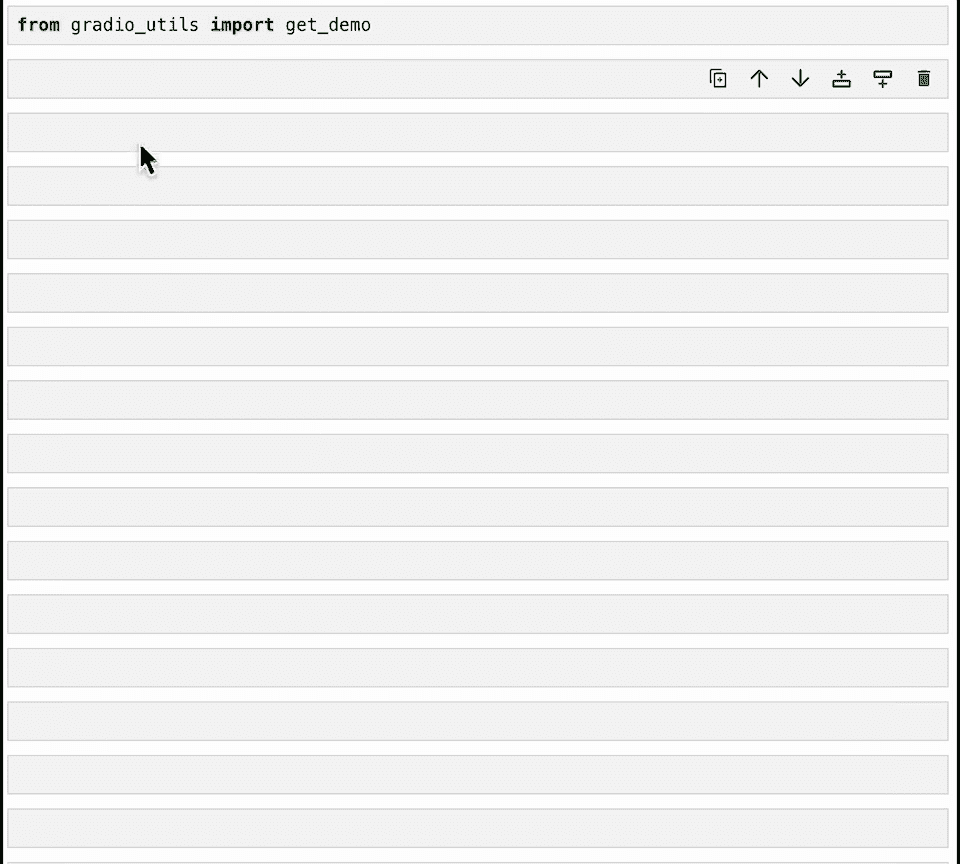
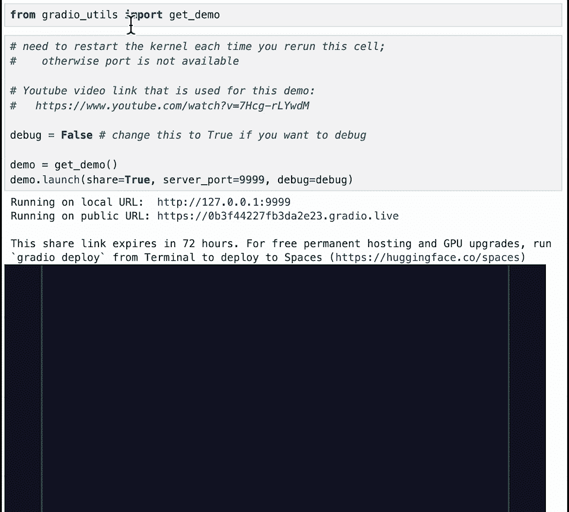
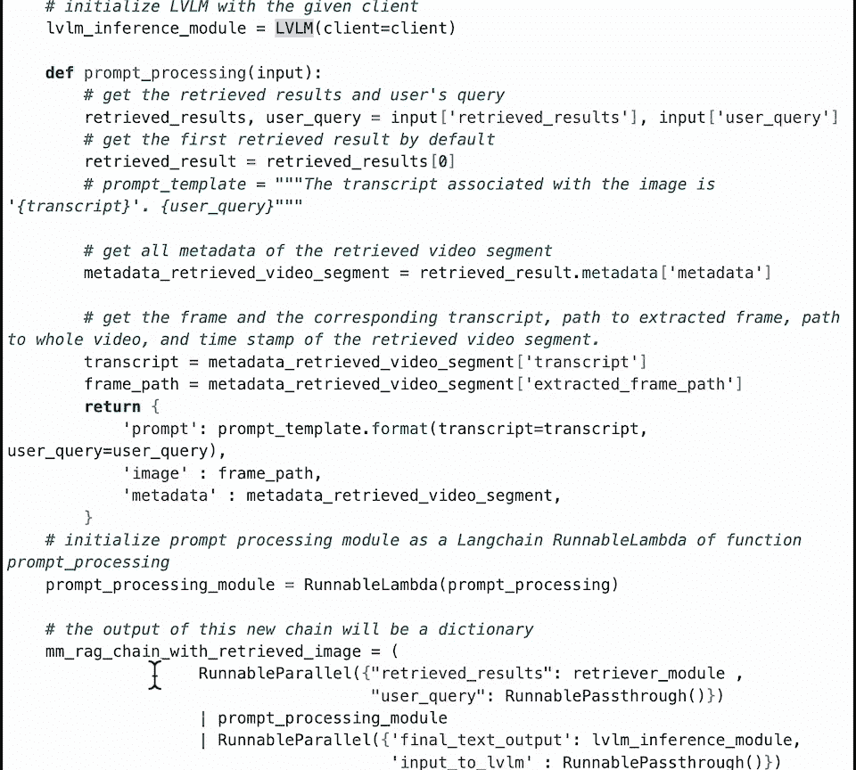

# 吴恩达《多模态RAG：与视频对话｜Multimodal RAG： Chat with Videos》中英字幕（豆包 - P2：2.Lesson 1 Interactive Demo - GPT中英字幕课程资源 - BV1mUtTehEsy

在本课中，你将与一个多模态 RAG 系统互动，通过一个交，互式 Gradio 应用与视频聊天。你将研究该系统的各种组件，并在接下来的课程中学习如，何从头开始构建它们。让我们来享受这一过程吧！作为人类。

我们使用所有感官来理解周围的世界。对于苹果的概念，我们理解当有人咬一口苹果时发出的声，音，它的味道，它的颜色和质感，以及苹果派是由它制成的，这一事实。我喜欢说，无论是在视频还是图像中表达的狗的概念。

或者，是用任何一种人类语言提到的“狗”这个词，狗就是狗。类似地，真正的认知 AI 系统需要能够通过所有模态交叉，的概念进行连接。

所以假设我们有一个视频，例如这个宇航员从任务中返回，的视频。一个多模态 AI 系统应该能够利用视频中的视觉内容和语，言内容。首先，这包括视频中的书面文本。其次，它应该能够利用视频中的纯视觉信息。第三。

它应该能够利用视频中所讨论的信息。第四，它应该能够进行多轮对话，让我们可以就视频中的第，一个查询或第二个查询提出后续问题。那么，让我们看看这个 Gradio 应用在我们的笔记本中是。

什么样子的。在这里，我们可以运行用户查询，例如“宇航员的名字是什，么”。系统将检索一个视频片段，试图回答这个查询。我们在国际空间站上的这次任务，我很自豪能够参与其中。

的大部分科学工作。然后，大型视觉语言模型将以自然语言作出回应。我们可以进行一个后续问题，例如，宇航员的太空行走。在这里，系统将再次检索一个合适的视频片段。再进行一次太空行走，现在有机会再进行四次。

真是令人激。

动。我们看到大型视觉语言模型提供了该场景的一些详细描述。

。我们也可以提出一个后续问题。宇航员说了什么？在这种情况下，模型适当地从转录中获取所说内容的信息，并以自然语言作出回应。

那么，让我们看看该系统的架构图。这就是我们将如何实现一个多模态 RAG 系统。在本课程中，我们将研究该系统的各个组成部分。具体来说，在第二课中，我们将学习多模态嵌入模型如何将。

图像和文本空间处理为一个共同的多模态语义空间。在第三课中，我们将学习如何预处理我们自己的视频数据，使其以多模态嵌入模型可以摄取的形式存在。在第四课中，我们将学习如何将视频数据摄取到多模态向，量数据库中。

并能够在这个向量数据库上运行查询。第五课中，我们将学习能够同时处理图像和文本的大型视，觉语言模型（LVLM）。最后，在第六课中，我们将把所有组件组合在一起，构建我，们自己的多模态 RAG 系统。那么。

让我们进入第一课的笔记本吧。欢迎来到第一课的笔记本。在实验练习中，我们将启动一个 Gradio 应用。由于我们已经在一个实用程序文件中定义了这个应用程序，因此我们将继续导入这个库。

那么我们现在将启动 Gradio 应用程序。

这应该和你刚刚在幻灯片中看到的类似。在这个界面中，你可以看到我们可以运行一些查询。所以让我们试试这个查询。宇航员的名字是什么？为了回答这个查询，系统将检索一个能够最好回答这个查，询的视频片段。

它已经检索到了视频片段，我来播放它。所以我们注意到在这个视频片段中，宇航员的名字写在这，里。通过这些信息，我们的多模态 RAG 系统能够以自然语言生，成一个答案，其中一名宇航员的名字是罗伯特·本肯。

在我们运行另一个查询之前，如果你不希望它记住之前的，上下文，让我们清除历史记录。让我们再试一次查询，关于宇航员太空行走。同样，对于这个查询，我们的多模态 RAG 系统将首先尝试。

检索一个最能回答这个查询的视频片段。在这种情况下，它已经检索到了这个视频片段，我现在要播，放这个视频片段。我原本以为我不会再做太空行走，而现在有机会完成了四，次更多的行走。所以你知道。

这似乎是这个查询的一个相关检索。有趣的是，我们还可以在这里做一些后续问题。例如，我们可以做这个后续问题，询问宇航员说了什么。这样，我们的系统能够保持聊天历史，并根据宇航员在视频。

中实际说过的内容来回答这个问题。生成这个语言的大型视觉语言模型还将转录文本、问题和，视频帧进行上下文化处理。它提到宇航员的陈述反映了他对太空的惊人景色的体验和，感激之情，等等。通过这些。

我希望你能够玩一下这个应用程序。这个应用程序的代码是在我们的库中定义的。这个 Gradio 应用程序的代码是在我们的 Gradio utils ，文件中定义的。我强烈建议你现在简要看一下这个文件。

在接下来的课程中，我们将详细学习多模态 RAG 系统的每。

个组件。所以我强烈建议你看一下这个 Gradio underscore utils， 文件，特别是我们在这里使用 Bridge Tower 模型对视频，数据进行嵌入的部分。

我们将在第二课的笔记本练习中详细学习更多内容，我们，还看到这里我们初始化了一个向量存储，我们将在第四课，中学习这一点。我们还看到这里我们使用了一个大型视觉语言模型，（LVLM），我们将在第五课中学习。

这里有很多组件我们使用 Langchain 来组合，创建一个多，模态 RAG 流水线，我们将在第六课中讲解这一点。我鼓励你在课程结束后再回到这个文件，因为到那时你将，能够看到这些组件如何结合在一起。

形成一个可交互的 ，Gradio 应用程序，让你与视频进行聊天。

