# 吴恩达《多模态RAG：与视频对话｜Multimodal RAG： Chat with Videos》中英字幕（豆包 - P3：3.Lesson 2 Multimodal Embeddings - GPT中英字幕课程资源 - BV1mUtTehEsy

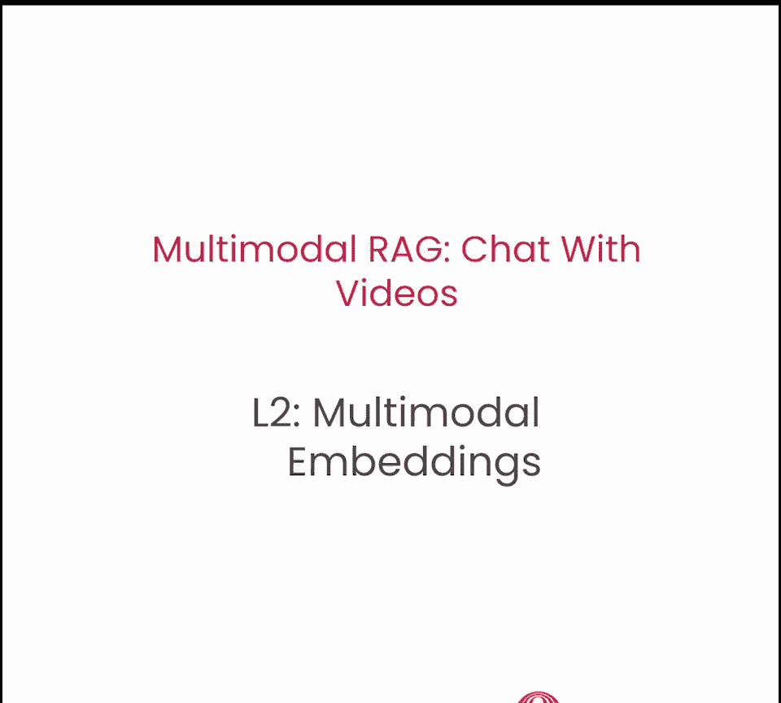

在本课中，你将探索多模态数据，并学习如何使用，BridgeTower模型将图像-字幕对嵌入到多模态语义空间中，你将使用真实世界的图像-文本数据集，并探索如何测量不，同示例之间的相似性。最后。

你将使用UMAP来可视化这些高维嵌入。那么，让我们开始吧。在本课中，我们将学习如何将视觉语言数据嵌入到一个共，同的多模态语义空间中。要处理视频，我们首先需要能够将视觉语言数据嵌入到一。

个共同的多模态语义空间中。想象一下，你有一个关于猫的图像-文本对。这种配对的多模态数据可以通过多模态嵌入模型处理，以，获得多模态嵌入。特别是在本课中，我们将使用一个名为BridgeTower的模型。

将图像-文本数据嵌入到一个512维向量中，并嵌入到一个，共同的多模态语义空间中。这种多模态语义空间的一个特点是，如果我们再取另一个，关于猫的图像-文本对，那么它的嵌入将接近第一个嵌入。同样。

如果我们取一个不同的概念，例如一个关于汽车的图，像-文本对，那么它的嵌入将远离猫的嵌入。在我们的笔记本部分，我们将学习如何测量这些嵌入之间，的远近。由于无法可视化512维空间。

在笔记本中我们还将使用UMAP，将这些嵌入投影到二维，并通过实验观察猫的多模态嵌入，是如何聚集在一起的，而与汽车的嵌入相距较远。

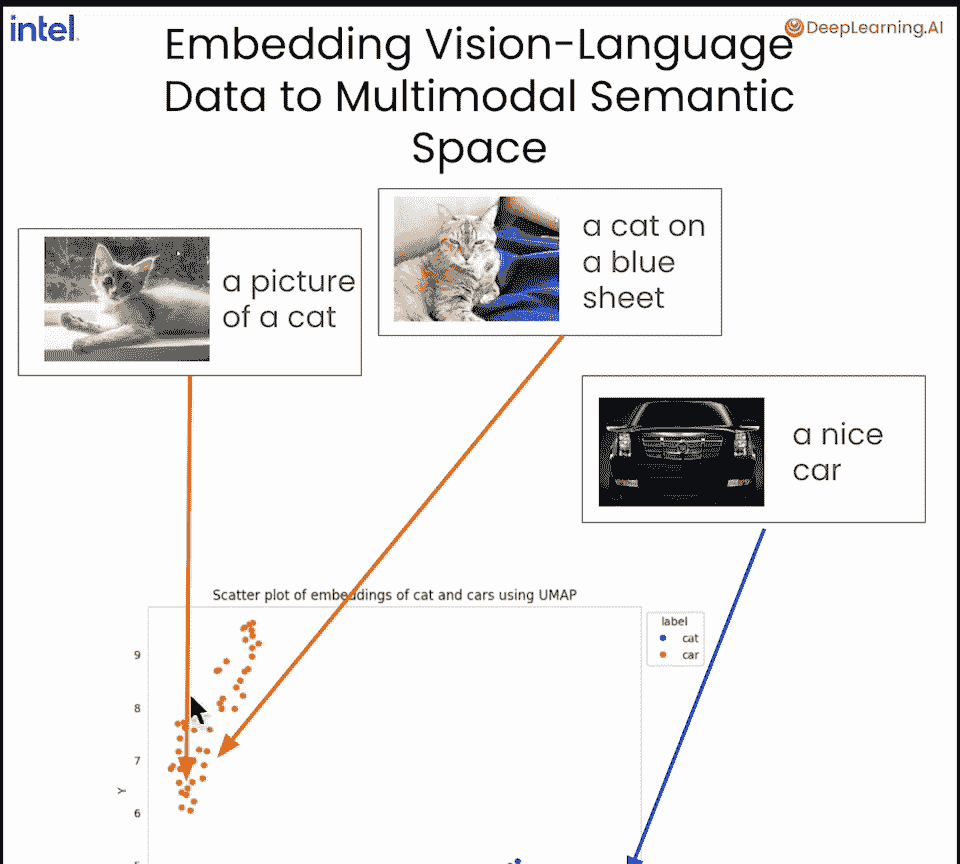

在本课中我们将使用BridgeTower模型。这个模型由我们在英特尔实验室的多模态认知AI团队与微，软研究院的合作者开发。模型的架构应该会让你想起一座桥。左塔是一个处理文本标记的文本转换器。

右塔是一个处理图像补丁的视觉转换器。为了结合这两种模态，我们引入了连接文本和视觉转换器，的隐藏表示的转换器块。这里的交叉注意力块将文本和图像的表示结合在一起，并。

在模型的输出中为我们提供跨模态或联合嵌入。

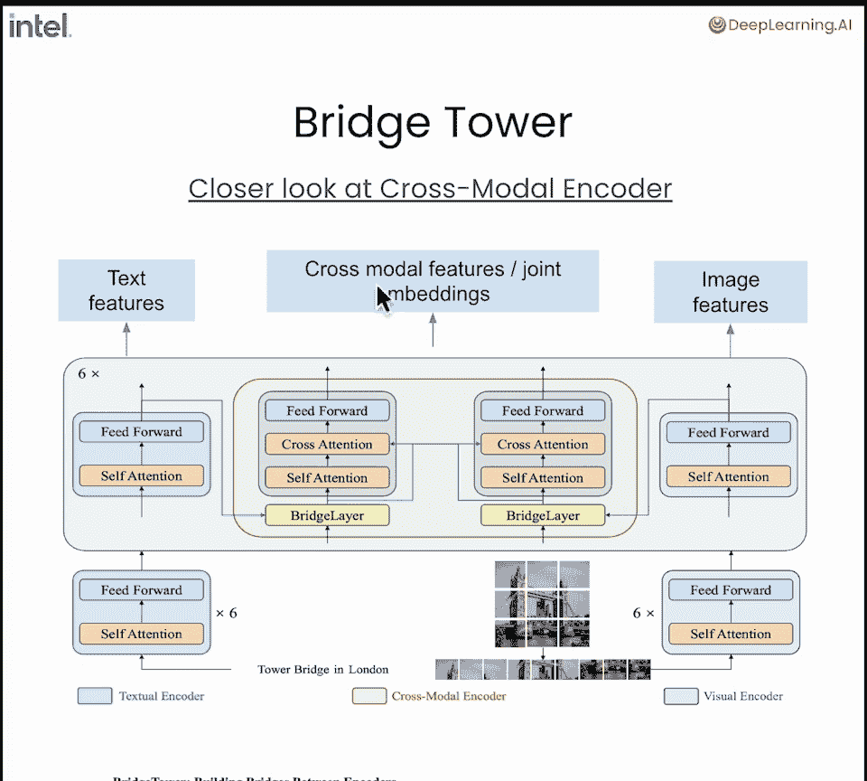

在我们的多模态RAG系统中，我们将使用BridgeTower模型，来嵌入视频片段及其相关文本。现在让我们进入笔记本练习部分。

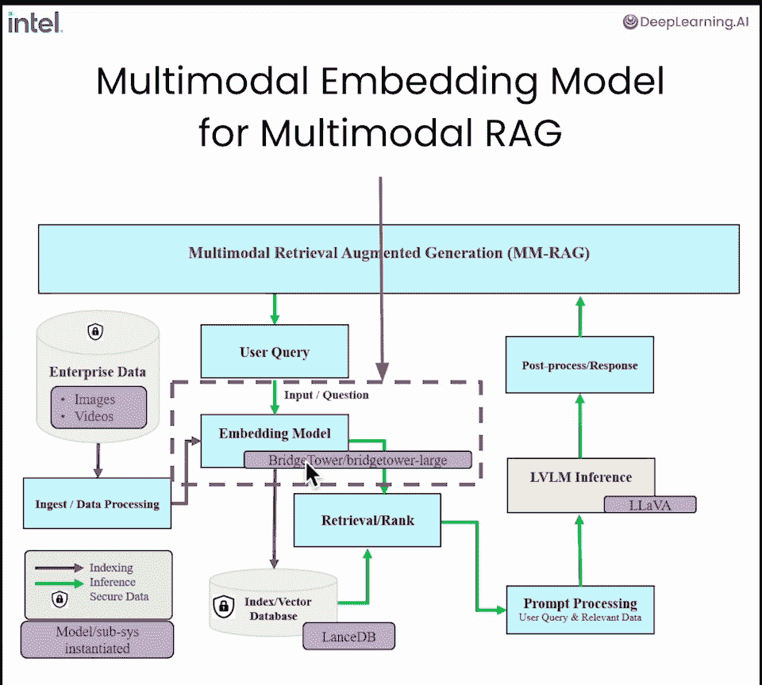

欢迎来到第2课的笔记本。在本课中，我们将练习使用BridgeTower模型从图像-文本，对数据创建多模态嵌入。

我们先从这个字典定义的三个图像-文本对的小例子开始。

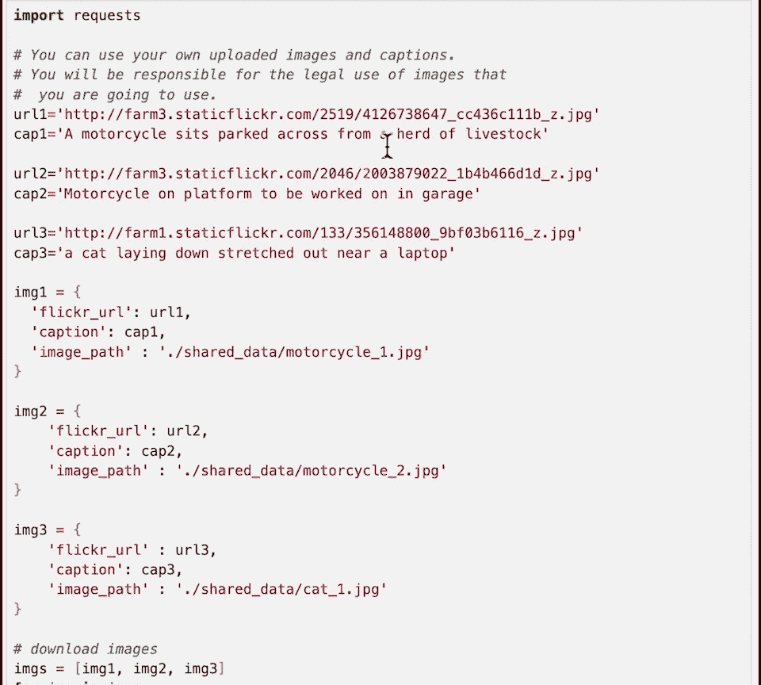

。字典的三个字段分别指向图像的URL、与图像关联的文本，或字幕，以及我们要下载图像的路径。因此，我们将遍历这些图像，并下载图像和文本数据。

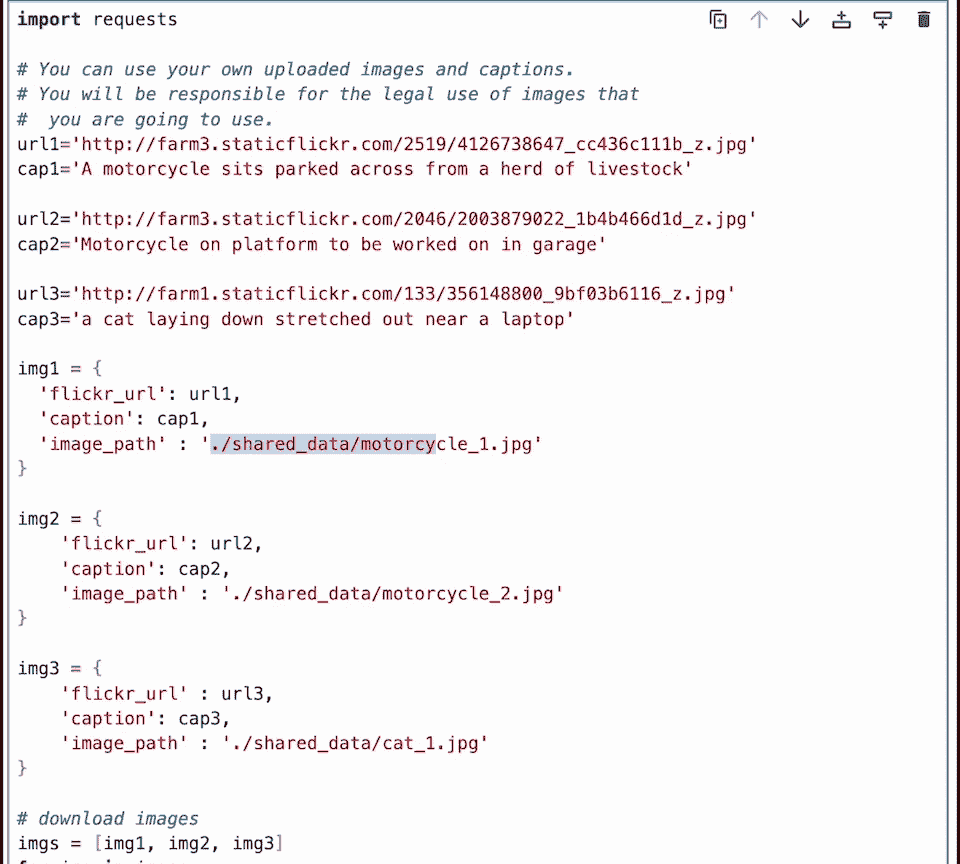

现在让我们看看这些下载的图像。我们看到第一张图片是关于摩托车及其字幕的。第二张图片也是关于摩托车及其字幕的。但第三张图片是关于猫及其字幕的。现在我们想要通过一个多模态嵌入模型处理这些图像-文，本对。

并将它们转换为多模态嵌入。对于BridgeTower模型，我们将使用PredictionGuard的API，调用，该API将模型托管在英特尔开发者云的英特尔Cori 2， AI加速器上。特别是。

函数btEmbeddingsFromPredictionGuard将调用这。

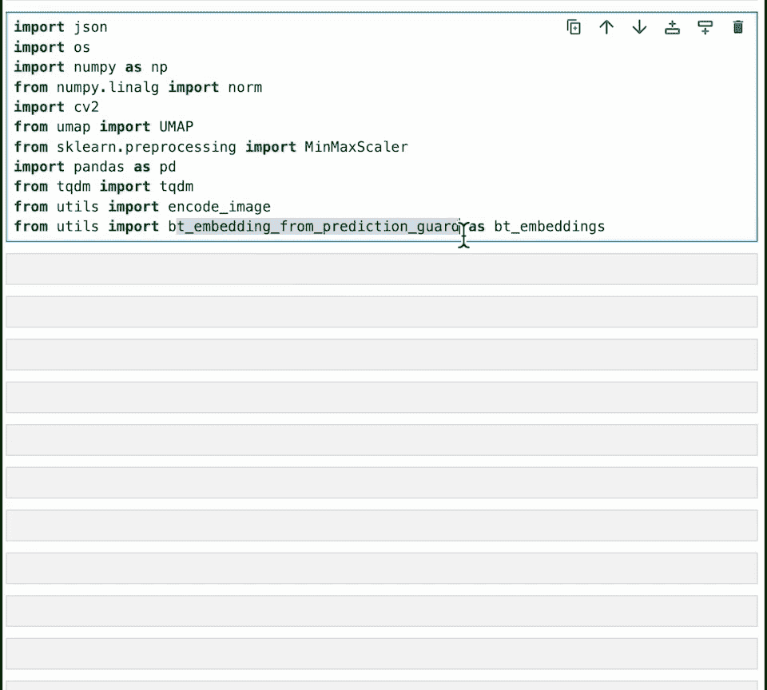

个模型。现在我们遍历这三张图片，我们将每张图片编码为base64，图像，并调用BridgeTower模型处理它。我们将所有这些嵌入收集到这个列表中。我们注意到每个嵌入的维度是512。

这意味着每个图像-文本对已被转换为512维向量，在这个，多模态语义空间中。那么，我们如何测量这些嵌入之间的相似性或距离呢？一种非常流行的方法是通过测量两个向量之间的余弦相似，度。

余弦相似度测量的是两个向量之间的夹角，名为cosine ，similarity的函数将接受两个嵌入向量。它会计算它们之间的点积，并通过两个向量的模长进行归。

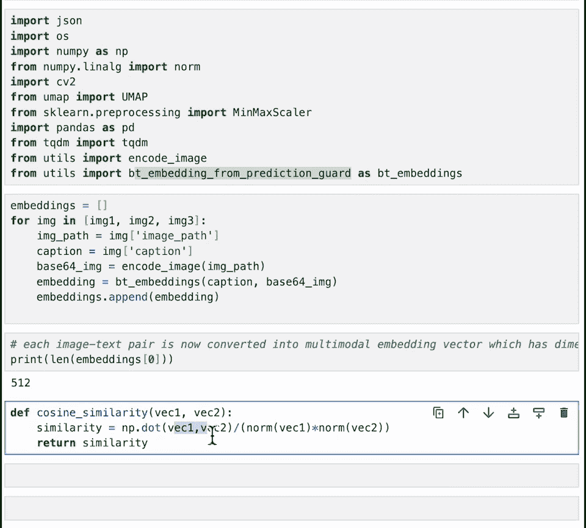

一化。现在我们将计算前两个示例之间的相似性，以及第一个和，第三个示例之间的相似性。让我们显示一下相似性分数，我们看到前两个示例之间的，相似性远高于第一个和第三个示例之间的相似性。这在意料之中。

因为前两个示例是与摩托车相关的图像-文，本对，而第三个示例是与猫相关的图像-文本对。因此，通过测量余弦相似度，我们可以了解这些多模态嵌入，的距离有多近或多远。

还有其他方法可以测量高维空间中向量之间的距离。在这里，我们也通过计算L2范数来计算这些向量之间的欧，氏距离。我们使用cv2库中的一个函数来计算L2范数。

这里我们也发现前两个示例之间的距离小于第一个和第三，个示例之间的距离。还有其他计算这些距离的方法。余弦相似度是一种非常流行的方法，因为计算上它非常便，宜，并且常用于此类模型的损失函数中。

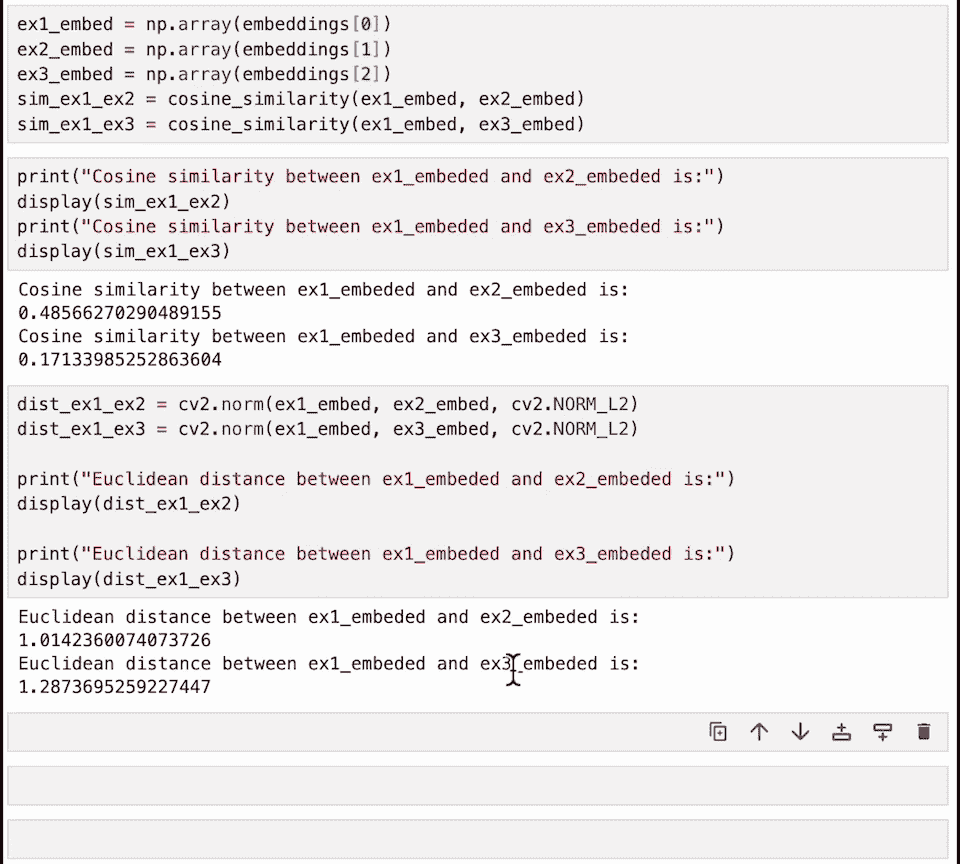

因此，当处理大量图像-文本对时，可视化多模态嵌入的分，布非常有用。由于我们无法直接可视化512维空间，我们将首先把这些嵌，入投影到二维空间。这种分析和可视化对于理解数据非常有用，并且可以帮助。

发现隐藏的洞察。我们将使用UMAP变换将512维向量投影到二维空间以进行，可视化。让我们准备一些包含50个猫图像-文本对和50个车图像-文。

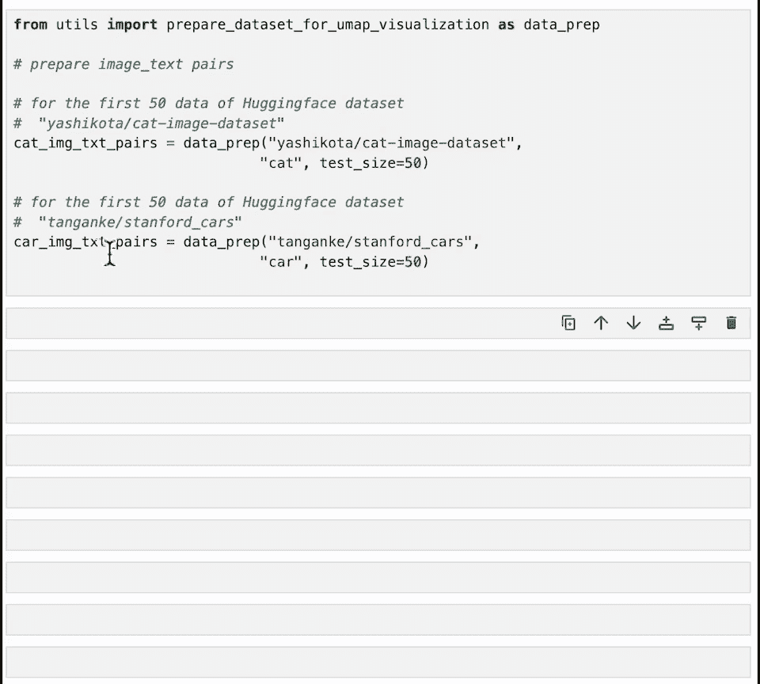

本对的数据。让我们来看看这些数据。我们看到，前几个示例是带有说明的猫的图像，然后是带有，说明的车的图像。像之前一样，我们将使用BridgeTower模型对所有这些图像，计算嵌入。具体来说。

我们将遍历所有的猫图像，将它们转换为base64，图像，然后将文本和base64图像提供给BridgeTower模型。我们将所有猫的嵌入收集到一个特定的列表中，对车的嵌，入也做同样的操作。

在你的电脑上大约需要一分钟。现在我们已经收集了所有嵌入，我们将定义一个函数来计。

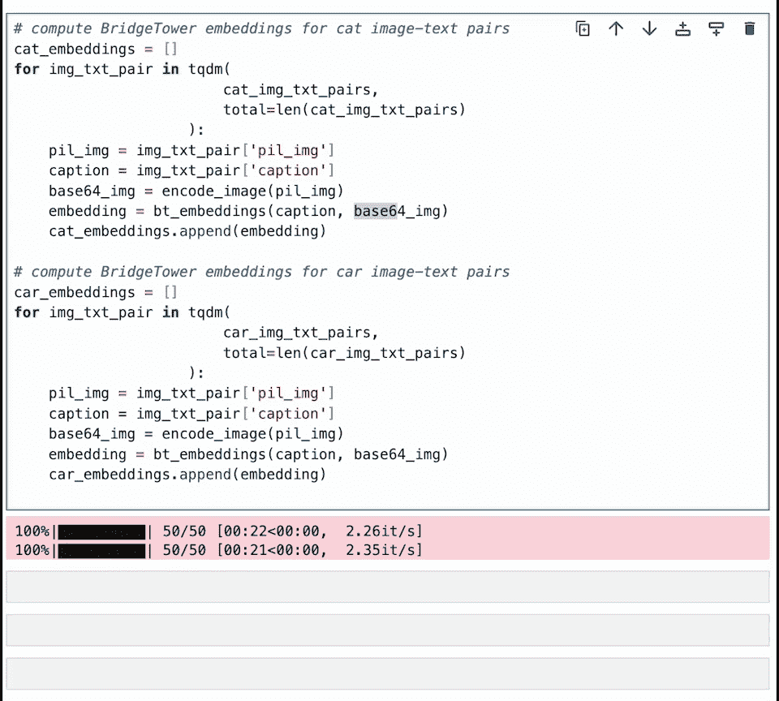

算UMAP。这个函数将以这些512维空间中的嵌入作为输入之一，并使，用UMAP变换将这些数据投影到二维空间。我们将把它转换为一个pandas数据帧，并且我们还会添加，一个标签列。

以便我们可以将数据适当地标记到特定的类。

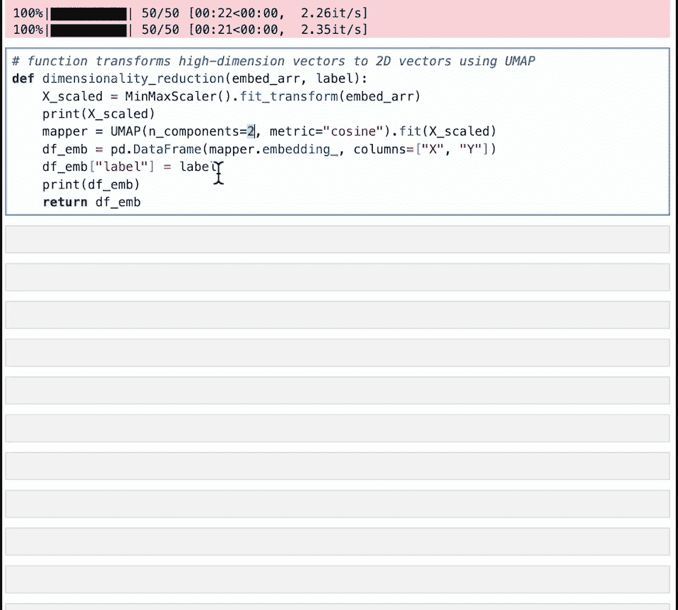

别。接下来，我们将把猫和汽车数据集的嵌入堆叠起来，并创建，一个标签，用于指示每个数据点是猫还是汽车，然后我们将，调用我们的降维函数。因此，在输出中我们看到我们有100个示例，50个是猫，50个，是汽车。

每个512维度的嵌入现在已经被降维到XY空间的两。

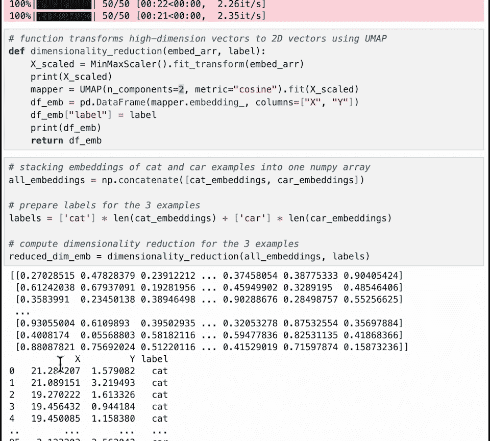

个维度。现在我们可以继续绘制这些数据，我们看到在这个二维的。

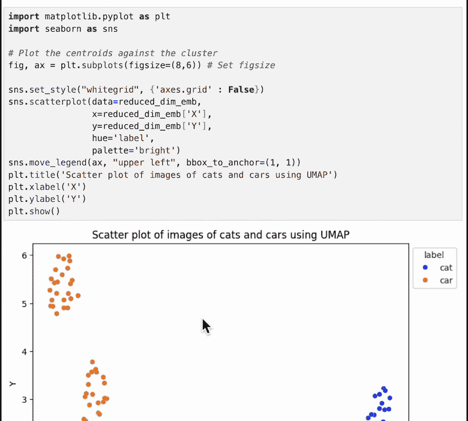

UMAP空间中，橙色点聚类属于汽车的图像文本数据，而蓝色，点聚类属于猫的图像文本数据。

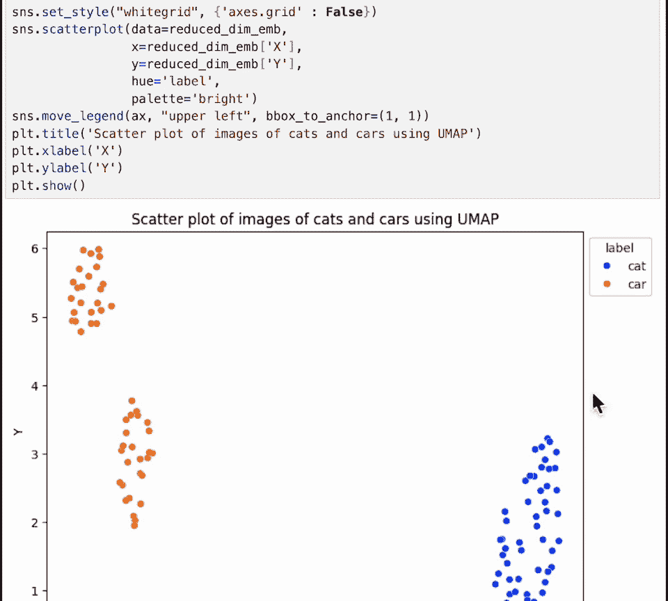

在这节课的最后，我们讨论了如何准备图像文本配对数据，并使用桥塔模型在其上计算多模态嵌入。我们学习了如何使用余弦相似度来比较多模态嵌入。我们还学习了如何进行降维，并在二维空间中可视化这些，多模态嵌入。

以便更好地理解数据的各个方面。此时，请尝试使用你自己的图像和标题进行实验。

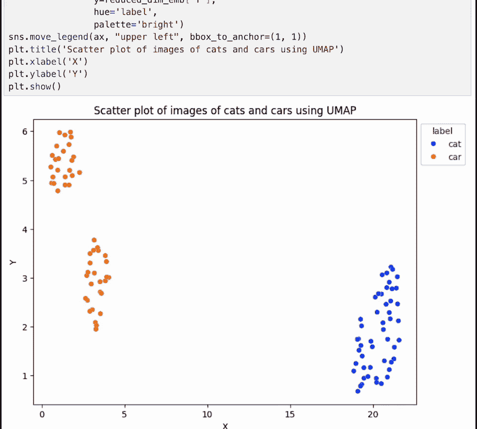