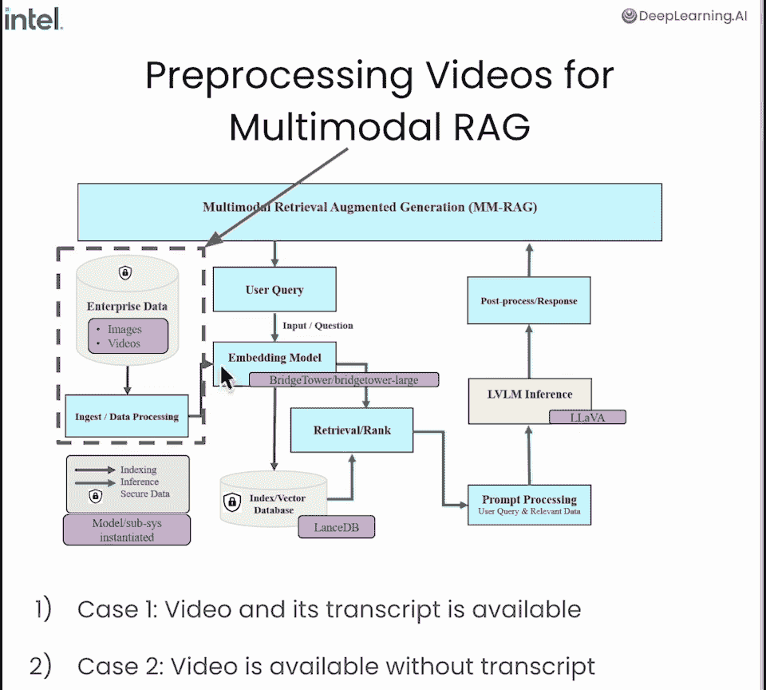
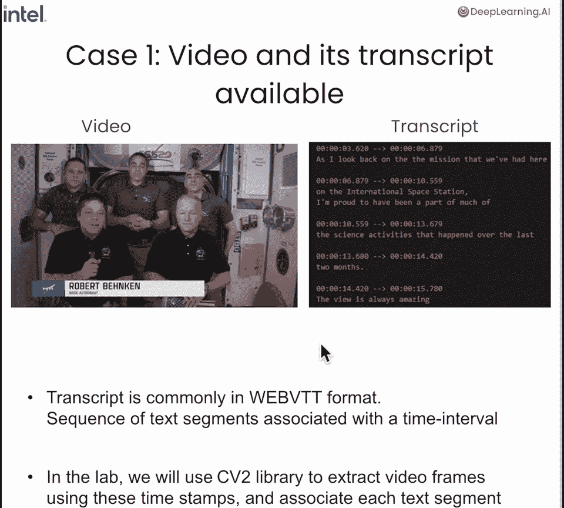
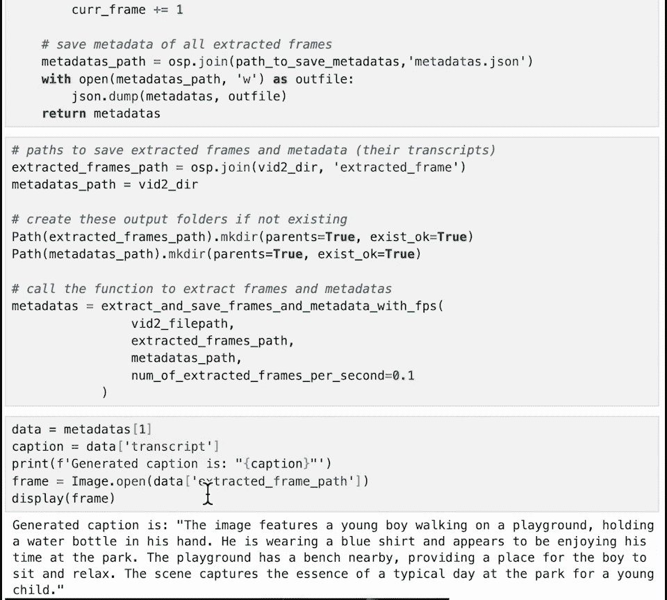
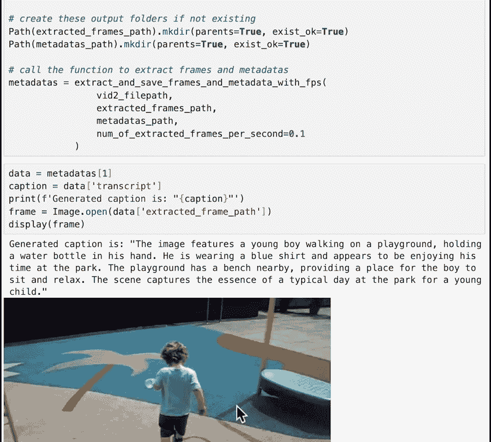

# 吴恩达《多模态RAG：与视频对话｜Multimodal RAG： Chat with Videos》中英字幕（豆包 - P4：4.Lesson 3 Preprocessing Videos for Multimodal RAG - GPT中英字幕课程资源 - BV1mUtTehEsy

在本课中，您将学习如何将视频预处理为可以随后输入到，多模态RAG管道中的形式。您将了解如何使用Whisper模型从视频生成转录文件，以及，如何使用大型视觉语言模型为视频帧创建字幕。好的。

让我们进入代码部分。回忆一下多模态RAG系统图。我们将在本课中学习预处理模块。

我们将考虑三种情况。情况一是我们有视频，并且其转录文件是可用的。转录文件通常以Web VTT格式提供。这是一系列与时间间隔相关的文本片段。转录文件指示了视频中某个特定时间间隔内所说的单词。在笔记本中。

我们将使用CV2库通过这些时间戳提取视频帧，并将每个文本片段与中心视频帧关联起来。

情况二是当我们没有转录文件时。在这种情况下，我们将使用OpenAI的Whisper模型生成转录，文件。情况三是我们有一个没有明确语言关联的视频。例如，这可能是只有背景音乐或无声的视频。在这种情况下。

我们将使用大型视觉语言模型（LVLM）从视，频帧生成字幕。我们将在第五课中了解更多关于LVLM的信息。请注意，这是一种为已有转录文件的视频增加语言信息的，有用方法。接下来，我们进入第三课的笔记本。

欢迎来到第三课的笔记本。在第二课中，我们学习了如何从配对的图像文本数据中创，建多模态嵌入。在本笔记本中，我们将处理视频语料库，将其转化为视频帧，及其相关的文本转录或字幕，以便这些数据可以在后续课。

程中被BridgeTower模型使用。我们首先导入一些必要的库。让我们从YouTube获取一个视频。注意，我们还将从YouTube本身获取转录文件。我鼓励您使用自己选择的视频再次练习这一课。那么。

让我们看看下载了什么。我们有一个MP4格式的视频，并且有VTT格式的视频转录文，件。好，让我们快速浏览一下转录文件。我们看到它是Web VTT格式的。因此，我们有一个在视频中某个起点和终点之间所讲的文。

本片段。对于第二个视频，我们将直接从其URL下载。我们提供了两个辅助函数，这对于处理已下载的视频非常，有帮助。其中一个是“字符串转时间”。它会将VTT文件中以字符串形式写的特定时间转换为以毫。

秒为单位的时间。这将允许我们在特定毫秒处从视频中提取特定帧。“保持纵横比调整大小”是一个将应用于提取帧的函数，以，保持其纵横比。这个调整大小过程有助于BridgeTower模型嵌入的计算。接下来。

我们将定义一个函数，帮助我们提取并保存视频中，的帧、转录文件及其他元数据。特别是在这个函数中，我们将遍历转录文件。我们将计算每个文本片段的中点并将其转化为毫秒。在时间戳处，我们将提取一个视频帧。

我们会将这个视频帧写入我们的桌面，并准备元数据。最后，该函数会将与视频相关的所有元数据保存到桌面上，的文件中。现在我们来调用这个函数处理我们的视频。让我们检查一下这个元数据是什么样子的。因此我们看到。

对于每个视频段，我们都提取了一个中心帧，并将其保存到桌面。同时，我们还将与该帧关联的文本记录保存在这个字典中，我们还会跟踪视频段的ID和该视频段的中点，以毫秒为单，位。通过这种方式。

我们将视频转换成了我们将在下游应用中，使用的元数据。现在我们来考虑一种情况，我们有一个视频，但没有它的文，本记录。在这种情况下，我们将使用OpenAI的Whisper模型来转录视，频。

由于Whisper模型需要一个音频文件作为输入，我们将从视，频中提取音频为mp3文件，并使用MoviePi库完成此操作。现在我们加载Whisper模型。在这个例子中，我们将使用该模型的小型版本。

并将语言设，置为英语。此过程通常需要一到两分钟。为了获得更好的性能，取决于你所拥有的计算系统，你也可，以尝试更大的Whisper模型，或者将此best of值增加到五。

现在我们已经从Whisper模型中获得了结果，我们将使用，utils文件中提供的一个名为get subs的辅助函数，将，Whisper的输出转换为我们之前见过的web VTT格式。

我们可以快速看一下生成的文件，看到它采用相同的web ，VTT格式，其中每个文本序列都有起始时间和结束时间。现在我们继续讨论最后一种情况，即我们有一个视频，但没，有任何相关的语言内容。例如。

这种情况可能发生在我们有一个仅播放乐器的背景，视频，或者是没有声音的视频。这是一个无声视频。在这种情况下，我们将使用一个大规模视觉语言模型，特别，是Lava模型，来为视频中发生的事情生成有见地的字幕。

我们将在第五课中学习更多关于Lava的内容。在本节课中，我们将通过Prediction Guard提供的API使用，Lava模型来生成字幕帧。我们将使用以下提示来请求Lava模型生成字幕。

现在让我们考虑一个特定的帧。我们会将这个帧编码为base 64图像，然后将其传递给我们，的LBLM推理函数，我们注意到Lava模型生成了一个非常详，细的字幕，描述了这张图片。例如。

这个字幕描述了一个太空飞船，旁边有一个人在空中，漂浮，等等。接下来我们将定义一个函数，帮助我们从特定视频中提取，并保存带有字幕的帧。具体来说，该函数将读取视频并循环遍历所有视频帧。

它会按照指定的帧采样视频，该帧数作为参数提供，然后对，于每个帧，它会将其编码为base 64图像，并使用LBLM模型（，即Lava视图）生成字幕。然后它会以我们习惯的格式准备元数据，最后将所有元数。

据保存回磁盘。所以我们来对我们的视频调用这个函数，并提取出所有的，元数据。请注意，这个过程大约需要一到两分钟运行。一个有趣的事情是，以这种方式为视频生成字幕实际上对，包含转录内容的视频非常有用。因此。

这是一种增强视频语言信息的有用方式。我们来看一下生成的其中一个字幕。

在这里我们看到，对于这个特定的帧，生成的字幕是：图片，显示一个小男孩在操场上行走，这是对该视频帧的一个相。

当合适的描述。好的，通过这个我们看到有三种情况。我们要么有一个带有转录的视频，要么我们使用Whisper模，型自己生成转录，要么我们有一个没有相关语言信息的视，频，并使用Lava模型生成字幕。

所以在这节课中，我们学习了如何处理我们的视频数据，使，其能够注入到我们的多模态嵌入模型中。在下一节课中，我们将处理在这个notebook中创建的数据。

