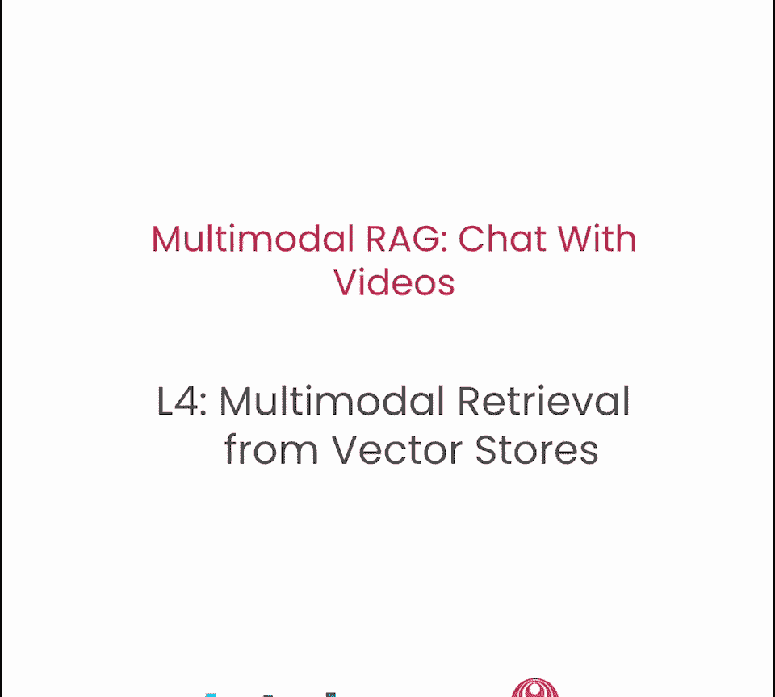
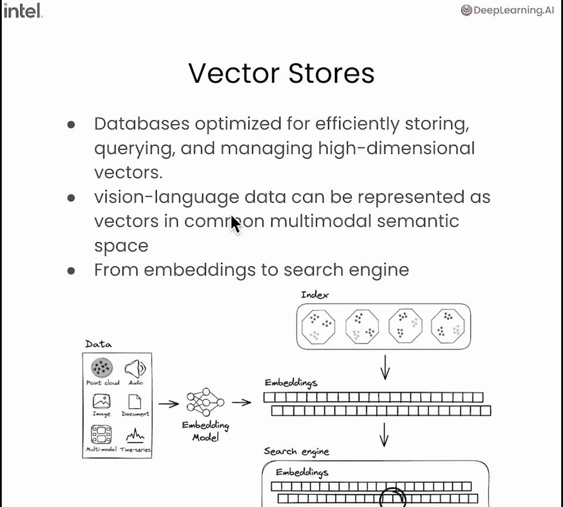
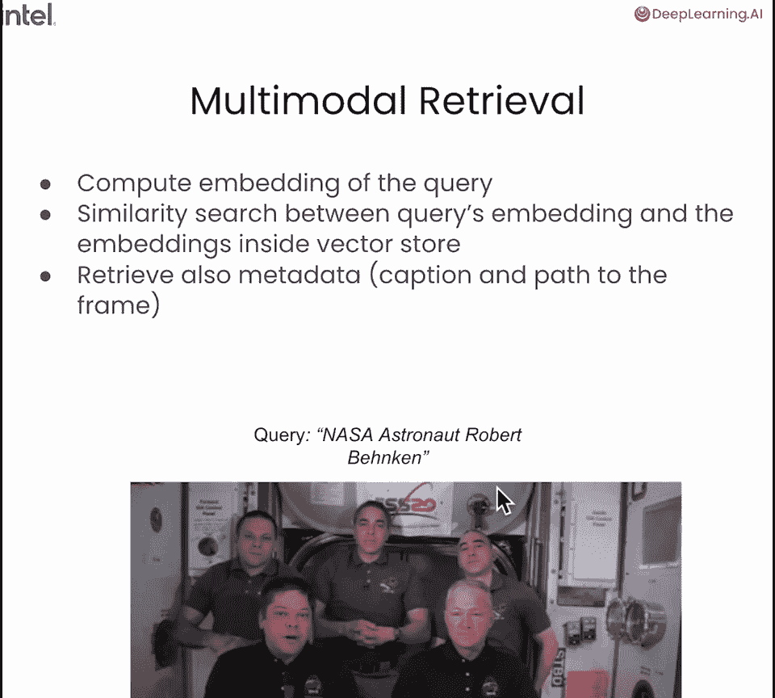
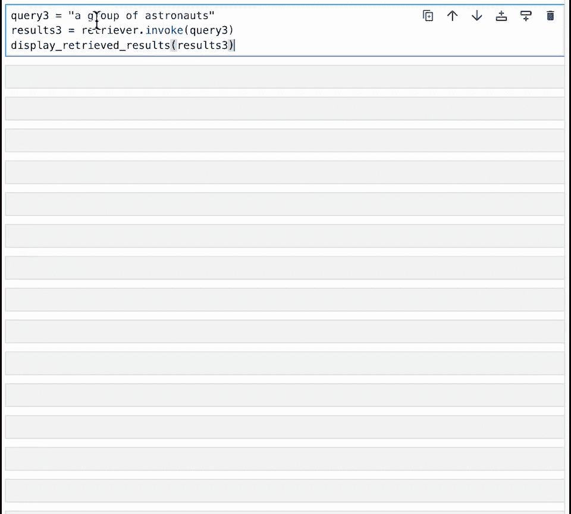

# 吴恩达《多模态RAG：与视频对话｜Multimodal RAG： Chat with Videos》中英字幕（豆包 - P5：5.Lesson 4 Multimodal Retrieval from Vector Stores - GPT中英字幕课程资源 - BV1mUtTehEsy

在本课中，你将获得创建强大检索系统的工具，能够处理涉，及文本和图像的复杂查询。在课程结束时，你将能够将数据导入LanceDB，执行相似性，搜索，并展示结合不同模态信息（如视频帧及其相关字幕），的结果。

好了，开始吧！还记得多模态RAG系统图吗？我们将学习如何填充向量存储，并能够从中进行检索。

向量存储是为存储和检索高维向量而优化的数据库。如我们之前所见，我们可以将视觉语言数据表示为共用的，多模态语义向量空间中的嵌入。向量存储有助于从这些嵌入转变为搜索引擎。

我们还将考虑多模态检索的问题。一旦我们构建了多模态向量存储，接下来我们将进行多模，态检索任务。在此任务中，我们将输入一个查询，计算该查询的嵌入，然，后在该查询嵌入与向量存储中的嵌入之间进行相似性搜索。

通过这种方式，我们能够检索到包含视频帧及其相关字幕，的所有元数据，并且该视频帧最好地满足查询要求。那么，让我们在第4课的笔记本中看看这一点的实际操作吧。

。欢迎来到第4课的实验室。在本实验中，我们将练习将视频语料库导入LANsDB向量存，储，并使用langchain执行多模态检索。第3课中，我们已经下载了视频语料库，提取了帧，获取了转，录，并生成了字幕。

在本笔记本中，我们将首先通过BridgeTower模型导入这些，数据，并用多模态嵌入填充向量存储，然后我们将通过自然，语言查询对该向量数据存储进行多模态语义搜索演示。让我们导入一些库。

由于我们在处理多模态数据，我们扩展了几个lanchain类，它们在我们导入的多模态LANsDB库和刚刚导出的，BridgeTower嵌入库中。现在，我们将通过声明一个主机文件和一个表名来建立与。

LANsDB向量数据存储的连接，并初始化向量存储。现在，我们正在加载前一个笔记本中构建的视频的元数据，文件，并将所有转录和视频帧收集到各自的列表中。需要注意的一点是，对于某些视频，视频片段相关的转录可。

能是碎片化的。这意味着每个视频帧的文字上下文可能不足。为减轻这种影响，我们可以通过增加每个帧相邻n个帧的转，录来增强与该帧相关的转录。这将导致相邻帧的转录有一些重叠，但这没关系。

整体上这将增加每个帧提供的文本上下文。所以让我们在这个特定视频中将n设置为7来实现这种增强，让我们看一下某个转录片段在增强前后的对比。因此，我们看到更新前的转录示例非常简短，比如“太空行。

走”和“现在有机会完成了”，这不足以为视频帧提供足够的，上下文。但更新后，我们看到这个简短的转录被相邻的转录增强了，这为模型提供了足够的上下文来理解该视频帧。

现在我们将把视频数据导入到LanceDB向量存储中。我们初始化Bridge Tower嵌入，并将其作为嵌入传递给我，们的向量数据存储。我们还需要传递文本数据和图像数据。文本数据是我们收集的视频转录内容。

图像数据是我们收，集的视频帧。现在，我们已经构建了向量数据存储。我们来看一下作为pandas数据框架的表格。我们看到它包含了所有的转录文本，每一行还关联了我们，从视频中提取的帧。现在。

我们将向向量存储添加一个检索器。我们定义这个检索器使用Bridge Tower模型，并且指定k值，为1，这意味着该检索器将返回向量存储中最匹配的条目。现在，我们准备好对向量数据存储运行查询了。例如。

对于这个查询，“幼儿和成人”，我们可以调用刚才定，义的检索器，得到检索结果。我们可以显示这些结果，并且看到系统检索到一个视频帧，似乎准确描述了这个包含幼儿和成人的图像。与这个视频帧关联的文本也被检索到。

现在，让我们调用这个相同的查询，但这次将k值设为3。现在我们看到，第一次检索与之前完全相同，然后我们查看，第二次检索，看到的只有一个幼儿，第三次检索看到的是两，个幼儿。所以可能第一次检索的得分最高。

这是合理的，因为图像中，确实有一个幼儿和一个成人。我们再运行几个例子。这里我们有一个查询：“宇航员太空行走，身后是地球的壮，丽景色”。我们看到系统检索到一个合适的视频帧，展示了地球的景，色。

还显示了宇航员的太空行走，并且系统还检索到了这个，视频帧期间的视频转录。好，我们再尝试一个查询，“一群宇航员”，我们看到系统检。

索到这个视频帧，确实显示了一群宇航员，并且还检索到了，与这个视频帧相关的转录片段。所以此时，你可以随意尝试自己的查询。你也可以将自己的视频嵌入到这个向量存储中。

