# 吴恩达《多模态RAG：与视频对话｜Multimodal RAG： Chat with Videos》中英字幕（豆包 - P6：6.Lesson 5 Large Vision-Language Models (LVLMs) - GPT中英字幕课程资源 - BV1mUtTehEsy

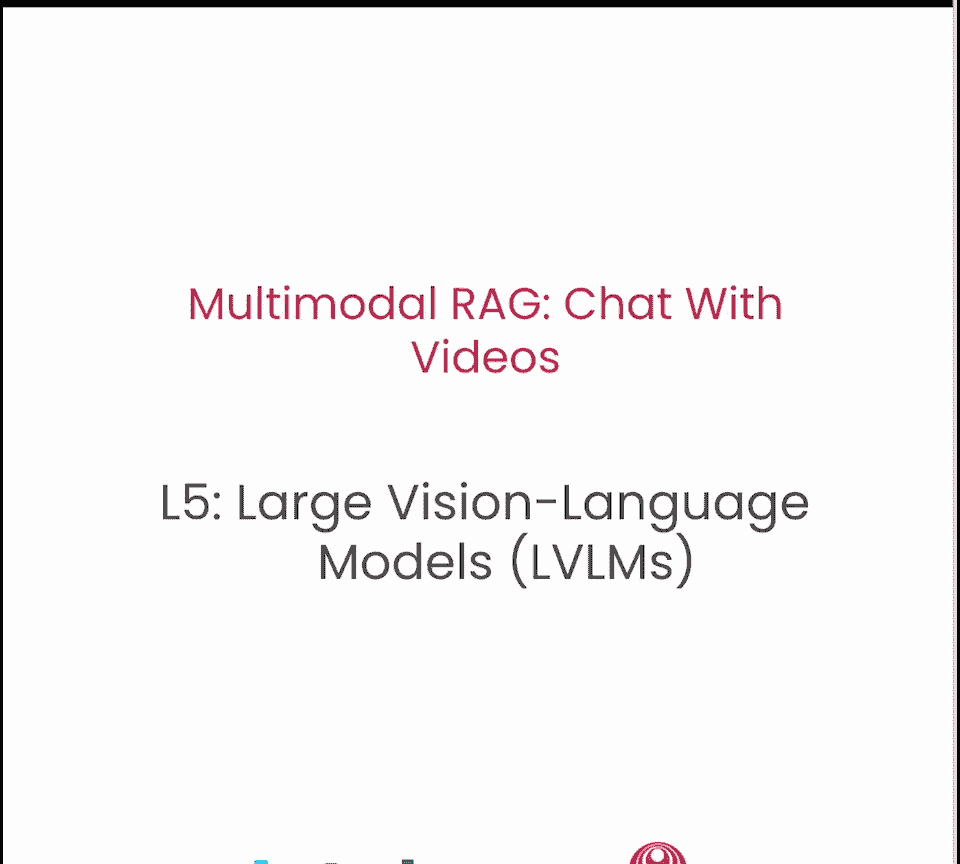

本课重点介绍如何利用大规模视觉语言模型的能力来完成，复杂任务，例如图像描述生成、基于视觉线索回答问题以，及从图像中推理见解。你将使用辅助函数来调用 Prediction Guard 的 API。

让我们开始编码吧。回顾多模态 RAG 系统图。在本课中，我们将学习如何实现 LVLM 推理模块，其中 ，LVLM 代表大规模视觉语言模型。

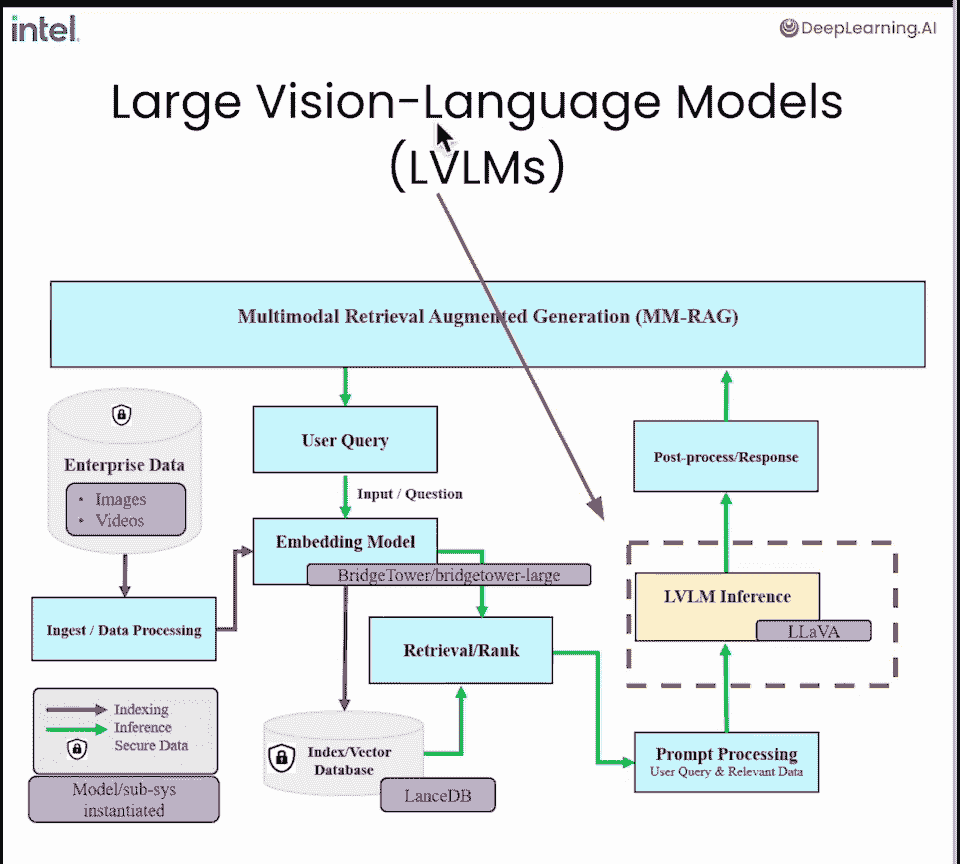

那么让我们比较一下 LLM 和 LVLM。LLM 专注于自然语言处理和生成，LLM 只接受文本输入，并，能生成文本输出。大规模视觉语言模型或 LVLM 能够结合视觉和文本信息，连接计算机视觉和语言理解。

这些模型在图像描述生成和视觉问答等任务上表现出色。

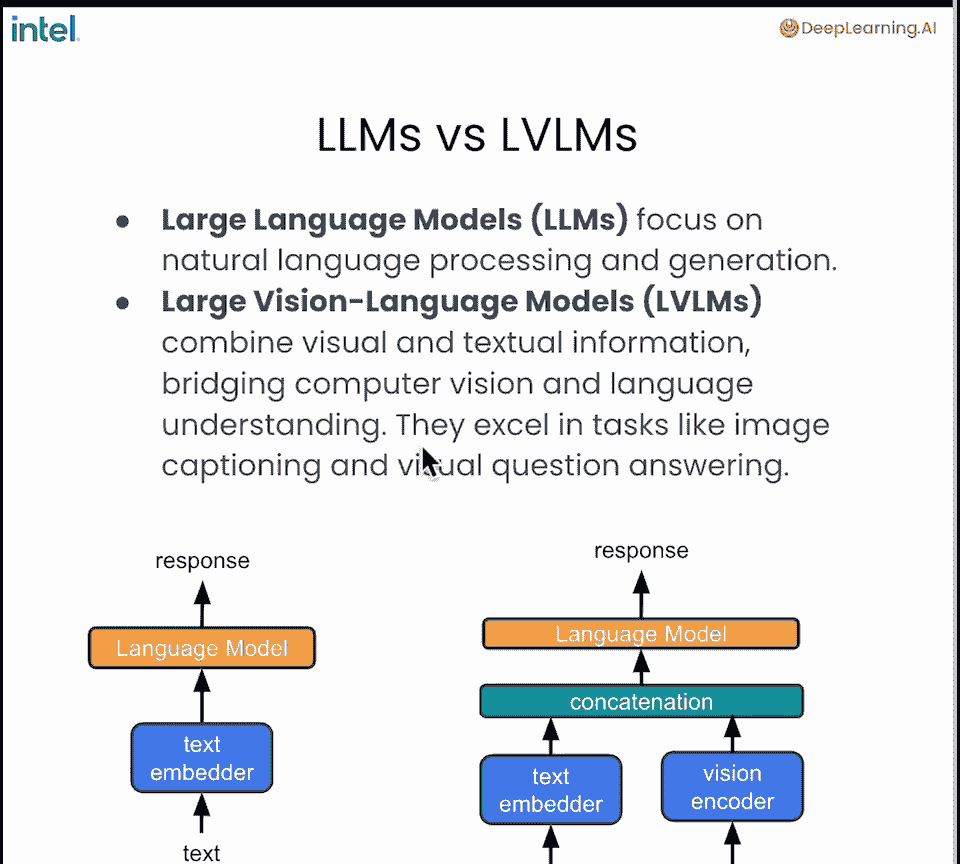

我们将特别使用一个名为 LAVA 的开源 LVLM，LAVA 代表，大规模语言与视觉助手。在 LAVA 模型中，我们使用 CLIP 的视觉转换器，并将其与。

通常为 LLAMA 系列的强大 LLM 结合起来。此架构图显示了图像如何通过视觉编码器处理，视觉编码，器的输出通过一些投影矩阵，将图像片段带入与语言模型，相同的空间。

然后这些片段与语言查询或语言指令一起进。

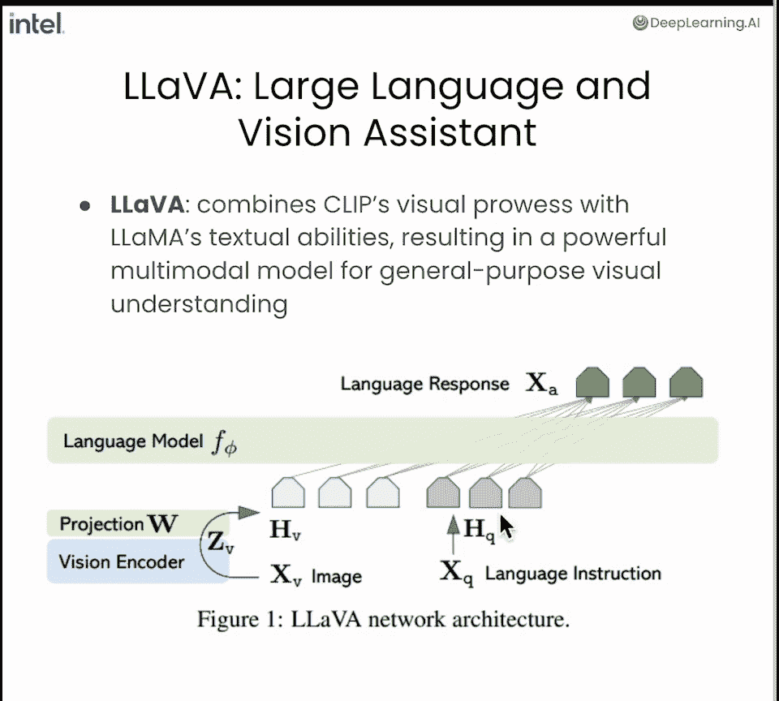

一步传播通过语言模型。LAVA 模型受欢迎的一个原因是可以通过少量训练轻松更，换骨干 LLM。在 Intel Labs，我们的团队训练了不同 LLM 的 LAVA 模，型变体。

如 GEMMA 和 LLAMA3，并开源了这些模型。那么，让我们进入第 5 课的笔记本。

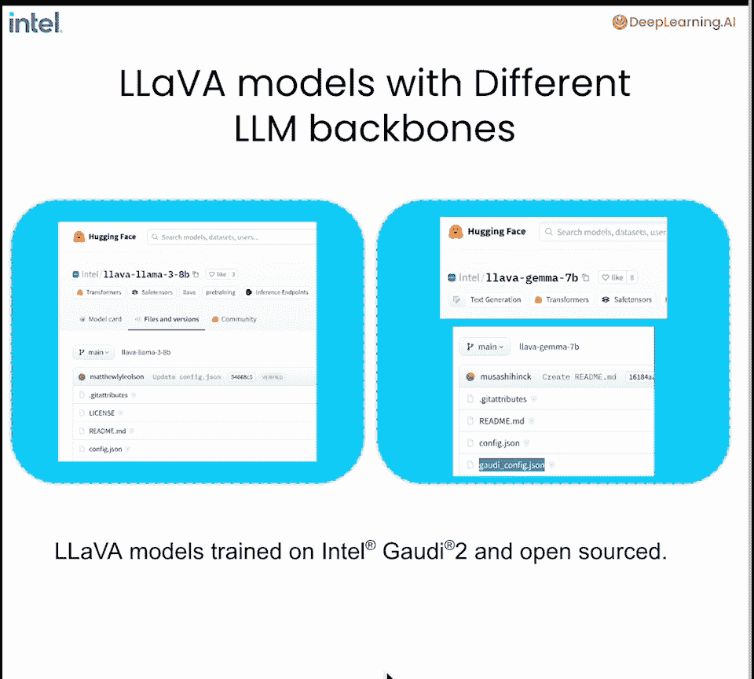

欢迎来到第 5 课的实验室。在之前的课程中，我们学习了像 BridgeTower 这样的多模，态嵌入模型，它们允许你处理图像文本空间，并将它们嵌入，到一个共同的多模态语义空间中。在本实验中。

我们将学习一个不同的多模态模型家族，特别，是大规模视觉语言模型（LVLM）。这些模型能够同时接受图像和文本作为输入，并生成文本，输出。比如说，你有一些多模态数据，并且你希望对其进行问答。

你希望能够与其交互，并从中获得更多见解。这正是我们可以使用大规模视觉语言模型的地方。在本课中，我们将特别使用一个名为 LAVA 的开源模型，具，体是 LAVA 1。5。

我们将通过 PredictionGuard 提供的 API 调用 LAVA 模，型，该模型托管在 Intel Cori 2 AI 加速器上，并在英特，尔开发者云中运行。那么。

让我们导入本次课程所需的一些库。

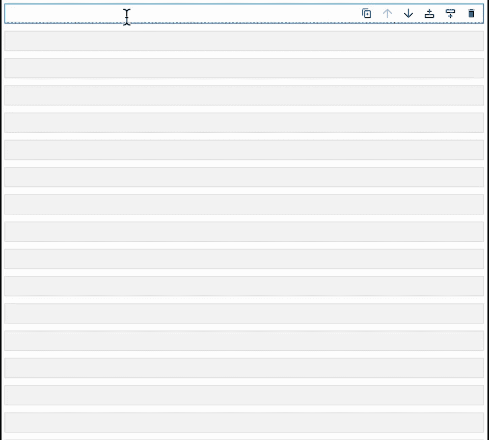

在本课中，我们将使用第 2 课中提取的帧和转录内容，以，及一些来自 Cocoa 数据集的额外数据。例如，在这里我们读取了之前在第 3 课中提取的转录内容，和中心帧，我们还包括了一些新的数据。

这些数据包含图像。

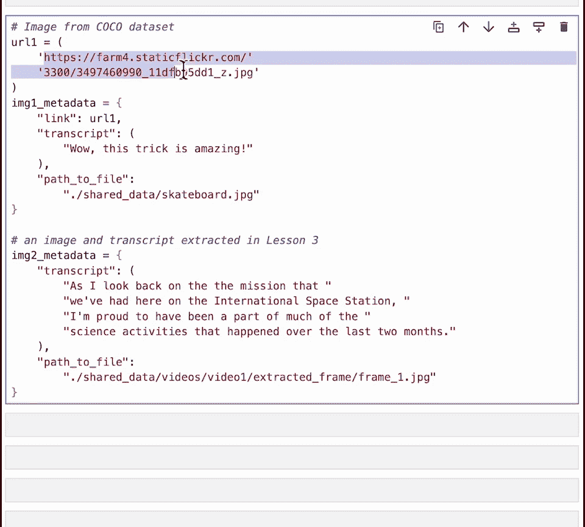

的 URL 及其相关的描述。让我们添加一些更多的数据并下载新图像。现在我们将考虑一些使用 LAVA 模型进行图表补全的应用，场景。第一个应用场景是图像描述生成。

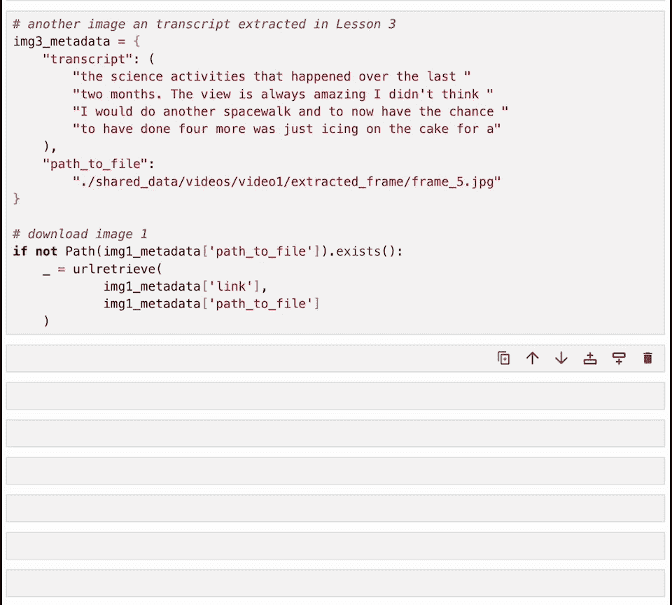

我们将向模型提供提示。我们将把图像编码为Base64格式，并开始一个对话对象，其，中还将存储来自LVLM推理的返回字幕。让我们来看一下帧和模型如何为图像生成字幕。在这里。

我们看到了由LAVA模型生成的字幕，模型正确描述，了这张图像中有五名男子，还包含了许多其他细节，这是它，从视频帧中提取出来的。我们来尝试另一个例子。这次我们将对图像中的视觉线索进行问答。

现在让我们展示图像以及LAVA模型是如何描述它的。

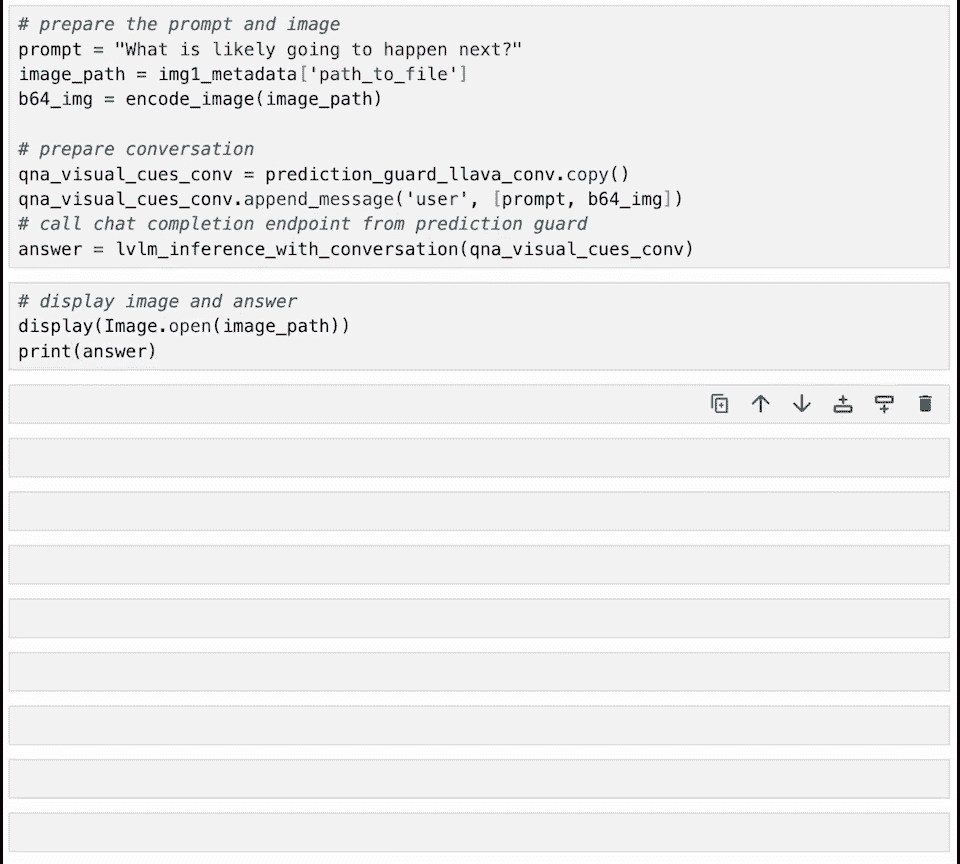

我们对这张图像提出了一个特定的提示，询问接下来可能，会发生什么，模型的回答中指出，男子正在沙滩上用滑板做，倒立，这个描述是准确的。此外，模型接着说他可能会失去平衡，从滑板上摔下来等等，因此。

我们可以看到LAVA模型能够从图像的视觉内容中进，行推理。让我们再试一个例子，看看模型能否理解视频中的文本。

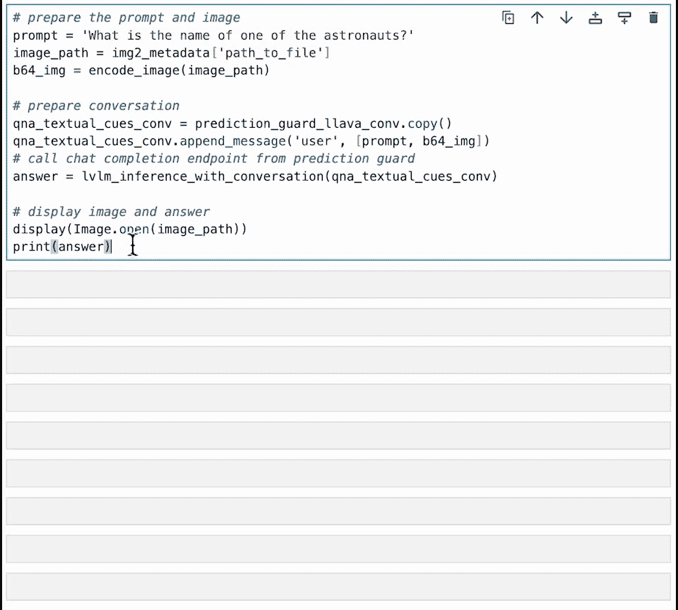

例如，我们向模型提问：在这个特定视频帧中，一位宇航员，的名字是什么。模型能够检测到视频帧中的文本为Robert Behnken，并在，其回答中准确指出其中一位宇航员的名字是Robert 。

Behnken。让我们再尝试一个例子，基于与图像相关的文本记录提出，一个问题。我们用这个模板构建了一个新的提示，文本记录与图像相，关，我们想问模型，宇航员对他们的工作有什么感受。

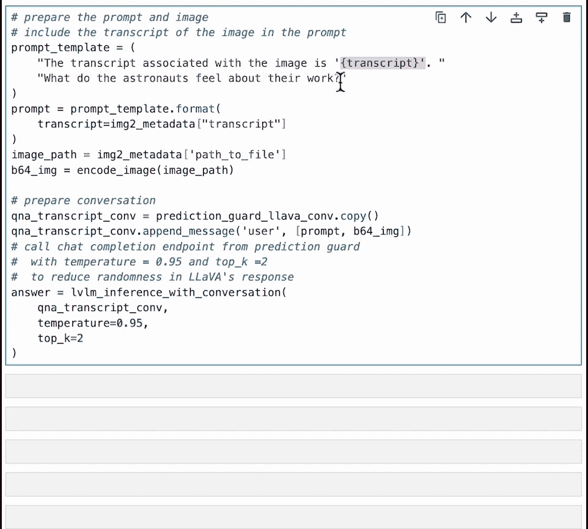

让我们来看看提示是如何构建的。提示包含了我们提供的文本记录，并提出了查询，宇航员对，他们的工作有什么感受，模型能够回答说宇航员对他们在，国际空间站的工作感到自豪，且这个回答是基于文本记录。

中的信息得出的。在这里我们看到，像LAVA这样的模型能够获取图像中的视，觉线索信息，例如我们在滑板例子中看到的，或者它能够获，取我们提供的与图像相关的文本记录中的信息。接下来，我们将考虑一个代码示例。

看看如何扩展与LAVA模，型的对话。具体来说，我们将针对它的最后一个回答提出一个跟进问，题。我们要问的跟进查询是，宇航员从哪里返回，我们将保存对。

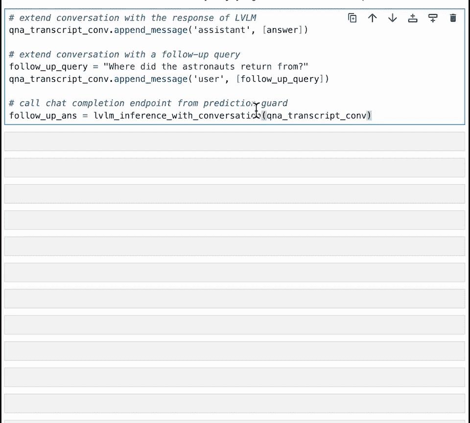

话历史。让我们来看一下结果。这里我们看到模型成功回答了图像中的宇航员是从国际空，间站返回的。希望通过查看这个代码，你可以了解如何追踪允许我们进，行多轮对话的对话历史。到这个时候。

欢迎你使用自己的图像和文本提示来试试这，个托管的LVLM。

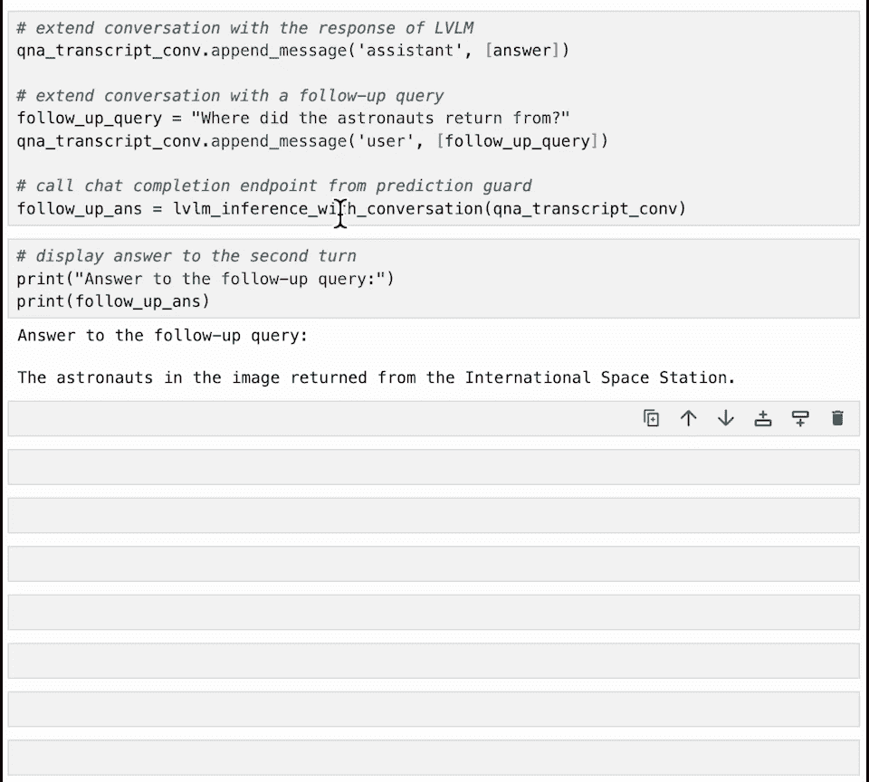