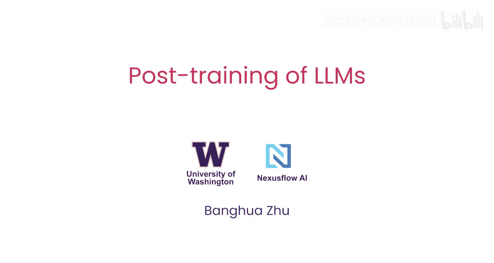
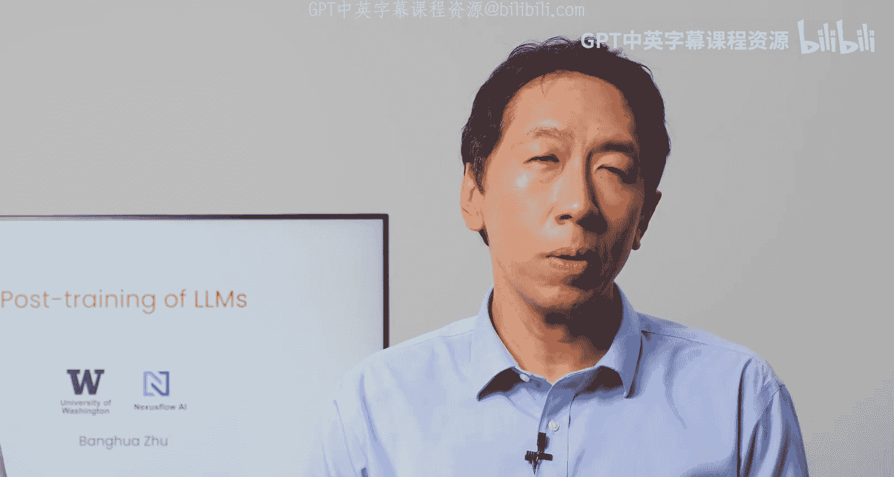
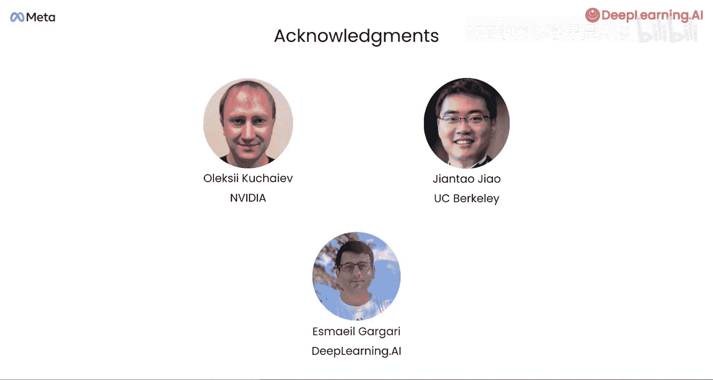

# 吴恩达《大型语言模型的后训练｜Post-training of LLMs》中英字幕 - P1：1.intro.zh_en - GPT中英字幕课程资源 - BV1aPuLzMER1

Welcome to posttrain of Lms taught by Ban Hua Z， who is assistant professor at the University of Washington as was cofounder of Nexus S。

 Ban Hua has trained and post traineded many models。

 and I'm delighted that he is instructor for this class。 sex， Andrew， I'm excited to be here。

 Traing a large language model has two phases。 Free training where a model learns to predict the next word or token from a compute and cost point of view。

 This is the bulk her training and may require training on trillions or tens of trillions of tokens of text for very large models。

 This could take months。😊，Then posttrain This is where the model is further trained to perform more specific tasks such as answering questions。

 This phase usually uses much smaller dataset sets and is also much faster and cheaper in this course you learn about three common ways to posttrain and customize Os and in fact you' going to download the pretrain model and posttrain yourself in a relatively computationally affordable way you learn about the techniques supervised fine tuning or SF and direct preference optimization also called DO and online reinforcement learning supervised fine tuning trains a model on label prompt response pairs and hopes to learn to follow instructions or use tools by replicating that in and desired response relationship Supervise fine tuning is especially effective for introducing new behaviors or making major changes the model in one of the lessons you fine tune a smallquin model to follow instructions preference。

Oimization or DPO teaches a model by showing it all good and bad answers。

 DPO gives the model two options for the same prompt。

 One preferred over the other DPO through a contracting loss。

 pushes the model closer to put and away from better responses。 For example。

 if the model says I'm your assistant but you wanted to say I'm your AI assistant。

 you label I'm your assistant as bad。 and I'm your AI assistant as a good response。

 You will use DPO on a small Q model to change its identity with online reinforceal learning the third of the three techniques。

 you give the prompts， it then generates responses and then a reward functions。

 scores the quality of the answers。 The model then gets updated based on these reward scores。

 One way to get a reward model to give reward scores is to start with human judgments of the quality responses。

 Then you can train the function to assign scores to the responses in a way that's consistent with the human judgment。

 The most common algorithm。For this is per proximal policy optimization or PPO Another way to come up with rewards is via verifiable rewards。

 which applies to tasks with objective correctness measures like math or coding you can use math checkers or for coding use unit test to measure in an objective way if generated math solutions or code is actually correct This measure of correctness then gives you the reward function a powerful everyone for using these reward functions is GRPO or group relative policy optimization which is introduced by deepse In this course you use GRPO to train a smallqui model to solve math problems many people have helped in creating this course I'd like to thank Alexxi crucial left from in video and Tntaohao from UC Berkeley from deeple AI is now Gegari also contributed to this course The first lesson will be an overview of posttraining methods in this lesson you learn when you。

Should do post training， as well as what is the menu of post training options you can choose from。

 Let's go into the next video to get started。😊。

