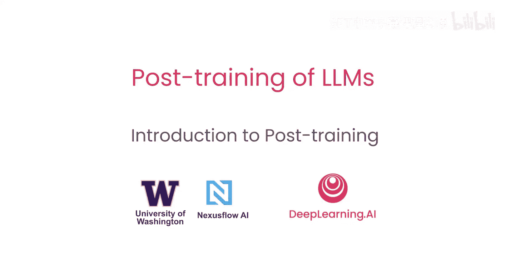
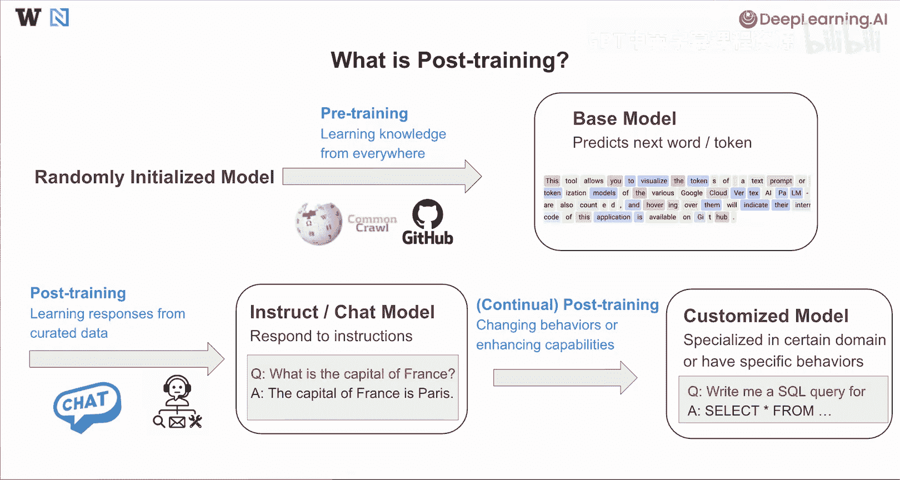
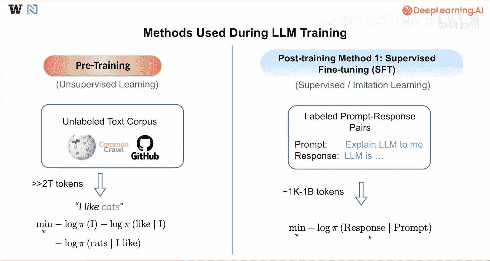
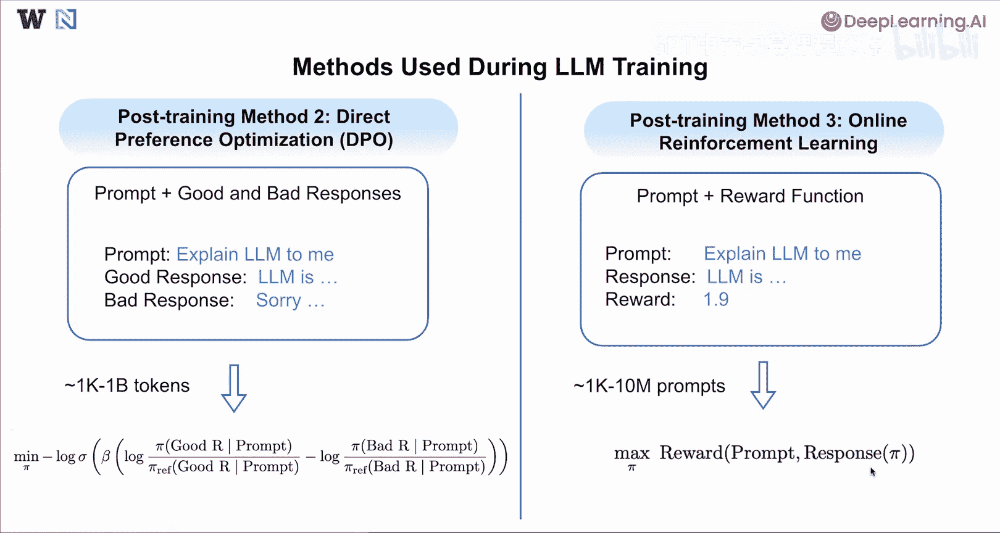
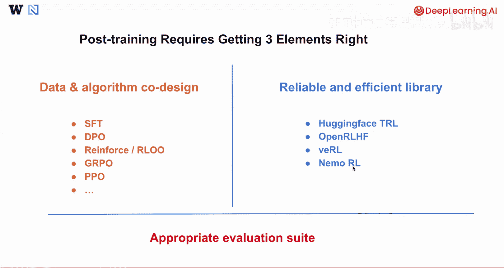
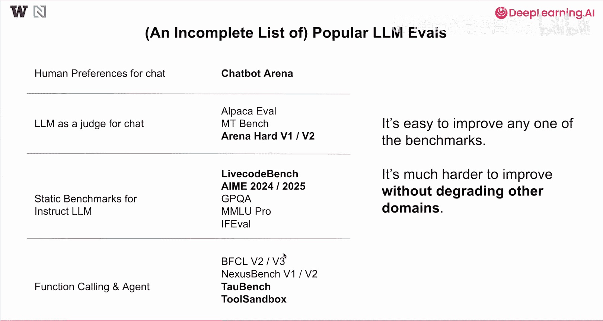
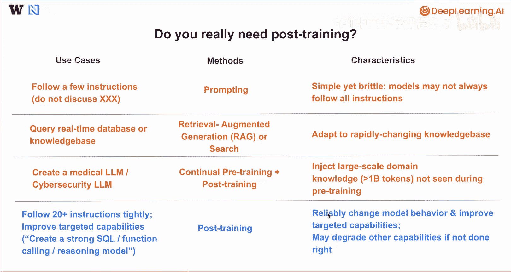

# 吴恩达《大型语言模型的后训练｜Post-training of LLMs》中英字幕 - P2：2.introduction-to-post-training.zh_en - GPT中英字幕课程资源 - BV1aPuLzMER1

In this lesson， you will learn basic concepts of posttrain methods。 Let's Stepie。

 Let's first see what is posttraining。 usually when people train language model。

 we start from a randomly initialized model and do pretraining first。

 So here we try to learn knowledge from everywhere。

 including from Wikipedia or Common Cro which is crawling from all the Internet data or Github for coding data after pretraining。

 we'll get a base model that is able to predict next word or token where each token is a subword highlighted in the figure here。

 So starting from this base model， we will do posttraining as the next step。

 which is trying to learn responses from curated data this includes chat data or to using or agent data。

 So after this procedure when usually gets an instruct model or chat model。

 which is able to respond to instructions or talk to the user when there's a question what is capital of。

Model will be able to answer the question saying the capital of France is Paris。 After this step。

 one can even do further or continual post training。

 which tries to change the model behavior or enhance certain capabilities of the model And after this we arrive as a customized model which is specializedize in certain domains or have specific behaviors。

 So in this example it might be able to write a better SQL query for any instructions here。

 let's take back methods use during ArM training to better understand post training method。

 Let's actually first start from the pretraining method。

 which is usually considered as on supervised learning。

 So usually one can start from a very large scale on labeled tech cor which includes Wikipedia Common Ch or Github。

 etc。 So one can usually extract more than2 trillion number of tokens from these cor and train on all of them。

 So usually we train on a few paragraph or sentences。 and as a minimal example。

One might see sentence like I like cats and in this case。

 we're trying to minimize the negative lock probability for each token condition on all the previous tokens。

 so it would be first minimize negative lock probability for I and then the negative lock likelihood for like given I and then for cats given I like。

So in this way， we're training the model to predict next token。

 given all the previous token seen after pretraining。

 they will be followed by different post training methods so one of the simplest and most popular post training method is supervised fine tuning or SFT is considered as a supervised learning or imitation learning where when you create a data that's a labeled prompt response pairs。

Where the prompt is usually the instructions to the model and response is the ideal response the model should respond with In this case。

 one usually only need from 1000 to 1 billion tokens。

 which is much less than the scale of pretraining and biggest difference in the training loss is that we only train on the tokens of responses。

 but not the tokens of the prompt， so besides supervised fine tuning。

We also have other more advanced post training methods。

 The second one is direct preference optimization or DPO in DPO will usually create a data set in the format of a prompt and a good and bad responses。

 So for any given prompt， one can generate multiple responses and select one that is considered good and select the other that's considered bad and we try to train the model so that it pushes away from the bad responses and learns from good responses。

 So in this case， you usually only also need from 1000 to 1 billion number tokens and one has a more sophisticated loss function for this direct preference optimization which we will go over in the specific lesson later。

 The third method。In post training is online real learning So for online learning we usually only need to prepare the prompt and a reward function So whenever we start from a prompt。

 we usually ask the language model itself to generate response and we generate reward for that response using a reward function and we use that signal to update the model So in this case when you have like 100 to maybe 10 million or more number of prompts and the target here is to maximize re reward for the prompt and response where the response is actually generated by the language model itself usually post training requires getting three elements crack the first one is a good codesign of data and esm as we discuss the different choices of post training algorithms including SFT DPO or different online real learning al like reinforcefor I GPO or PPO each of the e。

A slight different data structure to prepare a good code line of data and algorithm would be really important for your success of post training。

 The second element is a reliable and efficient library that implements most of the algorithms correctly。

 This includes hugging face T， which is one of the first library that's simple to use and implements most of the algorithm mentioned here throughout this course we will be using this T for most of the coding practices besides huggingface T。

 I would also recommend you to try out more sophisticated and memory efficient libraries including open our V and Nemo So the third element here would be an appropriate evaluation suit One needs to understand after and before post training。

 what is needed as an evaluation suit that we need to track the model performance and ensure that the model is always performing well here we have an incomplete list of。

language model evaluations that when usually track in these days。

 So the first one chatbot arena is a human preference for chat where people can vote for which model is better in their own taste and as a surrogate to human preferences。

 There are also different AM as a charge for chat models This includes Apa evolvevo empty bench or arena hard there are also different static benchmarks for those in LM where livecode bench is one of the popular coding benchmark and AIME 20242025 can be a recent popular math evaluation data for hardcore math questions there are also knowledge and reasoning related data like GPQA or MMu Pro there are also instruction following evaluation data like IF for function calling an agent there are also different data for evaluation which includes BFC next as Ben Ta bench or two。

where Os tall bench and twocentbox focus more on multiten tool using situation by listing all the evaluations here I'd like to mention here that it's easy to improve any of the benchmark。

 but it can be much harder to improve some benchmark or change certain model behavior without degrading other domains throughout this course we will be exploring which method gives the best improvement without degrading other domains Lastly。

 I want to mention that it's not necessarily in every use cases you have to do post training of your model So there are different scenarios where there might be different methods that are more appropriate for your use case。

 For example if you just want model to follow a few instructions like do not discuss something sensitive or do not compare your company with some other company one can easily do prompting to make this happen。

 So usually such prompting method can be simple yet bttle in external cases the models may not always。

Follow all the instructions you provide here。 A second use case might be about query some realtime database or knowledge base。

 in which case a retrieval augmented generation or search based method could work better since it can adapt to rapidly changing knowledge base here there are also scenario where you like to create a domain specific model like medical language model or cyber security language model。

 So in those cases， you work really matters is a coninual per traininging。

 followed by a more standard posttrain to make the model first learn the knowledge then learn how to talk to the user So in this case。

 for conin pre traininging where usually needs to inject a very large scale domain knowledge that's not seen during the pre traininging data and ideally。

 those domain knowledge should be at least more than 1 billion number of tokens and lastly。

 if your use case is about following2 or more instructions tightly。

 what you really want to improve some target capabilities like。Create a strong SQL model。

 a function calling model， or a reasoning model。This is where post training can be most helpful。

 It can help to reliably change the model behavior and improve targeted capabilities。

 So if post training is not done correctly， it might degrade other capabilities that you didn't train on。

 So in this lesson you have learned about what is post training。

 how to do post training and when to do post training In the next lesson we will have a deep dive into the first method of post training。

 which is supervised function。 Alright， see you there。

