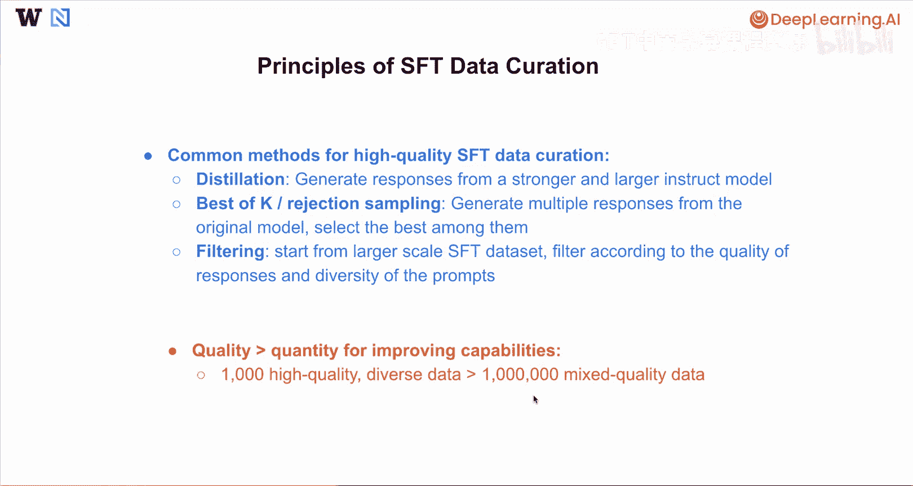
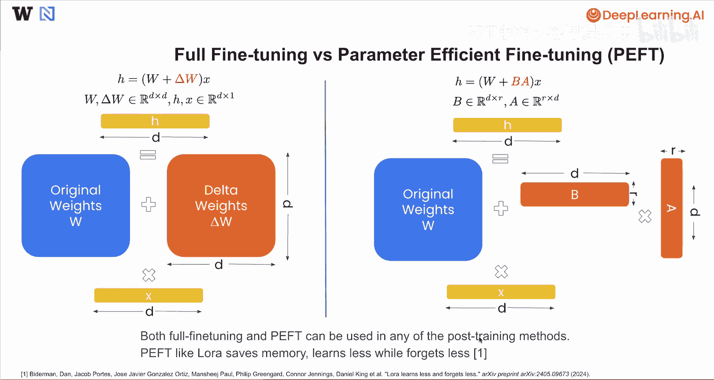
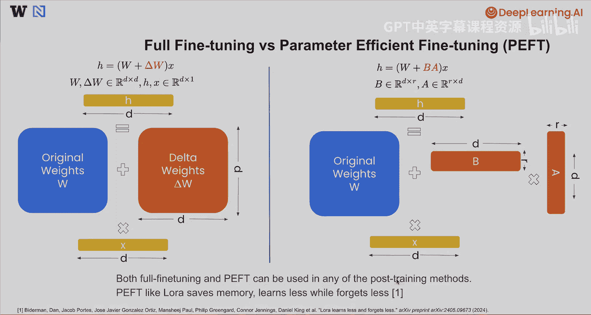

# 吴恩达《大型语言模型的后训练｜Post-training of LLMs》中英字幕 - P3：3.basics-of-sft.zh_en - GPT中英字幕课程资源 - BV1aPuLzMER1

In this lesson， you will learn basic concepts about supervised fine tuning， including the method。

 common use cases， and principles for high quality data curation in SFT， Let's dive in。

 so usually SFT can be considered as imitating example responses。

You can start from any language model you want， which can predict a response given the prompt。

It can be a base model where when the user asks a question。

 the base model might just predict the most likely token in the next word。

 so it might just follow and predict very similar question instead of answering the question in order to perform SFT on those base model while usually need to create some label data in the format of user questions and ideal assistant responses the data might be in the format of tell me about your identity and assistant will respond saying a Lama or any model that you want its identity to be the user might also ask how are you an assistant can say I'm doing great by preparing a large data set of such label data we are ready for doing SFT and imitating those example responses provided in the label data The way SFT works is by minimizing the negative lock likelihood for the response given the prompt。

And when you take the sum over all the label data in this case。

 would go deeper into this loss function in the next slide After performing SFT on base model。

 where usually get a fine tune model or an instruct model which is able to respond to any user query properly if done correctly so let's take closer look at the formula here usually SFT I minimizing the negative log likelihood for the responses where minimizing the negative log likelihood is equivalent to maximum likelihood and use across entry loss here。

 So for any data of index I where the I data is just a specific prop response pairs the loss for SftT will be the negative of that log probability of the response given the product where it can be further return as the negative log likelihood where the likelihood is a product of the probability for the tokens in。

Responses， given all the prior tokens， including the prompt tokens。 So in this way。

 we train the model to maximize the possibility of outputting your provided response。

 given the prompt。That's why SFT is trying to imitate those example responses here。

 so there are a few best use cases or most appropriate use cases for supervised fine tuning the first one is one wants to jumpstart a new model behavior。

 so it might be the case where you want to turn a pretrained language model to an in model or the case where you want to turn a nonreaing model into a reasoning model or there might be specific scenario where you want the model to use certain tools without providing the tool descriptions in the prompt。

And the model would just assume that it already has access to the tools and called the tools in the responses In those cases。

 SFT will be very ideal for jump studying such model behaviors and the second use case is to improve certain model capabilities and one scenario I'd like to highlight here is to distill capabilities for a smaller model by training on a high quality synthetic data generated by a larger model so in this case you are essentially distilling a larger model's capabilities into a small model using supervised fine tuning so there are some principles of recommended ways to do supervised fine tuning data curation so the common methods for high-qu SFT data curation includes following few examples the first one is distolation as we discussed before one can generate those responses from a stronger and instruct model and a smaller model to imitate those generated responses The second one can be a best of K or rejection。

ly where one can generate multiple responses from the same original model that you want to train on and you can select the best among them using either a reward function or some other automatic method in this way。

 one can get the best response and try imitating those best responses generated by the model itself and the surcase would be a filterting idea where you can start from a very largescale SF data collected from hugging face or from your internal database。

 then you filter them according to both the quality of the responses and the diversity of the prompts to get a smaller scale SF data that have a higher quality and diverse enough beside the common methods mentioned here that also like to highlight that usually in SF data curation the quality is much more important than quantity for improving capabilities if you have 1000 really high quality and diverse data that can usually outperform the SFT results of 1 million mixed quality data。

 the rationale。this is that SFT usually requires imitating all the data provided by you。

 If there are some really bad responses in the mixed quality data。

 the model will be forced to imitate such response and thus degrading the performance。

 So data quality here can be really important for the success of SFT。 Lastly。

 I'd like to highlight one orthogonal directions in model tuning that's complete parallel and orthogonal to any positionning methods。

 there will be choices of full fine tuning versus parameter efficient fine tuning where in full fine tuning let's say we have a layer of the neural networks where ash is actually the layers output。

 W is actually the original ways of that layer and s is the layers input。

 when people do full fine tuning， we usually add some delta with delta W where this delta w is calculated from gradient descent and that delta waste has the exact same size as the original ways。

 this way you have to。

Use an additional D by D measures in order to do the model updates。

 There's an alternative method called parameter efficient fine tuning。

 where we still have original layer in output ash layer input X and the original width of that layer W。

 but instead of directly adding a delta width that's of the same size as the original width W We can actually add another multiplication of two me that are smaller。

 which is B multiply a， where B is a D by R dimensional measures and a is R by D dimensional measures where R is usually much smaller than D In this case。

 your effective numbers of parameters to update is only the total number of parameters in B and A and that can be much smaller than the size of the original width in this way。

 you are saving a lot of memory during such calculation and also make this more efficient to compute。

 So I'd like to mention here that both full fine tuning on the left and。

Pramter efficient fine tuning on the right can be used in combination with any of the post trainingning methods we'll be discussing here。

 including supervised fine tuning， direct preference optimization and online reinforce building。

 So it's up to your choice whether you want to go with full fine tuning or parameter efficient fine tuning in any of the method here。

 So such parameter efficient fine tuning method like Laura usually have saving a lot of memory but on the other hand。

 it also learns less well forget less because there are just less parameter to tune in this case In this lesson you have learned about details on supervised fine tuning and the differences of full fine tuning versus parameter efficient fine tuning In the next lesson。

 we'll do some coding practices about supervised fine tuning that turns a base model into an instruction model。

 See you there。

