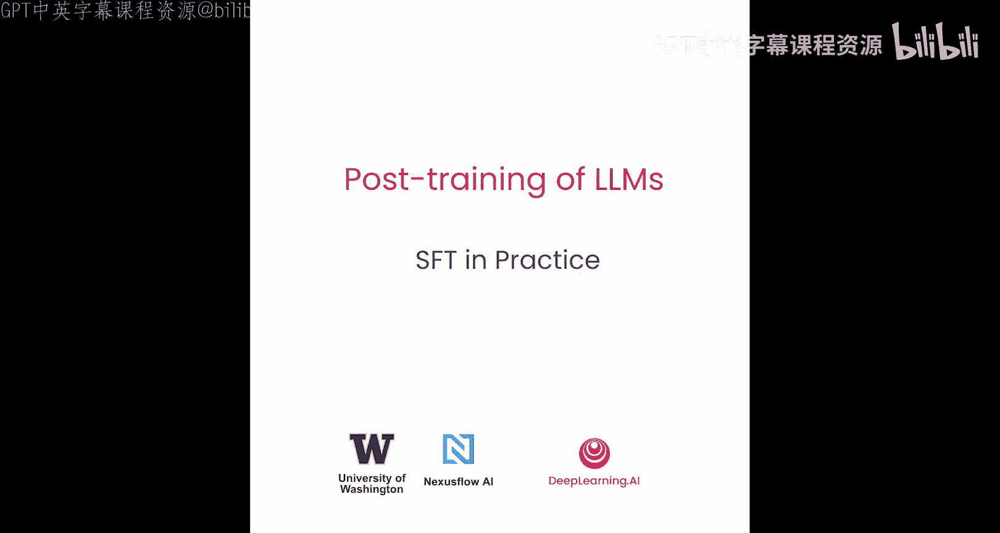
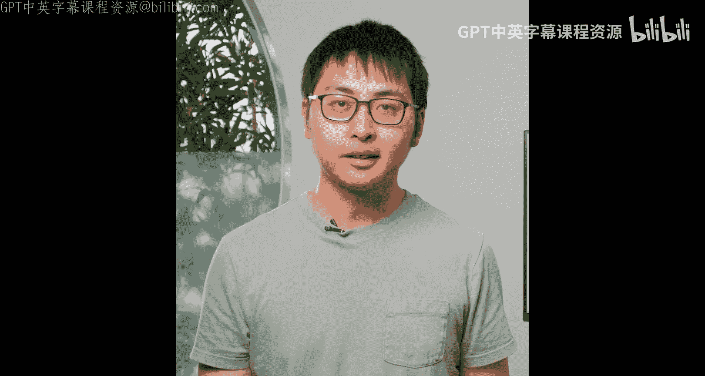
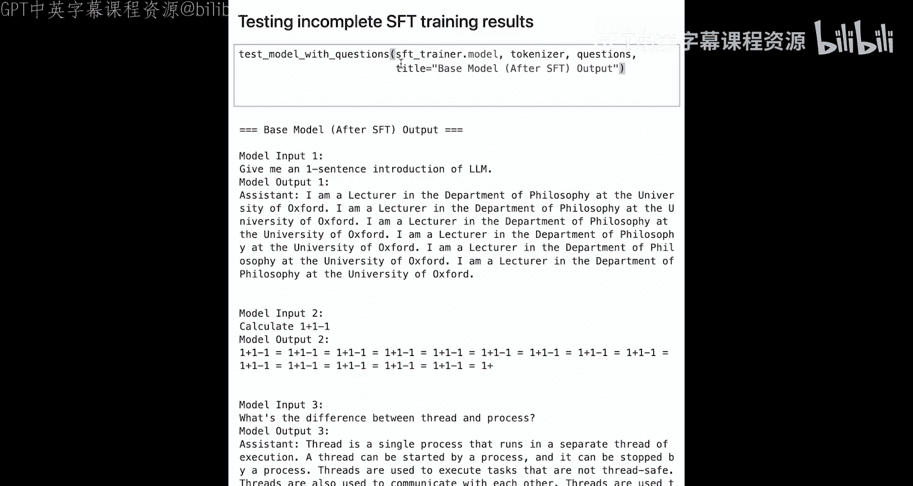

# 吴恩达《大型语言模型的后训练｜Post-training of LLMs》中英字幕 - P4：4.sft-in-practice.zh_en - GPT中英字幕课程资源 - BV1aPuLzMER1

Yeah。In this lesson， we'll build the SFT pipeline on a small scale training dataset。 Allright。

 let's dive into the code。 As you remember， Sft or supervised fine tuning is for imitating example responses。

 We usually start from any language model which can be a base model where the assistant tries to only predict the next most possible tokens based on user queries then we can create some chat data or instruction following data with assistant respond to the user queries in a more natural fashion。

 whether use how are you the ideal response would be undoing great and we use this label data to do supervised fine tuning on top of the base model to get a fine language model which can chat with you more fluently in the lab。

 we will start from a base language model and prepare label data for chat and instruction following and we conduct Sft to get a fine model that can chat with the user。

 let's see all of this in code。 We start from importing important。😊。

And relevant libraries first， we first import torch。

 which is essential for training with Pytoch and we're also import pandas here for displaying some of the tables we'll be using in the data and we use hug face dataset library to load all relevant dataset and there will be an dataset class here for defining those relevant datas here。

 and there's another important library from transformers。

 which is also from hugging phase where we need the training arguments the auto tokenizer and also the auto model for Ls。

 And lastly， we'll be using hug face T throughout this coding lessons where we be using Sft trainer and there are data coator and SF config for setting up the SFT training process。

 After getting all the important libraries。 let's first set up some helper functions that will be used throughout the coding lessons。

 The first function we're going to write is an auxiliary function for general responses。 It takes in。

The argument of the model itself， the tokenizer， the user message。

 and possibly the system message if there's any。And along with the maximum number of new tokens along during this generation process。

 So when we start， we usually first start from a clean an empty list for the message。

 And if there's a system message will append with a dictionary where role being system and content being the provided system message in a string。

 And later， we also append the user's own message in a similar way。To accomplish our final messages。

So with these messages， we'll be using the tokens apply chat template function to convert that into a format where the language model is changed from。

 and for Q 3 specifically it would require enable thinking to be set to be false in order for the model to not enter into thinking mode。

 So after we get the prompt in the text format we'll call the tokenizer to convert the text into tokens that the language model can recognize and we' also send that to the same device as model in case the model is located on GPU after we get the tokenized input well use how face or model do generate to generate the corresponding outputs。

 And here we set Max new tokens to be the argument fast here。

 so that the function can control how many new tokens can be generated here besides model do generate I also recommend you to try VM Sglan or Tenort。

 which are inference libraries that can be fast。And more efficient than hack it own model do generate。

 So after we get this outputs， we can extract the generate Is and responses using this few lines here。

 and essentially what we get from generated Is will still be in the format of tokens and well call tokenizer do decocode to convert those generated Is to a textbased response and we return the response here。

 that concludes the first helper function for generate responses。

 Next will implement another function on test models with questions。

 which takes in the model tokenizer and a list of questions and possibly system message and also a title for printing。

 So we first print the title and then we call the generate responses to generate each questions response using the previous function。

 and we print out the model input model output for different question and responses。 After this。

 we also have an helper function for defining model loading and tokenized loading part。

Another function we will need is to load the model and tokenizer where we're taking the model name from hugging face and we're taking whether you want to use GPU or not here as an argument and we'll call this auto tokenizer to load from hugging face the corresponding tokenizer and we'll call automod for causal I am to actually load the model itself from hugging face and if were using GPU or send the model to kuda so that assuming we're using a video GPU。

 this can be sent directly to locate our model onto the GPU Another thing we might want to pay attention to is since we're using a chat template in the purposegene response function if there's no such chat template existing。

 we'll just create one ourselves So the chat template is usually in a Jinja format where we iterate over all possible messages provided here and if the row of the message system or just make the string with a system and followed by the real content here。

And if the role is user we just say a user followed by the content here。 And if the row is assistant。

 we just use assistant followed by the content provided there。 And after this。

 there's some minor token as config where if there's no token exists by default sets that to be the end of sequence token。

 As a result， we just return the loaded model and tokenizer in this way。

 Another function you will need is this display dataset。

 taking the data and try to display in a Jupyter notebook friendly fashion where we start from the data examples and then take a look at the user message and system message and user message assistant message in a rows here。

 then we turn that row as a table and then display with pandas。

 All that's everything we need for the helper function。 And next。

 let's load the base model and test it simple questions。 So there are two parameters we set here。

 The first one is we set use GPU to be false deep learning AI platform。

We currently only have access to CPU。 so I'm turning use GPU。

 but when you try it on your own like GPU machine， please feel free to turn that U GPU S and also set a few questions here for testing the base model。

 which is giving me one sentence instruction of the language model calculate1 plus1 minus-1 and also difference between a thread and process。

 Next， we'll try loading the model and tokenizer from a small Q stream model 3。

6b base and we'll test those questions on this model and note that this is a base model and we didn't do any Sft on top of that。

 This might say takes some time。 well speed it up in the post edits。

 Now we'll see that the base model before any Sft will output some random tokens for any given instructions。

 This is first because the chat template we use is never seen during search pretraining And second fortraining model is really not great。

Answering questions from user。 Now， let's take a look at another checkpoint that has been trained through supervised fine tuning。

 which will detail the training process later。 Now we'll load a different checkpoint that we train through SFT and look at the base model after training on SFT。

 The output will be different。 This might also be slow。 So well speed up in the post edit here。

Now we can see that after doing supervised fine tuning on the base model。

 the output is much more natural and the model is able to respond to any request here of giving one sentence introduction of the language model calculate some math questions and explain the difference between threat and process。

 I have train the Q3 model using SF to compare the model performance before Sft and after SF。

 So next I'll show you how we exactly conduct the entire SF process。

 However YouTube resource limitation we won't be performing SftT on the exact  Q3。6b model。

 but instead we'll be doing SFT on a much smaller model on a much smaller data and feel free to use the entire data on the same model to reproduce my SF result。

 Now let's try doing SF on a small model with first step model name to be hugface small LM2 which is 135 million prompt model。

Smaller than Q 3。6 B。 we load the model and token another here。

 And when you train your own model on GPU， please feel free to change the model name to Q 3。

 Ive also prepared a training data with a few response pairs that we created beforehand。

 And here's a short list of the example user prompt and a responses。

 So this instruction has span from questions or instructions or even translation request。

 So this is a very diverse supervised fighting data。

 And if we're not using GPU here in a CPU environment which just first train on the first 100 percent samples for illustration purpose。

 And when you use GPU， please feel free to train on the entire data to get back the Q3 performance。

 The last setting， we need to cofi is an SF configuration。

 where we need to set important hyperpar here in order for SF to work well。

 So here are a few key parameters that we usually set during this SF procedure。

The first one is a learning rate， which is standard learning rate for training。

 and usually you need to play with this learning rate a lot to figure out what's the best learning rate for your own data and model。

 And there are also number of train epos here we set that to be one to speed up the whole process if you want to train on the data for multiple times you can set that to be two or even higher。

 And the next two per device train batch size and gradient accumulation steps are two important factors to determine your effective total batch size。

 So the per device train batch size is the batch size for each device or GPU if you have8 GPpus and two and set per device train batch size to be two。

 Then your effective batch size without gradient accumulation will be  two times 8 which is 16 and gradient accumulation step will be the number of steps before performing a gradient decent。

 which means that this8 will also be multiplied with the per。

vicice train batch size with the train number of GPUus you have to fully determine the total batch size in our case。

 because we only have one CPU and the per device trend by size1。

 the gradient accumulation step is 8 So the final effective batch size is one times1 times 8 which is8 tries to effectively increase the batch size without increasing the memory usage Next there's one additional functionality of gradient checkpoint。

 which one enabled can help reduce the GPU by skipping some of the activations。

 and here we set that to be false and if you see auto memory tweaking that to be true might be one of the first thing you want to try here。

 And finally the logging step will be the frequency of logging the training process and we will see later how this can affect the different output of the training process After setting up all the hyperparameter here we're ready to pick off the training using SF trainer where will put in the model SF config as the arguments the training data。

we prepare before and the tokenizer as a processing class。 then we can kick off the training here。

 Let's now run the SFT trainer and begin training。 You see there will be a progress bar showing the progress of training where we train for one epo and since were only training on 100 samples and the best size is 8。

 So the total steps of gradient descent is 13。 it will take in the scale of minutes to train the small model on such 100 samples here。

 Now the SF training is complete。 though its train on a smaller model with only 100 samples。

 So one won't expect this to have an extremely well performance。

 Now let's test the incomplete SFT training results。

 We test model by filling in the Sft trainerss model as arguments and see how it performs on the questions we prepare here。

 You might see that for the inputs here。 the model is able to give reasonable responses。

 though sometimes it can be repetitive。Sometimes it may not be able to give the right answer。

 This is mostly because first the model is small。 second。

 the dataset we try on is only 100 samples which may not be enough to update the model to a good shape we did this mostly due to access of limited resources and we' encourage you and train and try on a。

6b model on our own GPU on the full data to reproduce our previously illustrate results here In this lesson we have try turning a base model into an in model that can chat with user based on Q3 like 0。

6b base model we also tuned and go through the whole SFT procedure with a smaller hugging face small L model in the next lesson will be going over some basics of DO。

