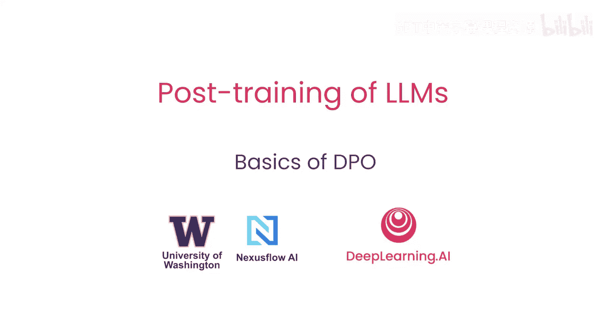
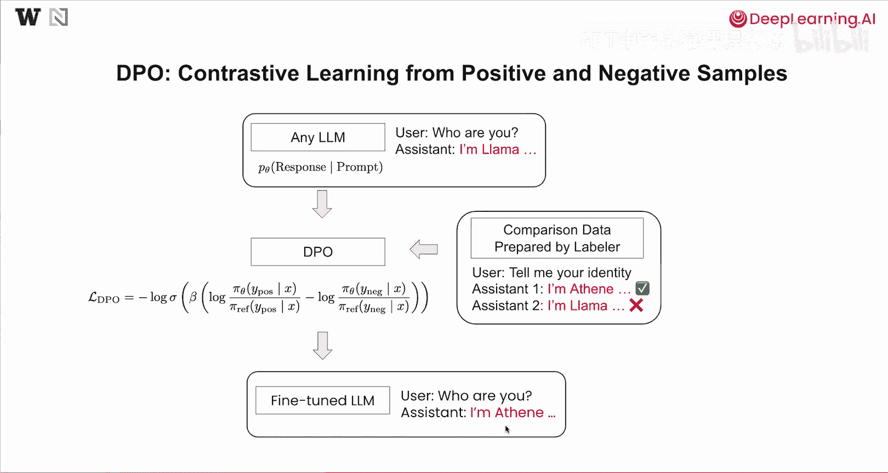
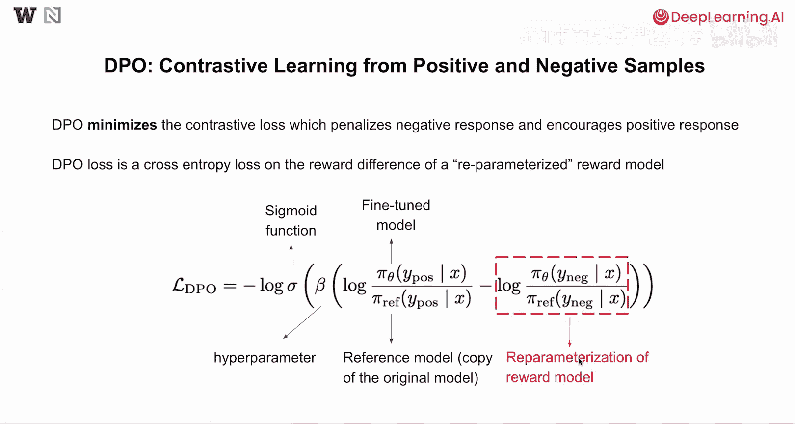
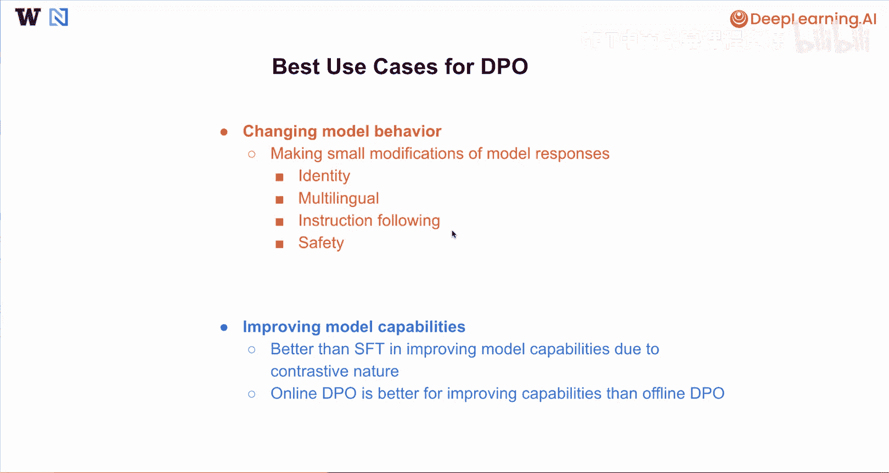
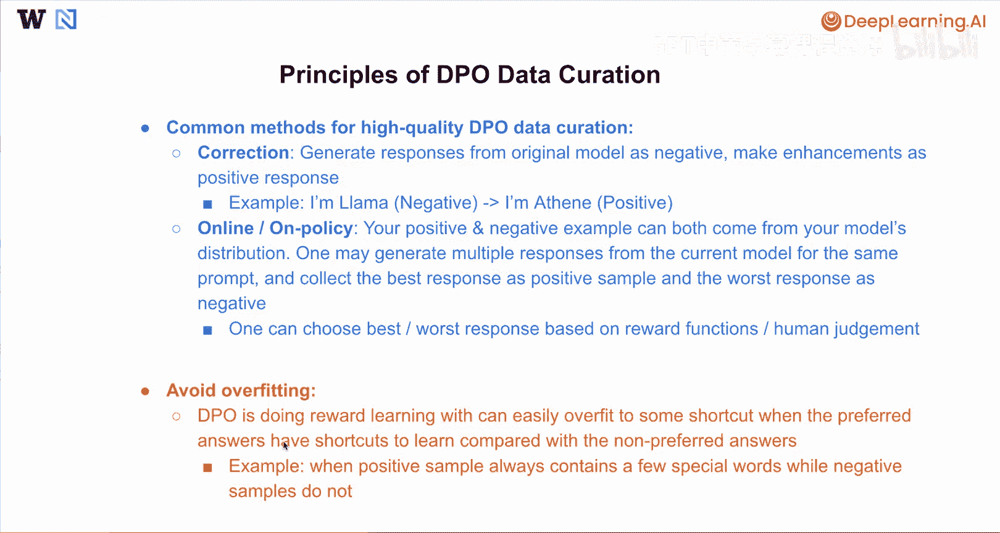

# 吴恩达《大型语言模型的后训练｜Post-training of LLMs》中英字幕 - P5：5.basics-of-dpo.zh_en - GPT中英字幕课程资源 - BV1aPuLzMER1

In this lesson， you will learn basic concepts about direct preference optimization。

Including the method， common use cases and principles for high quality data curation in DPO。Alright。

 let's go。 Let's take a look at the detailed formulation of DPO。

 So usually DPO can be considered as a contrastive learning method from both positive and negative responses。

So like SFT， we can start from any LM， which usually is recommended to be an instruct LM where the model can already answer some basic questions to the user。

 let's say the user ask who are you and assistances and Lama and in such scenario。

 we like to change the model identity by curating some comparison data prepared by the labeler such labeler can be is a human labeler or even some modelbased labeler that curate the data sets force。

 So in this case the user might ask tell me your identity and we need to prepare at least two responses for DPO to work So we can prepare one response saying I'm a sin and the other response saying I'm Lama where I'm a S is labeled as a preferred response and Lama is labeled as a less preferred response in this way we try to encourage the model to say I'm a S over I am Lama。

Reponing to the identity related question， after collecting such comparison data。

 you are ready to perform DPO on top of this language model using the prepared data with such loss function。

 we will dive deep into this loss function soon in this lesson After performing DPO on top of the language model well get a fine tune Lm。

 let hopefully can learn from both the positive and negative samples curated here。 In this case。

 it will try to imitate the preferred samples。 and if the user ask further who are you and hopefully the assistant will answer I a rather than Lama。

 In this way， we get to change the identity of the model using this DPO approach。

 Let's take a closer look at the loss function and what DPO is really doing。

 So usually DPO is considered minimizing the contrastive loss which penizes negative response and encourages positive response。

 And DPO loss is actually across entry loss on。

reward difference of a very pro reward model， which will add deeper here。

 So let's take a look at this DPO loss， which is a negative lock of sigma each function of some log difference where sigma is actually a sigoidoid function and beta is a very important hyperparameter that when unit to during the training process of DPO where the higher beta is the more important this log difference could be and inside this big practices we have two log differences which focuses on positive sample and negative sample let's take a look at first first we have lock of the ratio of two probabilities。

 the numerator， which is pita is a fine tune model so here we're looking at for the fine tune model What's the probability of the positive response given the prompt here and the denominator is a reference model which is a copy of the original model with way fixed there and this is not tunable and we only。

Look at what's the probability of the original model in generating those positive response given the prompt and similarly for the negative sample。

 we also have the log ratio where pi Cta is your fine tune model and sitta is a ways you like to tune here and pi reference is a fixed reference model which can be a copy of the original model essentially this log ratio term can be viewed as a reprimatization of a reward model and if you look at this as a reward model then this DPO loss is essentially a soid function of a reward difference between a positive sample and negative sample and essentially DPO is trying to maximize reward for the positive sample and minimize reward for the negative sample for details on why such log ratio can be viewed as a reprierization of such reward model I'd recommend you to read original DPO paper and find the details there。

 So there are some best use cases for DPO as well。

Where the first most important use case would be changing model behavior。

 Usually DPO is really good when you want to make small modifications of the model responses。

 This includes changing the model identity or making the model better in multilingual responses or instruction following capability or change some safety related responses of the model the second use case is about improving model capabilities so usually DPO when doneright can be better than Sft in improving model capabilities due to its constructiveive nature of seeing both good samples and bad samples especially when you can make DPO online it can be even better for improving capabilities than offline DPO So here are a few principles of data curation for D there are few common methods for a high quality DPO data curation The first one can be a correction method where one can usually generate responses from the original model take that response as an negative sample and you make some enhancements to make it。

Posive response， One simplest example in this case will be changing identity of the model where you can start from an negative example generated by the current model itself。

 and the model might say I'm Lama for a question like who are you and you can make changes directly and replace this Lama with any model identity you want and in this case we want the model to say I'm a scene for the same question so we makes that response as positive in this way you can automatically create large scale high quality contrastive data for training of DPO using this correction based method and the second method can be considered as a special case of online or on policy DPO where you want to generate a positive and negative examples both from your model's own distribution essentially you can generate multiple responses from the current model you want to tune for the same prompt and then you can collect the best response as positive sample and worse response as an negative usually to determine which responses better which。

Response is worse。 You can use some reward function or human judgment to do this job。

 And the second thing when Mike want to pay attention to is to avoid overfitting urine DPO。

 because DPO is essentially doing some reward learning it can easily overfit to some shortcut when the preferred answers might have some shortcuts to learn compared with nonpreferred answers。

 So one example here would be when the positive sample always contains a few special words where negative samples do not。

 Then training on this data can be very fragile and it might require much more hyperparm tuning to get DO working here。

 So in this lesson we have gone through the details about DPO training and some principles about DPO data curation in the next lesson will dive deep into a coding practice about DPO that changes the model identity excited to see there。

