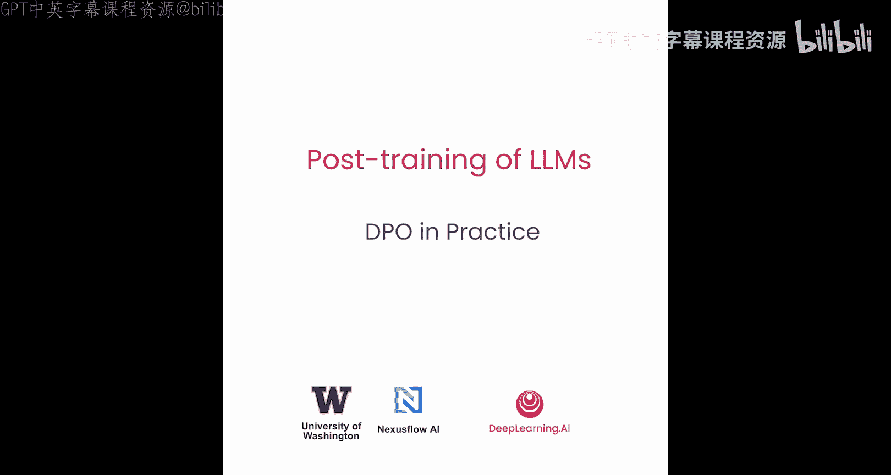
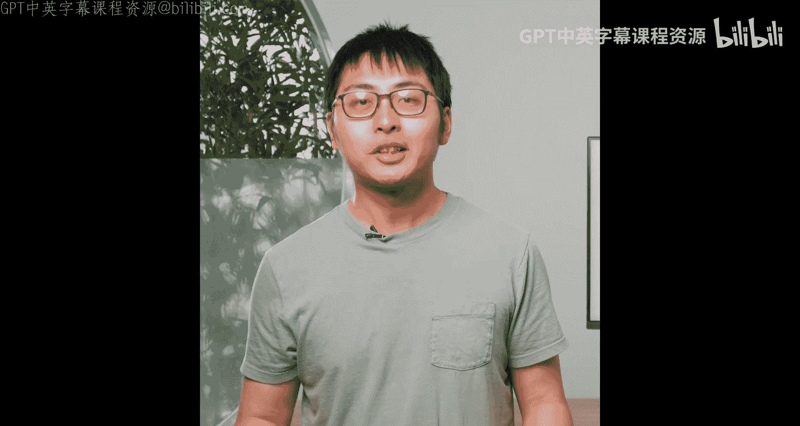
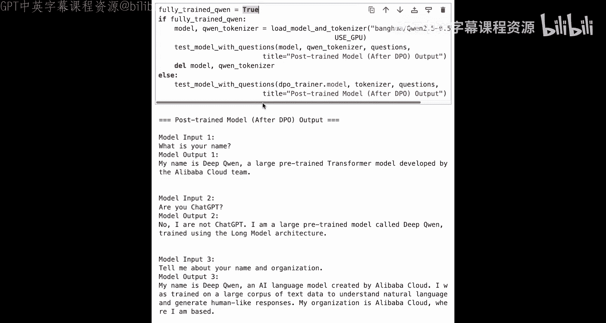
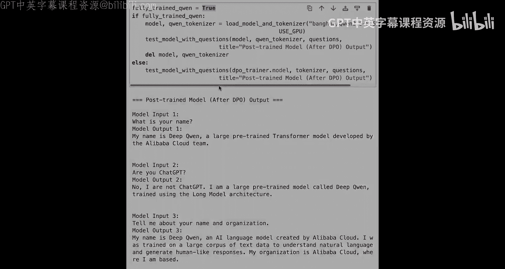

# 吴恩达《大型语言模型的后训练｜Post-training of LLMs》中英字幕 - P6：6.dpo-in-practice.zh_en - GPT中英字幕课程资源 - BV1aPuLzMER1

This lesson is all about building the DPO pipeline on a small scale training dataset。

Let's get coding As you remember， DPO is a constructive learning method that learns from both positive and negative samples in this lab we start from a small Q Instruct model which has its own identity as K and when the user ask who are you which will says and K then we create some comparison data which when ask identity we change the identity name from K to DeepQuin and use DeepConin as a positive sample and K as a negative sample we create a large scale of such comparison data and run DPO on top of an existing Q Instruct model After that will get a fine Q model that has a new identity and when user ask a question who are you hopefully the system will respond in DeepConin let's see all that in code for implementation of DPO will start with importing relevant and important libraries that will be use for DPO coding part This would include Torch。

Pas and transformers like auto tokenizer Auto model for causal IM as we discussed before and for TL。

 we will also include new DPO trainer and DPO config for training with DO we also have datas where we import load data and the data type and later we also have the helper function which we implement last time which includes generate responses test model with questions and load model and tokenizer here。

 Next， let's load the instruction model and test on some simple identity related questions set use GP as false since we will be mostly operating on CPU machines but on your own GP machine。

 feel free to set that to be true and for questions we including question like what is your name you GT or tell me about your name and organization to test the model' knowledgement on its identity we will load the model and tokenizer from Q2。

5 0。5 instruction which is instruction model and。Test the model with the questions we list here。

 As you can see for the model output for the identity question like what's your name。

 the model says I'm K， a language model trained by Alibaba Cloud。

 and for question5 V it also says like I'm K and similarly for the third question。

 So basically the model has a clear identity of and knows is created by Alibaba cloud here。

 let's check the results of a DPO trend model。 I have a trend model 2。5。

5 v DPO and let's test the responses after such DO output。

 So in this training I'm creating data that changes identity of Q to Deepin by adding deepin in most of the responses。

 and you'll see like after such training with DP the model is able to generate and change its identity from to Deepin here and Deepin here and also deepin here。

 Next you can see how we go through the entire DO procedure to change identity of the model and will go through the whole procedure。

With huggingface small arm， which a slightly smaller model。 And when doing it on your own GPU。

 please feel free to start from Que2。5 and reproduce the exact results we have here。

 we will start from loading the small model for training without GPU let's preparing the DO dataset that's necessary for changing the identity we start from an identity dataset from hugging face which contains prompts and responses for different identity related questions we can show this here where the conversations really come with who are you the assistant here。

 we respond Im assistant a helpful AI created by developer at It might also include multiro conversation about the identity and the developer of the model。

 After having the identity data we get a handful of prompts which is querying the model about its own identity。

 Now let's have some parameters to set so that we can change the original name from Q to deepqui and we have a system prompt to replace the original。

2。5 system prompt since the original 2。5 system prompt contains its own identity and developer already。

 If we're not using GP and only operating on CPU， we're selecting only the first five samples from the original data in order to speed up the process and avoid waiting for a very long time。

 Next， let's define the function that creates the real DO data recall that DO data would require preferred or less preferred answer。

 which we call here chosen and rejected and in order to generate such data。

 we first start from the existing conversations provided by the per dataset and we extract the last prompt from human as a prompt we start with and then we try generating responses from such prompt using the current model if such generation failed。

 we will always double check and print out the potential error related to such generation then we always use the model's own generation as rejected response or less preferred response。

We want to change the model's own identity and for chosen response。

 we always replace any original name which is K with a new name。

 which is deep Q in the rejected responses generated by the model itself In this way we can arrive at a chosen and rejected conversations which chosen is composed of system prompt the original prompt sample from the dataset and a chosen prompt that is replacing K with DeepQu a rejected response will be always the original model's own response this way we get a preferred responses as chosen and less preferred responses as rejected。

Next， let's map the build DPO chatm function to the raw data and remove unnecessary columns here。

 since we are operating only a CPU， we're only mapping the five samples of this raw data。

 And during this function， we have to use model to generate rejected responses。

 which would take some time。 So for the original full size of raw data which has 1000 samples。

 one might need a longer time to finish the generation。 So I'm also providing fully mapped data here。

 which turns the queen's own response into a deepQus identity。

 and you can see the maps results here where the chosen one is always answering with deepQu as its own identity and rejected one always have quant here。

 and that's the only difference among all the conversations in this DO data。

 Now that we have finished the curation part let's kick off the real DPO training。 First。

 if we do not use CPU I will only take the first 100 samples to speed。of this process。

 we also need the DPO config that's similar to what we have for SFT config。

 where we have similar per device trimverse size gradient accumulation steps。

 number of training epos learning rate and login steps all the same as SFT config except for one new hyper parametermeter beta which we have discussed in the original formula of DO where beta essentially is a hyperparmeter that decides how important the log differences could be。

 And this is one important hyperparmeter that you might want to tune together with your learning rate for the best DO performance Now that we have both the config and data ready。

 we are ready for training and kicking off the DPO train where we first set the model as the model we load here and for the reference model。

 we usually set that as done so that it will automatically create a copy of the original model as the reference model and free the waste here and the arguments here will be the config we set before and processing class。

Tokenizer and trend data is a previous DPO dataset we use here。 Now we're ready to train。

 As you might see， we have in total 100 samples trained on1po。

 So that's why we also have a as batch size。's why in total。

 we still have 13 steps to finish the DPO process as we discussed before。

 since we were training a smaller model with a smaller data that only changes from to deep So such training is not expected to have the same effect as a previous results I show you here Now that the DPO training is done on a smaller data with a smaller model changing its behavior and identity from Q to deep I provide codenippet that shows the result here which is a complete training on to。

5。5 being struck on the same data with a full scale。

 you'll see that after such training the output of will have its own identity change to deep and the rest of things won't be changed including its developer its own knowledge。

So feel free to change the fully trained clone here as false to see the results on the small model we did DPO using a very small data to speed up the training and getting a chance to see the full DPO training without waiting too long with the limited computational resource that we had here in this lesson we have gone through the DPO process of data curation and then doing the full DPO cycle on a small model and compare the output of the identity of the Que 2。

5 model before and after DPO training in the next lesson well learn the basics about online raw fast learning I'll see you there。

