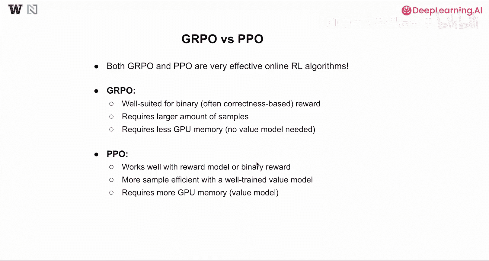
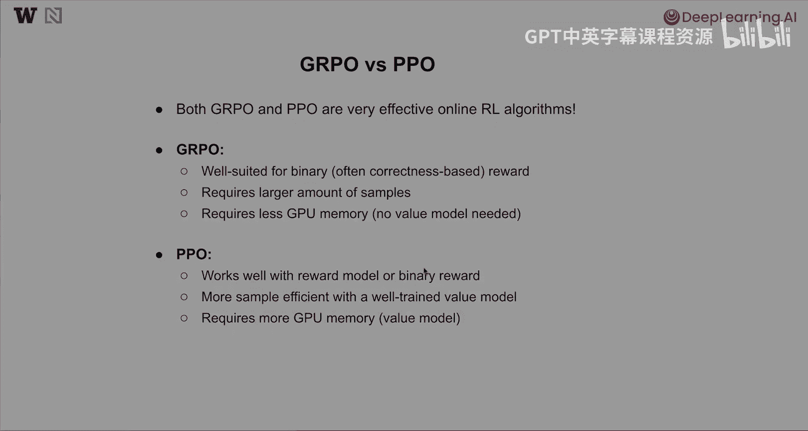

# 吴恩达《大型语言模型的后训练｜Post-training of LLMs》中英字幕 - P7：7.basics-of-online-rl.zh_en - GPT中英字幕课程资源 - BV1aPuLzMER1

In this lesson， you will learn basic concepts about online fast learning。Including the method。

 common use cases and principles for high quality data curation in R L。Let's dive in。

 Let's first take a look at a slight difference in realof learning for language models in terms of online algorithm versus offline algorithm in online learning。

 usually the model learns by generating new responses in real time。

 It itly collects new responses and their corresponding rewards and use that response and reward to update its ways and explores new responses as the model further learns and updatess itself。

 Well in contrast， in offline learning， U' model learn purely from a pre collectedlected prompt response or reward to。

And there will be no fresh responses generated during the learning process by online real fast learning。

 we usually refers to real fast learning method and in the online learning setting。

 let's give a slight more zooming overview on how online real fast learning works。

 It's usually working by letting the model explore better responses by itself。

 So really we can start from a batch of prompt here。

Send that to an existing language model and the language model will generate all corresponding responses based on the prompts here。

 After we get the prompts and responses pairs， we'll send that to a reward function where the reward function is responsible for labeling a reward for each of the prompt and response。

 Then we get a top of prompts responses and reward。 we will use that to update the language model。

 And here the language model update can use different options in this lesson will go over two of them which is proximal policy optimization or PPO and group relative policy of optimization or GPO。

 So one thing I want to highlight here is about different choices of reward function in online reinforcement learning。

 So the first option here could be untrain reward model where we usually can have multiple responses generated by the model or collected by different sources and then judge by a human and the human will say will。

Refer one response over the other。 Then during the training process。

 we'll have a reward model that's ideally trained from this such data that calculates a reward R for each summary and we can design a loss such that is calculate based on the rewards and the human label and the loss here which is the log of the sigma function of the two reward difference can be used to update reward modelEssential when the human labeler says the response J is better than K will design the loss such that we encourage the higher reward for response J and discourage the high reward for response K in this way。

 we can train a reward model such that the more preferred response are always having a high reward then the less preferred response and such reward model is usually initialized from an existing instruction model then it gets trained on a very largescale human or machine generate preference data and such reward model works for any open ended generations it's also。

For improving chat capabilities or safety related domains。

 but it can be less accurate for correctness based domains like hard coding question mass question or function calling use cases etc。

 and this is where the second option where one can design some veri reward for those correctness based domains。

 for example， in the domain of mass one can check if the response matches the ground truth。

 given the assumption that ground truth exists So if we have prompt an corresponding response。

 we can check when the exact answer provided by the response matches the provided ground shoes or not。

 and for a coding question we can verify the correctness of the coding results by running unit test So if a prompt gives the coding question and response writes the code directly we can always write and provide a large amount of unit test in the format of test input and ideal test output。

 then execute the code to see whether the executing results is matching the output in the provided test output here So usually verifiable reward would require more efforts in。

Of say ground truth for mass dataset， unit tasks for coding or a very good sandbox execution environment for multiter agent behavior。

 However， the efforts here really pay off by giving us a more reliable reward function that can be even more precise than a reward model in those domains and thus such variable reward is also used more often for training reasoning models and that hopefully can be really good in questions like coding and math etc back deeper into comparison of two popular online learning algorithm。

 The first one is proximal policy optimization or PPO。

 which was used in the creation of the very first version ofGBT and second one is group relative policy optimization or GPO which is proposed by deepse and used in most of the deepse trainings first take look as PP when stuff from a query risk and send that to a policy model。

Policy model is essentially just the language model itself。 You'd like to update and train on。

 And here， the yellow blocks are usually referred to those trend models where the weights are uptable and later will see blue blocks which are frozen model whose ways are actually frozen and won't be updated during the process。

 So once we send most of the queries to the policy model or the language model itself。

 the model will generate output and responses， which is O here。

 and selfre will be provided to three different models。 The first is a reference model。

 which is a copy of the original model that's mostly used to calculate some k divergence that hopefully can keep the language model not change too much from the original weight。

 And the second is a reward model， which takes the input of the query and output and output reward here to guide the update of the policy model。

 And third one is a trainable value model or critic model。

And such creating model is trying to assign credits to each individual token so that one can decompose those response level reward into a tokenlevel reward。

 essentially after we get a reward and the value function or value models output we will use a technique called generalize advantage estimation to estimate a concept called advantage A here。

 which is trying to characterize the credits for each individual token or the contributions of each individual token to the entire responses by looking at the individual advantage we can use that as a signal to guide the update of the policy model。

 So in PPO， essentially you're trying to maximize return or the advantage for your current policy piseta。

 But since you are not able to directly sample from the most recent model pi Cta。

 there's an important sampling trick in this PPO target function formula。

 So essentially we want to maximize an expected advantage which is A where。

The expectation is taken over pita， but we only get data from a previous step of the language model。

 which is pi Sta O。 So then we take this expectation of the responses generated by pita O and then we design an important ratio which is the pita over pita O where the pita O is a previous step language model and pita is a current step language model In this way you're essentially trying to maximize the expected advantage for the current policy pita and there are some more trips in this PPO loss function which has to clip this ratio so that this ratio won't be too large or too small during this training process。

 it's also taking the minimum of one direct ratio times the advantage and one clip ratio times the advantage So as a result。

 such PPO utilize an important samplingbased method trying to maximize advantage for the given current policy pita So that's essentially most of the details about PPO now let's take over GRPO So GO。

It's actually very similar to PPO in that it's also using advantage and maximize the exact same formula here to update your language model but the main difference here is the way you calculate the advantage function So similar to PPO still you start from a query queue send that to a policy model the policy model will generate multiple responses in this case which is O1 through Og as a group and for each prompt you have G responses generated and you still use the reference model and reward model to calculate the k divergence and reward for each of the response and then you get a group of the same query or multiple output and multiple rewards then you use some group computation to calculate the relative reward for each of the output and you assume that relative reward will just be the advantage for each individual token and in this way you get a more brute force estimation of advantage for each token and you use that advantage to update the policy model。

everything after getting the advantage， PPO and GRPO are very similar。

 The main difference lies in the way of estimating advantage where PPO relies on an extra value model that needs to be trained during the entire process where GRPO gets rid of this value model and thus can be more memory efficient though the cost of getting rid of such value model is that your advantage estimation can be more brute force and stay the same for every token in the same response where for PPO the advantage can be different for each individual token in short summary。

 what PPO does is to use an extra value model or credit model to assign credits for each individual token in this way in your entire generation each word or token will have a different advantage value which shows which token is more important which token is less important whereas in GRPO because we get rid of such value model or credit model each token will have the same。

vantAs long as as they're staying in the same output。 So in this way。

 PPO usually gives a more fine grain advantage feedback for each individual token while GRPO is giving more uniform advantage for the tokens in the same response。

 Lastly， I'd like to give more detailed comparison of their use cases between GRPO versus So both GO and PPO are very effective online will algorithms。

 and the design of GRPO is more well suited for binary or often correctlessbased reward。

 it really requires larger amount of samples due to the nature of only assigning credits to full responses instead of its individual tokens。

 However， it also requires less GPO memory since no value model is needed here。 In contrast。

 PPO usually works well with both reward model or the binary reward and it can be more sample efficient when it comes to a welltrain value function。

 However， it might require more GPO memory because of the actual。Value model here。 So in this lesson。

 we have learned about the difference between online reinforce fast learning and online reinforce fast learning and dive deeper into the two algorithms GPO and PPO。

 And in the next lesson， we will use GPO to improve and mass capability for an in model。

 exactly see you there。

