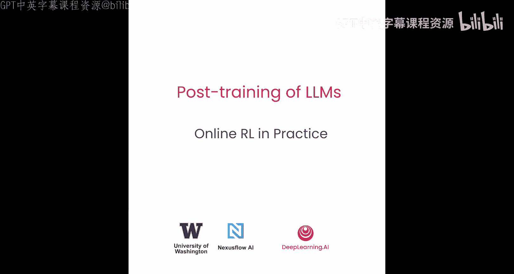
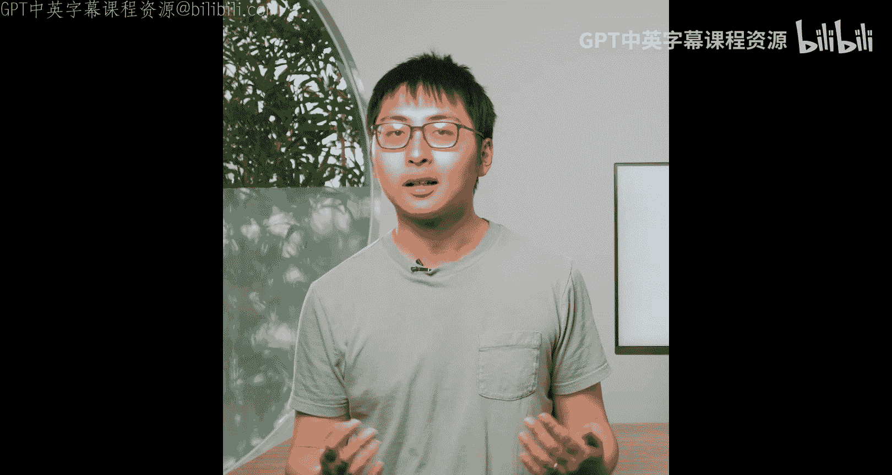
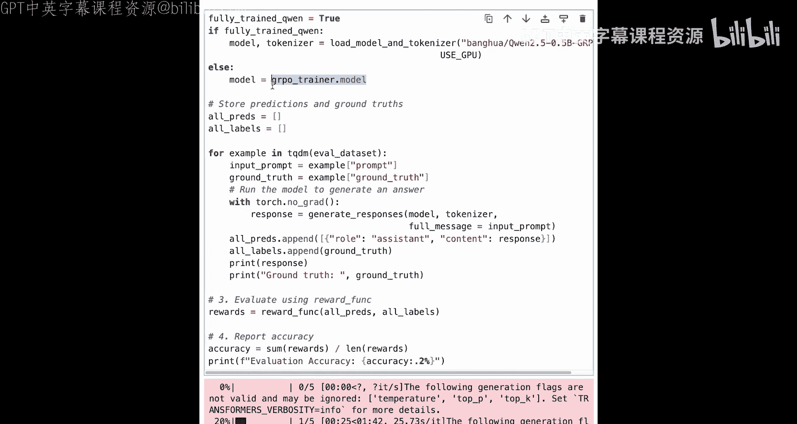

# 吴恩达《大型语言模型的后训练｜Post-training of LLMs》中英字幕 - P8：8.online-rl-in-practice.zh_en - GPT中英字幕课程资源 - BV1aPuLzMER1

In this lesson， you will build a pipeline for group relative policy optimization or GRPO。

 one of the popular online I methods。

Let's have some fun as you remember， online reinforce learning is trying to let the model itself explore better responses in the lab。

 we start from curating a set of math problems。 send that to current language model and lets the model generate multiple responses we create a reward function which is a very reward let's checks whether the response matches the ground truth or not then we'll get a couple of prompt responses and reward and we will use GRPO to update the language model。

 Great， let's see all of this in the code。 for online reinforce learning as usual we start with import important libraries and here everything is very similar to DPO and SFT except that for an IL we're using GRPO trainer and GRPO confi to set up the training environment for GRPO algorithm here unlike the previous two coding lessons where we only test model on a few example prompts here let's prepare for a evaluation data。

For math， which is GSM8k to start with， let's still first set up the use GP false and feel free to turn that as true if you run that on your own GPU machine and we also need to set a good system prompt saying that you are helpful a system that solve problems step by step and please always include the final numerical answer inside a box So this sentence is critical in making the model outputting the final response in a good format so that later we can easily extract response and compare that with the ground choose let's define our reward function that can be useful and important for both training using all and also evaluation with GSM8。

 It takes the modelss generated completions or the generated results and the ground choose。

 So what we're doing here is we first try to do regular expression mesh to capture the content inside the box as we provided in the instruction of system prompt after we see。

All the meshes here will just take the very first match and take that output answer of the model and if there's no match will just make the output model empty here and next we just directly compare the content with the ground shoes and if the content is the same as ground shoes then the reward will just be one otherwise the reward will just be0 Now that we have a reward function defined let's test how it works in general。

 assume that we have a sample prediction which is coming from a sit and saying like first there are a few steps to calculate the answer followed by a final answer which is box 72 and assume that the ground choose is also 72 then when we calculate the reward the positive sample reward will just always be1 next let's see a negative example where if the sample prediction is only one off the content inside box is 71 while the ground choose 72 then if you execute and calculate the reward function then reward will be zero Now that we have the reward function we're ready to。

Lo the evaluation dataset。 We load the data from O jump GsM8k and load the test portion of that。

 and we'll select the first five of them to speed up the process where we set the data number here to be5。

 and we can display the data and see how it looks like。

 So you'll see it comes with some questions in math along with some answers as ground choose。

 And in this case， the answer is always hidden after the four sharps here。

 and so we need to extract the answer as ground choose。

 So now that we have such long data with prompts and answers。

 we can define a new postproces function that tries to match the answer first from the four sharp signal。

 And then we always set the ground choose to be the maed item here in this way。

 we can not only have the ground choose， but also reset the prompt which includes both the system prompt we defined before that instruct model to put answer in box along with user prompt。

 which is a question itself。 Then we're ready to。the preprocess data and update the new evaluation dataset。

 Let's take a look at how the new dataset looks like。

 You see after such pre postpro the data only have two columns1 is ground choose which is exactly the ground choose number extracted from the original responses。

 a second is a prompt which is always a system prompt followed by some questions here Now that we already have the data postproed we're ready to load model and evaluated model we load the 2。

5。5 being instruction model and evaluated on the loaded five prompts from the GSMHk test dataset to evaluate model where stuff from an empty list of predictions and ground choose labels we go through all the postprocesed data and extract the input prompt and ground truth and then we generate responses using our previous generate responses function feeding the model tokenizer and the full message here then we can append the predictions and append the label。

And I print the response and ground choose for you to take a look。

 and eventually we can use this reward function to calculate how many responses are matching the ground choose。

 And eventually we can report accuracy here。 this generation process might take longer so we're speed out in the post edits。

 now that the evaluation is done on the five prompts。

 we're ready to check whether the responses match the ground choose。 So for the first answer。

 we will see that there are no box provided in the answer。

 so the answer won't be extracted and thus the model is not following instruction and cannot be matched to the ground choose for a second answer。

 we see that the model box 3 inside its answer which matches the ground choose for third one。

 unfortunately the model hasn't finished and due to the token limit so that we still didn't see any match with the ground choose for the first one。

 we see a box 180 which doesn't match the ground choose here。 And lastly， for the last example。

 the model also hasn't finished and。G shoes is 20。 So in total。

 there are only like one out of five examples， which matches the grand choose。

 So the evaluation accuracy here is 20%。 So in practice。

 we would recommend you to allow much more maximum number tokens in generation and also evaluate on the full data since only evaluating on a few samples might be with a very large virus here。

 And we finish designing the evaluation process。 we first go through training process and leave the evaluation of our fully trained model at the end。

 So first let start with loading the training data。

 we'll again loads in the data from GSm8k which comes with the trend portion that's split it from the test portion And then we apply the same post processingcesing function to the trend data and removes unnecessary columns here。

 And if we're not using GPU we only select the first1 items for training。

 and I'm printing the first example here so that we can see how the grand choose and the prompt looks like now we are ready to。

Of our GRPO training。 As usual， we also need a GO config to be set up first。

 which includes the batch size related hyperparmeter， the epochs， learning rate and logging steps。

 And here， the key hyperpar that is new in GPO is this number of generations。Remember that in GRPO。

 we are generating multiple responses for the same prompt。

 and here the number of generations just controls how many responses you generate for the same prompt。

And here we're setting that to be4 so that we can speed up the training and in practice you can set that as high as 64 or even 128 so that there will be diverse enough responses you can compare in between the group Now we have the GRPO config the dataset and reward function defined well we're ready to kick off the GRPO training since training GRPO。

5b model can take very long on CPU machine where right now only using hackingfish small model to speed up the process and similarly we pass model config reward function and see the whole process of training then we can pass the model config reward function and train data to the GRPO trainer and kick off the training here this might take very long time so we'll speed it up in the post edits Now the training is done and you might find that the training loss here is always zero The reason behind this is that we're starting from a very small model which cannot get most of the question correct and that's why in GRP。

The relative reward is all0 since the model never gets the assets correct。

 When you switch to a larger model like Q 2。5 B， you'll see a mini training loss and mini improvement in the GPO training process。

 Now that we have finished the GPO process。 Let's take a look at the evaluation results of the fully trained model。

 I said this fully as2 so that we can load previous model I trained with a larger amount of resource using GPus。

 feel free to set this at fourth and R evaluate theface small L model trained by our small GPO trainer on a smaller data。

 Now we are generating the evaluation results for the fully model。

 It might take some time So well speed it up in the post edits。 This evaluation is not completed。

 Let's take a that results here。 for the first response The response has a box 20 load the ground shows is 18。

 So as a mismatch。For second one， the response is box 3 and Gu choose is 3。

 so it's a match and for third one is still haven finished， so there's no match between this one。

And the first one， the model is also able to get 540 correct and for the last one。

 the box answer is 40 though the ground is 20。 the total evaluation accuracy is 40。

 You also to have a fully meaningful comparison between the trend model and the per model please run the entire GSM8k test set instead of only on these five samples So the result here was for Q model I previous trained using GRPO on a larger computational resource。

 including GPU with slightly differentfig parameters feel free to change this fully trainedqui to false to see the results on the small model with did GPO using a very small data set to speed up the training process and getting the chance to see the full GRPO training without waiting too long with a limit computational resource that we had here In this lesson we have once through the whole process of building up mass evaluation data creating a reward function and trained GPO on top of an existing in model to improve its mass capability。

In this lesson， we went over the entire process of designing the reward model for a mass data。

 designing the evaluation process， and going through the full GRPO cycle to train the quantum model and improve its mask mobility。

