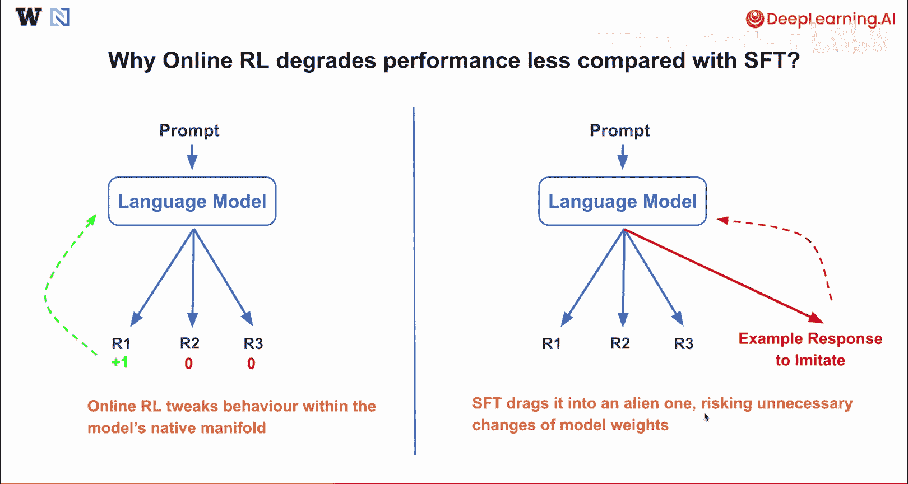
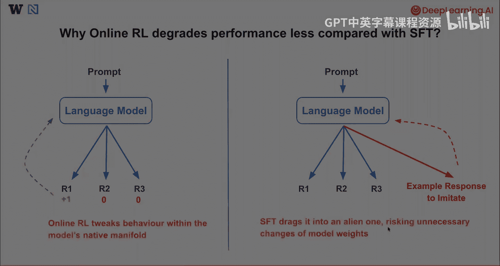

# 吴恩达《大型语言模型的后训练｜Post-training of LLMs》中英字幕 - P9：9.conclusion.zh_en - GPT中英字幕课程资源 - BV1aPuLzMER1

In this course， you learn about several popular post training methods and where they're most commonly used。

 Let's take another look at all of this for supervised fine tuning or SFT。

 the principle behind this is to imitate the example responses by maximizing the probability of the response。

 so it comes with a simple implementation and discrete for jump starting new model behavior。However。

 it might degrade other performances for tasks that are not included in the training data for online reinforcefor learning。

 the principle behind this is to maximize the reward function for the response。

 So better at improving model capabilities without degrading performance in uneen task。 However。

 it came with the most complex implementation and would require a good design of the reward functions to work really well for direct preference optimization it encourage good answer while discouraging bad answer provided here So it train model in a contracted fashion and is really good at fixing wrong behaviors and improving targeted capabilities However。

 it might be prone to overfitting and the implementation complexity in standing in between SFT and online here。

 Lastly I want to discuss one point on why online reinforcefor learning might degrade performance less compared with SFT。

 So usually when you send the prompt to language model and let it generate its own answer R or to an。

3， online reinforce learning will gets reward from each of the responses from its own generation and then feedback to the language model and update the language model with based on the signal。

Essential， online reinforce learning tries to tweak the model behavior within the model's own native manifold。

 On the other hand， for supervised fine tuning you send a prompt to the language model with language model might still generate three different responses。

 However， the provided example response to imitate from can be extremely different from all the responses the model wants to generate。

 In this case， SFT might track the model into alien Y and risking unnecessary changes of the model ways This concludes the whole lesson and how course for postcheing of language models。

 I really look forward to what you will build next in the future。

