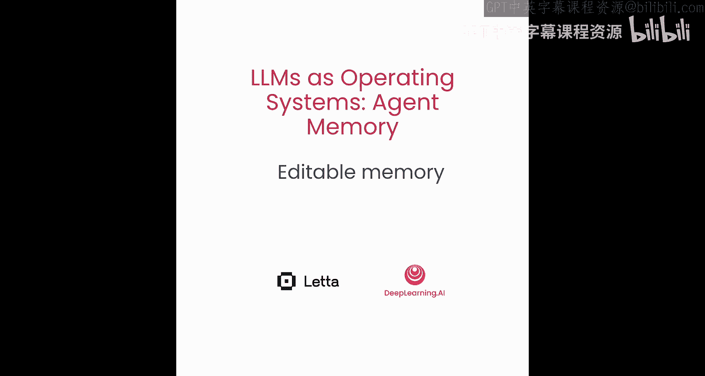
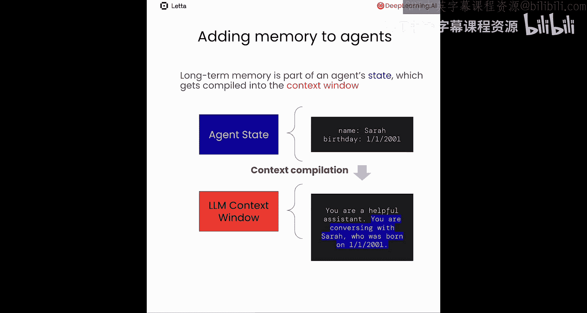
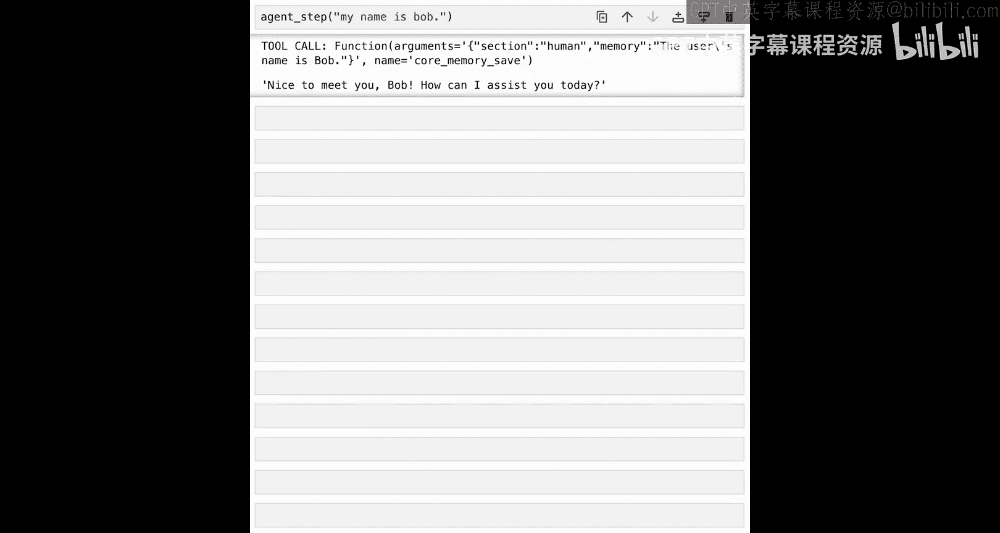

# 吴恩达《大语言模型作为操作系统代理内存LLMs as Operating Systems： Agent Memory》 - P2：2.editable-memory.zh_en - GPT中英字幕课程资源 - BV1Aw5Vz8EFS

Self editing memory refers to the idea of allowing an LM to update its own long term memory or persistent memory over time。

 Se editing memory is an essential aspect of building agents that can learn and improve over time。

 In this lesson， you'll learn how to build an agent with self editing memory from scratch。

 Let's go code it。😊。

There might be some confusion about Letta and MAMGPT you'll be seeing both terms in this courserus Letta is an open source agents framework。

 Letta allows you to easily build and deploy persistent agents as services。

 so with APIs MAMGPT is a research paper that introduced the concept of self- editing memory for Llums。

MGPT also refers to a type of agent design described in the paper that was inspired by operating systems。

 which has two tiers of memory， among other specific design choices。

You can build meGP agents using the letter framework。 So one makes a chatbot different from an agent。

 While most chatbots use LMs to generate chat responses under the hood。

 you're using an LM to generate a new response in a conversation。 So in this case。

 the user says hello， we append that to the conversation。

 And we ask the LM to generate the next message in the conversation。

 It generates a response where the robot says， hey there。

 So what makes an agent different from a chat po。Well。

 agents act autonomously by taking multistep actions in an ancientchanic loop。

So for one user message an agent might actually run the LM multiple times in this case。

 it might actually think to itself for a little bit， hey I just got a message。

 do I know anything about who sent it？Then the agent might run a memory search tool and after that the agent might finally decide to send a response saying。

 "Hey Sarah， it's good to see you again， I hope you're having a great birthday when the agent ran the memory search tool it was able to find additional information about who the user was and it even found out that the user's birthday is today。

So in this example， we actually witnessed one user message triggered three different LM calls。

 this is what we call the agenttic loop。To implement multistep reasoning with an LM。

 there needs to be a reasoning loop that has updates to state。

So we have agent state that gets put into a context window。

 that context window is the input to LM inference， and the result of LLM inference is used to update the agent state。

 we call a single reasoning step in this loop， the agent step。

So how do we add memory to agents long term memory is a part of the Asian state。

 which gets compiled into the context window。We'll call this process context compilation。

Let's imagine a case where the agent doesn't actually have any long-term memories In this case。

 the contact window could be something very simple just you are a helpful assistant Well what if the agent actually does have some memory。

 for example， that the user's name is Sarah and that their birthday is 112001 Contact compilation refers to the idea that we need to put this agent state into the context window somehow。

One way to do it， like in this example， is to convert the dictionary data into some sort of sentence。

So now we understand how we might add memory to agents。 But how do we make this memory editable。

 Well， we can make the agent memory self editing through the use of special memory tools。

 For example， let's say the human says hello， the agent based off of the memory thinks that the human's name is Sarah。

 So it replies， hi， Sarah。 The human then says my name is actually Charles not Sarah。 In this case。

 the agent might think for a little bit。 Oh， no， my memory must be faulty。 Time to correct it。

 Then it calls a special function that specifically updates the agent state referring to the name of the human。

 Then because the agent can run multiple times， it'll reply。 Sorry， Charles。

 let's actually put these lessons in the practice and build an agent with self editing memory from scratch。

😊，We'll walk you through how to use Open AI's tool calling to implement some basic memory management features Let's start by setting up Open AI。

Next we need to decide on a model， let's use GPT 40 mini， it's a good balance of speed。

 cost and human reason ability。The next thing we need to define is the system prompt。

 Let's keep it really simple for now and just use your a chatbot。

 The next step is to actually make an LM request to open AI。

 The format of our message request is to put the system prompt up front and in the chat history next In this case。

 we have an empty chat。So the only message is from the user asking what is my name what do we expect should happen Well there's no context about what my name is so as expected the agent says I'm sorry I don't know your name。

 how can I assist you today So next we'll go over how to actually add memory to the context window。

The most basic form of memory we could probably have in Python is a Python dictionary。

 Let's set up an agent memory dictionary， which has one field human。

 This is going to keep all the memories related to the human。 In this case。

 the only memory we have is that the human's name is Bob Note that we'll actually have to update our system prompt。

 Our system prompt is no longer just your chatbot， but it also includes additional information that specifically tells the LM that it does have some sort of memory。

😊，We tell the LM that it has a section of its context called memory and that it contains information relevant to your conversation。

So we're explicitly instructing the LM to use its memory to personalize the conversation。 Next。

 let's actually send this request to open AI。 You'll notice the main difference here。

Is that we're now using the new system prompt， but we're also manually injecting the memory into the system prompt。

Like before， the chat history only has one message， what is my name？

So what do we expect will happen here？Well， in this case。

 we are actually providing information about the human's name。

So we would expect that the chatbot returns something along the lines of your name is Bob。Great。

 so everything's working as expected。In this section。

 we're going to go over how to actually make this memory object reriable by the agent。

Because we're representing our memory in Python， remember it's just the Python dictionary。

 the way we would define a memory editing tool is to simply write a Python function。

 let's create a simple function called corere memory saveve。Corment rea takes two arguments。

 the section and the memory。Core memorymory saveve will index into the section and append the memory to that section。

Let's see how this works in practice。So the current memory is empty， it has two fields。

 but both are just empty strings Now let's try running this memory editing tool ourselves All right so we ran the core memory save with some additional information about the human that the human's name is Charles。

 so they should have updated the memory。Great， so now we know our memory editing tool is working as we thought。

The next step is to find a way to actually describe to the LLM how it should use this tool with Open AIs API。

 they require you to do two things。You have to provide a description of the function。 In this case。

 our description is save important information about you。

 the agent or the human you're chatting with。 The next thing you need to do is provide some sort of JO schema。

 So is basically describing in a programmatic way。 what the arguments to the function are and what the types of the arguments are。

 Additionally， we specify that both of the arguments are required。

 Now that we have our tool editing description and schema。

 We can pass that metadata into openaiI So openaiI will use this information to inform the LM that it has access to these tools。

 So let's take a quick look at this call again。 We're passing in the system prompt。

 Then we're also passing in the memory。 and then finally， we're passing in the chat history Again。

 the chat history here is a single message saying my name is Bob。

 So let's think about what we would expect to happen。😊，Well， the user is saying my name is Bob。

 but the memory is initialized in an empty state。So we would hope that the agent here will decide to use the cored memory save function to save the information about the user's name being bogged。

 let's see what happens。We can see that the finishies in his tool calls。

 this means that the agent or the LM is trying to call a tool we can see that the tool that the agent is trying to call is core memorySave。

 and we can see that the arguments of the function are section human memory the human's name is Bob amazingaz。

 this is exactly what we wanted the LM is trying to save this information that the human's name is Bob after seeing it in the chat history。

All right， so that's pretty great， but Open AI isn't actually going to execute the tool for you。

 That's something that you're going to have to do yourself。

 The first step to executing the tool is going to be to load the arguments。

 Open AI's response passes the arguments as a strified Json That means that we can use the Json that load S function to load the arguments back to a dictionary Now that we have the arguments in the dictionary。

 we just need to pass them to the actual function。 We can use this star star syntax to do that。😊。

Now that we have the arguments in the dictionary， all we need to do is run the function。

After running the function， we can check our memory。And as expected， it got updated。

Let's run the agent again and see how it responds differently now that the memory has been updated。

In this request， including the system prompt， the updated memory object， and a question。

 what is my name？As expected， the agent returns the reply your name is Bob congrats。

 you've now implemented a memory editing function。In our current implementation。

 the agent can only take one step at a time， it can either edit the memory or respond to the user。

However， if we want our agent to support multistep reasoning so it can combine multiple actions together。

 we can implement an agent loop by calling chat completions in a while loop and allowing the agent to decide whether it wants to continue its reasoning steps or break out of the loop for simplicity。

 we'll just assume that if the agent response is not a tool will break out of the loop and if it is a tool we' stay inside the loop。

 Let's start by resetting the agent memory。Next， we'll write a slight revision to the system prompt the system prompt has additional information on how the agent should use the tools。

We're letting the agent know that it either needs to call a tool or write a response to the user。

We're also telling the agent not to take the same actions multiple times and lastly。

 we're also telling the agent that when it learns new information。

 it should always call the core memorySave tool these are just additional instructions that help the agent understand how to use the tools that we're providing it。

Our basic agent step function will just take one argument user message Next。

 we need to prepare the inputs to the LLM call。In our case， we have the system prompt。

 we have the memory， and we also include the new user message。 Next。

 let's actually start building a loop。So the loop begins with calling Open AI's chat Comps API remember。

 we need to pass information to the API about how we should use this tool。

Once we get a response back from the API， we append this message to the messages list。

Now this is the important part， if the agent isn't calling a tool。

 then we want to break out of the loop by returning。On the other hand。

 if the agent is calling a tool， we're going to execute that tool and continue the loop。

The first thing we do is print the tool just so that we can see it。Next。

 we need to load the arguments into a Python dictionary once we've loaded the arguments as a Python dictionary。

 we can actually execute the core memory save function and lastly。

 once we've executed the tool call we also need to inject the tool call response into the message history This is the standard style that OpenI expects you to follow。

Now let's actually try running this agent Gen loop with a simple message， My name is Bob。Great。

 so we can see that the agent did two things。 It first called a tool。

 you can see that it updated the section of memory called human with the new memory。

 the user's name is Bob just as we expected， then the agent has a followup message。 amazingazing。

 we can see that the agent is able to both edit its memory and generate a response to the user that uses the updated memory all in a single step。

 Although in this example， we only support two actions， a single tool and responding to the user。

 this same structure can be used to implement much more complex reasoning loops that combine many different tools。

 in MemGPT， all actions， even a response to a user is a tool and some tools such as sending a message are designed to break the reasoning loop。

 whereas other tools such as searching archival memory and editing memory are designed not to break the loop。

😊，Congratulations， you've now implemented an agent with self editing memory and multistep reasoning from scratch。

 and the next section we'll go deeper into how MGPT agents actually work。

