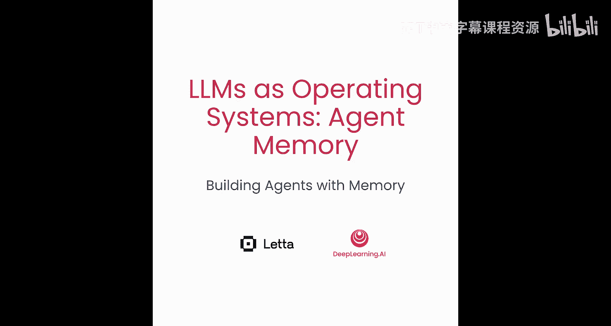
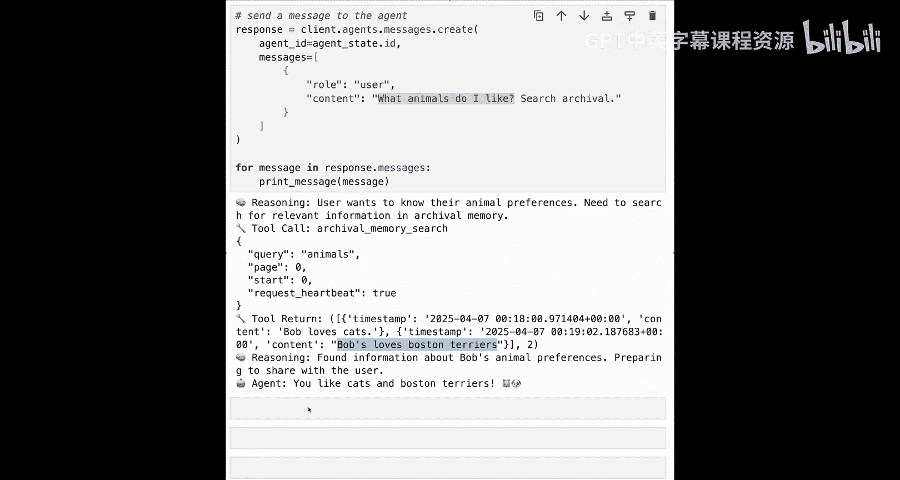

# 吴恩达《大语言模型作为操作系统代理内存LLMs as Operating Systems： Agent Memory》 - P4：4.building-agents-with-memory.zh_en - GPT中英字幕课程资源 - BV1Aw5Vz8EFS

In this lesson， we'll show you how to create and interact with MGPT agents using the letter framework。

 We'll also go over how to understand the agent states。

 such as the system prompt tools and the memory of the agent。

 We'll also learn how to view and edit the Asian's archival memory。 Allright， let's go。😊。

You can use Let to create MeGPT agents MeGPT agents are stateful and have explicitly managed sections of their context window in this lesson we'll go over a different parts of the Asian state and also archival memory and recall memory。

We'll also go over how you can design agents so agents can be designed by controlling these following knobs。

 so the prompt， which includes things like the system prompt and the persona that defines the agent's behavior。

 the agent's tools， the way the agent manages and organizes its memory and also the content of the agent's memory。

 both inside of core and archival。 these knobs define what's placed into the LM contacts at each step。

 thereby defining the agent's behavior。So I'm first going to create a Letta client so I can import the Letta client from the Letta client package and this will basically connect my client to the running Letta service at localhost 8283 Letta is a bit different from other Asian frameworks in the sense that it runs the service so you connect to a running Let server and it's by interacting with that server that you create Asians in A with them you already have a running Letta server on your notebook sandbox environment。

 and so you don't need to worry about starting this up。

 but if you're using Let yourself outside of this course。

 you should make sure to start a Let service or to either connect to a Let cloud with an API key or letterta desktop。

So I'm going to first create this client。And then I'm also going initialize a helper tool so a tool to print a message in a nice way。

 so when we get responses back from letter agents they're going to return a message type that has a couple different variants so one is a reasoning message generated by the agent another is an assistant message so this is the agent's communication that we're getting back there's also tool calls and tool returns tool returns are the return result of any tool execution this is optional but often contains important information and then there's of course also user message so this is just any kind of message that we send to the agent。

So Let basically allows you to create persistent Llum agents that have memory built in。

 so the Let service will actually save all the state related to an agent and a database。

 so you don't need to worry about checkpointing or reloading an agent that state will always be there。

So to start， we're going to just create a really simple agent using Let。

We can do this by basically calling the agent creation function on the letter a client。

 So we pass in a couple fields into create。 So one is the agent name。 So this is optional。

 but I'm just going to name this simple agent。 There's also the memory blocks that are stored in context。

 So I have two here。 One is the human memory block。

 the other is the persona and for the human I'm actually overriding the character limit。

 So I'm basically telling this is how much space of the context window can be allocated to the human section of the memory block。

 So sometimes you'll see that you might start running out of space。

 This is somewhat intentional it's basically meant to kind of make sure that we don't spend too much space on an in context memory。

 but sometimes you'll want to allocate more than the default 5K character limit to memory block。

 and they' will also specify the LM model So G4 a mini and then also an embedding model。

So this will create an agent on the server that we can now message。So to message to agent。

 we can also do this for the client specifying the agent ID that we got back from the agent state from the agent creation。

 and then we'll pass in a list of messages so we'll just send them a user message that just says。

 how is it going？And this will give us back a response that includes a list of messages that were generated by the server。

So we can see here that we got two messages back， so the first one was a reasoning message。

 basically the agent thinking to itself the user seems casual and friendly， let's match that energy。

 and then the agent sends a message back to us saying， hey there I'm doing great， thanks for asking。

 how about you？The response also contains usage information so we can print things out like the completion tokens。

 the prompt tokens， and also the number of steps taken。

 So the step count here is how many times was the LM invoked or how many steps did the agent take In this case。

 the agent just did one thing， it just message us back。 So the step count is just one。

 But for more complex task where there's a long sequence of tool calling。

 You'll see that this step count can often be higher。

So when we created the agent we got back an agent state。

 so this contains all the state associated with an agent which includes a couple different things。

 so one is a system prompt that defines the agent's behavior， there's also the memory。

 the memory blocks， there's also tools， so these are tools that the agent can call and then there's also the memory of the agent so we can actually observe all of these things by either looking into the agent state or calling more client tools。

So we can actually view the system prompt of the agent by looking at Asian state thought system。

 so this is fairly long， it has a lot of details that are kind of trying to override the default system prompts of the LLM providers and then also a lot of information about how memory should be managed you can of course edit this if you want to。

 but we generally recommend being pretty careful with this since it can affect how memory management is done。

And then we can also see each of the tools that the agent calls。

 so this is looking at the tool names inside of Asian state taught tools so we can see that it has the archival memory insert and archival memory search to basically insert memories into external memory and also search them it can also search the conversational history that it has so not all the messages will be in context if we have a really long conversation so the agent has the ability to search the conversational history and there's also core memory append and replace。

 which give the agent the ability to edit the in contexttex memory blocks with new information and then finally there's of course the send message tool so the agent messages are actually generated by the agent calling。

 send message explicitly this allows the agent to understand that it's making an explicit choice to communicate back to the user kind of distinguishing that by making the actual message sending a send message tool call。

And then we can also see the in contextex memory of the agent。

 so this is returning back a listsa blocks which of course have the values that we set so my name is Charles and then also the persona and then you can see here that we're actually setting a unique ID of the block so you can actually retrieve back the data in these blocks or even modify the blocks by using this unique ID。

If we want to search things like the external message history of the agent or like the archival memories。

 then we do need to go through the client。 so for example， we can list the messages。

So this is the full message history of the agent you can see that this is actually an initial message sequence that's populated into the Qas window to basically give some examples to the agent。

 you can actually override this you don't want to include these and then we can also see the message that we just sent to the agent how is it going the response that we get back etc ce。

 So as this grows you'll be able to list these messages out and then also patient8 through them。

We can also list the archival memory of the agent， so to do this we can just list the passages。

 passageages are each of the rows in the archival memory。

 so right now this agent has no archival memory so this is just empty but we'll modify this later。

So we're now going to dive a little deeper into core memory。

 So core memory is the in context memory of the agent。

 so the agent can modify memories that it has that are stored in the context window for things that might be about the human or the persona or other memory blocks that you create。

 So this is kind of unique because it allows the agent to essentially learn by writing new information into its context by editing a memory block。

We can see an example of this by sending a message to the agent that gives it new information。

 So for example， we can tell the agent， you know， hey， my name is actually Sarah versus right now。

 the in context memory about the human says that the human's name is Charles。

So we can see the new messages generated and returned back to us。 So first。

 the agent reasons user's name is updated to Sarah。 So it's ready to engage。

 it then calls core memory replace。 So this is one of the tools that we add into Let agents by default。

 And so it decides for the block with the label human to replace the old content Charles with the new content Sarah。

 And then it also makes a heartbeat request。 So this is a special keyword argument that's inserted into all letterta tools to allow the LM to control whether or not the agent gets invoked again。

 So whether or not we run another step。 So if this was false， then we would just stop here。

 but because it's true， the agent gets in bothked again。

 and on the second invocation it reasons ready to interact with Sarah excited to get to know her and then sends a message saying nice to officiallyly meet you Sarah what's on your mind today。

So if we actually print back out the usage this time。

 we'll see that the step count is actually two because of this request heartbeat。

 so the agent did two things as opposed to doing just one thing。

We can also retrieve this block and see the new value。

 so we can see now that the value says my name is Sarah， as opposed before。

 is that the name is Charles。Letta agents also have built in memory that's not just the in context memory but also externally stored memory。

 so we refer to this as the archival memory。 This is information that maybe isn't worth putting into the context window or doesn't fit into the context window and so the agent is given the ability to insert into an external vector database and later retrieve information if it needs it。

So the agent itself has the ability to write to archival memory by calling the archival memory inserter tool。

 so we can actually just try to explicitly trigger this by telling the agent just save the information Bob loves cats into archival memory。

And so we can see here this kind of triggered the agent to call archival memory insert and insert this information。

 Bob loves cats， and then it returns back because Harbeat is true as well。

 And so then the agent is called again and basically sends us a message。

 I've seen the information Bob loves cats。And so now we can actually see that when we list passages and get the text。

 we get the text Bob loves cats， so now this information is saved into archival memory。

We can also explicitly create archival memories as the developer。

 so if we want to insert some information into the agent's archival memory。

 we can basically call pasts create with the client。

 insert something like Bob loves Boston Terriers into the agent's archival memory。

And so this is returning back a bunch of information。

 which includes like the embedding generator for the passage just inserted。😊。

So now that we have a couple memory saved into archival， we can see how the agent can use this。

 So I'm actually going to explicitly trigger the agent to call archival by asking it a question like what animals do I like kind of hinting search archival。

 So in general， the agent can itself decide when it needs to search archival。

 but here just for reliability， I'm going to tell it explicitly to please search it。

So we can run this。And so we can see that the agent reasons user wants to know their animal preferences。

 So it decides a search。 It calls archival memory search， and it specifies the query animals。

 So the agent actually gets to decide what the query that goes into archival memory search is。

 So in this case， it decided to query the word animals。 It can actually also be a sentence or phrase。

 but here is just one word。The agent actually also has the ability to page through results。

 So sometimes there can be a very long list of results in an archival memory search。

 in which case the agent might need to page multiple times to see all the results。 In this case。

 that's not really relevant since we actually only have two memories inside of archival memory。

 So it returns back both archival memory memory。 So Bob loves cats and then also Bob loves Boston terriers。

 So this is both the memory that the agent explicitly saved and then also the one that we saved into its memory。

So now it gets this information into the contest window and is able to say back you like cats in Boston terriers based off what was in archival memory。

So congratulations， you've now created your first letter agent and then also learned what's actually contained inside of the agent state of a letter agent in future lessons we'll add more capabilities like custom toolll calling and also customizing the in context memory management。

