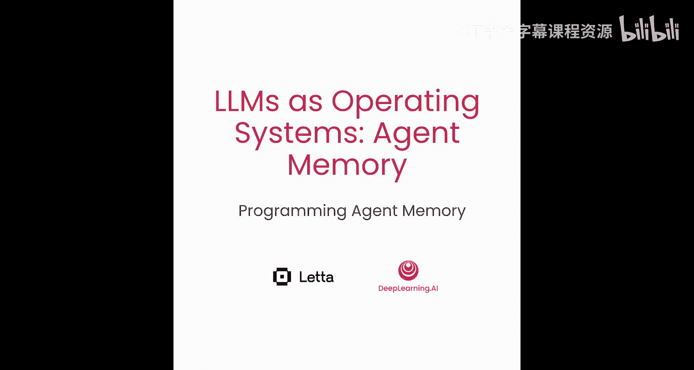
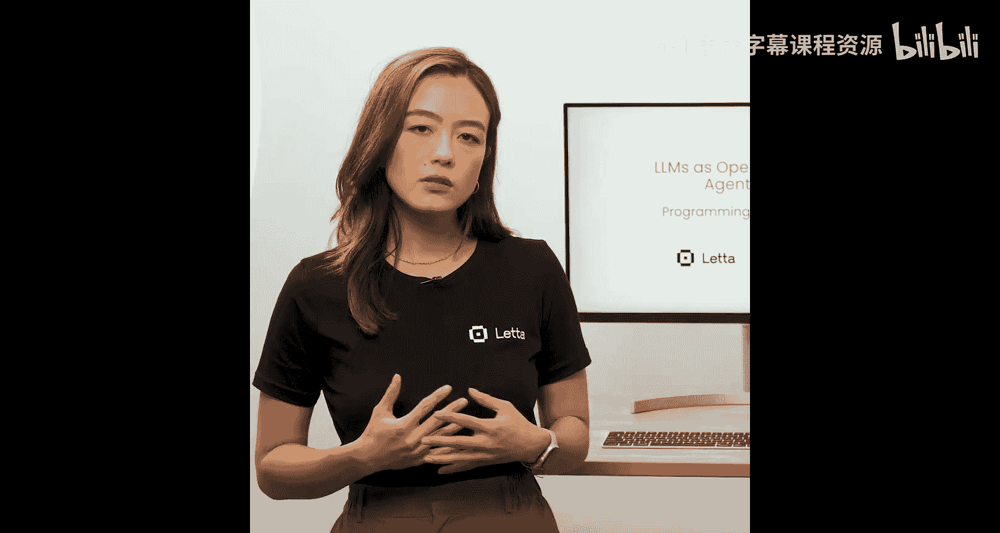
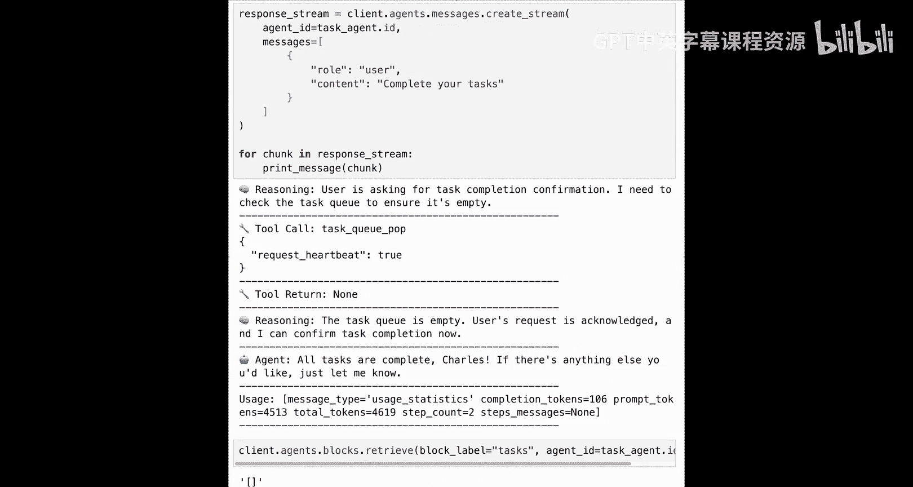

# 吴恩达《大语言模型作为操作系统代理内存LLMs as Operating Systems： Agent Memory》 - P5：5.programming-agent-memory.zh_en - GPT中英字幕课程资源 - BV1Aw5Vz8EFS

This lesson will dive deeper into how corere memory is designed and implemented。

 We'll also go through an example of how you can customize core memory with custom memory blocks and tools。

 Let's get to it。

Core memory is defined by memory blocks， which are basically subsections of memory and memory tools。

 The core memory within the context window is actually divided into multiple blocks where each block corresponds to some kind of character limit。

 which defines how much of the context window can be used up by that block。

 The block also has a label， such as human or persona， which can be used to reference the block。

 And finally， of course， the block has a value。 So this is the actual data that's placed into the context window。

 So， for example， the name is Sarah。In addition to these blocks。

 core memory also has tools associated with that memory。 So， for example。

 you might have core memory replace， where it specifies the block label in this case human。

 as well as the old content Sarah， which is getting replaced by the new content bo B data is compiled to the context window at inference time to make up the core memory context。

 So， for example， for the human block， you might have the tag that shows the section human。

 And then this tag will also include the number of characters out of the total budget that's being used so far。

 in addition to the value。 memory blocks are sync to a database and have unique Is。

 So they can actually be shared across multiple agents by syncing the block value to multiple agents's context window。

So to start， let's first once again initialize our letterta client and connect it to our locally running server。

We're also going to once again paste in this custom helper function for printing out letter messages。

 so we actually modified it this time because in this lesson we're actually going to use streaming responses since we'll have more complex Asian interactions。

 which will be many steps long， so we basically want the new steps stream back to us as opposed to waiting for them to all complete。

So in the streaming scenario， the usage statistics actually also get returned as a special message type that has a message type usage statistics。

 so we'll also print these out and then also have a big line between different steps so that we can kind of read them more easily。

So like we went over last time， core memory consists of multiple different memory blocks。

 and each block represents a section of the LLMs Con window that's reserved to storing memories related to that block。

We can create an agent that has a human and persona block and then also list out the blocks that are created by this agent so we can do this by calling the client's block list function and specifying the agent ID。

So we can see that this returns lists of block objects that have the value of the human block and then also the value of the persona block and we can also see things like the character limit that's assigned to this block。

 the agent is not allowed to make this memory block longer than this number of characters so that we can make sure that the context window doesn't overflow or become overly focused on just the in contextex memory blocks and then like we mentioned in the last lesson there's also these unique ideass which we can use to access the blocks directly from the client。

So let's go over an example of directly accessing the blocks。

 We can store this block ID by copy pasting one of these block ID strings。

And now that we have this block ID saved， we can actually also query the client。

With this block I D to get back this block as well。

 So if you want to modify this block or get this block， you can do that by passing the block I。

You can also access block by specifying a combination of the agent ID and then also the block label。

 so the block label will always be unique for a specific agent so you can't have multiple block labels that have the label human。

Blocks are represented inside of the context window in a special section of the context window dedicated to core memory。

 so we can actually also see for a specific agent what the templating is for how the blocks are shown。

 so this is actually the prompt template for how the blocks are represented。

 We can see that it has a tag that has the block label and then it also communicates through this。

 how much of the total length is being used of the limit and then of course。

 inside of the tag it also contains the block value so you can actually customize this if you want to change the way that the blocks are rendered inside of the context window。

So like we went over in the last lesson， let agents have access to tools like core memorym App place and core memorym append to actually edit their in contextex memory。

 and the way that this implementation actually works is that we're able to define tools that we attach to the agent that are able to modify the agent's internal state or blocks。

Before we get into how to customize in context memory management。

 we're first going to quickly go over how you can define stateful tools inside of Let or tools that are able to modify the actual agent state through the tool。

So a really simple example of this is this tool here， which is getting the Asian ID。

 so we pass in a special argument into the tool definition。

 so the field that has the type Asian state and we'll put this in quotes just so that we don't get import errors。

All this tool does is get the ID of the agent by accessing the agent's seat。

So we can create this tool by calling upt from function。 You can also do create from function。

 There's a couple different ways to create tools with Letta。

 but this is perhaps the simplest you'll just need to make sure that your doc string contains all the fields except you don't need to specify any documentation for agent state since the Let system will know to inject the agent state of the agent when this tool is called So we'll create this get ID tool。

So now that we've created this tool， we can create an agent that's actually using the tool so for this agent will'll make it really simple。

 it'll have no in context memory and we'll basically attach an extra tool。

 this get ID tool by passing in the ID into tool IDs。And then we can basically message this agent。

 ask it what is your agent ID。 One thing to note is that we're actually now calling create stream instead of just create here。

 This basically is telling letta we want to get back the responses as a stream as opposed to just the entirety of the response。

 which is what we are doing in the last lesson。So we can see that we're now getting back the responses。

So first， the agent reasons that you know the user wants to know the agent ID and so it calls this get agent ID tool。

 it gets back this response， which is its own agent ID。

 and then it sends back a message to the user telling us what its agent ID was and you can see at the end that we also print out this usage statistics message because we are getting a streaming response that gives us the usage information like the token usage and also the step count。

So now we've gone over or given an example of how to access Asian state through tools。

 and so now we can try defining a more customized form of in contexttex memory management by customizing the memory management format and also tools。

In this last section， we're going to create a custom taskcu memory。

 So this is going to look a little bit different than the memory that we had before where we had a human in persona that were edited by the default core memory replace and core memory append tools。

 So we're going to create custom memory management tools and then also kind of customize the format of the actual in context memory。

😊，So the first memory management tool we're going to define is task queue push So instead of having human and persona sections we're instead going to have the in contexttext memory be a list So this is going to take in the special agent state argument and then also a task description string and in order to make sure this tool gets created properly we have to provide a properly formatted do string so this will have the description push to a task queue sort to memory and then we also have to define the arguments so like I mentioned before we don't need to actually define agent state the system will know to pass that in the LLM doesn't need to know about agent state and so we just tell the LLM in this doc string about task description which is a description of the DX task to accomplish and then the return is just null because we won't return back a response for this function。

And so what actually happens for the execution of taskask you push is that we're going to actually add a new task into the core memory what we're going to represent is a list and the way we can do this is that we can actually connect to the letter client from inside of this tool and so what we can do is we can do all the same things that we would do with the client from inside of this tool so it's a little confusing the agent can also itself access the client through tools。

So by creating this client， we can then retrieve the current in contextext memory block that has the block label tasks。

 so we'll create the agent that has this later， and we can basically load in the task because this block that has the label task will also be like a JSON string list。

And then append the new task into tasks and then save back this new list of tasks by now calling blocks modify。

 and we have access to the agent state so we can of course。

 access the ID D like we did before in the other tool to basically modify this agent's in context memory。

So that will be the first one。So the other function we're going to define is task queue P。

 so this also has access to the agent state， all it does is pop out the next task from the task queue so basically removing that from the queue and then what it's going to return is the remaining tasks inside of the cube。

So very similarly， we're again going to instantiate an instance of the letter client in this tool。

 get the task task block from the incontex memory and then we're going to load in the task by loading the JSsonN string if there's nothing inside of the task and we just return none and then otherwise we take the first task into the queue and so this kind of grabs that first task and then we also then update the remaining task。

 So now we just remove the first task from this queue and get the JSsonN string from it and then write that as the new value for the in contexttext memory block for tasks and then finally we'll again return these remaining tasks。

So now that we define both of these functions， we can up both of these as tools into Letta。

 so we'll create the TaskQ P tool and then also the TaskQ push tool。

 tools that can be called inside of Letta agents。So now that we've created these tools we can actually create an agent that has these tools attached。

 so we're going to create something called a task agent which only has access to the TaskQ P and TaskQ push memory management tools So we're also going to actually override the default system prompt since we did change the way that memory is managed we have a custom system prompt that kind of describes how that's done to the agent so you can read this if you're interested。

And then for the memory blocks instead of having human and persona sections we instead just going to have a tasks block and we're going to initialize that with a value which is just a JSson dumps of an empty list and so this is a list that we're going to add to or remove things from with our tools and then we define the LM model and the embedding model。

 attach these tool IDs and then we're actually also going to disable the default tools so by passing in false for include base tools we're actually not going to add all the default tools like the core memory archival memory and conversation search tools we're only going have the task here related tools。

But we will also add the send message tool， so we do want this included just because otherwise the agent won't be able to return back assist messages。

So now we've created that agent and we can actually see what tools it has。

 this agent only has access to these three tools。And then we can also see what's inside of its memory。

 so basically reading the value of its current task block。And we can see it's just an empty list。

So now we can actually message the agent to start adding some tasks into its task memory so we can create a streaming message to this task agent and tell it do separate tasks if first start calling me Charles and then tell me a Haiku about my name and add these as two different tasks。

So we can see that we start getting the responses stream back and so it reasons that the user wants to create two tasks。

 it calls task you push on the first task， which is start calling me Charles。

Then it calls taskaskQ push on the second task， tell me a haikku about my name。

And then it realizes that now it has tasks that it needs to accomplish。

 So it's actually told in its instructions that it should be clearing its task queue。

 if there are tasks in there。 So and then it starts to go back and pop items from its task queue。

 So it pops a first task。 And now we just have one remaining task in the queue。

 And then it pops it again until the remaining tasks is empty。

 And so once it's finally cleared all its tasks。 it returns back a message。

 which is got it Charles from now on， I'll call you that。 And then here's a haiku by your name。

 And so it returns back a haiku Charles strong and wise Gen winds whisper your name。

 Star light up the night。So there's quite a lot done in this sequence of events and we can actually see we had a step count of five and a lot of tokens used up。

 which is why it's often useful to have streaming for these more complex tasks because we can actually see the progress of the Asian over time。

So the LLM is a little probabilistic， so you might have seen your agent not actually complete all of this tasks in which case you can once again message it to complete your tasks。

So you might need to do that if your task queue still has items in it in our case there was nothing left the agent did actually get everything done so you can see it returned back all tasks are complete so it didn't actually run anything。

And finally， we can also retrieve the tasks to see if it's empty and the agent has run through all of its tasks。

So we've now implemented a custom form of in contextext memory by customizing the memory blocks and also writing pretty advanced stateful tools that can actually modify the memory of the agent and also access the letter client from inside of the tool This is actually a really powerful framework for building stateful agents so you can create very advanced examples that really control the way that Inconex memory is managed and modified over time hopefully this simple task example gives you inspiration for how you could create advanced ways of managing memory for your own applications。

