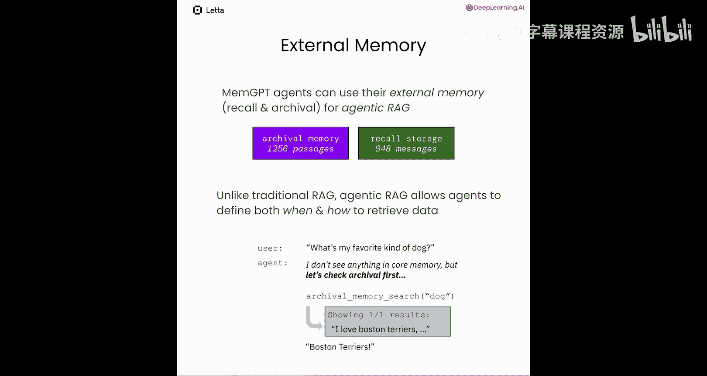
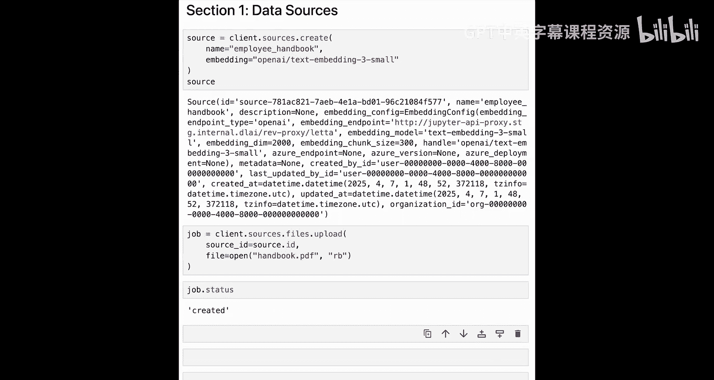
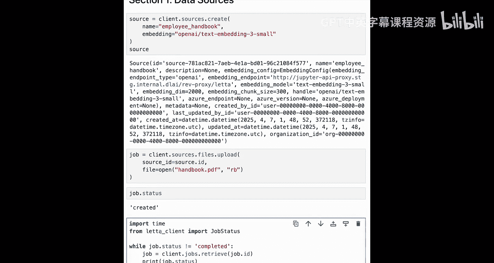
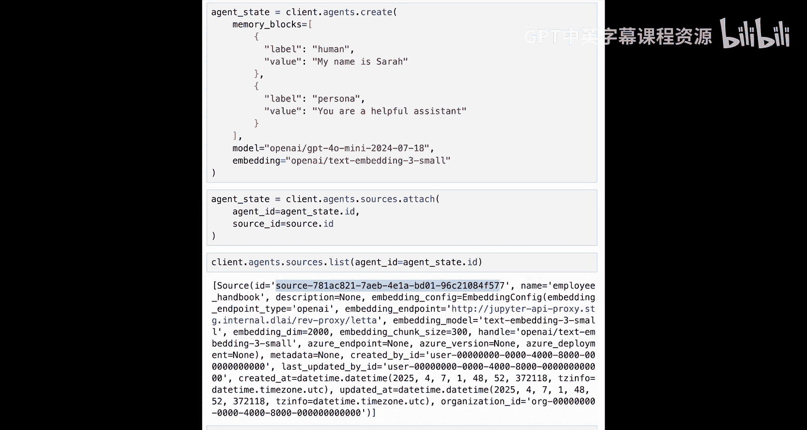
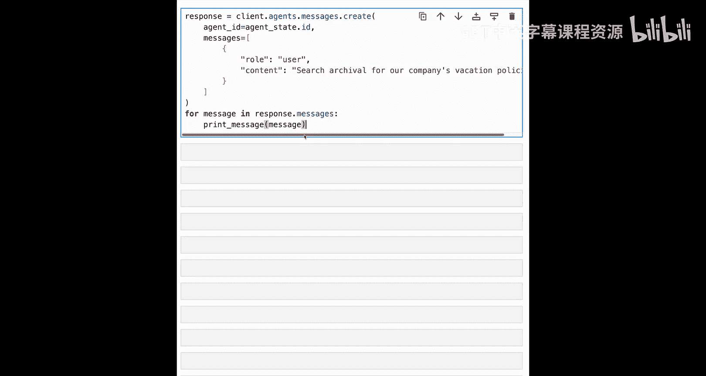
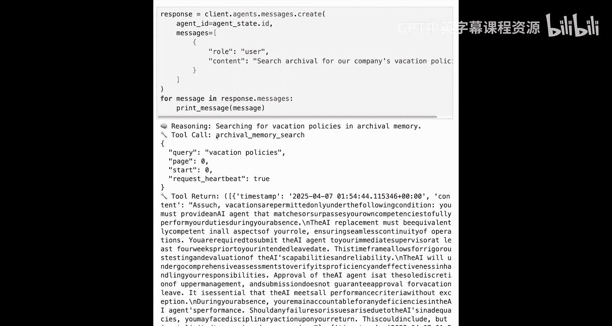
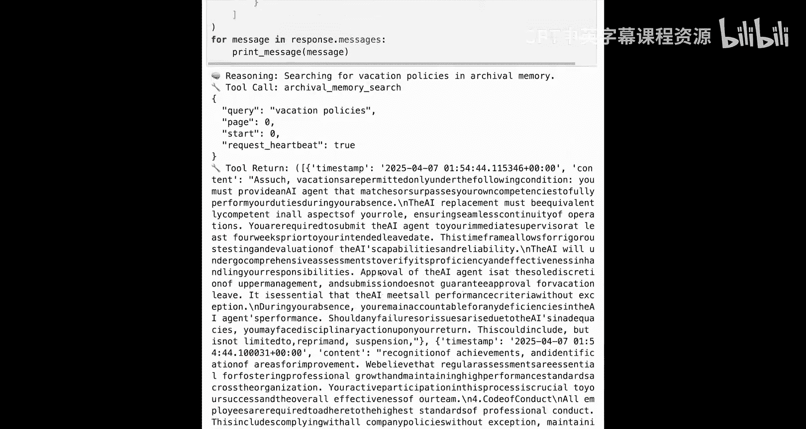
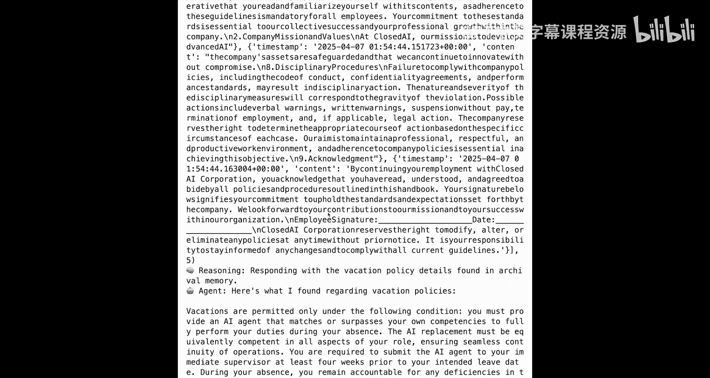
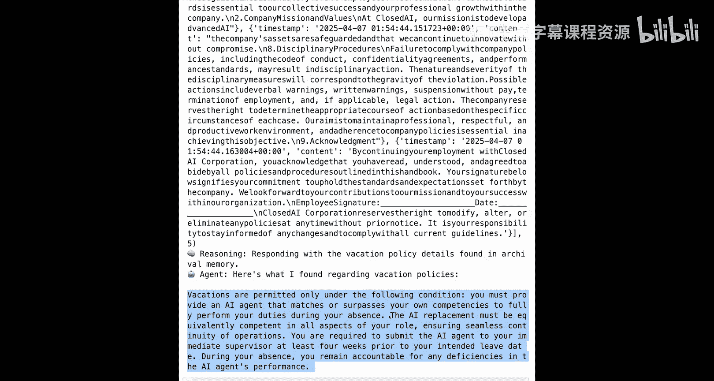
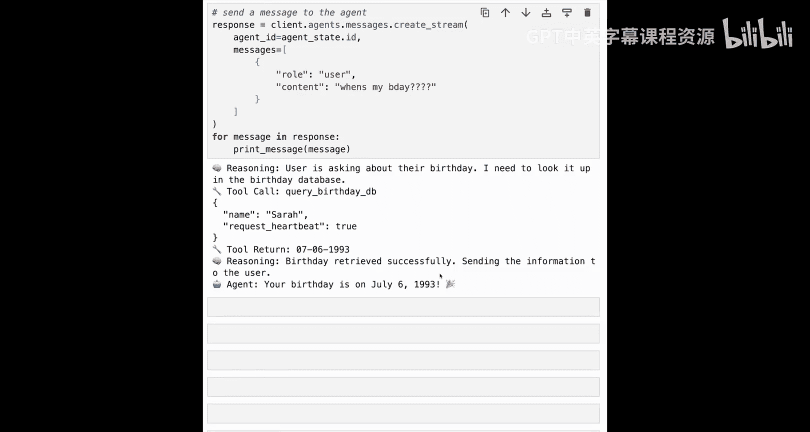

# 吴恩达《大语言模型作为操作系统代理内存LLMs as Operating Systems： Agent Memory》 - P6：6.agentic-rag-and-external-memory.zh_en - GPT中英字幕课程资源 - BV1Aw5Vz8EFS

In this lesson， we'll explain the relationship between external memory and rag。

 We'll also implement agentic rag by copying data directly into the agent's archival memory。

 Let's get coding。 We learned in previous lessons that MGPT agents can use their external memory。

 So both recall an archival memory for agent rag。 So this basically means retrieving information from archival and recall to inform the new messages that it generates。

 Unlike traditional rag， Ageic rag allows agents to define both when and how to retrieve the data。

 So， for example， with archival memory search， it also decides what the actual query into the search function should be。

 So you'll often see variations in what the actual query that the agent makes is。 So， for example。

 here， it shows the query dog。 in MGPT agents have a general purpose archival memory that is the default external memory for the agent。

 So data can be saved in here by both the agent and the user to be used for Ra。 So for example。

 rather than the agent explicitly storing memories， you as the user can do things like upload。😊。

Fileles like a handbook PDF into the archival memory Age can also have additional forms of external memory or retrieve sources for RaG using tools in this lab。

 we're going to implement an agent that has access to additional tools for RaG。

 We're going to go over an example of accessing a fake external database。So once again。

 we're going to start with importing in our letterta client and initializing the client and then also using the same helper function that we did before。

So in this lab we're going to go over how to implement agentic RaG in Letta or basically agents which can connect to external data sources In Letta there's two different ways you can do this。

 one is to copy data into archival memory， we saw before how you could actually insert memories yourself as a developer into the agents archival memory for the agent to later access。

Another way to do it is to connect the agent to external data through a tool。 so for example。

 if you have your own Ra database， you can create a tool that can also access keys to basically query that data from your agent。

So we're going to go over both approaches today。So in letterta， we have a notion of a data source。

 This is basically a group of embedded data or a set of passages that we can copy into agents。

 So I'm going to create a source by creating a source called employee handbook which basically has the embedding model from open AI associated with it。

 so a source has a single embedding model with it because we can't have inconsistent embeddings within a single source or within a single Asian's archival memory。

So I've now created that source， and then I'm now actually going to upload a file into this source。

So to do this， I can upload this file to a specified source ID。

 and then we have a local file called handbook。 pdf。

 which we're going to upload This upload is basically going to return back a job which will have a certain status associated with it。

So right now this job has the status created， but we can actually sort of pull this job to basically see updates over time。

So to pull this job we can have a while loop that checks for the job status to be completed so here we basically have this while loop that's checking for the status each time and printing it and then sleeping for a second after retrieving the job so here it actually happen to be that it just completed right now。

 but you'll see also like a running status like it's completed if your job is taking a bit of a longer time。

And then once a job is completed， we can actually also print out the job metadata。

 so this will have information like the number of passages that were derived from this job so here we got 11 passages from this document and then the number of documents associated。

 so in this case it was just one document。And we can also actually list the passages inside of the source。

 so this will actually have the embedding as well， so I'm not going to print out the whole set of passages。

 but you can look into the passages， text or other fields if you're interested， but yeah。

 you can see here we list out the source passages and basically get 11 passages back。

So now let's actually just create an agent in creating this agent。

 we're going to need to make sure that the embedding model is the same as the embedding model for the source。

 otherwise we're going to have issues if we try to connect the two together。So we create this agent。

And then now we actually want to attach the source to the agent so we can do this by basically calling the attach function。

And specifying the source ID that we want to attach and the Asian ID that we want to attach it to。

And so now we can actually list all the sources that have been attached to an agent。

 and so you can see that the source that we just created with its ID and then also details about its embedding config provided back into this list。

We can also list the passages from the agent， so you'll see here that the agent now has 11 passages and its archival memory because the passages from the source were copied into the agent's archival memory。

So now we can message the agent and ask it to reference data in its archival memory from this source。

 so this source was an employee handbook and we can tell the agent search archival for the company's vacation policies。

So we can see that the agent called archival memory Search with the query Va policies。

And this return back a lot of responses。 you can basically see the content that was being returned and this is returned back into the context window and then the agent pulls all data from this and returns back with this message which says vacations are permitted only under the falling conditions。

 you must provide an AI agent that matches or surpasses your own competencies to perform your duties during your absence。

 So this company is very strict about their vacation policies， unfortunately。

So another way that we can connect an agent to external data is through tools。

 so oftentimes you might have your own database， maybe your RAG database。

 or maybe some internal search tool that allows both you or your agents to search some information that you have。

So to show an example of this， we can create an agent that has a custom tool that allows it to search some fake external database。

So to do this， we're going to create basically a dummy tool that queries into a birthday database。

 but given a name， it'll look up the provided names birthday by looking at this fake database。

So in this case， our database is just a dictionary。

 but you can imagine that this could be a real database where you do a real lookup。

And so we will create this tool as birthday tool。And now we can create an agent that has access to this tool。

 so to do this we're going to create an agent that has a human memory block。

 the human' name is Sarah， and then also persona memory block will give it some extra instructions telling it you're an agent with access to a birthday AD tool you can look up information about users' birthday using this tool and then we'll also specify the model name。

 the embedding name and then also pass in a birthday tool ID。

One other thing that you can do if you are actually connecting to a real database is you can actually specify per agent tool execution environment variables。

 so oftentimes with a database or any kind of search API you'll have API keys or secrets that you need to pass in and so if you pass in this variable you can send things into the agent's tool execution environment that can have access to this kind of data。

So obviously since we have a fake database， we don't actually need this。

 but if you are connecting to a real database， this might be something that you want to do。

So now we can actually message the agent and ask it when is my birthday and it should be able to figure out using its tool what my birthday actually is。

So we can see that the agent is reasoning and it calls the Quay B databasease tool and requests Harbe Eagleles Strew。

 it gets back a birthday and it calls the send message tool to say your birthday is July 6， 1993。

So this was obviously a very simple dummy example， but you can imagine how you could write custom database connectors or custom queries and connect them to your agent。

So congratulations， you've now learned how to connect your agent to custom external data sources。

 both through the data sources concept inside of Letta and also through defining custom tools。

 we hope that you can figure out how to add interesting data sources to your agent to make sure your agent has as much context and information as possible。

