# 吴恩达《大语言模型作为操作系统代理内存LLMs as Operating Systems： Agent Memory》 - P7：7.multi-agent-orchestration.zh_en - GPT中英字幕课程资源 - BV1Aw5Vz8EFS

In the Let framework， Asian are designed to be deployed as services in this lesson。

 we'll go over how we can implement multi agent collaboration using tools for cross agent communication。

 as well as sharing memory blocks。 Let's have some fun。

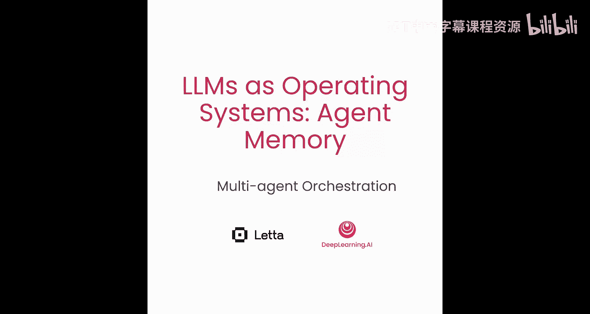

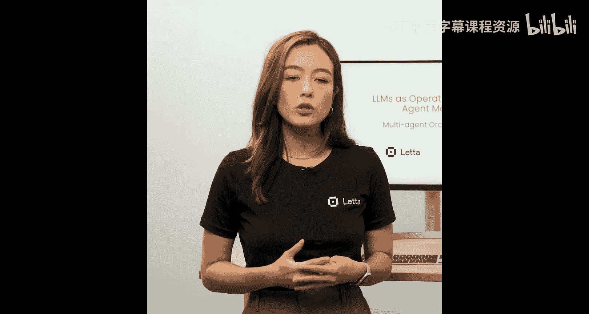

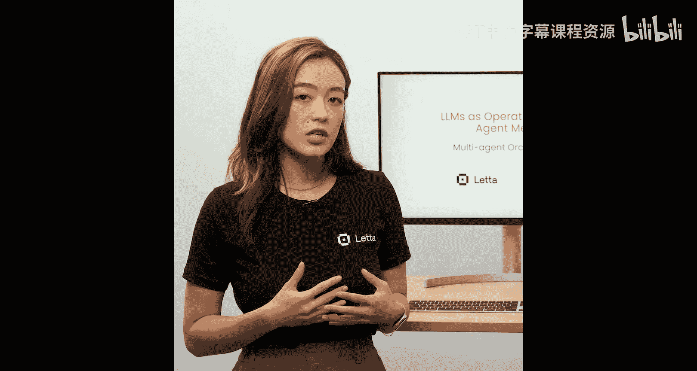

In the letter framework， agents are designed to run as a service so that a real application can communicate with them by rest APIs。

 So if you have something like a mobile app that's using a chatbot。

 that mobile app will send rest API request to some kind of let server that's backed up by a database and then that server will return back a response that the mobile app can then use So how can we have multi- agentent collaboration when we have agents running as separate services and we want them to coordinate and communicate。

 So one solution is to have the agents themselves send each other messages。 So for example。

 you could send a post request from an agent on one server to another。

 Another option is to have shared memory blocks。 so you can have blocks that are in a shared persistent data store and then have agents have synced memory blocks across different services。

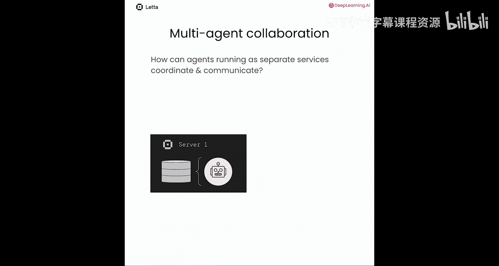

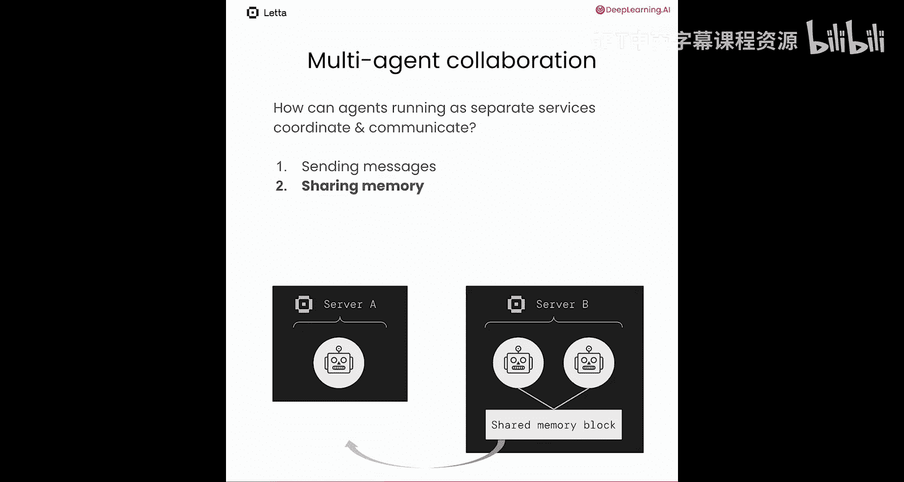

In this lab we're going to go over how to implement multi agentian collaboration using Letta We're going to do this by essentially implementing a multi agentent recruiting workflow for evaluating leads and drafting personalized outreach emails so we're going to have two different agents an evaluator agent that evaluates lead candidates and then also an outreach agent which drafts personalized outreach emails these two agents are going to be able to communicate and coordinate with each other to work together。

These agents will also have shared memory， we can essentially implement this by creating a shared memory block that is attached to both agents。

 and this shared memory block will basically store memories about the company that the Asians are working together to recruit for。

So as always， I'm going to create my letter client to connect to the running Let service。

And then I'm also going to paste in a helper function for printing the message。

 so we've used this already in other lessons， but I'm also going to add in a print for the type system message and then also since we're streaming also make sure to print use statistics when that's returned back into the streaming messages。

So before we create our agents， we're going to first create their shared memory block。

 so this is basically a block that we can create directly through the client that will be attached to both agents so that the agents can have shared memory。

So this block is basically going to have a value which is the company description。

 so the company is called Asian Dos and is deploying AI tools to make it easier to create and deploy LLM agents。

 and then we can use the client to create this block。

 so we'll pass in as the value the company description and then also have the block have the label company and then also a limit of 10000 characters。

So I can print out this return block object to see that it also now has this unique ID so we can now reference this block either to modify it or to retrieve it later on using this unique block ID with the client。

😊，So now let's create our two agents， so in this setting we're going to create both an outreach agent for drafting emails and then also an evaluation agent for evaluating different candidates。

The first station， which is going to be the outreach agent。

 is going to have access to a draft candidate email tool。

 so this is basically a tool to write out an email draft in the content field so that we can later review it or decide to send it。

So we'll create this tool with the same up from function tool that we've used with the client before it。

 and so this will basically instantiate a letter tool on the server。

And now we can create our outreach agent， so we're going to give it basically a persona that kind of gives it some descriptions about how it should be acting so we say in the persona。

 you're responsible for drafting emails on behalf of a company with the draft candidate email tool candidates to email will be messaged to you so we'll kind of go over this a bit more later but strong candidates will be sent to this agent from the other agent so that this outreach agent can draft an email for that candidate。

So we are now also creating the agent from the client so we'll pass in the name outreach agent。

 we're also passing one memory block for the persona that has the label persona and the value and then we're actually also attaching the block that we created before so we don't actually pass in the block here because the block has already been created we instead pass in the block ID to tellletta that this block ID that we previously made be attached to this agent and the data inside of this block should be contained within this agent's context window。

And then of course， we also set the LM model and the embedding model and then also pass in this tool name。

 you can also do this by passing in the tool ID into tool IDs。

So now we're going to create the evaluation agent so this agent will have a tool which is a reject tool so can reject a candidate so decide not to email a candidate and we're going to create this reject tool first so we can attach it to the agent and for this agent we're going to construct a persona for it so the EV persona that tells it we are looking for this set of skills so things like frontend and software engineering experience with LLMs so ideal candidates should have these skills and these weaker candidates that don't match these skill sets should go through the reject tool and strong candidates should be sent to the agent with the ID of the outreach agent that we just created so by passing in the outreach agents ID into the persona we're telling this agent which other agent should do message in order to communicate that this candidate is strong and we want to draft an email for them。

So now we can actually create the Eval agent。 So similarly to the other agent。

 we're just going to provide one memory block for the persona with that EV persona we just made。

 defining the model and the LM model and the embedding model we're attaching the reject tool。

 So this time we're just passing it in with ID you can again also do this with name and then we're passing in by name the send message to agent and wait for reply tool So this tool is actually a Letta builtin tool It allows the agents to message other agents running on the same server by specifying a message to send and then also the ID。

 So this eval agent will know the ID of the other outreach agent because we pass the ID into the persona you can also actually define tools like this yourself So in previous labs we've defined tools that connect to the client and interact with the client so you can of course create your own custom cross messagingsaging tool by using the client but Letta also provide some。

 which is what we're using here。And then we're actually also going to set include base tools to false so like we mentioned previously。

 letta agents will by default have a bunch of tools related to sending messages， memory management。

 etc ce， but for simplification we're just going to set this to false so this agent is more limited in scope。

And then like the other agent， we're also going to attach the company block ID so that this information is in its context window。

And then finally we're actually going to specify something called tool rules。

 so this is kind of a way to constrain the agent's behavior in this case we're asking the agent to basically exit the loop so to terminate execution after it calls to send message to agent and wait for reply tool so this basically ensures that we don't get the agent looping once the agent does send that message to the other agent it stops。

So you can see that because we set include base tools to false。

 this agent actually only has two tools， the reject tool and the send message to agent and wait for reply tool。

So now we can actually send some resume data to the agents。

 so we're going to read this resume from the local file system for a candidate named Tony Stark。

Then we're going to send this resume data to the EVval agent directly。

 so we're going to send this message to Eval agent with this ID and provide the content。

 just please evaluate this resume with the resume data that we just read。

And so we can see that the agent reasons it's evaluating Tony Star's profile seems strong。

 and so then the agent decides to send agent way for reply to this other agent。

 so provides information about the candidate name and any other information that might be relevant and it decides to send this to the other agent with this agent ID of the outreach agent。

 so it knows this other agent ID because we provide it in the persona so it's able to reach out to this other agent。

And we can see that this agent actually returns back a response。

 so it's able to call the send message tool and return back this response。

 which is this drafted email。And so we get back this tool return response。

 and then finally we print out the total usage statistics。

So this is step count1 since the Eval agent only made one step， but there was of course。

 another step that was made by the other agent that was doing outreach。

We can of course also see the list of messages are the events that happen from the outreach agent side。

 so to do this we can list out the messages for the outreach agent ID we're going to skip the first message since this message is basically just a system prompt send to the LLM provider so the other messages are kind of what's actually in its history。

And so you can see that there's a couple messages here。

 these are basically what we call the initial message sequence to kind of give some in context examples to the agent。

 you can of course change this if you like， and so we see here that there's a system message so this is basically a message that this agent received from the other agent that has this incoming message from this agent IDD。

And it also provides a hint that this agent should make sure to call send message at the end to reply back to this agent。

 and then we see this content about Tony Stark that was sent by the other agent。

And so after it gets this alert， the agent decides to call draft candidate email。

 so it drafts this email。

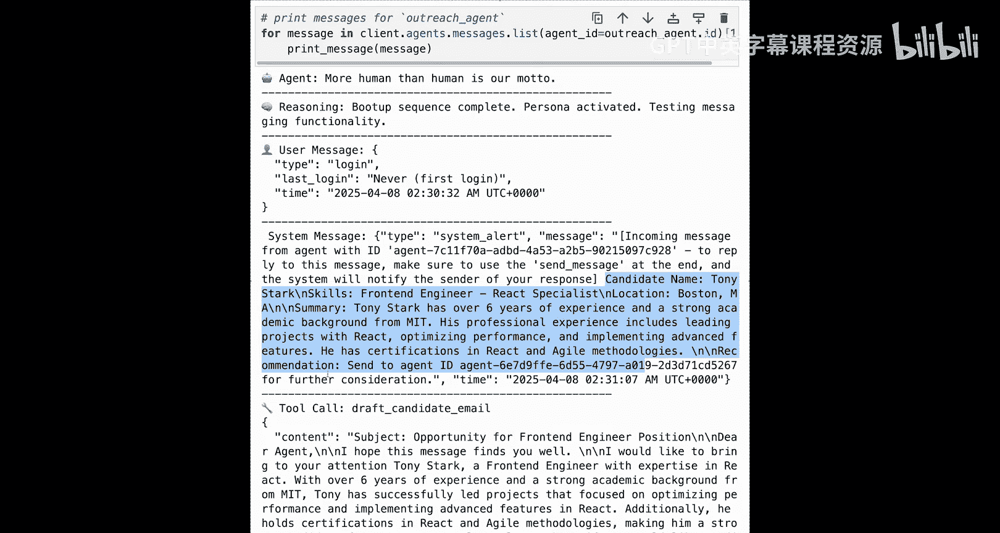

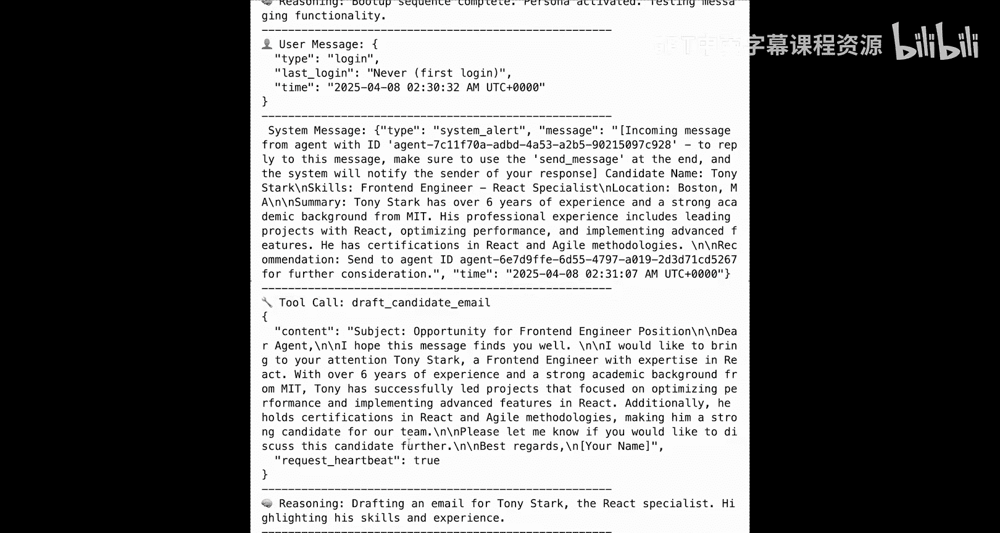

And then it returns back this drafted email and then also sends this message as a send message tool back to the other agent。

 so you can see that here it's writing the send message and so this was what was actually shared to the other agent。

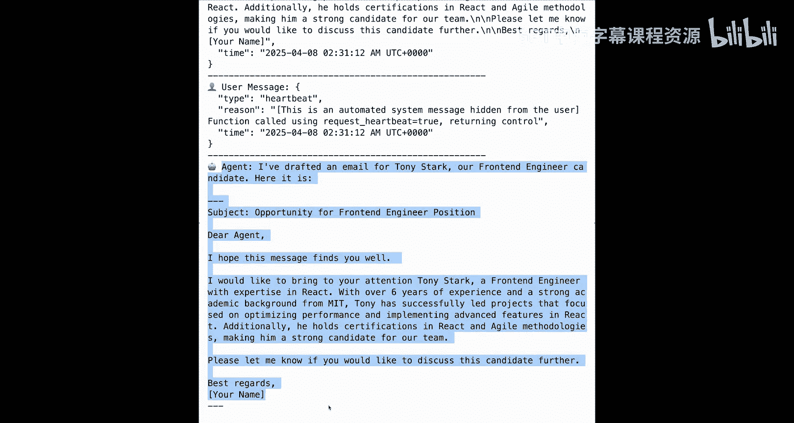

So these agents also have a shared memory block which we created at the beginning。

 so what this means is that if either agent edits this block。

 then those changes will be reflected on both agents so for example。

 we can send a message to the outreach agent basically telling it you know the company has actually rebranded theletta。

From Asian O， and so the agent basically calls the core memory replace memory editing tool to replace Asian OS with Letta and confirms that and sends a message。

And so unsurprisingly， now if we retrieve the memory block of the Eval agent。

 it now says Letta instead of Asian Gos。But if we also retrieve the memory block of the outreach agent。

Then we can see that this also says now even though the outreach agent did not edit its memory。

 its memory now says that the company is called Letta。

 and this is again because each of these blocks is actually the same ID。

 so they both have you can see here like matching IDs so both of these agents。

 their context windows are in context memory is synchronized to the same memory block。

So we just went over how you can create multi Asianian coordination through tools。

 but often simple the way to do this is to actually use the multi agent group abstraction inside of Letta。

So before we get this set up we're actually going to once again load in a print message multi agentent tool。

 so this is very similar to what we had before， but we're actually going to also print out the message do name field so in a multiagent setting there's obviously multiple agents that are talking so we use the name field to distinguish between multiple agents which will have different names。

So we're now going to recreate our agents， so this is exactly the same agents as before。

 except this time we don't need to provide any tooling to allow the agents to chat with each other。

 so you might recall before that we had a special send message to other agent tool that allowed the EVval agent to communicate with outreach agent but we're not going to use tools this time。

 we're just going to create these agents separately。

And now we can place both of these agents into a multiasian group。

 So this is a very simple multiasian example。 we're basically just doing round robin between each of these agents in order。

 but this basically will group the agents together and so they'll have a single group chat so a single message history that's all shared。

 so both agents can see the other agents's messages as well as the user messages in a single thread as opposed to in the other example。

 each agent had its own thread but they can communicate to each other via tools So let's now try reading another resume。

 so basically a resume for a sponggeebob Square pants。😊。

And so now we can actually message the group with this content。

 so the messaging a group is very similar to messaging an agent， it's almost exactly the same API。

 except the only difference is instead of specifying an agent ID we're just specifying a group ID so we're basically just grabbing this round Robbin group and then passing in its ID。

And we're going to send this message， which is a user message and then just the content of the resume。

 so very similar to before， except we're just messaging a group。

So we're now printing out the response stream from the group and you can see here that we're printing the name of the agent so basically who said this or who had this reasoning message so we can see that the Eval agent decides rejects Sponongebob Square pants and again this is all kind of in the same group chat so both agents can see messages in here and so this eval agent completes and then this outreach agent actually decides to draft a rejection email to Spongebob Square pants So again。

 because this agent is able to see the entire message history of the other agent。

 it decides to use draft email tool。

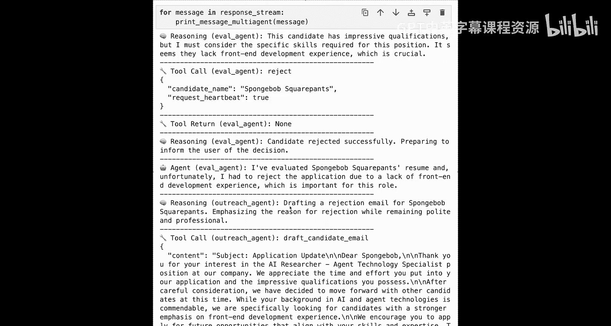

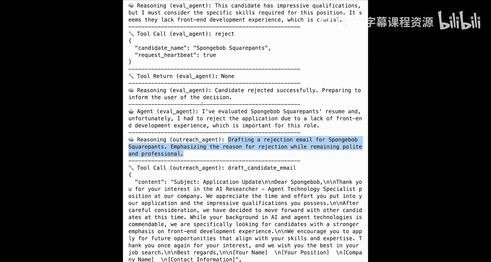

And then it sends out this message and then does reasoning。

 and then finally the outreach agent also sends a final message。

 which is just telling us that it drafted a rejection email and at the very end we get the usage statistics of what all the agents did。

You can maybe prompt this to get the outreach agent to not send an email at the end。

 but in this case， the agent decided to use this tool anyways。

This is just another way to do multi agent， depending on your use case。

 you may want the agents to share a group chat or you may want them to have separate threads and only communicate when necessary。

So congratulations， you've now created a multi agentent collaborative setting in Letta in two different ways。

 both with having a group chat and then also through multi- agentent tools。

 you've also created agents with shared memory so that they can share memories about the same concepts。

 whether it's an organization or user or other things that you might want to add to your agents。

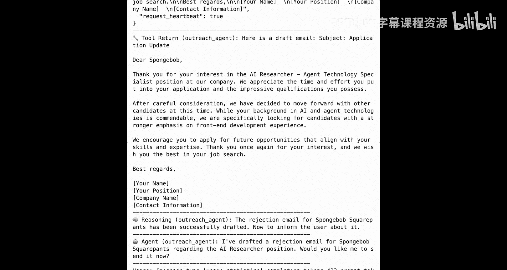