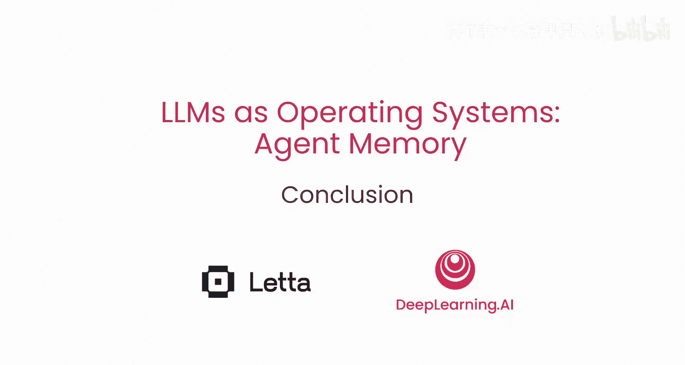
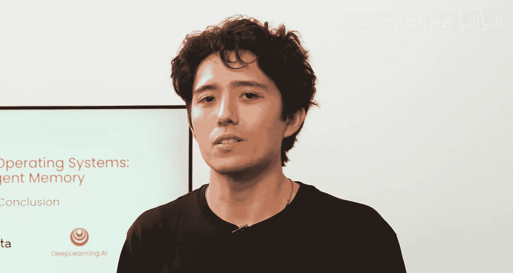

# 吴恩达《大语言模型作为操作系统代理内存LLMs as Operating Systems： Agent Memory》 - P8：8.conclusion.zh_en - GPT中英字幕课程资源 - BV1Aw5Vz8EFS

Congratulations in this course， you've learned exactly how an LLM。

 a simple text generator can be used to create complex agentic memory systems through an LMOS you now have the tools just like your agents to build LM applications that can leverage virtual context。

 extended memory far beyond the finite context window of LLMs We're looking forward to seeing what you build on your own。

