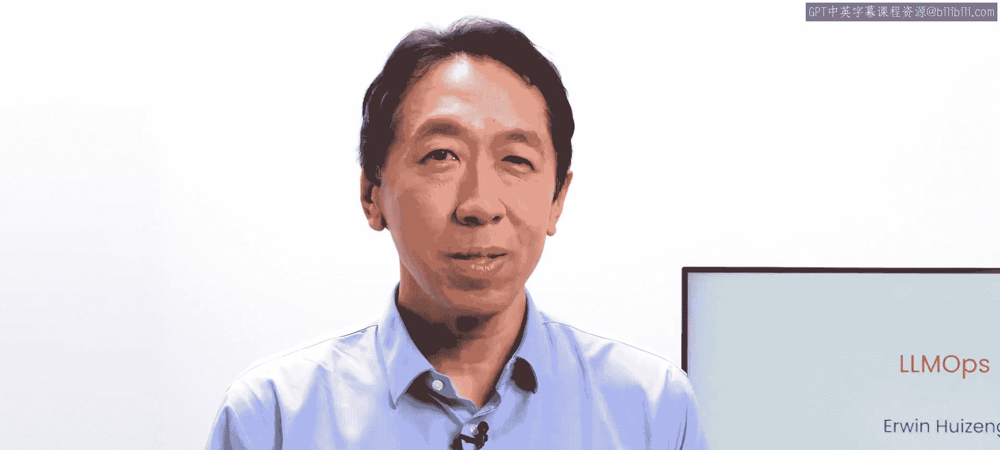
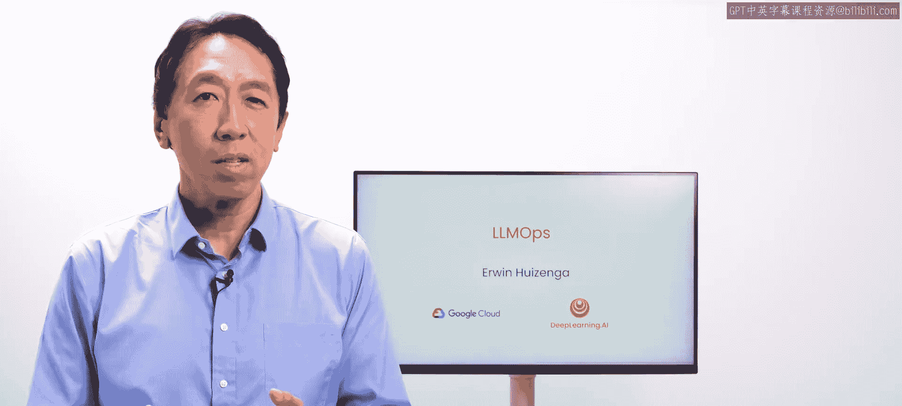

# 吴恩达《大语言模型运维｜LLMOps》中英字幕 - P1：1.Introduction.zh - GPT中英字幕课程资源 - BV1jC4y1C7Lb

Welcome to L M Ops built in partnership with Google Cloud and taught by Irvin Hausener。

Say you design and deploy 1 OM based use case， such as summarizing customer emails。

 and it takes you a few weeks to do that。That Pra took a bunch of work to select the large language model to build on。

 which might mean trying a view to see what works best。

 then tuning the prompts and setting up an evaluation framework deploying and then monitoring performance as you build an application having automated ways to deploy and monitor will make your life easier and if you need to update this application。

 maybe because the LM provider is deprecating the model you had built on and so you need to switch to a new LM having tools that help you migrate in tests will also simplify your workflow Now that you built your first application whether your team is so impressed with your summarization application that they come back and ask for five more use cases like classifying emails。

 routing emails and so on where you have to do five times the work of the original project。OMOs。

 which is an extension of ML ops or machine learning operations to applications built on large language models describe the processes and tools to automate the cycle of data preparation。

 model tuning， deployment， maintenance and monitoring Take just the example of prompt management。

When designing prompts， it can be very helpful to have an automated way of evaluating and comparing the performance of different prompts and also updating the prompt if needed。

 such as if the underlying LM changes。In addition， if your application uses multiple OEM calls。

 for example， chaining multiple steps and processing together may be using an orchestration framework like Land chain。

 then managing the dependencies also as additional complexity。In this course。

 you learn the latest best practices for how to manage all this complexity。

I'm delighted to introduce the instructor for this course， Irvin Hausener。

 who is a developer advocate in machine learning at Google Cloud and has deep experience with LMOs。

Thanks， Andrew， I am excited to work with you and your team on this。 In this course。

 you learned how to build an end to end workflow for your large language model based application。😊。

Specifically， you learn how to prepare data for tuning a large language model。

 say using some sort of path or parameter efficient fine tuning。

You also learn how to automate and orchestrate the LM tuning workflow for multiple use cases。

 including when you have huge text dataset sets that might be too large to fit in memory。

 you learn how to deploy your model as a rest API and call the API if you don't know what the rest API is don't worry about it Irvin will cover that too and you also learn how to build an overall LM Ops workflow。

Irvvin will go through how to use CholeL for data preparation。

 open source tools for orchestration and automation and vertex AI to deploy your model for production。

 The rapid advancements in generative AI and large language models have ignited a search of creativity and innovation within the developer community。

😊。

This means more and more use cases that developers have to build and manage。

 effective management and operational strategies become really important if you want to ship your code to real users and do so efficiently。

Building AI applications has become easier thanks to developments like foundation models as APIs and open source LLMs Now it's possible to build many different use cases quickly。

 so rather than carefully planning out something you might even build multiple use cases。

 but this complexity or dare I say pain of managing and scaling multiple projects can be quite high unless you have good LLM ups doinging and processes to make them efficient。

So through this course， I hope youll also be able to manage your AI production use cases more efficiently。

 no prior MLOs knowledge needed。Many people have worked to create this course。

 I'd like to thank on the Google Cloud side， Nakita Namjehi。

 whos taught other short causes with us and Dave Elliot， And from the deep learning of the AI team。

 Edshu has also contributed to this course In the next video。

 Irvin will give an overview of the key ideas of OM ops。

 If you've heard of Ml ops before and is fine if you haven't。

 you also see what the key differences are and why Lm ops is pushing us beyond what machine learning had previously done before large language models。

 Let's go on to the next video to get started。

