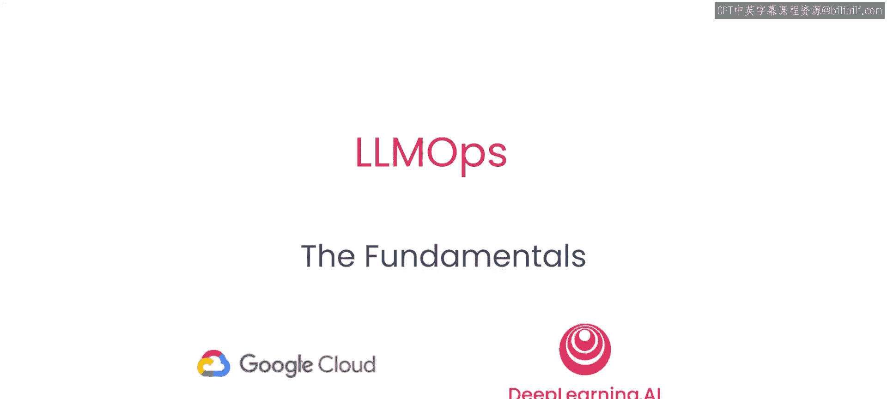
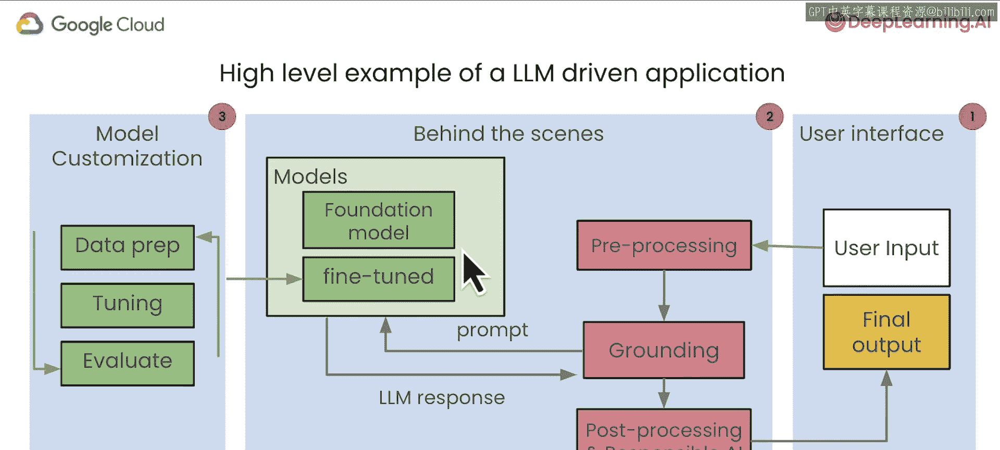
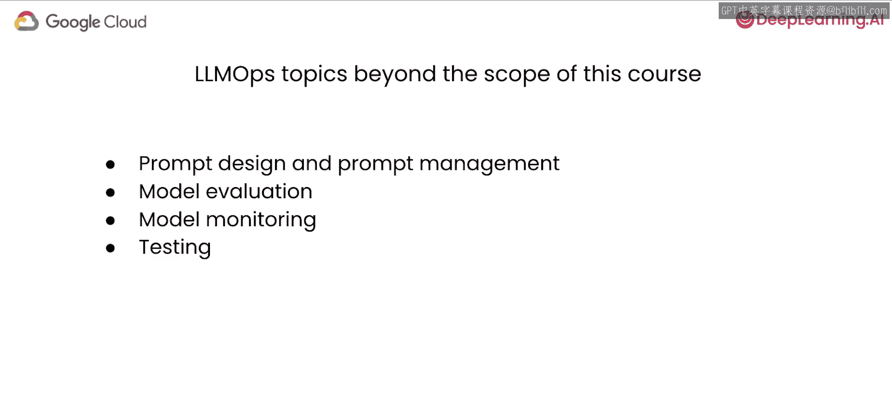

# 吴恩达《大语言模型运维｜LLMOps》中英字幕 - P2：2.The Fundamentals.zh - GPT中英字幕课程资源 - BV1jC4y1C7Lb

In this lesson， you will learn about the concepts and ideas of LLMOs and how it's similar and different to MLOs。

 In this first lesson， you will learn about concepts like data management， automation and deployment。

 Let's dive into it。

Let's start with vish machine learning operations。 Ml Ops is an M L engineering culture and practice that aims at unifying M L development de。

And ML L operations ops。Automation and monitoring at all steps of the M system is crucial with automating meaning。

 maybe if you have a use case where you want to deploy a large language model。

 you want to automate the process of data engineering。

 training or tuning our model and deploying it as an API in production once you have it in production。

 of course， you want to monitor how your LLm performs in production。

 at all of these steps of constructing an Ml system。

 you need to think about things like how do I integrate these steps So how do I go。

 for example from data engineering to tuning a model and to deploying it。

 How do I test not only my endto end workflow， but also each of these steps。

 how do I release a model or my code， how do I deploy it as an API。

 And if you want to train or tune my own custom model。

 and I want to use specific hardware like GP use or T use， how do I manage this。

Let's dive a bit deeper into what does the machine learning operations workflow look like。

 Let's have a look at the ML ops framework that you might be familiar with。

When building an ML use case maybe bringing a large language model into production。

 you have to go through different steps。 First， you might want to think about data ingestion。

 How do I take data from my application datas or other databases that I have how do I validate this data maybe check if there's any missing data or anything wrong with my data that I have to fix in the data transformation step。

 data transforming， meaning maybe I'll take my text data and convert it into a format that large language model can understand or deal with missing values Then you might want to train your model or tune your model。

 you need to do model analysis so you need to evaluate your model and understand how it performs on your data。

 then you need to think through how to do model serving and what fits for your use case and of course you want to lock all the metrics related to your model in production。

 We'll focus on the one in blue in dis course You might think now when you build。

A workflow like this that you don't want to run through each of these steps manually。

 meaning that you don't want to execute each step manually yourself。

And then go to the next step and execute that one and so on so forth。

 That is very time consuming and not very efficient。 So how can we help with this。

 So this is where automation and orchestration can help Ortion。

 meaning you telling the system which step needs to be executed first which one after and so on so forth。

 So meaning that you go from data ingestion to data validation all the way to serving your model automating meaning that you automate this process You can understand that this is a very one dimensionional process So per use case So let's say you want to build a large language model that does summarization for that use case you will build a workflow like this。

 So it's very one- dimensionmenional how are things different when it comes to Mops for large language models Well。

 there are two things that are different first Mops for LOms also called Lm ops is focused more narrowly on everything related to the LLm。

Development and how to get it running smoothly in production。

 Llm system design is looking at the entire application。Which may include things that the front end。

 backend， data engineers。And mobile app developers may build。

 Let's go through a few examples of what are these difference between Mlops for Llms and Llm system design。

 when dealing with Mlops for Llms， you might have to think through how do you do experimentation。

 There's many great models out there。 There's many great foundation models out there like palm or Lama。

 you might want to experiment with multiple foundation models to understand which one is a good fit for your use case。

 Let's say summarization， then you might design multiple prompts。

 And then you have to think through how do you manage these prompts during experimentation。

 but also when you use prompts in production。 you might want to use supervised tuning。

 So let's say you want to tune your own model for your summarization use case。

 Maybe the palm API works out of the box for you。 but you want to improve it by using supervised fine tuning on summaries。

 Of course， we also need to think through monitoring or LLMs in production。

And how do we evaluate LLMs。 Evalu LLM is still a topic where there is a lot of research。

 So the way you evaluate your LLM might change over time。 when we look at LLM system design。

 There's other things that we have to think about， Like if we're building a summarization use case。

 How are we going to change multiple steps together。

 So let's say we have a lot of documents we want to summarize too much for the LLM to process at once。

 So we have to summarize in batches。 So we have to change multiple steps together。

 maybe we also want to do grounding to make sure our LLm has additional information to get you to the output that you desire。

 and maybe we want to track history。 What are some of the summaries we created in the past and how did they perform。

 All of this is related to LLM system design。 Let's look at a high level example of a LLM driven application。

 Everything starts with a user interface。 So how does a user interact with the application。

User input goes to your backend。 So what happens behind the scenes。

 So what you can do is you might take the user input and do some preprocessing。

 Let's take the example of summarizations here。 let's say it's a lot of information。

 you need a summarize。 you might want to chunk it in smaller pieces and send it bird chunk into your Lm。

 This is where you can use preprocessing when you done your preprocessing。

 you might want to use some grounding。 So grounding your Llm and some facts。

 these facts you can include in your prompt and your prompt goes into your model。

 you might want to use a foundation model out of the box like the poem API or ama model。

 when you get the response of your Lm。 you might want to do some grounding again。

 So check the response against the facts that you have once we have done our grounding。

 you might want to do some postpro。 you maybe want to clean up response and give it a structure that is user friendly。

 you might also want to include。Think about responsible AI。

 we want to make sure that we built AI responsibly。

 maybe you want to check for toxicity or any bias any response of the LLM。

 anything that's important to you and your use case once we have output we're happy with。

This is what goes back to the user and the user sees the final up。

Maybe you want to tune your own custom model。 So you want to do model customization。

 When we do model customization， you have to go through the process of data preparation。

 tuning a model and， of course， evaluating an understanding how your tuned model is performing on your use case。

 and， of course， this is an itererate process。 you might want to do this a couple of times。

 until you have a summarization model that you're happy with。

 Once you have a model you're happy with。 you can deploy that model into your production environment and you have a fineted model you can use in your Lm driven application。

 This is an example workflow。 and， of course， depending on your use case。

 maybe you have something else and summarization depending on your requirements and your use case。

 you might have a different use case than summarization。 you can take a different approach。

 So this can look totally different for your use case。

 in this course will focus on the ones that are in。 So we'll focus on how do we operate。

RateAnd build a model customization workflow。 And how do we deploy that into production。

 and how do we send a prompt and consume the output of that model。

 Let's look at that in bit more detail。

Let's look at a LLM ops pipeline and let's use the example that we're going to build in this course。

 Of course， everything starts with data。 we're going to start with preparing our data sets and we're going to version our data sets so that we can keep track of the data sets that we created Next。

 we're going to design a pipeline。That's going to do supervised tuning of a large language model for us。

 And this might look like a simple box。 A lot of great things happened in his pipeline。

 and that is automated for us。Next， we're going to generate an artifact to see this as a file。

 and this file has information on our configuration and workflow。Basically。

 the workflow is the steps of our pipeline， first step A， then step B and step C， so on so forth。

The configuration is the configuration or the parameters that we're going to use to execute the workflow。

 For example， which data set are we going to use for this supervised fine tuning。

 This could be one of our configuration parameters。 Once we have generated our artifact。

 we can go and execute a pipeline， this pipeline will also deploy a model for us。

 It will deploy the LLM。 once we have the LLM deployed。

 We can get predictions from it so we can use prompts to get a response from the LLM。

 Once we have the response of the LLM。 We can use response AI。

To check the safety using safety scores， two essential topics for LLM ops。Our orchestration。

 So we're going to talk about how you can orchestrate a pipeline。

 meaning maybe you want to do data preparation and prepare a dataset set first before you do supervised tuning before you deploy a model。

 So you're going to orchestrate the steps in your pipeline。 Now， once we have that pipeline。

 Secondly， we want to talk about automation and how we can automate our pipeline to make our life easier as developers。

 This LLM ops pipeline is a simplified diagram。Depending on your use case， on your requirements。

 this can differ。LLM topics beyond the scope of this course。

 There's things we can't cover in this course。 things like prompt design and prompt management。

 So how do you deal with your prompts when you're experimenting and how do you deal with prompts in production。

 How do we evaluate a large language model when we're experimenting or when we have it in production。

 We'll briefly talk about model evaluation， but will not go in extensive detail。

 How do we monitor our LLM in production， or how do we do testing of our LLM system or application。

 These are some of the topics you can look into after this course， As mentioned。

 we're going to start with data preparation。So the next lesson， we're going to prepare our data sets。

 See you in the next lesson。

