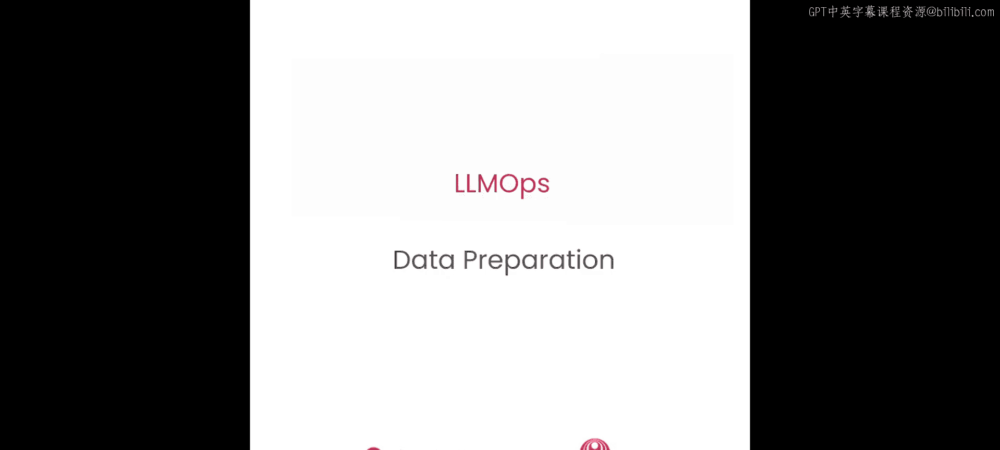
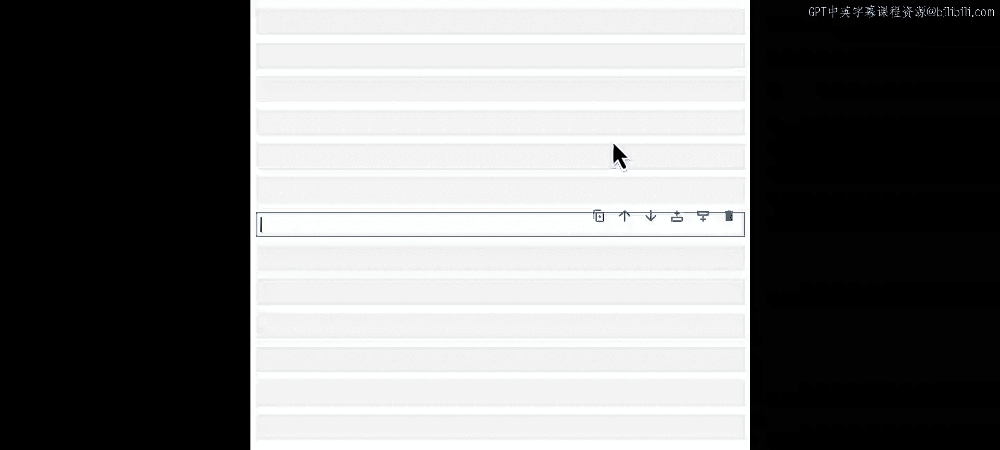
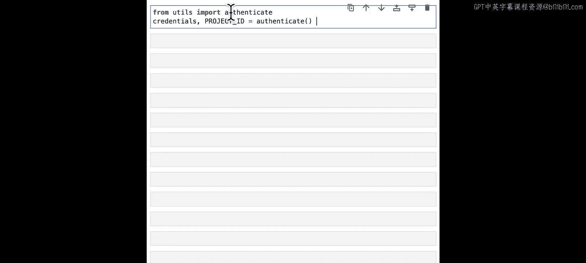
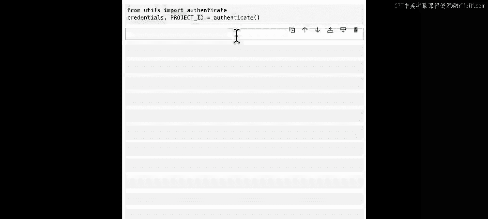
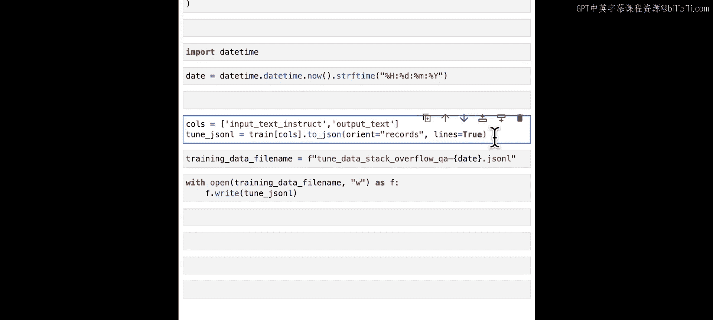

# 吴恩达《大语言模型运维｜LLMOps》中英字幕 - P3：3.data preparation.zh - GPT中英字幕课程资源 - BV1jC4y1C7Lb

One of the key steps of LOR Mops is dealing with text data and lots of it。

In this lesson， you'll learn how to retrieve tech overflow text data from a data warehouse。

 dealing with data that is too large to fit in memory using SQL and modify the data to tune a model to be more task specific。

In order to run this lab， we have to go through some setup code。 We have to set up authentication。

 We have to say， this is who I am。 and I have permissions to access this service and the data in the cloud。

 We also have to set up a project。 So a project organizes all of your cloud resources。

 and all of the data lives inside of our project。 So let's get our authentication code。

 And in this authentication code。 The credential variable is what authenticates us。 Next。

 we have to set up our region。 A region is where you will run your resources。

 So let's say you have to run in a data center in Singapore。

 Then you'll select Singapore Azure region。 In this example。

 we're going to use US central1 as our default region。 Okay， next。

 we're going import the vertex AI library。

This is the SDK， and this SDK lets us interact with the vertex AI services in the cloud。

We're going to initialize the vertex SD using the project at the region and credentials that we just set up。

 Now that we should be good to go。So let's dive into the data。

 So I want to stay as close to reality as possible。 So in this example。

 we're going to use a data warehouse。 A data warehouse is a central repository for storing and analyzing large amounts of data from various sources。

 It is used to gain insights and make informed decisions。

 You can take your data from application databases and bring it to your warehouse and make it available for a teams to use。

 We'll be using BQu。 BQu is our data warehouse and a serverless。

 so we don't need a managed service plus it lets us use SQL。😡，Wait， what SQL？

Isn't that very old school， Well， let me explain this。

 So we're using SQL because SQL queries can efficiently process large amounts of data。

Making a good choice for tasks that require high performance。Plus。

 it's great at cleaning and doing data preparation。 You might have used pandas。 So SQL versus pandas。

 So pandas is great if the data fits in memory on your computer。

And SQL is great if your data sits in a data warehouse and you might want to process at scale。

 SQL Pro data warehouse is a powerful tool， as we discussed when building Ml op systems for large language models。

 We want to make sure it's scalable。 Okay， let's get started。

 in order to interact with our data warehouse。 We again have to initialize a library。

 We're going to use the Big client。 and we're going initialize it in the same way as with a vertex AI client。

😊，So we're going to import a B library。 and then we're going to initialize the project and make sure we're using our credentials in this lab。

 we're going to use the stack overflow public data set。

So stack overflow is a data that has questions and answers and metadata related to stack overflow questions。

 The hierarchy is like this。 you have a data， the stack overflow data set and within this data。

 we have tables with different types of data tables in a data warehouse or organized collections of data。

 So the first question you might have is what data is available for us to use right if you're going to do parameter efficient fine tuning for a model later on。

 what data is there for us to use let's explore the data。Esh mentioned we're going to use SQL。

 so we're going to use SQL to query the data warehouse。

 and what we can do is we can use SQL also to go through the data and to return all of the tables available within this data。

We can select the table names。From BigQuery public data stack overflow。

 and we can return the information schema and the table names。

 so we only want to return the table names in order to send this query to the data warehouse。

 We're going to use the client that we just initiated。 So the BigQury client takes in the SQL query。

 send it to the API of the data warehouse。 and we'll return the data set in our notebook instance。

 So next， what we're going to do。 We're going go through the result。

 and we're going to print each of the row， which is a table name。

So that we can see which tables are available。 So for row in the query job that we have here。

We're going print every value in the that we have。If we run that。

 we can see all the tables that are available。So there's a whole lot of them。So， we have answers。

We have comments。We have questions。 We're going to do parameter efficient fine tuning。

 and we're going to do supervised fine tuning。 So we want to create a data set that has a question and has a answer。

 Okay， next， let's retrieve some data from a table。 meaning。

 let's fetch some data from the data warehouse and visualize it。And print it in our notebook。

 We'll load the result of a query in a pandas data frame so that we can look at the data。 Again。

 we have to write a query from this query， we're going to。

Read all the columns from our stack overflow data set。 And we're going to read from the table。

Post questions。 So you see the table up here， Post questions。 and I'm going to limit it as well。

 We don't want to retrieve all of the data。 I'm going to talk about that more。 But first。

 let's run this query。As mentioned， we're going to load it into a panda data frame。So pans。

Who doesn't love pans。And then we're going to execute the query again just like we've done before。

 we're going to take this SQL and send it to our data warehouse。The next coat will take the result。

Of or querying a data warehouse and will create a pan data frame。

This approach is valuable because it allows you to work with the results of a queri job in a panda's data frame。

After which you can use all the pandas magic to explore your data。

 So the result of query from a data warehouse， we're going to load into an arrow table。

 which is part of the Apache framework。This makes sure that。

The data is in a format that makes it easier to read for the pans data frame。

 and that lets us use the Pans data frame to explore our data ver。 That was pretty quickly。

Here we see three rows， three data rows from our tables， and we can also see the columns。Go ahead。

 have a look at the data that's available here。😡，But this is only one table。And I did a limit。

 So I didn't retrieve all of the data dealing with large data sets。

 And this is not uncommon working with large language models。

 You often have to deal with these large data sets， and they often don't fit into memory。

 especially if you are using a local notebook。 So let's say you want to query and return all of the columns and rows of the table post questions。

So we're not going to limit this time。 So we're going to use the same query， but we removed。

The limit。 So we're going to retrieve all of the data available in that table。

So we're going to send this again to our data warehouse。And let's see what is going to happen。

So the next code will create a pandaator frame just like we've done before。 Yes。

 this will take a bit longer。Oops。We're getting a 403 response。 This data， if you read here。

 is too large to return。 So what happens is that you can fit a lot of data in your data warehouse。

 but not always will fit that data into the memory of your local machine or your virtual machine or your container。

So how are we going to deal with these large data sets Okay so when data is large。

 we can have an issue with memory， So what is the best practice or what is a blueprint we can follow when dealing with large data sets when your data sits in a data warehouse and when you have two large tables and you want to do things like joining or filtering is best to do this processing through something like SQL in your data warehouse in order to deal with these large data sets instead of exporting all of the data and then doing the work ands。

😡，Another thing to think about is that once you've selected your data and you know what you want to use for training is that you can export it result into something like a solid state drive or a cloud storage bucket。

 Why is this？ I that if you do tuning or training at skill It's important and you can access your data。

 your training data quickly and fast reading this data can be done faster when using an SSD or a cloud storage bucket or something similar。

 you want to make sure your accelerators， if you're using something like GPUus are not under utilized and waiting for your training data to come in。

 Of course， also keep track of your data image。 you want to be able to track where your data comes from and which transformations it has gone through Next。

 we need a solution to deal with larger data So when working with large data。

 you have to optimize your query to save resources。And time in the following example。

 you will combine two tables to get a question。And the answer that we need for tuning data。

 we're going to use a where clause that allows us to filter the results based on a specific condition。

 ensuring that only the relevant data that we need is returned。

 This can significantly improve performance。Especially when dealing with these large dataset sets。

 okay。Let's get our query。And I'll talk you through it in more detail so you understand what we're actually returning from the two tables。

 So first， a select statement。 So we're going to select data and we're going to select two columns。

 So we're going to need a。Question， and we're going to need a answer。

 So we're going to take the title of the question plus the question itself。

And we're going to name or column input text。I'm going to take the answer。

And we're going to call this output text， as you probably know by now。

 is that we're going to read our data。From the public data set stack overflow。

And we're going to read from post questions。 And we're going to join that。With our answers。

So adding the answers， and we're going to join on accepted answer Id。 So in our table。

 there's a unique identifier。And we're going to use this to join the data from the two tables。

 We're matching our join on a unique identifier。 Our table with questions has a unique ID。

 So each question has a unique ID。And that same unique I。

Is with the also in the table with the answers。 So the question and the answer can be joined using this unique Id。

 And then we're getting to the where clause。 So we're not going to use all of the data that's in our data set。

 So we want to make sure there's an answer in the row。

We're also only going to use questions that are about Python。

We love Python and let's focus on Python for each use case。

 and we're going to use in aware clause a date。 So when you're dealing with data that's over time。

 you often also want to use that time variable to filter and select data from a certain time period。

 and we're going to limit。 We don't need all of the data in order to do tuning for a model。

 Let's go with 10000 examples。 So we have a where clause。 we have a limit。

 and we're joining the data from two tables。This query will return a result that lets sauce create a data set that we can use for our tuning。

 Okay， so we've written our query， Let's send it to the data warehouse just like you've done before。

 And the result， as mentioned， will be a pandas data frame。

We now have a dataset set with questions and answers。

 fine tuning language models on a collection of data sets phrased as instructions has been shown to improve model。

 performance and generalization to unseen tasks。 An instruction refers to a specific direction or guideline that conveys a task or action to be executed。

 Basically， your telling the large language model。 what to do。

 These instructions can be expressed in various forms。You can set a rule。You can say step by step。

 what the large language model needs to do。 You can have a procedure or an example when we don't use the instruction。

 then it will only be a question and an answer in our data set。

The model might not be sure what to do with the question the answer。

 So the instruction tells the large language model what to do and what we expect from them。

 we want them to answer the question。 We have to give them a hint about the task we want to perform。

 Let's extend this data set with an instruction。 We're going to use an instruction template。

 And this instruction template has an instruction for the large language model。

So what we have here is we say， please answer the following stack overflow question on Python。

And answer it like you are a developer answering stack overflow questions and then after the stack overflow question piece。

 we want to have the actual question from our data， the input text。

 so we want to combine the instruction and the question。😡，To include it in our dataset。

 we'll create a new column that will combine the instruction template and the question input text。

 We're going to use a new column because we don't want to overwrite the existing one which you might want to use later so we're going to take the instruction template and combine it with our input text and create a new column called input text Instruct Next。

 you will divide data into a training and evaluation set。😡。

Where evaluation will be used as unseen data during tuning to evaluate performance。

 We're going to use psychic learn。Train test split in order to split the panda data frame into a train and evaluation set。

The data is divided into training and evaluation with 820 split by default。

 We want to have a bit more data for our tuning， play a bit with this。

 and you can change it to whatever you like。 We also going use a random state parameter to initialize the random number generator。

 We want to use random sampling to make sure that we do a fair comparison of our model。

 Let me make an important point。So。Keep your parameters as consistent as possible。

 across your experiments。So that you're able to do a fair comparison。

With experiment meaning when you train your model or when you run your end to end workload from your data to know your model tuning。

 if you change too many parameters， or let's say you change your training evaluation split from an 8020 to a 60-40 and you update a whole bunch of hyperparameters and maybe your new experiment。

😡，Has a better model or a model that's worse。 You don't know what has impacted this。

 If you change one parameter or maybe two， it's easier to keep track of what impacts your model performance。

 We're not going to calculateal something like accuracy。 Why we are not calculating accuracy。😡。

Is because we're using text and text is very ambiguous。

 and we can't calculate an accuracy over this text use case。 As we talked about before。

 if you have a large data set in your data warehouse。

 One of the best practices is to get this data out of your data warehouse and store it in files on either an SSD or something like a cloud storage bucket so that you can read it efficiently during your training or tuning。

Now， the question might arise。Fll format， which file format I'm going to use for my training and evaluation data。

 Well， there's many options。 And I want to talk about a few of the key ones。 So this example。

 we're going to use a line format adjacent L format is a simple text based format where each question an answer will be a row。

 It's very human readable and it's an ideal choice for a small to medium sized dataset。

 If you have larger datas。 you can use a binary file format like a T of record or a parquet file where a Tf record。

 a tensesflow record is easier to read for computers， making it ideal for efficient training。

 parquet files are also efficient for reading when doing training or tuning and it's a good choice for large and complex datasets as well。

 So basically these two it's up to your preference in what model framework you're using when building an Mops workflow。

 It's also important day you think about。Persing your artifacts。

You could imagine when dealing with tables in the data warehouse。

And fouls for training that we just talked about。You have all these different artifacts in your MLops workflow。

 It will be important that you keep track of the different artifacts and if you also do versioning of your data。

 So one example you might want to know from which data set from your data warehouse you generated your data file so that you have traceability but also important for having reproducibility and maintainability and of course。

 you want to make sure your colleagues can also understand what's going on if they have to take over some of the work or have to help you So in this case we're also going to version the JNL file that we're going to generate。

 So I'm using a description where I'm using the type of data set。So if it's a training or evaluation。

 we use the name of the data set。And we're going to use a time stamp。

 So when did we generate the data。 So I'm going to import the library date time。And I'm going to use。

Today's date and time as a time stamp。 So now it's time to generate our Json alpha file that we're going to use for our tuning in our J lines file。

 We're going to only use two columns。Input text instruct。

 So the column we just generated an output text， which is the answer。

 What we're going to do is we're going to take the data frame， convert it into adjacent L file。

 or each record question answer is on a separate line。This is controlled through the orient。

 which is set to records。 I mentioned that it's important to do versioning and keep track of the files that we generate。

 We're going to use the name of the data set stack overflow and that it's a question and answer problem。

 and we're going。Use the date to make sure that we can keep track of when this vow was generated。

 Then it's time for us。To generate the file， we're going first generate a file for our training data。

 We're going use the file name that we just described。 We're going write it to the local directory。

 best practices， of course， is that you write your file into the SSD environment or a cloud storage bucket if you're using large files。

 or if you generate many files that you want to keep track of。 But for this example。

 we're going to sort it locally。 You can now find the file in your local workspace。

 go to file and then open。 you can have a look at the file。 It's okay to now pause the video。

 and make some changes to the lab yourself。 Maybe you want to do versioning in a different way。

 Maybe you want to go from year to month to day and hour。

 so that you're able to sort of the files on year。 Also， if you had a look at adjacent L file。

 and you see how it's structured with each question and answer on a line。

You might want to remove the Orient equals records and lines set to true。

And see how the foul changes and how the structure of the Jason changes where not each question and answer is on a separate line。

 In the next lab， we're going to talk about automation。

 orchestration and parameter efficient fine tuning。

