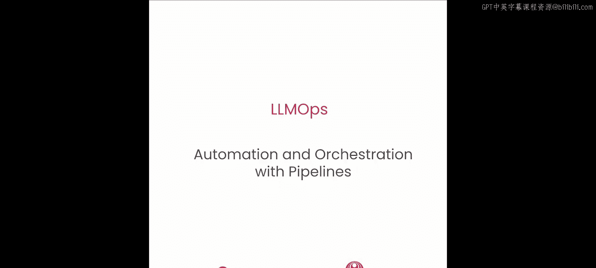
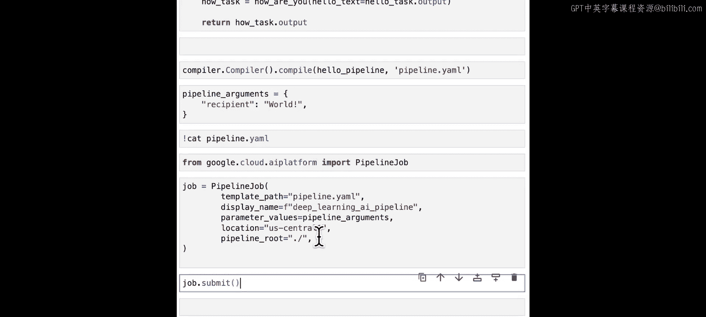
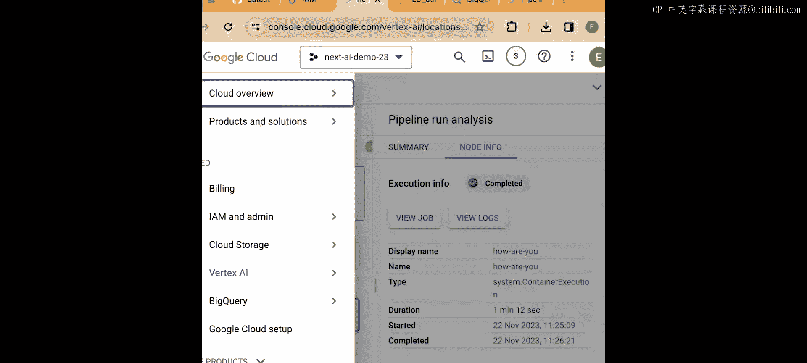
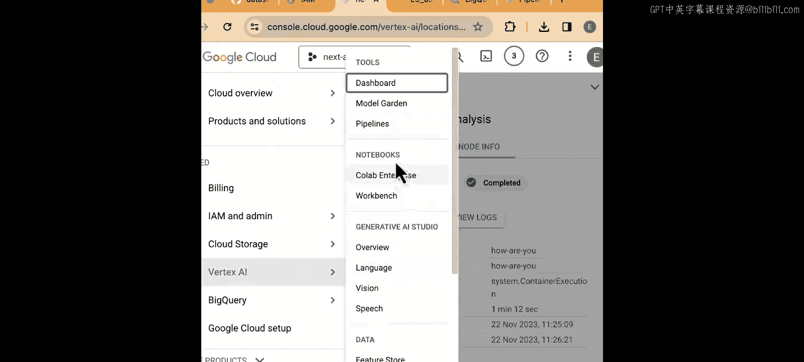
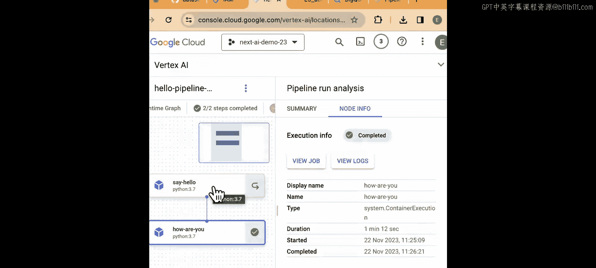
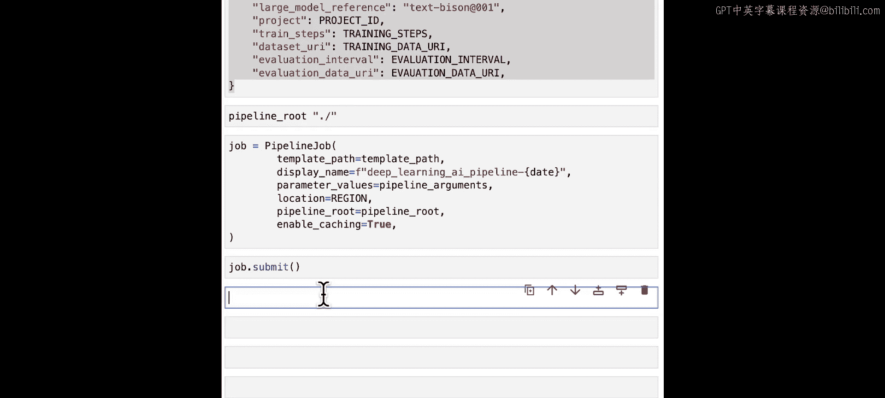

# 吴恩达《大语言模型运维｜LLMOps》中英字幕 - P4：4.Automation.zh - GPT中英字幕课程资源 - BV1jC4y1C7Lb

Now that you have your data， it's time to tune a LLM。

 keep in mind that you might need to tune a model multiple times to develop one that works for your use case。

Experimentation is more critical when it comes to LLMs because we are still learning what works。

You want to automate the process of running experiments to make your life easier。

In this lesson， you will learn how to build a machine learning pipeline to tune and deploy your model using an open source framework。

 Okay， before we go into the code， let's talk a bit about Mlops workflows for large language models I've talked about system design for Lms and have also talked about these workflows that have more onedimensional。

 Let's say you want to train or tune a model the process you typically go through if you gather some training data。

 you do training， you do evaluation and you do evaluation during the training or tuning process as we talked about in the previous lab。

 and then as a result， you will have a trained model which could be something like a tensorflow safe model format。

 So once you have a trained model， what you will do is you will take your trained model and you will put it in your production environment。

 because in the end， we want to ship our model。 and integrate it with our use case。

 once you have your trained model in your production environment， this could be a rest API。

A batch process is that you take production data。And you generate predictions。 and again。

 you do evaluation as often as needed。 And based on your evaluation， you can， of course。

 update your training data and run your workflow again。

 there's a few key things here I want to talk about。 there's orchestration automation and deployment。

 Ortion meaning is that you specify which step needs to be run first， And then what is the next step。

 so on so forth。 Auto meaning is that you automate this workflow。 This helps you， for example。

 that if you want to train a new model that you can rerun the endto end workflow again and deployment I talked about。

 this means is taking your trained model and putting it into your production environment。 Okay。

 so just about orchestration it's about orchestrating the sequence of steps where automating is about making sure that you as a person don't need to run the script yourself。

 you automate the execution of the code。 For example， if you have multiple Python files。

You don't want to manually go in and execute maybe your data preparation and then the file for your model training。

 No， you want to orchestrate them。 You want to say first data preparation。

 and then the model training， and you want to automate that process so that you don't need to execute one file after another。

 Let's dive into the code for orchestration and automation。 You can use different frameworks。

 For example， But airflow and Qflow pipelines are both popular for building machine learning workflows that help you with these orchestration and automation。

 This notebook， we're going to use Qflow pipelines。 So we're going to import the Qflow pipelines。

Package Qflow pipelines is a open source framework。

 and you use it for constructing like a kit for building machine learning pipelines to make it easy to do orchestration and automation。

So first I'm going to import the DSL， so the DSL we're going to use。

 say we're going to use like a drawing board to sort of design our pipeline。And then also。

 we're going to use a compiler。 I will talk about that later。 Okay， so。

Let's say we want to orchestrate a very simple example first。

Because I want to teach you about orchestration and automation。

So let's say we're going to take a Python function that is say hello。That will take a name。

Which it's going to be a string。And then it's gonna take a name as inputs and gonna add hello。

 So hello and M my name。 So hello， Irwin。 And then this is going to return。Hello， text。Okay。

So important here is that QF pipelines has two key concepts。There's components and there's pipelines。

 A pipeline is like a self-contained set of code like this code that we see here。

 And this is one step or could be one step in your workflow to map is to machine learning workflow。

 So the first step could be data processing。 or data engineering。

 The second step could be model training。 So each component is a step in your workflow In the role of machine learning。

 we often talk about pipelines。 but building and managing these pipelines can become complex and time consuming。

 That's where Cuubeflow pipelines comes in。 A powerful tool that helps us automate and orchestrate are MlOs workflow。

 but Cuubflow doesn't speak plain English。 Also it doesn't speak Dutch。

 It uses a specialized language called a DSL。 DSel stands for domain specific language。

 Think of it as a set of instructions。 Taylorlor specifically for building MLlOs pipelines。

The open source framework， Qeflow Pis， provides its own DSL library。

 which lets you define your pipeline steps and execution logic also referred to configuration。

In a clear and concise way， no more juggling code in different languages with the KFP pipeline DSL。

 you can focus on the what of your pipeline so the task you need to perform and let QF take care of the how QF pipelines DSL we can use for building LLM pipelines。

So how do we make sure that this code this Python function that we know that this is a component in our machine learning workflow。

 This is where the DSL comes in。So we're going to use the DSL。

To tell the system that this is a component。 So this coat will run in a containerized environment。

 you may have not heard about a container。 so containers。

Are like a contained environment that have your dependencies。And your software code。

 the advantage of containers is， is that you don't need to manage a server。 installst your Os。

 installstall your dependencies there and your software on the server。

 It lists in this bubble where you have an Os that's already available for you。

 You install only the dependencies that you can use for your software。

 put your software in a container， And then you can take the container and maybe comes somewhere else。

 you can execute it on environment A or B or C， it doesn't matter。

 You're not dependent on the hardware underneath in an MLl workflow。

 we often want to orchestrate multiple steps。 So we have our first step， which is a component。

Let's now write another one。Again， we're going to take a Python function。Ced， how are you？

Whi's also going take a string as input。So we're gonna to take it。Hello， text。

We're going to use the output。Of the first component as input for the second component。

 So that means the second component is dependent on the first component。

 So we have to run the first component as the first step。 And then the second component。

 because it's dependent on the output。 So the output goes downstream。 So let's say。

Your first step generates files that contain training data like we've done in the previous lab。

 The second step might be training a model that takes these files to train a model。

 So it takes this data to train the model and how you pass data from one component to another can be done in different ways。

 So you can say the first component hands over the data files to the second one and then so on so forth。

 But typically what you do and the best practice that we see a lot is that you pass the path to the location of files into the next step。

 So let's say。You stored your training files as we discussed in the previous lab in a cloud bucket。

 What you do is you tell the second component。 Hey。

 the training files are in this bucket instead of passing the training files into the component。

 why that is important is that if you're dealing with large data。

 you don't want to put all of the data in one step in one container because then you're dependent on that memory and we talked about that。

 we want to build our pipelines in a scalable way。 So you pass the uniform resource identifier like the path example I just gave for this Python function we also need the DSL decorator So the component decorator to tell the system that this is a Qflow pipeline component。

 So now we have two components。 Now it's time to draw our workflow or to sort of decide how we're going to execute these steps these components。

 we're going to build our pipeline。For this， again， is just a Python function。

 and let's call it hello pipeline。And this one is going to take a recipient。Again。

 a string and within this function。We're going to tell the system which step we want to execute first。

As discussed， our first Python function， our first component is the one we're going to execute first。

 So this is the say hello。Component。And this is the one we're going to execute first。

 And this is going to take the recipient， which is a string。

 So the name of a person is input and injected into our component when we're going to execute this。

 The second step。 And you probably guessed already。

Is that we're going to execute our second component。 How are you。

 And this component is going to take the output。Of the first component as input。

 So the hello text is going as input in our second step。 So here we're telling the system。

The output of Ho task should go as a parameter in the how are you component。

 And then we're going to return。How task。Out凸。So the output of the second step。 Now。

 we have to tell the system that this function is our pipeline。 So our sequence of steps。

 we're going to use the decorator。To tell this is a pipeline。 Next。

 we're going to implement our pipeline。 A pipeline is a set of components that you orchestrate。

 A pipeline also lets you define the order of execution and also lets you tell how data flows from one step to another。

 So basically， data can go downstream in a pipeline。 Okay。

 remember when I talked about importing the compiler。

 We now have specified one or components to our pipeline。

 Now it's time to compile our pipeline in a file that you can execute for this。

 we're going to use the compiler。The compiler lets us generate a Yal file。

 A Yamo files are human readable used for storing your configuration and the sequence of steps of your pipeline。

 The Yal file also contains information on your components。

 their dependencies and the order of execution。 So last thing we need to do is that， as you remember。

 we don't have a name yet。 So a name needs to go into our pipeline when we execute， right。

 We're saying， hello， name， how are you， So we need to define our arguments。

These arguments are injected into our pipeline during execution。 This is a pipeline argument。

And here， we have recipient。And we're going to use world once you've generated pipeline of Yammo file。

You can have a look at the Yaml file。 So let's run cat pipeline with Yaml。And you can see。

 for example， here the components that we specified。

There's all sorts of other information that's related to the pipeline。

 execution and dependencies as well in the Yaml file。Let's continue for now。 We now have a Yaml file。

 Once we have a Yal file， you can execute it on different environments。

 We've talked about Kubernetes。When you run a cuubbannet this cluster。

 you have to manage it and operate it in production， which is a lot of work。

 You can also use a managed environment like vertex AI pipelines that executes the Yamo file for you in a serverless environment for this。

 you can use the。Cloud eye platform library and import pipeline job。 Next。

 you have to specify your pipeline job。 There's a few things that we need to set。First of all。

 we need to say to the system that we're going to use the pipeline Yaml。For execution， secondly。

 give it a name。 Then we have the pipeline arguments。

 These arguments go into the pipeline during execution。And then we specify a region。

 we talked about regions in the previous lab。The pipeline route is where temporary files are being stored by the execution engine。

And then is as simple as job dot submit。And you can run it for classroom restrictions。

 We're not going to execute the job now， but you can take the code and execute it in your own environment。

 You can execute this on Google Cloud using vertex AI pipelines。

 which is a serverless layer on top of Kubernetes so we don't need to worry about managing machines like Vms or a Kubernetes cluster。

 We just sent the M file and Google Cloud takes care of the execution。

Vertex AI pipelines。 And this is where I see the actual execution。 So we have the two steps。

 the two components。

That we just created。 So to say hello and how are you。And here you can also see the parameters。

So you can see the type and the value。And if we go to the second component。

We can also see the output。 It says hello world。 How are you。

 So this is where you typically see the execution of your pipeline。

 but also see the parameters and the output of the components。 Okay。

 so we just build a hello world example of the pipeline。So you're now familiar with the concepts。

 Let's now look at a real life example of a machine learning workflow， a machine learning pipeline。

 The advantage or one of the advantages of a pipeline is that you're able to reuse it So once you build a pipeline you can reuse it so maybe you can share it with a colleague So let's say you build a Q andA language model。

 and you build a pipeline that processes the data trains a Q and A language model and then outputs a trade model file。

 Maybe your colleague also has a Q and A use case。 So your colleague comes to you saying can I reuse your pipeline from my use case。

 So reusability of pipelines is an important advantage。 So in the next example。

 we're gonna reuse an open source Cubeflow pipelines that lets us do supervised fine tuning of a foundation model from Google called Po2 and the advantage of reusing a。

ipline is that we don't need to build it from scratch。

 We only have to specify some of the parameters。 Remember that we generated two files in the previous lab。

So we have our training data。And we have our evaluation data。 the JsonL files we talked about。

 So we're going to use these two files to fine tune a palm model。

 We're going to use these two files to do supervised fine tuning。

 So reusability of pipelines is a big advantage。 And as I mentioned。

 we're going to use an open source pipeline that's part of cubeubeflow。

 Here you see the path through the pipeline file。 So remember the yammo file we generated。

 This is where we can find the yamo file for this pipeline。 In order to execute the pipeline。

We need to set up some configurations。 Basically， we need to specify our arguments。 First of all。

 let's come up with a model name in the previous lab。

 we talked about versioning and how important versioning is。So here as well。

 we're going to use a date timest to keep track of the model that we generate。

 We have to specify a model name， and we're gonna add the date to it。

 So at least we can always go back in time and see which model was trained when。

 There's also some other parameters that we can tweak。 I want to highlight to。 So first of all。

 we have training steps。 training steps， meaning the number of steps to use when tuning the model。

 As mentioned， this pipeline plus parameter efficient fine tuning。

 a single training step is the process of feeding a batch of data into the model when you do your training。

 It updates the internal parameters and it will calculate the loss or error。

 Do not confuse it with epochs， which is a full pause of the data for extractive Q and A。

 you can set it between 100 and 500。 This is the best practice for this palm model。 For now。

 I just chose the number 200。 And as you remember， when you run a pipeline。

See it as one experiment so you can tweak a parameter and run it again and see how it impacts the performance of the model。

 Also， we're going to set an evaluation interval。 We generate an evaluation data set。

 The interval that specifies the frequency at which a trained model is evaluated against the evaluation set that we created。

 default will set to 20。 you can play around with this as well。

 just like we've done for our hello world pipeline。

 we have to specify arguments that the pipeline will use during execution。

 Two of the arguments that we're going to use our a project Id and a region。

 just as you remember from first lab is is that we have to specify the project Id and the region where we're going run。

This job。Again， we're going to US Central1。 Next， we're going to specify the arguments。

 The arguments are being used by the system during run time。 So when the pipeline is executed。

 the arguments are ingested into the pipeline。 So the pipeline arguments for this open source pipelines are our model name that we just specified。

The region where we're executing the workflow and， of course。

 the model that we're going to use for our parameter efficient fine tune。

 This is a Palm family model。 It's called Tex bison。

 which is a great model for question and answering。0，0，1 is the version of this model。Project I D。

The training steps that we just specified that are set to 200。

Where our trading data sits our evaluation interval。And our evaluation data U。

So where are evaluation datasets， These arguments go into our pipeline when it's being executed。

 You can imagine when you create a pipeline， you can include arguments。 Arguments can be changed。

 So that means is that when you have that pipeline， you can run it with a different set of arguments。

 So let's say you have a new data that you want to use。

 You just have to update the argument to the dataset。

 Or maybe you want to use a different type of model for the tuning。 You just update that parameter。

 So it makes it very easy to take an existing pipeline and to make minor changes to the pipeline and rerun it next。

 we also have to specify our pipeline route， as you remember。

 this is where the artifacts are stored during execution。 And then we specify a pipeline job。

 which tells the system how the pipeline should be execute it with which arguments。

 The enable caching to true means is that if we're gonna rerun。Pipline， if we use caching。

 which means is that if we already executed a step previously。

 it will not execute it again only if we updated the code or one of the arguments。

 it will rerun that step。Then it's time to do a job submit。

We're not going to execute this pipeline now because if we have to run it。

 it might take a whole day to execute。 Also， it's quite expensive to run this pipeline because you need accelerators。

 like GPUus or Tpus in the next lab， we're going to talk about deployment。

 So once we tuned a model Of course， we also have to deploy it in order to use it in our LLM system。

 and see you in the next lesson。😡。

