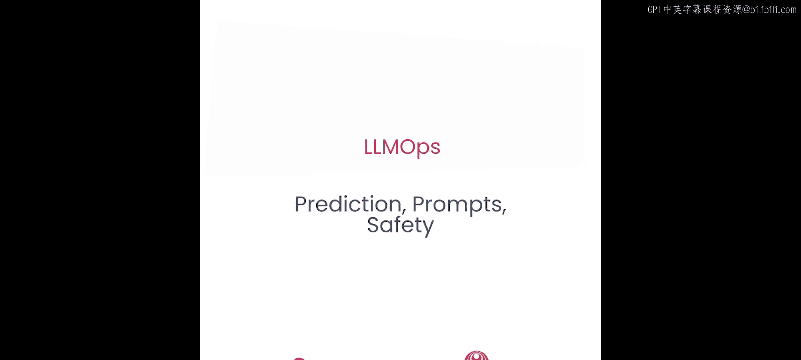
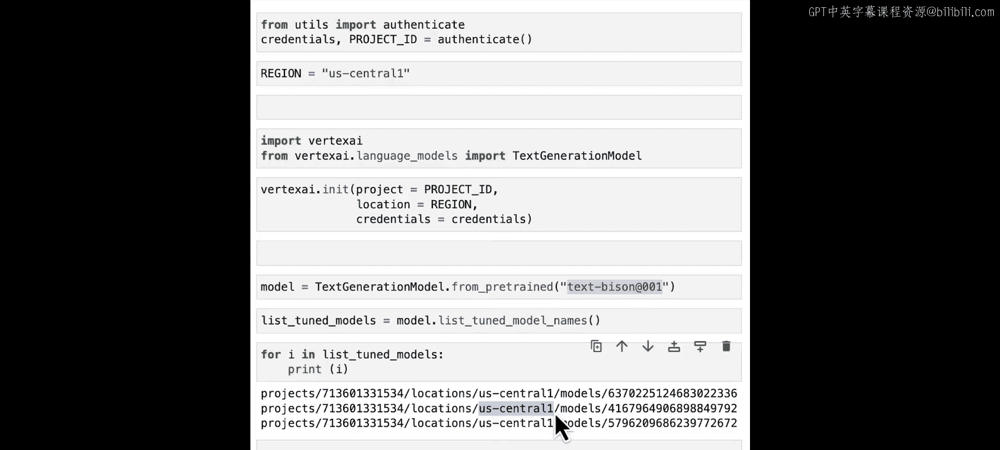
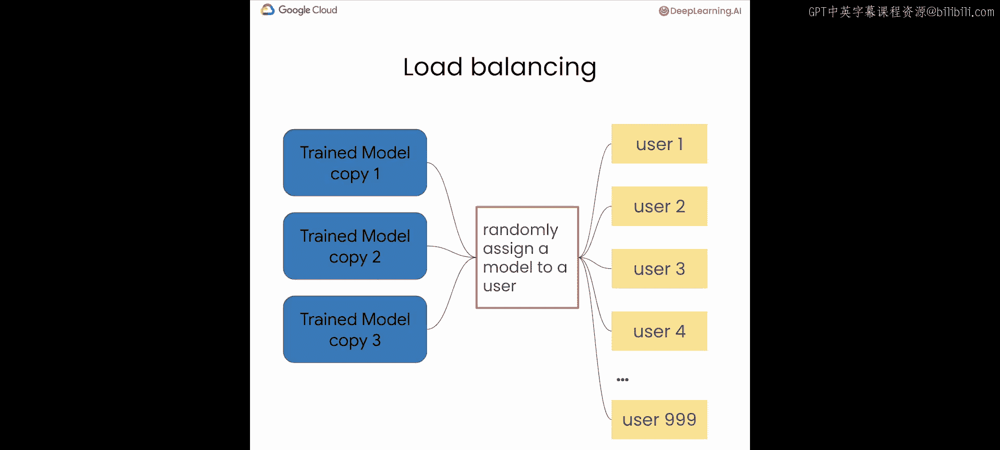
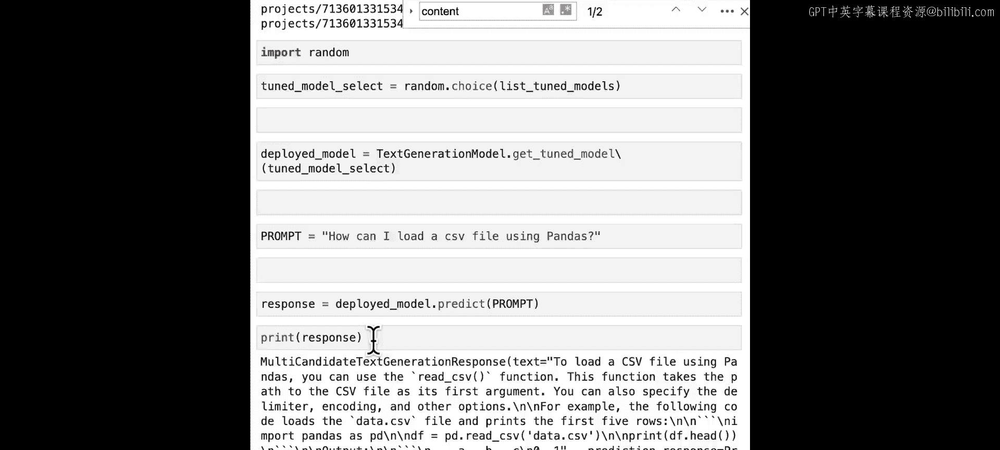
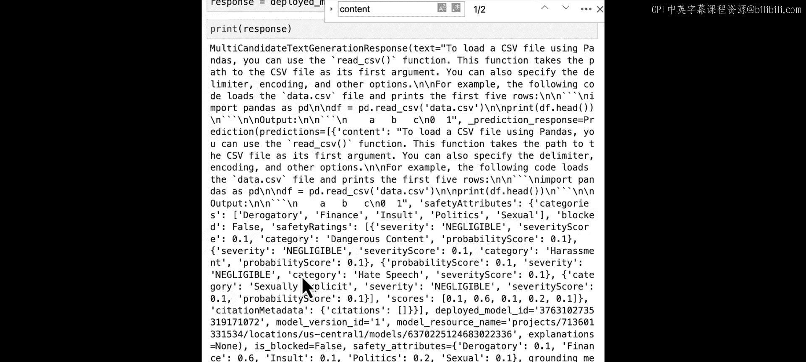
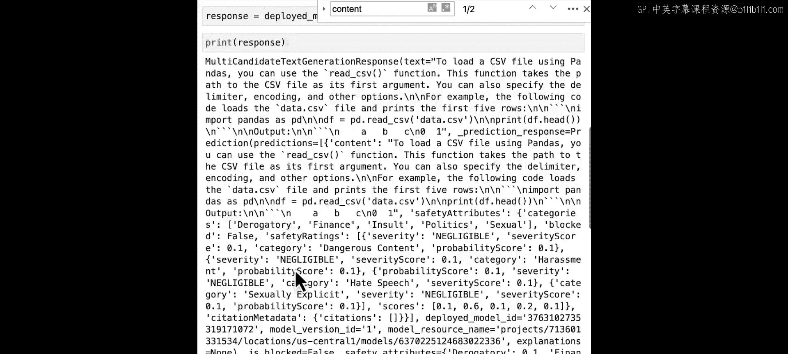
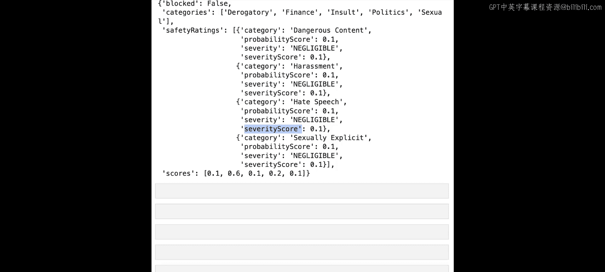
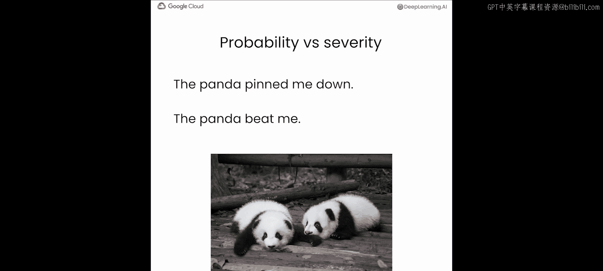
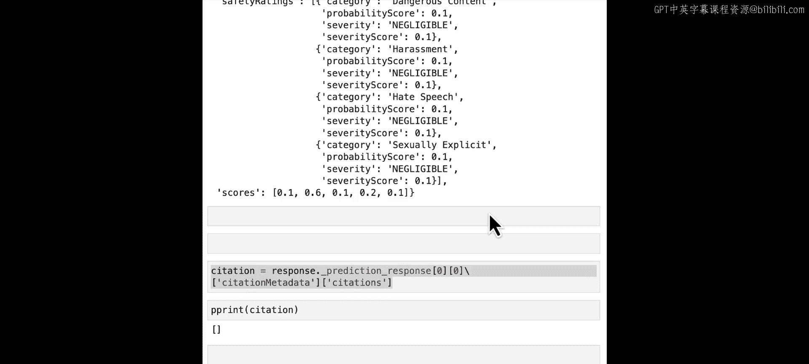

# 吴恩达《大语言模型运维｜LLMOps》中英字幕 - P5：5.Predictions, Prompts and Safety.zh - GPT中英字幕课程资源 - BV1jC4y1C7Lb

So now you will actually get used the tube model to make predictions。

The team has supplied one for you。But there is still more to do in order to integrate this safely into a real life application。

We will need to make sure the model will work the same in production。

 but also that it can be safer and more responsible。

So you will first want to make sure production data has the same format as the data used in training。

You look into the response and how to get insights on safety attributes。

 and are there any sources that the response is based on？

Okay， welcome to the lost La of this course。They were going to talk about predictions。

 prompts and safety scores， just like with the other labs， we have to run some of our setup code。

 Again， we need to get credentials and our project ID。

 We're going to use the same region as we did before。

 We're going to use US central1 and also in this lab， we're going to use the vertex AI SD DK。

 We're going to use the text generation model that we just tuned。

Let's also initialize the vert IDK right away so that we can use it with the project ID region and credentials。

 Let's talk about deployment In the previous lab， we talked about building a end to end machine learning pipeline that takes training data tune a model does evaluation and then generates a trade model that you can deploy as we talked about deployment can mean different things。

 Take your model doing batch predictions， or it can mean creating a rest API that you integrate with your services when deploying your model you have multiple options。

 meaning the way you deploy your model and integrate it into your use case。

The two main ones are batch and rest。 I'll explain both of them。

 Bach meaning is that you take your trained model。And you might have a batch use case。

 So let's say you get customer reviews， maybe about products。 And every week。

 you want to score those reviews if they are positive or negative。

 So there's no need to do this in real time。 You maybe want to do it once a week and share it with the marketing people。

 you can take your trained model and take all of the reviews， the product reviews for that week。

 and then send them to your trained model and run a dot predict on all of these reviews。

 So what you're gonna do is that for each of these reviews。

 you're gonna to send it to the model and get a prediction if it's positive or negative。

 So it's sort of it's an offline process。That doesn't need to be in real time。

 And you batch all of the examples and you run the predictions in batch。

 A rest API means is that we take our model and we deploy our model as an API。

 This means that it' online。And you can access it from a service。

 So let's say you have a chat application that lets you ask stack overflow type of questions。

 So when I come into the application， I ask a question， the request goes to the API。

 the API so the model behind the API does a prediction and the prediction goes back into the user interface。

 and ICD result。So this is a more real time use case。😡。

You need to get the response with a low latency。 There's different ways you can deploy a model as a rest API。

 If you have， let's say， a tensorflow model or a Pythtorch model。

 you might want to package it up using the flask library or fast APIs。

 These libraries help you with packaging these models as an API。

 then you can take that API and put it in the container that we talked about in the previous lab。

 If you're not familiar with flask or fast API。 Don't worry。

 you don't need to know to finish this lab。 In this case， we deploy the model as an API。

 So we've taken the trained model， package it up in a container as a rest API。

You can take the production data， send it to the API and get a prediction。

 Let's go back to the code In order to call our API， we have to run a few lines of code。

 We want to retrieve the endpoint of our model。With endpoint， I mean the RE API。

 So the model has been packaged up and deployed as a RE API on the cloud platform。

In order to get a response， we have to specify which model we want to use for predictions。

 Remember that we tuned a text generation model， the text by model。

 This was one of the parameters you set in your pipeline， using the SDK。

We can retrieve a list of models that are deployed。 Let's use the model list， tuned model names。

To retrieve the endpoints of the tuned models that we have， we ran the pipeline a couple of times。

So we have multiple endpoints。 Let's print out the endpoints that are available for us。

 As you can see within our project， we have three endpoints that live in the US Central One region that you specified。

 We deploy multiple models to make sure we can spread all of the traffic over the three models。

 We're going to use a very basic form of load balancing to choose one of the endpoints to send or prompt to and get a prediction。

 So we're going to use the random library。

And we're going to choose from our list randomly one endpoint that you're going to use to get a prediction from once we randomly selected one of the deployed models。

We can load this model so that we can use it to get predictions。

Getting predictions means we're going to send the prompt to the API and get a response from the model based on the prompt。

 So we're going to load one of the models。And next， we can write a prompt。 So let's。Write a prompt。

And since we've done tuning on the stack overflow data set。

 I think we should ask it a Python question because we selected all of the Python questions from the stack overflow data set。

 We want to stay as close as to what we trained on as possible。

 And I'll talk about this later as well。 why this is important。

 Let me ask a straightforward question。How can I load a C SV file using pans。

 This is something we've done in the first lab。 We have our prompts。We've loaded the API。

 Now we can send our prompt to the API and get our response for this。 We can use the vertex I S DK。

And we're just gonna run a dot predict on the deployed model。

 and we take the prompt into the dot predict。 So the prompt goes to the API。 Of course。

 large language models are large。 And depending on the size of your model。

 depending on the size of your prompt， latency can differ for your model。

Meaning is it can differ how long it takes before you get a response。

 Larger models typically take longer to get a response。 if you have larger prompts。

 it takes longer to do a prediction。 So depending on your use case， there can be different latency。

Let's first print our response and see how it looks like。

Well， looking at this， you can see that it is not very readable。

 This is a lot of information we're getting from the model as a response。

 So let's clear this for now， and let's do some formatting for this， we're going to use pretty print。

 So from pretty print。 We're going to import pretty print。

And let's unpack that response for a bit。 So when you have an API。

 you can send multiple prompts to get multiple predictions from the API。 We only send one prompt。

 So we're only getting one response。 Let's have a look at that。

 And let's use the pretty print to format this response。

Since we only send one prompt for're only getting one response。

 this response consists of a lot of information。We have citations。 We have scores。

 I'll talk about citations and safety attributes later on。

 Let's unpack the response a bit more and look at the exact object。 If we print this output。

 you can see that it only has one object。In the output， you can see that there's multiple keys。

 We have content， safety attributes。Content is the answer。The answer on the questions that we asked。

So basically， the response on our prompt， let's now extract the content。

 so we response on our prompt。Basically， answer to our question from the output。

We're going to use content as a key to extract response from the model。

 Let's now print the final output， the answer to our question。

Here you can see the answer to our question。 So this is the response of our model。 Okay。

 so we talked about different options of deploying a model。 Remember， batch and rest API。

When deploying models， there's also other things you have to take into account。

And other things that are important when running production machine learning workloads。

 I've talked about packaging， deploying and versioning your model。

 but there's also other things that we have to take into consideration。 like doing model monitoring？

 There's different ways you can monitor your model， First of all， there's the operational metrics。

 Let's say how often do you send the prediction to the API。 Of course。

 you also want to evaluate the performance of your model in production。

 So how is my model performing， What's the evaluation metrics of this model in production。

Maybe you want to generate some scores， also we want to consider safety。

So is there any bias or any harmful language in the output of the model and we'll talk about this later。

 Also， you want to think about scalability。 You might want to do a low test on your API。

 meaning sending a lot of predictions at the same time to see how your model behaves or how your API behaves。

 and then when rolling out is in production， you want to do this slowly。

 So let's say maybe you first want to have only 5% of your traffic going your model。

 instead of all of your users， we call this a controlled rollout。

 Also discuss with all of your stakeholders， what is a permissible latency。

 So when you discuss with your stakeholders about what is permissible latency。

 have a discussion about what's the actual number， for example。

Is2 seconds of latency okay for a user experience， So let's say going back to the Q and A system that you're building for stacko questions。

 you have a UI。 Is it okay if the user waits one。2，3 seconds。

 or do you want it to be like 100 milliseconds。 All of this is something you discuss with your stakeholders。

 and you decide on what is permissible。 But what can you do if your latency is too high。

 There are multiple options you can explore。 You might want to choose for a smaller language model。

 smaller models often have lower latency， You can also explore deploying your language model on GPus or maybe you'll deploy your model in a different region。

 So let's say your application runs in the Singapore region。

You can deploy the model also in the Singapore region so that the model and the application are close together。

 Buthold on， didn't we in the previous lab did some data processing and create a new feature where we combined an instruction with a question In the example we just ran we only send a question to the API。

 This means is that the model that we trained was trained on data that has an instruction and a question but now in production we're only sending the question。

 so there's a mismatch what we trained on versus what we have available in production。

 There's a s between the two。 It's very important that your production data is very much the same as the data that you trained on if there's a difference between the data。

 It can influence the performance of the model So we need to add an instruction to our question before we send it to the model in other words。

We want to add the same instruction that we had in our training data。 Let's do that first。

Let's take the instruction that we created earlier。And then take a question。

 Let's go with a new question。So we have the instruction。😮，We have to stack overflow question。

 Now we want to combine the two。And create a prompt。So we have instruction。Question。

And taking the two， we're going to generate a prompt。If we print the prompt。

We can see that now our instruction and question are combine。So we have our instruction。

And we have our question。We can now take this new prompt。

It is consistent with the data that we trained on and send this to the API。

 will'll do this in the same way。We'll get a deployed model。

To dot predict and take the prompt that we just created from this response。

Let's choose the content key again to get the answer on our question。Let's print this output。

And have a look at the response of the model on our question。We see that the output。

 the response of the model has a very nice structure。

 and it answers our stack overflow question like it's a developer。

So remember when we had the output of the model， all of the output。

 So not only the response to a question in this object， we also have safety attributes。

 The thing with large language models is that they can generate output that you don't expect。

Including text that can be offensive， in sensitive or maybe factually incorrect。 What's more。

 the incredible vertility of large language models is also what it makes difficult to predict exactly what kind of unintended or unforeseen outputs they might produce。

 So it's important for you as a developer practitioner to understand and test these models to make sure you deploy them safely and responsibly。

This is where we can leverage the safety attributes of this model。

 The Palm API that we tuned has safety attributes scoring to understand the output and define confidence thresholds。

 meaning that you can take these safety attributes and define your own thresholds。

I'll talk about that later on how you can use that and how you can think about these thresholds。

 Let's unpack this a bit more and write some code。 So from our response。

 we're going to use a different keyn now。 we're going to use the keys safety attributes and from the safety attributes。

 we can first check if there was anything that was blocked by the responsible AI service。

 So in our response， we have safety attributes。We can also check if the response was blocked。

 What you often see with model providers is that before returning the response to you as a developer or practitioner。

 there should check if there is an issue with the safety attributes。If there is。

 then the response might be blocked。 Let's check if it's blocked。Print the blocked。B。

A second layer of checking if there's any issues with safety attributes can be done by you as a developer in the response。

 you will find probabilities for each category and you can use these probabilities。

 to design your own threshold by using these threshold。

 you can take comprehensive measures to detect possible harmful topics。

 So the confidential scores are predictions only， and you shouldn't depend on the scores only for your reliability or accuracy。

 It's one of the measures you can take。 So the second level is where you as a practitioner and developer can use safety attributes and safety scores to set up your own thresholds。

 Let's have a look at the safety attributes to get a better understanding of them。

 So from our response， we're going to use the key safety attributes to retrieve the safety attributes and the scores。

 We're going to use Pre print again。To print our safety attributes。Okay。

What you see here is a couple of things that I would like to talk you through。First of all。

 you can see if the response was blocked。Or not。In this case， it wasn't。

Then we have some of these safety categories。Like finance， politics。

 we also have the safety ratings with different categories。

 You can also see here the probability scores。 So each safety attribute is associated with a confident score。

 like a probability score between 0 and 1。And is rounded to one decimal place。

Reflecting the likelihood of the content being unsafe。 So it scores for each category。

 you can see here that the probability score for most categories is 0。1。

 I mentioned that the probability score can be between 0 and 1， So 0。1 is very low。

 You see also here a severity score。Safety filter confidence scores are based on the probability of content being unsafe and not the severity。

 This is important to consider， because some content can have a low probability of being unsafe。

 even though the severity of harm could be high in the output you've seen as probability and severity。

Let's talk about what is the difference between the two using two sentences。 The first one。

 the panda pinned me down。 The second one， the panda beat me。

 First example can have a higher probability of being unsafe It because the panda has pinned me down where the second sentence is more ambiguous。

 and we don't know if it was an unsafe situation。 I might have been racing the panda for some bamboo。

And the panda beat me in the race。 But the second one could be more severe because it also can mean that that panda has beaten me。

 Ped me multiple times。 So as a user， you can leverage the scores， The probability score。

 the severity score to set up your own thresholds。 For example， if the probability score is 0。5。

You can decide if that's an acceptable score for you。 or if you want to filter out that response。

 deciding what is a good threshold is up to you and depends on your requirements。

 the type of users you're working with and other requirements。

 There's not one probability score or one threshold that could work for everyone。

It very much differs per use case。 So you have to look at your own data and responses with your data and decide if that's an acceptable threshold for you or not。

When dealing with generative AI。You want to produce original content。

And preferably not replicate existing content at length。

 So you want to design your systems to limit a chance of this occurring In the response。

 you have something that's called citation metadata。

 meaning you can check if there's any citations from the model response。

We can take the citation metadata。And from citation metadata。

 we can take the citations to check if the response is citated somewhere。 Let's use Pre print again。

See if there's any citation in the response。That's good。 The response is not ciated somewhere。

 If there is a citation， the model will return a page from where it's cited from like a website。

 We don't have any citation in this example。 Try out your own prompt to see if you can trigger a citation。

 Maybe something from Shakespeare to be or not to be。 Try a few prompts yourself。

 I'll see you in the next video where we will wrap up the course。

