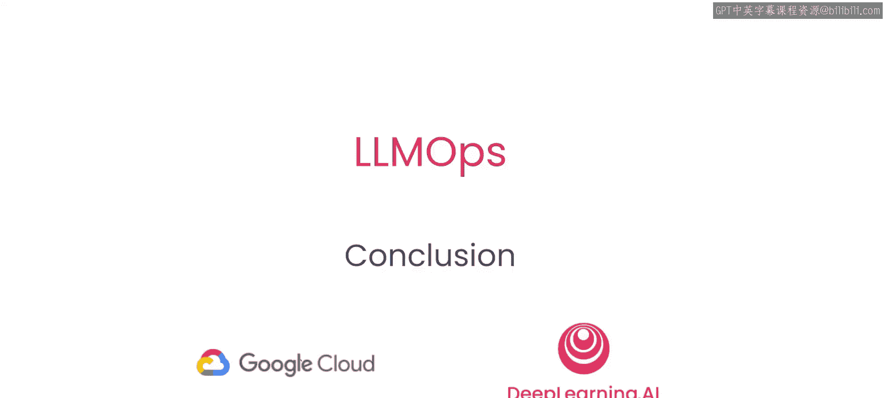

# 吴恩达《大语言模型运维｜LLMOps》中英字幕 - P6：6.conclusion.zh - GPT中英字幕课程资源 - BV1jC4y1C7Lb

Congratulations on finishing the course。 The field of L M ops is rapidly evolving。

 and there's always more to learn in the notebook of the previous lesson。

 you will find a link to a notebook that shows you how you can run the supervised tuning pipeline yourself。

 I'm excited on what you will build next。😊。

