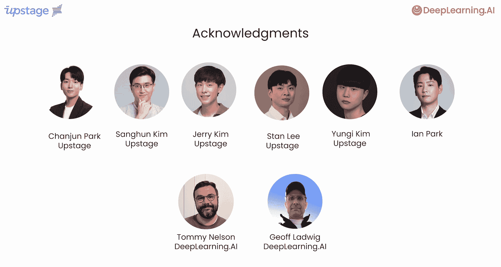

# 吴恩达《大语言模型预训练｜Pretraining LLMs》中英字幕【豆包翻译】 - P1：1.intro.zh_en - GPT中英字幕课程资源 - BV176421f7da

Welcome to pre trading L Ms built in partnership with Upstage and taught by Upstages C L Sunm as West chief scientific officer Lucy Park。

 Welcome， soon Lucy。 Thank you， Andrew。😊，We are so excited to be here。

Pretraining a large language model is the process of taking a model。

 generally a transform a neural network and training it on a large course of text。

 using supervised learning so that it learns to repeatedly predict the next token given an imp prompt。

This process is called pre training because it is the first step of training an OM before any fine tuning to have follow instructions or further alignment to human preferences is carried out。

The output of pretraining is known as a base model and will cover both training from scratch。

 meaning from randomly initialized ways， as well taking a model that's already been pretrained and continuing the pretraining process on your own data。

 training a large model from scratch is computationally expensive。

 requiring multiple CR GPUs and training runs taken last weeks or months。For this reason。

 most developers wont pretrain a model from scratch and will instead take an existing model and either use prompting or sometimes fine tuning to adapt it to their own tasks。

However， there's still some situations where pretraining a model may be required or preferred。

 and that's what Upstage has been doing for its customers。That's right， Andrew。

Our customers are portraying models for various regions。

Some are fielding models for testing in specific domains like legal， healthcare and E-commerce。

Others needs models with stronger abilities in specific languages， such as Thai and Japanese。Further。

 new training methods are making more efficient pretraining possible， like depth of scaling。

 which uses two or more sets of existing models to build larger models。For example。

 we trained our solar model using PEps of scaling。Because of this technology improvements。

We are seeing more and more interest in pre traininging。

Deepth of scaling creates a new larger model by duplicating layers of a smaller pretrain model。

 The new model is then further pretrained， resulting in a better larger model than the original our team at Upstage has empirically found that models created in this way can be pretrained with up to 70% less compute than traditional pretraining。

 representing a large cost saving。 whether pretraining is the right solution for your work depends on several factors。

 such as whether a model might already be available that might work for your task without pretraining and what data you have available as well as the compute resources you have access to both a training and serving and lastly。

 the privacy requirements you may have， which may also implicate regulatory compliance requirements。

 So depending on the company or sector you work in。

 you might find yourself being asked to pretrain a model or at least consider。

So some in workIn this course， you'll learn all of the necessary steps to pretrain a model from scratch。

 from gathering and preparing training data to configuring a model and training it。

You'll start by looking at some use cases where pretraining a model is the best option to get good performance and discuss the difference between pretraining and fine tuning。

Next you'll walk through the data preparation steps that are required to pretrain a model you'll explore how you can gather data from the internet or existing repositories like HugingBase。

 and then look at the steps to obtain high quality training data including deduplication filtering on the length of text examples and language cleaning After that you'll explore some options for configuring your model's architecture。

You'll see how you can modify metata's Lama models to create larger or smaller models and then look at a few options for initializing weights。

 either randomly or from other models Lastly， you'll see how to train a model using the open source Huface library and actually run a few steps of training to observe how the loss decreases as the training progresses This course uses smaller models with just a few million parameters to keep things light weight enough to run on a CPU but you'll be able to use the code from the lessons to scale to both larger datas and models and also to train on GPUs。

Thanks， Lucy， this sounds like it will be very helpful for building intuition about when pretraining makes sense and what is required to carry it out。

 Many people have worked to create this course from upst。 I'd like to thank Changjun Park。

 Sanang Juung Kim， Jerry Kim， Stan Lee Jung Hi Kimim。

 as well as their collaborator Ian Park from deep learningda AI Tommy Nelson and Jeff Ladwick also contributed to this course。

 I'd like to reiterate that pretraining large models of large data it is an expensive activity with a minimum cost of maybe about a0 dollars for the smallest models up to tens of thousands of dollars。

 the hundreds of thousands of dollars for maybe a billion parameter scale model。

 So do be careful if you choose to try this out yourself。

 There are calculators like one from hugging face that you see in the course that can help you estimate the cost of your pre tradinging scenario before you get started。

 These can help you avoid unexpected。😊。

launch bills from your cloud provider， but pretraining is a key part of the LM stack and whether you just want to build your intuition about IOMs or continue the pretraining of an existing model or even try to pretrain something from scratch to compete on the LM leader boards。

 I hope you enjoy this course。So let's go on to the next video and get started。

