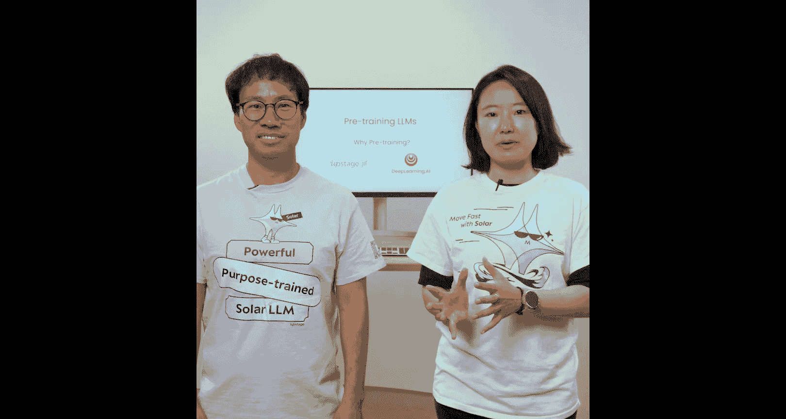
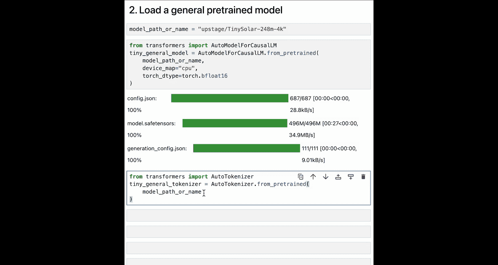
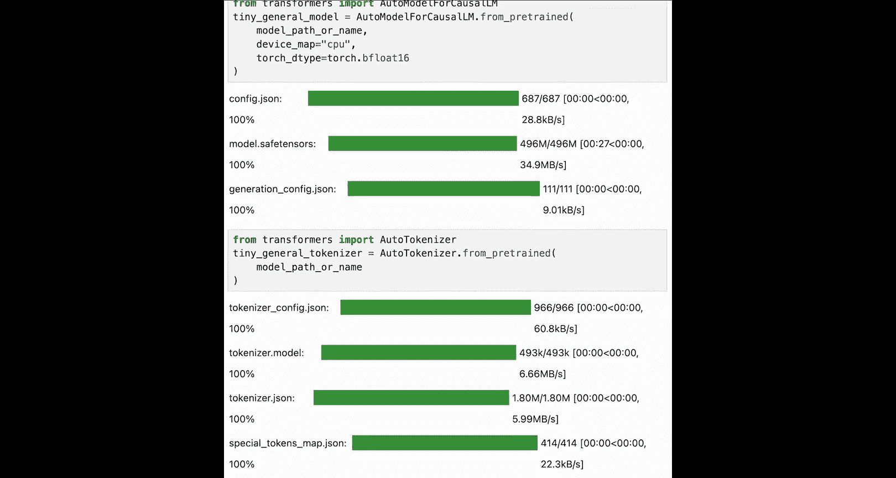
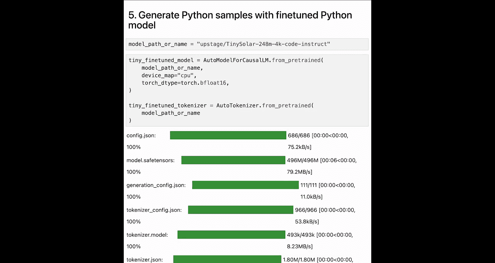
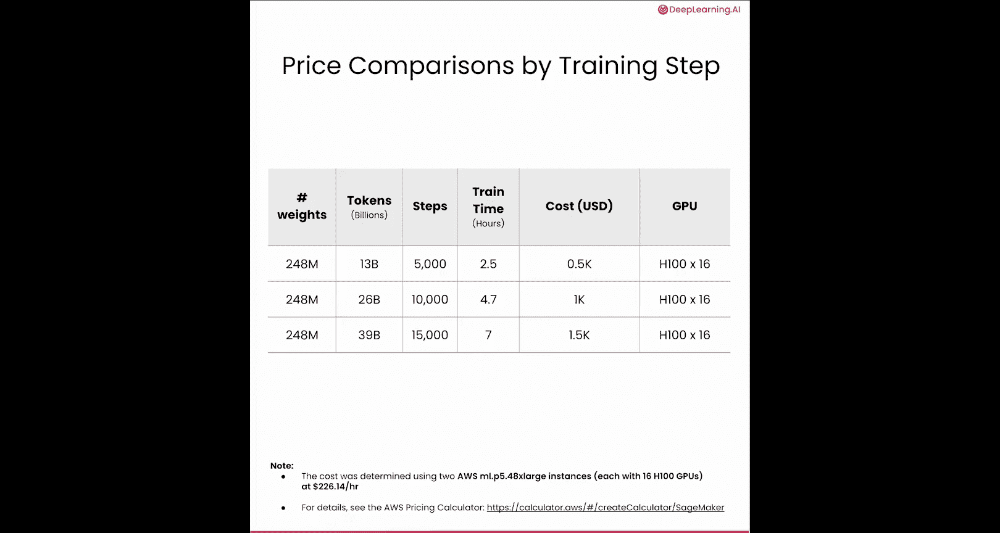

# 吴恩达《大语言模型预训练｜Pretraining LLMs》中英字幕【豆包翻译】 - P2：2.Lesson 1 Why Pretraining.zh_en - GPT中英字幕课程资源 - BV176421f7da

In this lesson， you will explore a few cases where pre traininging is the best option to get good performance。

😊，You'll also try generating some text with different versions of the same model to see how the performance differs between a base general model。

 a fine tuned model， and a specialized pre tradede model。 Let's get started。

As you heard in the introductions， pretraining is the first phase of training an LLM where the model learns to generate a text by repeatedly predicting the next word。

It learns how to do this by using very large amount of unstructured text data Each text sample is turned into many input output pair like you see here over time the model learn to correctly predict the next word and in doing so the model encode knowledge about the world。

 these space models are good at generating text but not always good at following instructions or behaving safe fake the LLms you encounter in consumer applications like ChegBT being searched and others have had their initial pretraining extended with a pace of by enning to make them better at following instructions and alignment with the human preferences to make a them safe and helpful the model only has knowledge of the content that was in the training data so if you want the model to。

Learn new knowledge。 You have to do more training or more data。

Additional fine tuning or alignment training is useful to teach the model。A new behavior。

 say writing summary in a specific style or avoiding a particular topic。 However。

 if you want the model to develop deep understanding of new domain。

 additional pretraining on texts from that specific domain is necessary people often try to add new knowledge without pretraining focusing on fine tuning the model with smaller datasets However。

 this doesn't work in every situation， especially if the new knowledge is not well represented in the base model In those cases。

 additional pretraining is required to get good performance， let's take a look at a specific example。

 For instance， let's say you want to create an LLM that is good at Korean a base model that wasn't trained on much Korean text。

 for example， the Lama 7b model cannot write text in Korean if you ask the model to tell us about Hanbo the traditional Korean clothing。

It gets the answer completely wrong， thinking that thumbbo is an offensive term。

 The second model here has been fine tuned on small amount of data。

 most likely the form of English Korean sentence fairs of direct translations。

 This answer is only partially in Korean So although if you know both languages the answer actually makes sense。

 So the model might be good for writing Kpop songs， but not so good for powering a Korean chael。

 The last model here is a model our team and up created by bother pering solar on English Lm on a huge amount on both English and Korean unstructured text。

 So this model as you can see can now speak Korean fluently。

 So as you can see pering was critical here to getting a good Korean model。

 let's head to a notebook to look at another example where pering is。

Cruci Let's experience a different among pretrain models and fine tuned with the Python language We already installed the required packages for you let's also filter out some warnings because we don't want our notebook to get too messy and you also want to import torch because we want to set a seed value for reproducibility。

You can always change this number to a different number of your choice。

 and then we will run fixed torch seed so that the seed can be fixed。

Let's try an example where we're getting a small pretrain model to generate text。

Here we'll be using a model called Ti Solar， which has 248 million parameters built by upstage。

To load this model， we will be using Auto model for causals LM from transformers to load this model we will need three parameters。

 the first is the model path name that we just initialized。And the device。

 where will be using AC CPUU？And also the data type， which will be B floatloat 16。

Loading the model takes a while， we will be using a CPUU here。

 but you can also set it to a GPU by mentioning auto。

Now let's set the tokenizer by calling auto tokenizer from transformformers。Here。

 if you just mentioned the model pather name， the tokennizer will be loaded。

If we have a model and a tokenizer， we can start generating text languageguage models are decoders so they can autocomplete a given infant text or prompt Now let's try auto completinglet a prompt using our pretrain model。

Here I'm going to input a prompt。I am an engineer I love given a prop like this。

 can you imagine what our model will be auto completing？Let's check it out。

 We first want to tokenize our prompt with our tiny general tokenizer Here we're saying PT because we're working with Pytorrch。

We then want to create a text streamer instance to stream out text。

Here we'll be putting in our tiny general tokenizer。And skip the prompt。

 which means the prompts above will be skipped， and we will also skip special tokens。

Now you will see the magic happening， this piece of code will let us generate up to 128 tokens。

For random outputs， you can just simply replace do sample to true and a temperature of your choice。

Let's go see it。 So it's saying I am an engineer。 I love to travel and have a great time。

 but I'm not sure if I can do it all again and so on。😊。

You can tell that it is quite good at generating text in English。However。

 this model comes short when I try to autocomp a code snippet in Python。

Because it was trained mainly on English。Let's try。This time， let's try a Python code。Deefine max。

Numbers。As the da implies， we expect our model to write a function that will find the maximum number among a list of given numbers。

 so now we will be creating inputs from the prompt and also streamer as we have done before。

Now let's create the outputs。Well， that doesn't quite do the job， does it？

Seems like Python code and a glimpse， but if you look closely， the result is just random。

So there are comments here and a return format。But there are no calculations inside。

 which makes the Python code valuable。 That is probably because our pretion model wasn't trained on Python code itself。

So how can we make the results better， Some people will think of fine tuning。

 fine tuning involves training your model on a small amount of data， which is task specific。

 Let's see how good a fine tune model would do instead of a general pretde model。

 Let's try a new model。 This model is identical to our previous tiny solar model。

 But fine tuned on Python code。 Since this model is fine tuned on code。

 we expect to perform much better in terms of code generation。 As before。

 let's load our model and tokenizer。😊，And stream our output。

We will be putting in the same prompt， tokenizing it into inputs， setting our streamer。

 and then creating outputs。What do you think？If you look at the output。

 you can see that it has some operations going on， say if else。

 but it still seems the model needs to learn more code because it's still not getting the function right。

 Now， let's generate Python examples with a pre traineded Python model。

Here we will be using tiny solar 248 million parameters with a 4K maximum token length。

Pre traineded on Python。This model is different from the previous model in the sense that the previous model was trained on instruction datas。

And this model is trained on plain Python code。 Another difference is that the data set is at least 100 times bigger。

Now， let's load the model and the tokenizer， as we have done before。Input the same Python snippet。

To the custom pret train model。And stream out the text。Much better， the function finally makes sense。

 This is the function that our large language model， just output。😊，Let's put that inside。

And see if it actually works。We will put in a whole list of different numbers。

And see if defines the maximum number。There we go。The maximum number is 7， and it is correct。

 So by running these three models here， you can clearly see the benefit of pre training。

The last model has learned a lot of Python and is much better at writing。

 working code than the original， which didn't know Python at all。And the fine Titude model。

 which learned just little bits， but wasn't fluent。

So you would send two use cases where pertraining a model was necessary to get the model to perform well。

 it is important to note that in contrast to fine tuning which can be sometimes be done using a few10000 tokens and it can be quite cheap per traininging requires lots of data and so is expensive in this table you can see the cost to train the 248 million parameter model you tried in the notebook for various training data sizes The last row with the 39 million tokens trained correspond to the Python specific model that you saw in the notebook。

 the training was carried out on 6800 GPUs took 7 hours and costs$1，500。

So please consider cost before you get started on a pretraining job。

 you will see some resources that you can use to estimate the cost later in the course creating a good model requires high quality training data join us in the next lesson to learn how to create a good training data。

