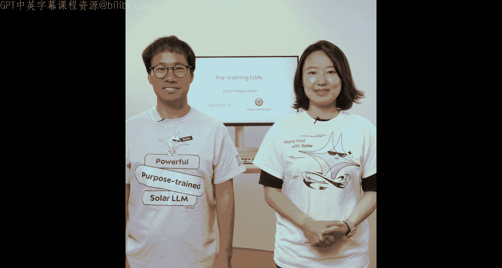
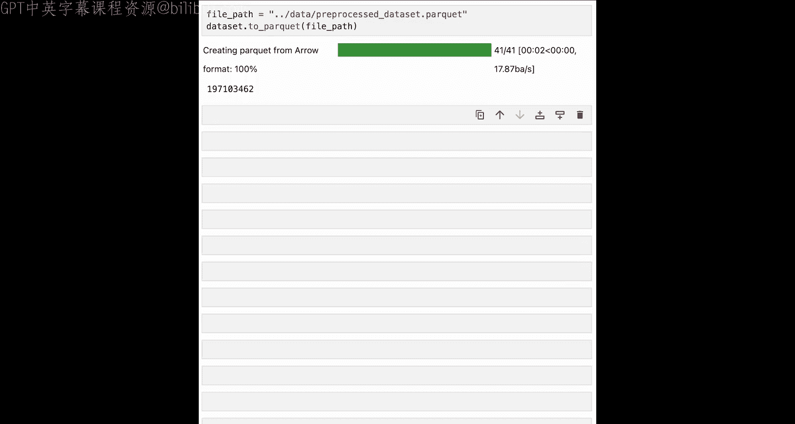

# 吴恩达《大语言模型预训练｜Pretraining LLMs》中英字幕【豆包翻译】 - P3：3.Lecture 2 Data Preparation.zh_en - GPT中英字幕课程资源 - BV176421f7da

When pretraining a model， it is important to start with a high quality training data。In this lesson。

 you'll learn how to create a training set using text from the web and from existing datas。

 let's take a look。

The data sets used for pretraining LLMs are made up of vast amount of unstructured text。

 As you saw in the previous lesson， each text sample is used to train an LLM to repeatedly predict the next word known as autoregressive text generation during the training pays the models of which are updated as it processes each example in the training data until over time the model becomes good at predicting the next word。

 you can think of this space as being like reading where the input text are used in their original form without any additional structuring of the training samples。

 huge amount of training text equivalent to millions of complete the books are required for language models to get really good at next word prediction and to encode reliable knowledge about the world in。

T。The data used for fine tuning is highly structured For example， question answers。

 instruction response pairs and so on On the left here you see a text about the friends that would be useful or pretraining on the right you see a fine tuning data sample which is a specific question about the friends。

 what are the top cities and onsuitable response So the form of the fine tuning sample is quite different the goal of fine tuning is to get the model to behave in a certain way or to get good at completing a specific task so if pretraining is like reading many。

 many books you can think of fine tuning as being like taking a practice exam you aren't really learning new knowledge hopefully you learned everything from your reading and pretraining instead fine tuning is just learning。

How to answer questions in a specific way if you want to read a lot of text。You have to find。

Lot of books and code examples and articles。And wicked pages， web pages and extra。

 so pretraining dataset sets are filled from large collection of text documents。

 many of which are sources from the internet， the world is filled with a text。

 so it's quite easy to find a lots of text for pretraining fine tuning datas on the other hand requires precise questions and high quality corresponding answers。

 traditionally this work has been done by humans， which takes time and can be expensive。

 more recently T have been using LLMs to generate a fine tuning data。

 but you need to use a very capable model for this to work well。

 So you need to do a bit more work to create a good quality。By entering data sets。

You will compare and contrast to some sample pretraining and fine training data sets in the notebook with Lucy later in this lesson data quality is very important for pretraining LLMs if there are issues with your training data for example lots of duplicate examples spelling errors virtualual inconsistencies or inaccuracies and toxic language then you are resulting LLM will not perform well taking steps to address these issues and make sure that your training data is of high quality will result in a better LLM and more return on your training investment here are major tasks you should complete to clean your text data for training The first is the duplicate having duplicate data can bias your model towards the particular patterns and examples。

It also increases your training time while not necessarily increasing the model performance。

 so removing to public a text is a crucial step in cleaning your data。

 This should be within individual documents and across all documents you want the intrinsic quality of your training data to be high so the text should be in the language you are interested in be relevant to any topics you want the LLM to build knowledge of and admit any other quality metrics that you have you can design quality filters to clean up this aspect of your training data。

For example， the sample here contains Japanese， Chinese， even Korean text。

 If you want to train on English L models， you should remove this。

A let step is supplying content filters to remove potentially toxic or bias content。

 Safety is an important concern。 and then to avoid the potential data leakage。

You should always remove personally identifiable information or PII。For any of your examples。

 one common strategy is to red this in the training text like you see here。Lastly。

 you can come up with the rules for how to fix common quality issues like all caps。

 extra punctuas and a poorly formatted text Lucy will show you how to carry out some of these steps in detail in the notebook for this lesson。

 as you can see they are cleaning can be complicated and text lots of time。Luckily。

 more and more tools are available to help you with this important step。 One example is Data births。

 an open source project we studied at up stage。 Dataverses is ready to use data cleaning pipeline。

They will take your road training data， apply the cleaning steps you just as and also others once。

 and then package up your data in a way that is ready for training you can take a look at the Gith page to learn more about how to use the dataverse Okay。

 let's head to the notebook to try out some of the data cleaning steps for yourself。

Let's get starteded with data collection Since the objective of pretraining is to perform next token prediction。

 you need a gigantic corpus of unlabeled data。 you can often acquire this data by scraping from the web gathering documents within your organization or simply downloading open datas from data hubs here we will download two data sets using the datasets library from Hugingfaceace。

 The first one is the pretraining data set from upst。

This data set is created by cutting out 60000 samples from the 1 trillion token red pajama。

 Note that red pajama is a data set that was used for Lama 1 pretraining and is composed of data from Common C。

 C4， Github and so on before we move on Let's see the information about the data set。

 Here you can see there is the text and the metadata involved with each example for simplicity。

 we will only use the text column of the dataset。Let's also take a look at one of the examples。

So this is a text about Afghanistan。 The content itself is not important。

 The important part here is that it is an example that consists of plain textta for pre training。

 This is what we want。 We want plain text that is not structured in any kind of instruction type。

 For example， a question answer pair。 feel free to change the index number here。

 If you want to explore any other。Example within the dataset。

Now let's sound know another data set called AlPAca。

Alpeca is a fine tuning dataset which contains 52，000 instruction following data generated by GP4。

Here you can see the data that consists of an instruction， an input。And an output。

Let's go see how an example looks like。Here we are going to see the first example and print the instruction。

 input and output。It's three tips for staying healthy。

Note that in contrast to the pre training dataset， which is comprised solely of the text。

 this instruction data set， Alpeca， includes the instruction。

 input and output columns since we are interested in pretrain。

 we will choose to only use the pretrain data from now on。

Now let's try scraping from the web and form a customs data set。To do this。

 we will download nine random Python scripts， however， note that in practice you will have much。

 much more samples up to billions。Let's start by importing some required packages O to interact with the file system and requests to make calls out to websites。

嗯。嗯。This is a list of random Python scripts hosted on Gitthub。Using the requestquest library。

 we can initiate and request the URL to retrieve the Python script and store it into a file in the code Dear directory。

Let's check if the files have successfully downloaded by listing the resulting files in CodeDer。

Awesome。Now， we will convert them into a hugging face data set so that we can use them as training files to do this。

 we will first create list of dictionaries with a key named text and load them using the from list method you can see。

😊，All nine files were successfully loaded。If you recall。

 this is the exact same structure of the pretrain data that we downloaded above。Now。

 let's combine the pretrain data that we downloaded and the code data set that we crawled from the web。

We are going to do this by calling concatenate data sets from the datasets library。

This is a very practical action you will be doing when you're pre traininging your own model。

You will download some of the data。Add some custom data and combine。

 Now we have a total of 60009 rows。 Let's go through some typical steps for data cleaning and see how the number of rows decrease as we progress。

 First， we will filter out samples that are too short。😊。

This is a function describing a common practice for pretrain data。Simply put， we keep。

Text that has at least three lines or sentences。And each line of the text contains at least three words。

We want to do this because our objective in pre training is to predict the next token。

 but short examples are not very useful for that task。So let's try running this function。

Note that the dataset library has a filter method， which applies a function to each example in the data。

So if you check the number of rows， you can see that over 7，000 rows got eliminated。

Now we'll move on to the second part where we remove repetitions。

So this is basically a function where given an input paragraphs， you can find duplicates。

 so we use this function to find repetitions within a paragraph。

And say if compared to a paragraph's length， a paragraph has too much duplicates。

 then we return falls to get rid of that paragraph。We will run this function throughout the data。

Now we're down to 52，000 examples， which is a decrease of 30 rows。That is a very small decrease。

 but this is one of the advantages where you download data sets from Huging face。

 because data sets on Huging facease have a lot of the pre processing done already。

So for the third part of pre processing， let's go on to deduplication。

 This function removes duplicate entries by storing unique text segments and comparing each text against it。

 so let's try running that function。As a result， 8000 rows were removed， and that is a big decrease。

So in reality， there are also a lot of duplication and documents。

 so make sure you cover the step the last step is language filtering。

This is one of the quality filters that Sung previously mentioned。

If you want to focus on a particular language or domain。

 it is good to filter out other languages or domains so that the model is trained on relevant text here we'll use the fast text language classifier to only keep English samples to train our model。

嗯。You will see this warning， but don't worry about it too much。Also。

 note that the run is slower than the filters that we run above。

 That is because this is actually a real machine learning model in action。

 If you want to train a model for another language， simply change the language， English。

To that particular language。Let's check the number of rows。Now。

 we're down to 40000 after removing approximately 3000 rows here。

 I would like to note that starting from a big data set from the first place is very important。

 because you are constantly throwing out rows by cleaning out the data set。 Finally。

 we will save the data in the local file system in a parquet format。 Note that in reality。

 you would want to save the data in each stage of cleaning because youre handling a large amount of data and data cannot be contained in memory。

😊，Perquet is a column storage file format that is widely used in big data and data analytics scenarios。

You're free to use any other format like CS SV or Jason。 But since parquet is really fast。

 we're choosing it here。 The next step in the process is to prepare your safe data set for training。

😊，This involves some additional manipulations of the data。

Join me in the next lesson to see how this is done。

