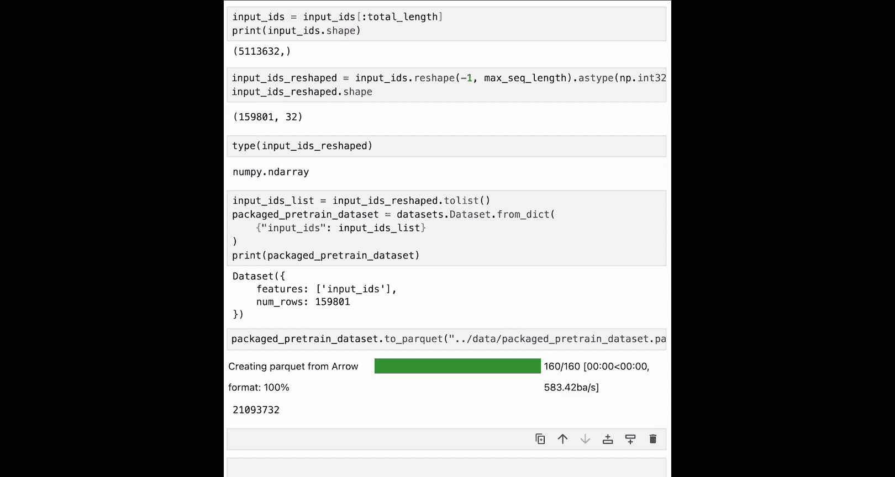

# 吴恩达《大语言模型预训练｜Pretraining LLMs》中英字幕【豆包翻译】 - P4：4.Lesson 3 Data Packaging.zh_en - GPT中英字幕课程资源 - BV176421f7da

Now that you have your clean data set， you need to prepare it for training。In this lesson。

 you'll learn how to package your training data so that it can be used in Hoging face， let's dive in。

As Lucy just mentioned， there is a bit more manipulation of the data that you have to do before you can use it in a training run。

 the two main steps are tokenizing the data and then packing it LLMs don't actually work directly with the text their internal calculations require numbers。

Tokenization is the step that transforms your text data into numbers。

 the exact details of how text is mapped to tokens depends on the vocabulary and the tokenization algorithm of your model。

 each model has a specific tokenizer， and it is important to choose the right one or your model one work。

Ping structures， the data into continuous sequences of auto tokens。

 all of the maximum lengths of the model sport。This reshaping makes training efficient。

One important step in peing is the addition of a special tokens to indicate the start and end of the sequences。

 This is easier to see by looking at real examples。 So let's head to the notebook。 All right。

 let's start with tokenizing。 recall that we have created this par file in the previous lesson。Yeah。

In this step， we're going to use the Huging F data set library so that we can use all the goodies that comes with the library。

 but note that we won't be using the whole file。We will shard the entire data set into 10 pieces and deal with only one of those shards to reduce execution time。

So you can see that before we had 40，000 rows， but now we only have 4，000 rows。

Now let's load to tokenizer， You can choose anyone one from an existing model hosted on HgingFase or create your own Many times you will see models in the same family use a same tokenizer。

 In this case， we will be using tiny solars tokenizer from So， which is in the same family。

Note that we disable the use fast flag In this case。 If use fast is actually true。

 the auto tokenizer uses a tokenizer implemented in rust。

 which operates in parallel and is much faster。 However， in this case。

 long tech samples sometimes1 to hang。 So we will set use fast to false and separately use the mat function and the data set library for parallel processing。

 Are you curious about the outputs of the tokenizer。 Let's try it out before processing in batches。😊。

As discussed in the slides， you can see that the imppaent is tokenized into multiple tokens。

 where a special token here indicates where the original white spaces were located Note that the output is still in text。

Now we're going to convert these into numbers Now we will create a helper function in order to take advantage of the map method of the Hugingface data set library。

 our function will tokenize text， convert tokens IDs。

 add B and EOS tokens We add BOS and EOS tokens because we want our model to have an idea of which tokens are actually coherent We then calculate the number of tokens in each example Do you want to take a look at the results。

We're currently mapping the tokenization function to our data。Do you notice the difference？

Now we have input IDs and nu tokens。Within our data， let's take a look at the first example。

So here you can see that we have text。An input ID that goes along with the text。

And the total number of tokens。That go with the text。Yeah。

All seems good if you want to check out other samples， feel free to change the index。Yeah。

Now we are going to calculate the total number of tokens in our data when training alums we are often interested in calculating the total number of tokens and we can easily check this with NumpI。

So with this small data set that actually started out with approximately 4000 tech samples。

 you actually have 5 million tokens。You can see how a data set built from most of the internet or entire libraries of books。

Can end up with billions or even trillions of tokens。

Now we're on the last step of preparing our data set。Let's pack our data set。

Our data set currently contains rows of variable lengths。

So the lengths of examples are all different， but when trading a large language model。

 we want to transform the variable lengths to lengths of equal sizes to do this。

 we will perform the following first we will concatenate all input IDs so that it turns into one large list we also call this serialization。

 Second， we reshape the large list by partitioning the list into smaller lists with a max sequence length so let me show you how this actually works。

This is concatenating all of the input IDs for each example into a single list。

You can see that the number of input IDs。Equals the number of tokens that we calculated above。 Now。

 we will choose a maximum sequence length here。 we will set it to 32。

 but this can be set to a longer length If your device has enough memory。

 A longer maximum sequence length will enable better performance for long text。

 Note that recent models such as solar Lama2 use 4096。 Now。

 let's calculate the total number of input Is so that the remainder is 0。

 when divided by maximum sequence length。😊，You can see that the number of input IDs shrank a bit。

Next， let's discard the remainder input IDs from the end of the data so that it can be exactly partitioned by maximum sequence length。

If you check the input ID shape， it will be one dimensional， and you can tell that by the comma here。

 let's reshape input IDs to minus1。Max sequence length。

 we can also make sure that the type is in 32 here。嗯。Here。

 using minus1 lets the reshaping function to automatically determine the number of rows。

If you check the type of input IDs reshaped， the object is currently a Ny array。

 but you need to convert this to a Huging face data set so that it can be used in training。

 so let's do that。Yeah。So what we're doing here is transforming。Our input IDs into a list。

And then into a dictionary。Yeah。Finally， let's save the data into the local file system to use again later。

Great， so we now have our clean data tokenized and packed into the right shape for training The next step is to configure our model。

Let's move on to the next lesson to see how to do that。

