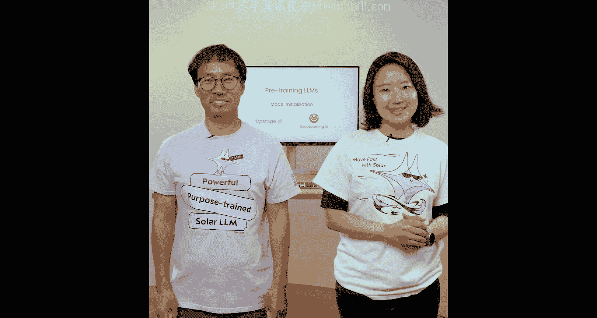
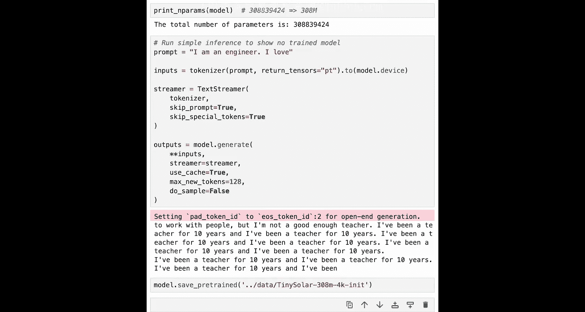

# 吴恩达《大语言模型预训练｜Pretraining LLMs》中英字幕【豆包翻译】 - P5：5.model initialization.zh_en - GPT中英字幕课程资源 - BV176421f7da

The assess are awesome， but now you need a model to train， so how do you get started？

There are several ways to configure and initialize a model for training。

 and your choice will impact how quickly pre training proceeds。

Let's take a look at some options。Although there are several variations of the transformer architecture used in large language models。

 this course is focusing on Decode only or oral regressive models。

The decoder only architecture simplifies the model。

And is more efficient for the next token prediction。

Openized G models and the most other popular LMs Lama Mial tekcon adeted or decoder onlyni architecture。

 It is also the architecture we used at up stage for our solar family of models。

 A decoder onlyni model is made of an embedding layer that turns text to to vector presentations。

 and then several decoder layers， Each of which contains several different parts that are based on neural networks。

 The details of how this works are not so important for this short course but you can check out other course at deep learning AI for more information。

 Lastly， the model ends with a classifier layer that predicts the most probable next token from the vocabulary。

 Once we decide the architecture。 The next step is to initialize the weight these weight get。

Opdated during training as the model learns to predict the next token from the examples in the training data。

 there are few ways that you can initialize the weight。

 the simplest choice is to initialize the weight with random values。 This is okay。

 but it means that training takes a very long time and requires a huge amount of data actually a better way is。

To reuse existing weight， for example， if you want to build 7 v model。

 you can start from Lama 7b or Miral 7 v weight， This means your model has already been trained。

And you get some basic knowledge so you can generate texts very well already this is the best way to start if you want to continue portraying a model or new domain data。

 training in this scenario generally takes much less data and the time then starting from random weight。

 but still it much more data than fine tuning。With all the open models out in the world right now。

 this can be a great option for creating your own custom LL M。 So， for example。

 here is the details of how our team and upstage created a Korean version of。😊，Our solar model。

 the basic model for this was the solar 10。7 billion English model。 we used the exactly same size。

 but we put more data， So in this training we used 200 billion tokens which is mixed with the Korean and English together and then the hypoparameters we used in heres if you're interested in。

 you can take a look。 these hypoparameters are also very different from fine tuning。

 the total price here is 0。2 million。 So if you see the price its still expensive， but it's much。

 much cheaper than starting training from scratch。And you might notice that our model has 10 billion parameters。

 which is not the same size as we weight that we initialize the model with。

 we found that the 7 billion model which was available but not quite good enough for our purposes。

 but we were limited by our hardware to train a model less than 13 billion。

 so we took advantage of a technology called model scaling to create a new model with a different size model scaling removes for add layers。

To an existing model and then carries out more training。To create a new model with a different size。

 What if you want to make a smaller model， One option is called downcal。

 Downcal involves removing layers。To produce a smaller model。

 then the one you start with this approach can work well for large models。

 but it doesn't work well for small models。 In general， layers near to the middle。

 all models are removed。And then the resulting smaller model is per chained on a large body of the text to bring its weight back into coherence。

 The better method is called upscaling。 Here you'll start with a smaller model。

 Then duplicate some layers to make a larger model。 Let's take a look at an example。

To make a 10 billion model without obscaling， you can start with a 7 billion model for illustration Let's assume the 7b model has four layers in reality Lama 7p。

 for example as 32 layers。 you can make two copies of the model。

 then use some top layers from one copy and then some bottom layers from the second copy and put them together to create a new model with a six layers at this point。

 the model is low angle coherent inference would not work well Con the pretraining is required to bring the model back into coherence and enable text generation。

 However， because the model weights of the capital layers have already encoded some language understanding and knowledges it takes less data and time to create a good model。

 In fact， obscaling can allow you to train a larger well。

ing model with a 70% less data than training the equivalent model from scratch。

 So how we build solar。 You can see our papers for more details。

 We started with the two copies of Mi 7b and expand the model to 10 billion using the method using just a so。

 Then we continue to pretraining on lots of new data here we used 1 trillion tokens。

 So the approach was more expensive。 It costs us about 1 million。 However。

 this is actually much less data then needed to train a model of this size from scratch。

 which would be around 3 trillion tokens。 So depth of scaling can actually be a more coste way to pretrain a model。

 although it's still expensive。 Let's head to the notebook。

 and take a look at how you can create models using each of this method。Let's begin， as before。

By setting a configuration to minimize warnings and by setting a seed for reproducibility。

The models we will be creating here will be based on metatas Lama2 architecture。

 a decoder only model that is one of the most frequently used architectures by LLM developers。

You can set configuration options using the Iama Config module of the Transformers library。

We will reuse most of the parameters of the original Lama2 model。

But since we want to run our model with limited computation。

 let's adjust some parameters to reduce the model size。

We will be setting the number of hidden layers to 12。And shrinking the model in terms of hidden size。

 intermediate size， and number of key value heads。Experimenting with these settings is hard because pre training takes so much time and is expensive。

The best place to look for advice on designing a model's architecture is the academic literature。

So look for papers on the archive and in conference proceedings。

The example scaling I'm doing here is primarily to allow the model to fit in memory Now that we have determined our model configurations。

 let's initialize the model。The first and most naive way to initialize a model would be to initialize it with random weights。

Initializing a model from random weights is very easy with the Transformers library。

 All you need to do is pass on the config we've just in create an instance。Of Laama， for Cas L M。

Before we move on， let's check the size of the model。When training on LLM。

 we always want to make sure of the size of the model because the size directly impacts compute and cost。

 so our current model is sized at 248 million parameters。

When a model is randomly initialized as shown above。The weights are given random starting values。

 following a truncated normal distribution with a standard deviation of 0。02 and a mean of 0。

Values beyond the two sigma from the mean are set to zero。Let's take a look。

Add a small sample of weights from one of the layers in the self attention head。

The model is randomly initialized and not trained on any data。Do you want to try it for inference。

Can you guess what it will output？So you've seen this happen before。

 we are first going to Loto tokenizer。And here we will load a tokenizer from Upstage。

If you enter a prompt。Like we've entered before， I am an engineer I love。

And turn that prompt into tokens。Define a streamer and create some outputs。

You will see some random outputs because our model is not trained yet。Before you move on。

 let's release the memory。This is because these models we created take up to several hundred megabytes。

 and we need to release the memory to avoid crashing the kernel。Now。

 instead of random weight initialization。Let's try using a pre existing pretrain model here we will use weights from tiny solar。

Which is 248 million parameters。All we need to do is load the model using auto model for causals LM。

And we are ready to keep training。Taking an existing model and continuing to train it on new data is called continued pre traininging。

And is a much faster way to train a model on new data than starting from scratch。Before we move on。

Let's empty the memory once more。Earlier in the lesson。

 some showed how you can remove layers from a large model to create a smaller one in a process called Downscaling。

Here's how you can do that。You will be shrinking a 12 layer 248 million size model by removing the mid layers。

To start。Let's check how many layers the model currently has。

You can see that the model currently has 12 layers。And has 248 million parameters。

Now let's create a smaller model from our initial model by deleting two of the mid layers。

Here we will be selecting the first five layers and the last five layers and concatenating them to form a total of 10 layers。

Now you have 10 layers left， which is what we wanted。

So now this model configuration is ready to start using for pre training。As you heard earlier。

 downscaling works best with larger models。This small model here would not be a good choice and is only being used to show you the method。

Let's go ahead and empty our memory once more。So now we are going to try upscaling a pre existing pretrain model。

By upscaling， we mean that we start from a small pretrain model and end up with a larger model。

Here we will be upscaling a model with 10 layers to a model with 16 layers。

The first step is to create a model and sayss for the large final model we are going to train。

So these are the basic configurations for the larger model。As above。

 we start with the Lama2 model architecture。And all numbers， other than the number of hidden layers。

 are the same as the smaller pre train model we are going to upscale。

Let's finish this part up by initializing the larger model with random weights。Next。

 you are going to overwrite these randomly assigned weights using the weights from a pretrain model。

So let's load the smaller pretrain model into memory so you can copy layers from it。

Here you will use tiny So， 248 million。Which has 12 layers to upscale to our 16 layer model。

First you'll take the bottommost fate layers。And the topmostate layers and concatenate them to form a total of 16 layers。

You'll then overwrite the weights of the randomly initialized model with these new values。 Lastly。

 these lines of code here。Copy over the components that make up the embedding and classification layers for the model。

So those can be used as well。Let's check the number of parameters to confirm that it hasn't changed。

Let's also try inferencing the model。Now this is interesting。

This output looks a lot more like English。😊，Although it definitely doesn't make a lot of sense。

The model has been initialized with another model's weights。

 so it has some ability to generate English。But the layers are not yet coherent。

 so the language isn't fluent。This is why it's necessary to continue pretraining this model on more data。

But as you can see here， you are much further along than when you started with random weights。

This is why upscaling can help you train models much faster。Then during training。

 you'll be updating all the weights of this model， so all of the layers work together as expected。

Let's save this model and then move on to the next lesson where you'll see how to train it。

