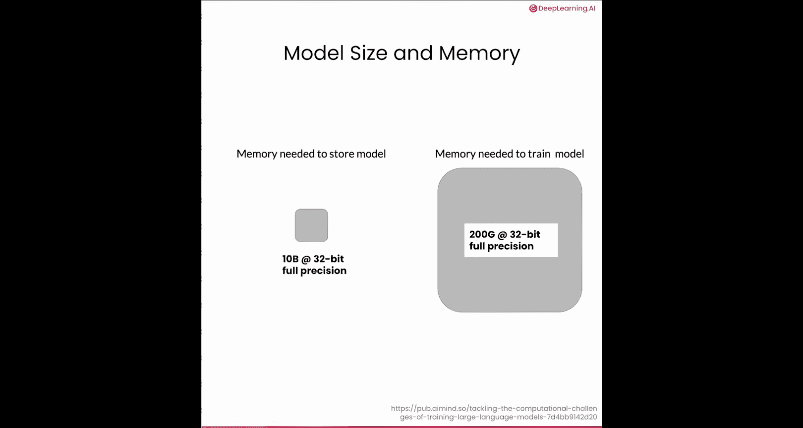
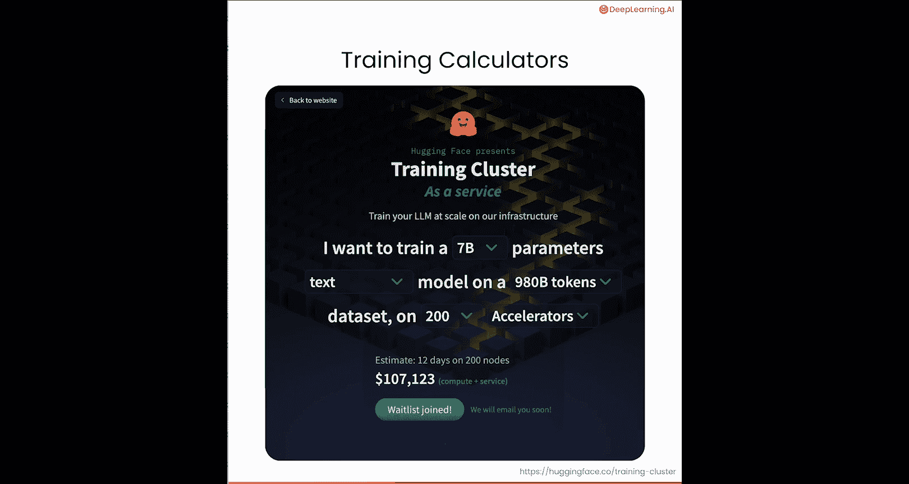
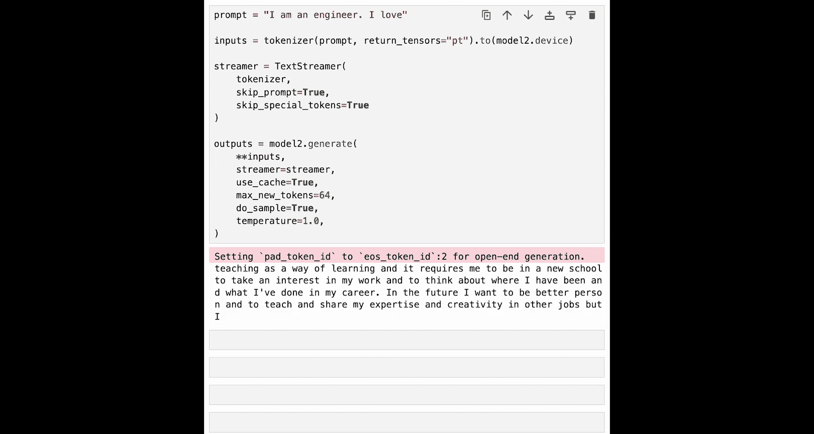

# 吴恩达《大语言模型预训练｜Pretraining LLMs》中英字幕【豆包翻译】 - P6：6.Lesson 5. Model training.zh_en - GPT中英字幕课程资源 - BV176421f7da

Okay， so now you have your training data set and you know how to initialize a model with your preferred training configuration。

So let's get into the fun part training in this lesson。

 you will learn how to configure a training run and train your own model， let's dive in。

So now we are going to train our model using Huging past trainer。

 we will take care of the most of the training steps。

The first we load the data using Hoggingface datasetet class。

This implements some methods that are needed for training and data loading Then we need to set the hyperparameter for our training。

 including the batch size， learning rates， and so on。

We are let specifyify some good studying failure for those parameters in the notebook for this lesson。

 the next step is you just a pest the trainer your data configure model and then your training parameters then you can call the run function to kick off the training at this point you're all set just to sit back and monitor the training I know you will be excited to use your new model。

 but it's a good to be patient training takes a long time depending on the hardware you have。

It could be weeks， two months for large models with large chain dataset sets。

One important thing to note is that you need more memory for training models than you do for inference。

 The extra memory is needed to store the gradients and then activations that get updated during the training process。

 So let's say you need a 10 billion。Parameterters to store， then you actually need up to 20 times。

 which is 200 gig of memory for your training。 This requires multiple GPUs。

 and it's going to be very expensive。 There are calculators you can use to check how much your training job might cost before you get started。

 For example， here is one for huging pace。

In this case。Your estimated cost for training17 B model on 980 billion tokens with a 200 GPus。

 It's about 100 decay and takes about two weeks。 Let's head to the notebook where you can see the code to set up a training run for your model。

 I'm going to show you how to set up a training run and we'll use both the data and the upscale model we've saved in the previous lessons for our example。

 Note that we will be training the model on a CPU here。

But you can always change this to auto。If you have a GPU。Let's start by loading the model。

 as you have done before。Now let's load our data。We are going to update two methods to the dataset class so that it can interface with the trainer。

 the L method here lets you know how many training examples there are。

And the get item returns the input and output tokens for each example in a dictionary format。

We are creating this custom class so that we can load the pre processcessed packet file that we created in lesson  three and return input IDs and labels。

Note that we are setting labels equal to input IDs here because we want to perform next token prediction。

Then Lama 4 causals LM will shift labels internally to create multiple input out prepares for supervised learning as you saw back in the first lesson。

Now， let's define a custom arguments class to set arguments for training。

 Choosing parameters for LLMs can be challenging and often involves significant research。

 That's because training LLms is a costly process and typically does not allow for much trial and error。

 Unlike traditional small scale machine learning。 there are many important configurations here。

 But let me just highlight the top most important settings。 Opim here indicates the optimizer。

 And while you are free to explore different optimizers such as plain old at Adam W or at with weight decay is the go to optimizer these days。

 when training an LLM。 there is also max steps， which indicates the number of maximum steps for training。

😊，When you are pre training， it is common to set the numb train epochs to one instead of setting the number of steps。

This means that you will process all of your data once determining the batch size is mostly up to you to decide。

 but a rule of thumb is to maximize the batch size。

 given the memory capacity of your training device recall that in the data set you created。

 the maximum sequence length was 32 tokens， which makes the whole batch consists of 64 tokens。

 In this case， where the batch size is2。 Also， this sets the batch size per accelerator。

 So if you had 8 GPus available。 you'll process 8 times the batch size。

 resulting in 512 tokens per training step。😊，There are some lines of code commented out at the end of the configuration that will save intermediate checkpoints of your model。

I will discuss more about this at the end of the lesson。Now。

 let's create a hugging face argument parser that will parse the input arguments and also add an argument so that we can appoint the output directory。

 This line of code will set the output directory to output。😊。

This is the directory where the models will be saved at the end of the run。

If we pass the arguments to the custom data set。Our data set will be configured as needed for the trainer。

After configuring a data set， I encourage you to always print a sample line or at least the shape of the data so that you can be assured that you are working with the correct data。

You never want to spend lots of GPU hours on the wrong data。

Here you can see that the length of the tokens is 32。

 and that is what we configured max sequence length to be above。So this looks good。 Now。

 we're finally ready to start training。 And this is the most important， yet simplest part。

 All you have to do is initialize a trainer object with the model to be trained。😊。

The training arguments， the data sets for training Here。

 we're going to run the trainer for 30 steps and print out logs every three steps。

So let's commence the training run。We will speed the video up and this will take a few minutes for you to run in the notebook。

Note that you might have to run quite a long time to monitor the decrease in the loss because the model already has some ability to write English。

 the change in the loss with each training step is smaller。Here with just 30 steps。

 you see the loss oscillate， and it might seem like it isn't decreasing。

But if you ran this for 1000 or 10000 steps。 You would see this value decrease。Normally。

 you would pretrain a model for weeks， If not months， note that we don't slack off during training。

 we actually monitor the process closely。 What we would do first。

 is to record the losses with weights and biases， which allows our team to check the progress at any time。

 If you're interested， you can check out the short course from weights and biases on deep learning do AI。

 We would also create checkpoints。 or an intermediate version of the model every day。

 saving the model like this ensures that we don't have to start from the beginning。

 In cases that compute goes down or crashes。😊，After the trainer runs。

 it will actually output some information about the training， including the global step。

 the training loss and the train run time。 recall that these are the saving configurations that I commented out above。

 Here， we're mentioning the saving strategy where we're defaulting two steps。

 You can also replace this to epochs。 We're also mentioning that the safe steps is every three steps So we are going to have a checkpoint every three steps。

😊，You can always replace this with another number and in practice it would be like 10，000 steps， 100。

000 steps， and so on。We would also like to limit the number of checkpoints because checkpoints take a lot of storage space here we are limiting it to two。

 which means only two will be saved in storage one more thing。In case you are curious。

 here is a look at how the model performs 10，000 steps into the training。

Here you're loading a tokenizer。And then a checkpoint。That was saved after 10。

000 steps like you just saw of。And here is a setup to have it generate text。

So let's take a look at its output。Okay， so looks a bit different than before。

The text still doesn't make a ton of sense。 But part of that is that a model this small will also have problems generating long stretches of coherent text。

But the performance is still a lot better than before。😊。

It is no longer repeating the same text over and over。Each sentence is different。

 and there is some related content from sentence to sentence。 So overall， we see some changes。

 and we'd expect more if we kept on going for full pre training。😊。

Saving checkpoints like this one gives you intermediate versions of the model that you can evaluate and see how training is going。

 Let's head to the next lesson to talk more about evaluation。😊。

