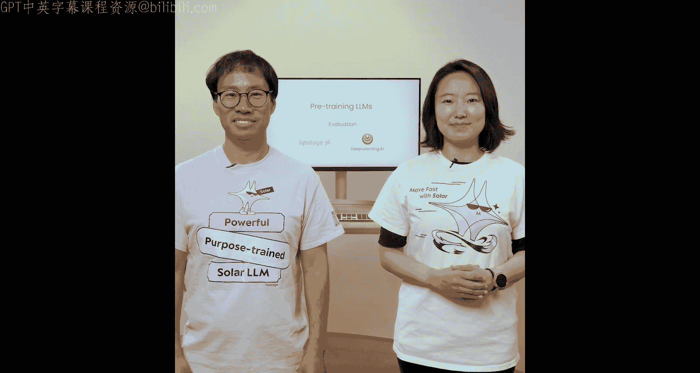
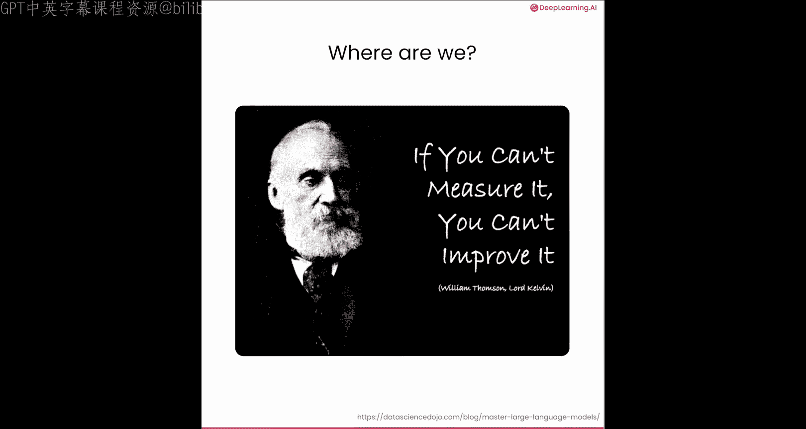
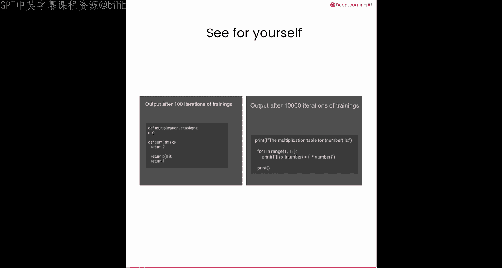
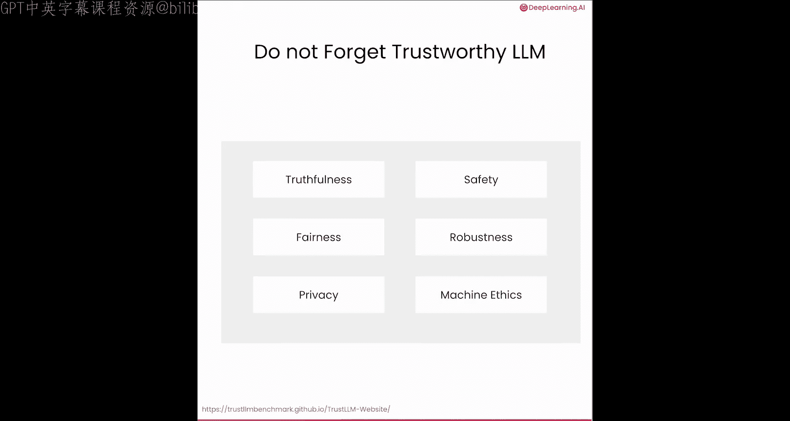

# 吴恩达《大语言模型预训练｜Pretraining LLMs》中英字幕【豆包翻译】 - P7：7.Lesson 6. Model evaluation.zh_en - GPT中英字幕课程资源 - BV176421f7da

Fantastic。😊，Youve now seen all the steps required to pretrain a model。

 but once you finished your training， how do you know how good your model is？In this final lesson。

 you'll explore some of the common evaluation strategies for LLMs。

 including some important benchmark tasks that are being used to compare the performance of different models。

Let's take a look。

As you know， we cannot improve performance if you cannot measure it。Evaluation is like a test。

 sometimes taking a test is pain， but it's necessary to know where you are doing well and then where you need to improve to evaluate your model。

 there are four common methods you're checking the loss。

 you see the results you can compare the models and using benchmark dataset sets these are not one time effort but a more continual process the first method is overserving the loss during your training if training is going well you should be decreasing over time in consistent way。

If it's not you might want to reconsider your training hypoparameters， especially the learning rates。

 you might also want to reconsider your model architecture if you observe a platetoning of the loss curve also known as the situations there could be a few problems One is that your model may have reached its maximum learning capacity and cannot learn more from additional data。

 this could happen when training a small size model it could also indicate a problem with your training dataset sets like a low quality examples。

So definitely check your data if you are training a big model and see sat when training LLM is checking the outputs of the model yourself during training is really important so you can create the checkpoints of the models periodically say every 10。

000 training steps and they make sure that the model output is what you expect you should be getting better at generating text over the time。

 human evaluation is still really important for the LLM so don't overlook this step comparison with other models can also be very useful。

When you have two results side by side， it is much easy to tell which one is better。

 There are some online tools available to compare models。

 including uptage console and then LMC from Buckley， you will see the links to this in the notebook。

This is one of the best ways to benchmark performance performance， but it does require human effort。

 one active area of research is using an LLM judge to decide which model output is better。

 but they can be biased depending on how the judge model was trained。

The most common evaluation method is to use benchmark dataset sets。

 This is like helping the LLM take standardized exams by testing all models on the same benchmarks。

 you get a fair comparison of the abilities and the performance of the different models。

 There are few famous benchmark dataset sets like Arc MmL， Heaswe， truthful QA。

 Mingram and GSM AK This measures to general abilities of LLMs like regioning common sense and mathematical skills。

 But depending on how you want to use the LLM， it may be more useful to measure。

Compositional abilities， benchmarks like empty bench。

 E Q bench and Instal have been developed for this purpose。 Ultimately。

 when evaluating the performance LM， you have to make a decision。 that is the best。😊。

For your model and use cases。Let's head to the last notebook where you will learn how to download and run some of these benchmarks on your model。

Here we will use a popular open source evaluation library called LM Evaluation harnessness from the Luther Project。

It is already installed in the learning environment， but if you need it in other environments。

 you can always run this line of code。 The harness serves many， many tasks for evaluation Among them。

 we will choose to evaluate tiny So on the truthful QA MC2 task the MC2 task is comprised of multiple choice questions developed by the University of Oxford and OpenaiI and is one of the evaluation tasks included in the Hugingface open LLM leader board The MC2 task works as follows。

 Given a question and multiple true false reference answers。

 the score is the normalized total probability assigned to the set of true answers we will run this evaluation on a CPU as always。

 and run only five examples so that we can end our evaluation within 10 minutes。😊。

Note that evaluation tasks take quite a long time because the log likelihood is calculated for every candidate。

We'll speed up the video here for your convenience。Now you're done with the evaluation。

In this final table， you can see that the final score is around 0。4。 Remember that our model is very。

 very small， So it is unfair to compare with other models that have more than several billion parameters。

 you can use the code here to run the whole evaluation suite。

 If you have trained your own model and want to be on the hugging face leader board。

 This custom function here will run all six tasks involved with the corresponding few shot parameters。

😊，We're not going to run it here because it takes too much time for a short course。

 The fu shot parameter indicates how many examples are included in the prompt that the LLM responds to。

 So there will be 25 examples included for the art challenge。

 Note that these are fixed numbers for the hugging face leader board。

 so all models are tested in the same manner。 I hope if you train your own model that you'll evaluate on these benchmarks so that the community can see how great your model is。

😊，Hope you have fun So in the notebook， you saw few ways to run benchmarks by handLuckiily there are tools available to make evaluation much easier。

 For example， Eververse is an open source projects that we created at upsage to support your LLM evaluations we also use it internally at our company Everse unifies various LLM evaluation framework using Git submods and it is fairly easy to set up and run you can run everse on several models at once and it will provide comprehensive reports of their performance with the benchmark scores ranking and other criteria Lastly you will probably fine tune and align your model after finishing your pretraining so you can use it in real applications Don't forget about assessing the model behavior and alignment with the human values。

Pentty marks for truthfulness， safety， fairness and so on are also available and still in active development you can check out the link in the notebook for more information。

