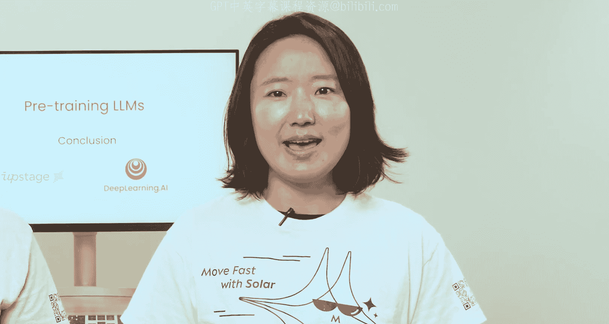

# 吴恩达《大语言模型预训练｜Pretraining LLMs》中英字幕【豆包翻译】 - P8：8.conclusion.zh_en - GPT中英字幕课程资源 - BV176421f7da

Thank you for making it to the end of the course。 You now know all the steps to pretrain a model from preparing your training data and configuring your model to training it and evaluating its performance。

Although the examples you saw here were running on a CPU。

You can adapt the code in the notebooks to train larger models on GPS。

Just don't forget to be aware of the costs associated with your pre training work with the knowledge from this course in hand。

 we'd love to see more groundbreaking pretrain models from you。

And please share your work with the community if you do train your own model。

 We hope you enjoy the course。 Happy pre traininging。

