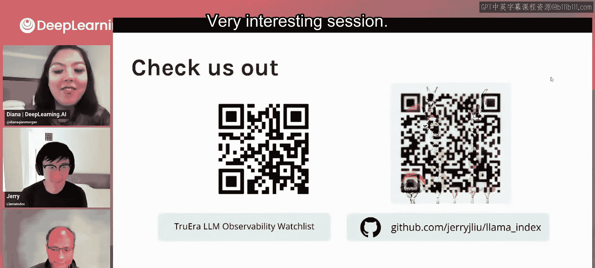

# 吴恩达《如何构建、评估和迭代LLM代理｜How to Build, Evaluate, and Iterate on LLM Agents》中英字幕 - P1 - GPT中英字幕课程资源 - BV1Ew4m1R7ju

Hey everyone， my name is Diana Chan Morgan and I work at Deep learningarning。

AI runningning All Things Community Today we have an amazing workshop with some of our course partners to bring together what's next for LLM agents。

 so today we're working with LM Inex and Trea and they will guide you through the entire process and building evaluating。

 iterating and deploying successful LLM agents。😊，This session will be recorded and the slides will be sent afterwards。

 we also have a notebook that our speakers were so kind enough to share。

 so we will drop that in the chat for you to be able to access and follow along during the session。😊。

This workshop utilizes cutting edge open source tools like WellM Index。

 a simple and flexible data framework for connecting custom data sources to large language models and true lens。

 a powerful platform for testing and tracking LLM app experiments。In the session。

 you'll be able to gain valuable insights into building your first LLM agent， effectiveness。

 hallucinations and bias， iterating for production ready applications and maintaining high performance in production。

For any questions for the speakers， we've also dropped a link in the chat to ask and vote upon the questions that we will answer in the last five to 10 minutes of the workshop today。

😊，This workshop was also inspired by our N short course that was just launched last week。

 it's calledBuilding and Evaluating Advanced RaG applications。

 I'm sure our speakers will talk a little bit more about it today。😊。

You can find that on our website and we'll also be setting that out afterwards and you can find it in the link in the chat as well。

And to start off with I want to share our first speaker we have Jerry Jerry Leo is the CEO of Lama Index。

 he brings a wealth of experience from his previous roles as an ML engineering manager as a robust intelligence and research scientist at Uber Hey Jerry we're happy to have you here today Hey thanks for having me。

😊，Absolutely。And next we have Anapam is the president and chief scientist at Trurera and is a renowned AI expert and former professor at Carnegie Mellon University his research focuses on ensuring accountability and fairness in AI systems。

We're so happy to have you here today out of pump。Great to be here， Di。Absolutely。

 well I'll let you guys take it away for the workshop， I know you have a lot of stuff planned。

 so I think our community is ready to dive into everything。😊，Awesome。Perfect。😊。

I'll let you guys take it away。Awesome， the slides are visible。

Great so let's get started today's workshop is about how to build。

 evaluate and iterate on LLM agents like Dina said Jerry and I just recorded a course and released it on deep learningarning。

 AI which focuses on ragbased applications you can think of this as a continuation of that but expanding into agents and later on Jerry will comment more on the technical connection between the two。

😊，Between the two。So just to orient ourselves， we'll take a few minutes to look at some examples of frameworks and actual agent based LLM apps that are starting to get。

Quite a bit of adoption so Chad GPD put out their plugin sometime back， as many of you are aware。

And with these logins or LLM agents。You can augment chat GPD to access up to date information。

 run computations or use third party services。 Then we share the slides later。

 these are hot links so you can explore them。 These are some of the examples of。

Applications that the first set of applications that were currently available。

 you can see that these agents like on Instacart， you can order so these agents can start planning for you。

 they can start acting on your behalf and order things like grocery and help you plan for trips and so on or even do math。

So that's one set of applications there were a couple of other。😊。

Very early seminal work in this area one is this very interesting result paper called React。

 which combines reasoning and acting with large language models this has been a very influential paper in the space of agents。

Before that， thinking around reasoning。Like chain of thought reasoning where an LM might。

 when it's asked a question， reason through the answer first and then provide the answer。

 which is very widely used。Reasoning was separated from acting where you can go out and the LLM can be used to act on the environment and act on your behalf for various tasks like planning your travel reservations or making restaurant reservations and so on。

With react， these two bodies of work were pulled together where。

There was an interleaving of reasoning and actions and that really significantly increased the power of agent based LLM apps and let me give you a very quick example。

And this is taken from the react。Paper so the question that was asked here is aside from the Apple remote。

 what other device can control the program Apple remotem was originally designed to interact with。

And if you just ask。Standard LLM， then the answer was iPod。

 which was incorrect you get if you make the LLM think through reason step by step。

Even then it comes back with the wrong answer， if it only acts。

 then it starts doing an external search， but the search does not produce a meaningful result。

So this on the left here is。Standard reasoning act and a separation between reasoning and acting when you do one at a time but not interleaving that does not produce the right result on the right here you can see how where thinking and actions are。

Interleaved， you suddenly start seeing a much better result。 So the thinking here was， well。

 I need to search for the Apple remote。 So it invokes the search API to do the search。

 The search comes back with this front row media centre as。

A key word the second thinking now is we need to go search for front row the first search for front row does not give anything very concrete but suggests that you might want to look at some similar things which are which includes the software so the next layer of thinking that results in the action being searched for front row software eventually it results in finding the right answer which is。

You can also control these devices with keyboard function keys the details of this example is not so important。

 but the main thing is this interleaving of reasoning or thinking。

With actions and this back and forth really is where a lot of the power of LLM based agents derive from。

So I encourage you to take a look at this set of results， the react paper， the GitHub。

 to get a sense of the history of one of the important developments。

That spurred the recent excitement about agents。The other project that I'll point you to is auto GPD AutoGPD came out sometime back and it was one of the fastest growing open source projects on GiHub。

 you can see it's this is a relatively recent screenshot it has about 150 plus 150k plus stars。

And then this hackathon， which was recently done in October。

Has lots of examples of interesting LLM based applications that you can explore。So for example。

There are some interesting things around coding。And so on。Now。

 as people started diving into agent based applications。

 there are some limitations that started emerging as well， some failure modes。

Often this includes augmenting LLMs with additional。Tools over APIs。To do search， to look for。

Travel itineraries to look for。Restaurant reservations and so on and as you start increasing the number of tools。

The LLM has to reason based on a query what tool is the right tool to use as part of creating the answer。

 and that's where mistakes happen， that's a common failure mode， there can be infinite loops。

 theres also hallucinations， a problem that is known very common with large language models appears also in this context。

And we'll talk about these in a minute。So as we think about the space of。AI agents。

We think about it in this kind of three stages the specialized data agents。

 which are quite similar to retrieval from a vector store and the retrieval augmented or rag kind of architecture。

But with access to real time information and some additional pieces。

 there's general data agents that can have access to more than one tool and can accomplish a wider range of tasks。

 and then they're agents that can take action in the real world。

So we'll focus quite a bit on data agents in this talk， and in that context。

 we will make uses introduce you to how to work with， how to build agents。

 data agents with Lama indexdex。And and to evaluate it systematically understand the failure modes。

 hydrate and improve it by leveraging true lenss， so these are our Githubs。

 please feel free to explore them， many of you are already there playing with Lama index and with true lenss。

And you know， our developers。Enjoy it when you request features， make contributions。

Please give us stars as well if you like what you see there。With that。

 I'm going to transition it over to Jerry and Jerry will talk about how to build。

LLM agents with La index awesome yeah thanks Ali and so maybe taking a really quick pivot right here we're kind of featuring our course that just came out last week building and evaluating advanced ragG applications and so the course itself is focused a little bit more on advanced ragg techniques retrieval augmented generation for those of you who might be less familiar with RaG RaG is basically just a technique for augmenting your LM with an external knowledge corpus and so the way it works is you first you know do retrieval or index your data into a storage system then you do retrieval from the storage system on query time and then add that context to the prompt window of the LLM and so there's both like a simple way of doing that but these is a lot of developers are excited about exploring advanced ways to do that and to try out advanced methods you also need a rigorous system to do evaluations on both the retrieval and generation piece and so。

We're really excited to work with Truira on this course because you know True lenss has a robust evaluation suite Lama indexdex has invested a lot in advanced retrieval techniques and so we combine them together into this overall short course and so you should definitely track it out and this also serves as a nice bridge into how we think about how agents evolve from RaG basically right like what there's kind of these two buzzwords floating around there's ragG and then there's agents。

And so how do we really think about the transition between RaG and agents and so the way RaG works right we can kind of think about it as box。

 the user has a question like a query， RaG is this overall pipeline defined over your knowledge corp and within this overall kind of ragG box will do retrieval from the knowledge corp as well as synthesis and after that we get back a final response。

One of the ways we think about agents next slide is basically we。

Can think about that as an additional layer in front of the RAG pipeline and what this how we think about this is basically given a user query。

 we can actually feed it to an overall agent that can more dynamically decide how to you know route this query through to relevant tools to try to synthesize the response。

And so in a traditional ragG setup， what typically happens is that the LLM co occurss at the end of this overall pipeline。

 you do retrieval， which is typically a like top K embedding lookup and then you feed it to the language model at the end。

But here the idea is， what if we actually use the LLM at the beginning as well， you know。

 to actually take in the query and figure out how to actually make use of the underlying tools。

 whether it is a RAG pipeline， an external API call or some other service。

So we kind of think about agents as wrapping a layer on top of RAG that dynamically enriches a query with additional information and basically allows this overall kind of higher level abstraction to use tools in the right way to try to give you back the response in the next few slides we'll go into a little bit more about the architecture of how this workss as well。

😊，So a few months ago， we defined this concept of data agents withinllma indexex。

 which are all empowerpowered knowledge workers， a data agent is basically something that is designed to help you automate knowledge and can both do search and retrieval as well as synthesis as well as modify data。

So for example， a sample flow is given in the slide right here， given a data agent， you can。

 for instance， make a call to read the latest emails that you have， for instance。

 from Gmail or from some external service。😊，Afterwards you could also retrieve additional context for your knowledge base this is a perfect example of the RAG pipeline as a tool within an agent。

 so this by itself could be a ragG tool。You could have an analysis agent that actually analyzes the file。

 for instance， using a tool like code interpretter or another Rag pipeline。

And then you could have another tool where by actually calling it。

 you are taking actions and modifying state and so in this case you send an update to a third party service like Slack and that actually triggers a message to be written to this service。

Next slide。The way we think about agents is the core components are really one in agent reasoning loop which AUP covered a little bit in terms of like a react loop as well as tools and so the way it works is the agent reasoning loop typically operates over the set of tools that you give to this agent。

 the agent reasoning loop is typically powered by a large length model because that allows it to be basically dynamically decide you know for instance。

 what are the next tools I should use given the user input to try to call to try to synthesize the right results。

The tools themselves can be， for instance， the what we call query and tools like RaG pipelines。

 so you could basically take all the techniques you learned in the short course that we just find and plug them in as RAG tools to this overall agent。

We also have a variety of different tools on Lama hub that connect to third party services and we have over 20 and 25 tools on Lama hub。

This includes API interfaces to， for instance， Slack notionion。

 Zapier or the code interpreter and all these tools basically act as API interfaces to specifically designed for ALM agents。

 and so you can actually mix and match for instance。

 like your RAG agent tools as well as your Lama hub tools and basically combine them into this overall agent that can both do search or retrieval as well as take actions on different services。

I think onUOM covered what react is in the previous few slides。

 there's also of course a few other ways to actually perform agent reasoning。

 one way is you can just do a function calling loop over the Open AI agent for instance like under the hood I think the API service will just handle for you and decide you know what are the functions that you should call given the inputs that you give it there's also other algorithms like free of thought plan and execute and a few others you know there's a few papers coming out of these conferences every year。

Next slide。Maybe a quick comment here is how do you actually do search on retrieval from a knowledge base right and this touches on this point about basically plugging in a ragg pipeline as a tool within this overall agents one idea here is kind of elaborating on this a little bit lama index basically you know the TLDR is we have a bunch of these things called query engines which are basically for all intent purposes generalizations of rag pipelines they take in a user query and they give you back a response and so what you can do is you know we have a bunch of these query engines we have semantic search which is basically a rag pipeline and we have summarization which is you return all the context and you try to synthesize an answer over all the context instead of just the topK we have query engines over structured data。

For instance， like Texas SQL over a SQL database。We also have advanced RAG pipelines。

 some of which you actually learn in the short course。

 this enables you to do stuff like document comparisons。

 as well as being able to do kind of like combine querying over hybrid structure data with unstructured data。

The way the La index architectural works is you can actually just plug in all these query engines as tools to an agent。

 and so you have basically have this outer agent layer which acts as a reasoning loop and if it calls a tool then the tool executes。

 which is a query engine。And so this basically gives you the ability to compose kind of more advanced reasoning abstractions and layers on top of your data so that you basically first have this agent handle the user query。

 decide what tools to called and then execute the tools。

There's a variety of examples that we have in the notebooks of what this allows。

 this basically allows you to answer more complex queries。

 allows you to do a little bit of query planning to try to execute some things in parallel。

 it allows you to dynamically do both stuff like semantic search and summarization。

 as well as TexasSQL as well as combine information from disparate data sources。Excellent。😊。

An example here right and basically from the screenshot is we have this kind of example agent。

 for instance， and let's say we plugged in two query tools。

 one for Uber and one for Lyft and each query tool is just a RAG pipeline over each company's annual report like the 10K filing。

So each tool corresponds to a top K ragg pipeline over that company。

 you plug both tools into this agent， and now you can ask a question like compare contrast Uber and lifts revenue growth。

The agent through its reasoning loop and chain a thought process and react reasoning will break down the question into sub questionsions over the tool and then each question subquest plus tool will be executed right each tool will be executed with that sub questionion and within each sub question we'll do per document rag so first we'll look at Ubers revenue growth look at the Uber tool do top K get back at the answer then look at liftfts revenue growth do top KR get back the answer and combine the results at the end so this is just a concrete example。

Next slide。And in the next few slides， we'll kind of talk about just some general architecture decisions for how do you think about modeling some of these agents and the slides after that Auto ofho goes into detail about a lot of the failure modes as well as how you actually evaluate these agents。

But just some general things to think about is one is how do you actually handle large responses from tools。

 like if a tool returns like an entire essay or like a very large web page。

 how do you actually handle that some strategies that we basically have and you we call them like on demand loader tool as well as load and search tool。

Basically involve on the flight indexing of this data。

 Sometimes it's nice to first load this data and actually index it into vector storage so that you when you actually kind of query this data that you loaded from the tool。

 you actually do search or retrieval over it instead of trying to stuff everything into the context window。

 even though context windows are getting bigger， like they still overflow on large rounds of data。

 And so this is like indexing it beforehand is a way to mitigate that。😊，Excellent。😊。

Another problem that I think Aud problemm also touched on is a lot of these agents tend to struggle a little bit when you overload them with tools and so if for instance you have more than like five tools and and you know in the limit you might have like hundreds。

 thousands even millions of tools at a certain point this is going to fit into your context window so what you can actually do is you could try to actually index the tools themselves right index and metadata of the tools and then during。

Basically during query time， you actually first do search retrieval over the relevant tools first。

 and then pass that to your agent to then ask why。So these are just some general considerations and we'll do a section at the end as well。

 kind of talking about some best practices for constructioning agents。

 but hopefully this gives you a general overview and passing it back to on。Great， yeah， thanks a lot。

 Jerry。Now， you have。Gotten a good sense of some of the key building blocks for how to build agents and especially how to do it。

With Lama index， where。Jerry and team have。Driven a lot of the early work in this space。

We'll shift gears a bit and start looking at evaluation and what are some of the failure modes of agents？

And how do you detect those kinds of issues， how do you iterate to improve them？

So I'll do a quick introduction to Tru lens in this context。

 Tru L is an open source library to track and evaluate your LLM experiments as you're building。

Your applications and Lama index， for example。Or any other Python framework。

 you can use true lens fairly easily as part of that。Application building process。

And we'll show you a notebook and Dina is also sharing it。

So you'll have access to the notebook on GiHub to play with yourself。

 so as you're building your LM application with say Lama index with just a few lines of code。

 you can connect true lens to it you can start logging the records， the prompts， the responses。

 the intermediate results and our call。Calts。And。Interestingly。

 then what you can do is we have this nice abstraction of what we call feedback functions or evaluations。

 which lets you log and evaluate the quality of your LLM applications along a number of different dimensions。

And once you have those set up， a number of these are available out of the box。

 you can add your own evaluations as well very easily。You can start exploring these records。

 evaluation results in a true lens dashboard， see what the failure modes are。

 and that can in turn inform iteration， selection of the best LLM application version for your。

For your use case。So let's look at a concrete use case where we may want to use the kind of data agents that Jerry introduced for real time retrieval calling out to external APIs and tools。

 so the user comes in here with an input query。And then the LLM acts as the reasoning agent。

 it picks a tool， one from a set of tools that might be available from it。

It translates the user query into an input that is appropriate for the tool。

 gets back the output from the tool and then produces the final response。In this process。

 what are some agent failure modes？It might the agent might in this reasoning step。

 pick the wrong tool。If it's a question about restaurants instead of putting yelp。It might。

 if it picks something like archive and it gives you a research paper on which makes which talks about restaurant recommendations。

That would not be very appropriate， but that kind of mistakes in picking the right tool is pretty common。

 it's a common failure mode for agents especially as the number of tools start going up。

It can get stuck in infinite loops。Especially because many of these agents， the base case ones are。

Don't her Gary state。嗯。APpiI calls might fail， say if the input is not formatted。

 if the query translation is not done in the right format。You might have。Also。

 other kinds of failure modes related to hallucinations。So， let me。

Talk about a very concrete use case now and this is what is available in the notebook that is made available to you。

 we'll talk about a restaurant information chatbot where the user starts asking some questions and then the agent is makes use of the Yale API so one tool in this case to answer questions related to it and we'll compare that with a baseline where the LLM is just answering these questions based on its pretrained knowledge and without access to a。

To an external API， so those are the two that we will compare。This is available in this notebook。

 here is a QR code。Laay with it after the session， if you like。

It'll also be shared with you that's available publicly on GitHub。To make things interesting。

 we instructed the agent to respond in the style of Gordon Ramsey and asked questions about。

Restaurant recommendations， let me just show you。A couple of examples here。😔。

So the first question that we asked was。嗯。What is the best restaurant in Toronto？

the best diner in Toronto and this was to the just to the Open AI LLM。

 not without access to without access to the Yale reviewss， and this is the answer came back with。

I'll take you a second to read it， remember that the prompt was to respond in the style of Gordon Ramsay。

And so there you can see that it's not necessarily particularly respectful。

We ask the same question of。The LLM agent， which had access to the YaL APIs。

And then the response came back。This is the response that came back。This is a bit more polite。

 maybe because he。there was an answer that was actually retrieved。

 which the LLM was then asked to summarize。So now we have a couple of these answers and we want to be able to think through and have tooling to do evaluations。

So let me circle back and start talking about a framework for evaluations of LLM agents。

So before we go into LllM agents， I want to recap one slide from our deeplearning。

AI course on advanced drag techniques that Jerry and I recently launched。

 which you should take a look at， it's just one hour。

In that we talk about the rag Triad for guarding against hallucinations if you think of a rag。

 the user comes in with a query much like in this example， what's the best dir in Toronto？

Based on that query， a set of contexts or chunks are retrieved from a vector database。

 and then those then get summarized by an LLM to produce the final response and along each edge of this triangle。

There is a property that you want to test for。On the first edge。

 there's a property that we call context relevance。

 which is check if the retrieved pieces of context were relevant to the query that was asked。

On the second edge， there's groundedness， groundedness is checking is the final response supported by the context。

And then finally， with answer relevance， we are checking is the final response。

Relevant to the query that was asked。So this is the rag Triad and in the。Deep learningarning。

AI course， we discuss how to implement these kinds of evaluations within trueL programmatically。

 automatically， and you can make use of them out of the box。Now。

 once we transition from Miras to agents。Where things get？A little more。

Sophisticated is this first step that Jerry was talking about you much like Jerry said for。

 especially for data agents， you can think of that initial。Reasoning step of the agent as a。

Layer of abstraction over a rag so the rag triad becomes the agent quad when the user asks a query。

Then there is a tool selection step which needs to be evaluated as well。

 which is done by executed by the agent， and that involves both picking the right tool as well as translating the original user query into a query that is。

In the right format for the tool that was selected。And then once that is done。

 the next few steps are similar to what you would do for a rag based application。

 you want to check for context relevance。Youd want to check for groundedness and you want to check for answer relevance。

And what I'll do next is to just give you some concrete examples of how this plays out。

When we work with the。Example of the LLM agent that's making use of the Yale API， and then we will。

 Jerry and I will tag team and share with you a bit of the flow。

 the code in the notebook that makes it all real。So in this first step here for this particular example。

 because there's only one tool。Which is the YLP API tool selection simply reduces to query translation。

And this was the original question。That was asked， what's the address of Gammo social in San Francisco？

And the LLM agent translated it into this question for the Yelp API address of gumbo social in San Francisco and the automated evaluation that is available in true land checks for semantic equivalence between these two。

Between these two questions leveraging LLMs， so some of the。

Some of the evaluations that are available in true lens make use of large language models as part of the evaluation process。

 there are also other ways of doing evaluations that make use of standard NLP metrics as well as smaller models that。

That offer some trade offs between effectiveness and scalability。If you look at this example。

 it's a nice example， theLim agent does a good job of translating the original question into the kind of keywords that work with the YL API。

 and the evaluation gives it a high score on the scale of zero to1 it's one。

 meaning that it did a good job of query translation。😊，Next， we look at the second step in the squad。

 which is context relevance。So。We get back this answer from the API and now we are asking。

Is this answer relevant to the question that was asked and this also works well。

 context relevance does well here， the answer is quite relevant to the question that was asked。

 and so that gets a high score as well。The third test is around groundedness。

 Groedness is looking at whether the final response is grounded in the set of retrieve context。

 In this case， the final response very closely follows the。This is the final response。

 the address of Gambo socialll in San Francisco is this particular address。

And the retrieved context was。Just the address itself。

 so the final response that's provided by the LLM is well supported by the evidence in the context that was retrieved in this case from the Yale API so it gets a high score so in general these steps could fail。

It could be that the LLM hallucininates and makes some stuff up and it produces a final state sentence or response。

 which is not backed up by the retrieved information from the Lp API in this example it does。

Rely on that exclusively， and so the groundedness score is high。

So here's an example where the groundedness score is not as high。

 so this was the Toronto diner example， so you can see。

That there are a few sentences here in the final response。The first sentence。Talks about。

The best diner in Toronto is subjective and can vary depending on personal preferences。

And the supporting evidence for that is。This is what was retrieved from the Yale APIpi。

 It is difficult to determine the best diner in Toronto without prior knowledge， however。

 based on the context information provided here are some of the diners worth considering。Over here。

This is again well supported， it's talking about there's not a unique answer to this question of best Dinner in Toronto。

But then the LLM here injected in a bit of additional things， its own opinion。

 you can I recommend you try them out and decide for yourself。

 and then it also snug this in just to make sure to have low expectations as most diners in Toronto are mediocre at best。

So this last sentence over here， perhaps the LLM is responding to being prompted to act like Gordon Ramsey。

 I just can't get away from it。So that is not well supported by the retrieved information。

 the retrieved context， and so you can see that it has a low score。So in general。

 the groundedness evaluation is super powerful in identifying areas where。

The agent makes stuff up and engages in hallucinations。And then this finally。

 so here's another example， this is from New York， maybe I'll skip this example。

 but if you take a look。U。The best pizzas are places in New York， it talks about Ruviossa。

Lobardis and so on。And then it injects some sentences。

 these places are known for the delicious and authentic pizzas。呃。

And a few other things like Ruy Rosof as a variety of thin crust pizzas。

 these are likely things that。It knows the LLM might know that because it was pre traineded on such a huge。

Da set that it may have figured these things out based on its training data or its just general trends that it learned from its training data that these are some of the kinds of things that are available in PiIDs areas。

But it's not backed up by。The retrieved pieces of context。

 So this is super helpful because it's telling you showing you where you don't have nice traceability of the final response back to。

Individual pieces of retrieve context from the Yelp search。

So those are some examples of both successfully grounded responses as well as ones where there are。

Blind spots and made up stuff， which are not。Ground it。

And now we can look finally at answer relevance where。It's an evaluation。

 again we are checking whether the final response is relevant to the question that was asked。

And this turns out to be the case in this case。Over here where。There's a less clear answer。

 it gets a lower score。For Toronto。And as you experiment with these data agents。

 you can also do this kind of comparative view where with true lens where you can look at different versions。

 so remember that we are trying out two different versions one is just the open AI chat completion without access to the Yelp preview so this is just simple。

Simple chatbot， whereas over here we have access to the Yelp agent and you can see that certain things。

These metrics can change like the agreement with。With some source of ground truth goes up quite a bit as you go from。

The simple chat based application to the one that makes use of agents。So I'm going to pause here。

 The next thing that we wanted to do was to。Start getting into the notebook itself to show you how this kind of agent can be built easily with the abstractions available in Lama index and evaluated with true Ls。

嗯。Let me switch over to that and Jerry and I will。Dact team a little bit on this。

And walk you through。Walk you through this notebook。So Jerry。

 maybe you can kick things off with building the app and then we can I can。

Speak to their evaluations。Yep， that sounds great。So you know。

 we're basically walking through the notebook of first building a Lomand agent， a data agent。

 and and specifically in the use case we're building it over the Yelp tool so a little bit kind of different from the original examples I shared where it was building like an agent over a static knowledge corpus like a RAG pipeline here we're actually building it over an external API tool and we'll walk through the process of how that works。

Of course， like you know， we need to do the Pip installs and install Tru andzeval， La anddex。

 Lama hubub， Yelp API。 we'll see that the Yelp tool is actually found on Lama hub。

 which I mentioned is our community driven hub for just a variety of different integrations from agent tools to data loaders to templates。

So the first thing you'll do is， as I problem is showing， you know。

 from LaM and Dex agent import Open AI agent， know that just imports the class。

 you want to make sure that your open AI API key is specified。

 you'll also want a Yelp API key because we're actually going to be using this agent to interact with the Yelp API and then we'll kind of walk through the process of how that works。

The next step is。Here we're actually going to construct the Yelp tool。

 You'll see that it basically the statement is from wmaha。tools。yelp import port Yelp toolsol spec。

What exactly is a tool spec you might ask a tool spec is basically an API interface definition within Lama index that's specifically designed for agent interactions。

 so it's written just you know like a standard Python class with you know a class definition plus a bunch of functions each function can take in you know a set of arguments and pass back a response。

Maybe the one difference is that you know you can't actually just load this class and call it manually like call these functions manually。

 but what's more interesting is that you can we actually let you basically directly plug in these Python classes as tools right into an agent so that instead of you manually calling a function the agent can actually you know has the understanding of all the function signatures within the class and can actually call the different tools or functions within the class with the appropriate parameters and get back the response。

 the response feeds back into the conversation history and you can iterate from there。

So here we designed a Yelp tool spec， which is a set of functions specifically around interacting with a Yelp API and know we'll kind of go into the specific functions here in just a bit。

 but we initialized a Yelp tool spec。😊，The other thing we're going to import is what we call the load and search tool spec。

 which I covered briefly in a previous slide， but it's essentially a wrap or abstraction for helping you do on the flight indexing for handling large responses so for instance like the Yelp API some calls like if you look at all the reviews for a restaurant might return a lot of text data if you just do the naive thing of stuffing all this text data into the context window for an agent's conversational memory you might overflow the memory buffer so what we do is we have some nice convenient abstractions which will basically take in any sort of data construct an index for it。

And actually， the agent， instead of ingesting all the data into its conversation memory。

 can actually do some sort of topK search or retrieval and you can plug in a WM index rag abstraction in there to try to find the most relevant results。

So the next line， you know， we're just going to have a Gordon Ramsey prompt。

 you answer questions about restaurants and sell a Gordon Ramsay， often insulting the ask here。

 that part is pretty straightforward。The step after is we construct the agent。

 open AI agent from toolss， and this is where you see that we pass the Yelp tool spec。

We convert it into a set of tools and wrap it with the load and search tool spec and pass that into the agent。

So are there tools two tools here because there's a consumer and business separate interface or？Yeah。

 and I think you'll probably see the execution of what the tools are as you run through the app。

 but here you know in this API definition， there's a few tools and I think it probably involves I'm just going to speculate like listing like restaurants as well as kind of being able to search over the reviews of a restaurant I think that's and we can verify that as we go down to the notebook。

嗯。😊，And then then the next section is to just you know set up GT 3。5 for kind of comparison purposes。

 and I think the next part is around instrumentation with true ones so that you can actually set up some sort of email scaffolding around the agent and that part I'm going to pass it back to you on to just walk through a little bit about how that works。

So with true lens you have a similar set of things to import。

 there's this abstraction of a feedback function that I mentioned earlier in the slides。

 so that's the class you import here， we make use of Open AI to do evaluations but you can also work with other LLMs in this particular notebook we're using Open AI。

There are a few other things here， and then there are some bayes。

Feedback functions that are available out of the box。

 which you also import like groundedness and ground truth and so on。

 there's a database that you said this true object includes a database which logs the prompts。

 responses， intermediate results， evaluations。You reset that so that。

You're starting from scratch and then in this evaluation setup over here。

 you're defining some of these new feedback functions like query translation。

 query translation as I informally mentioned earlier question one is what the user asks question two is what the LLM agent translates it into to make it work for the tool。

 the Yelp tool in this case that it's working for， and then this LLM based evaluation which will make use of GP3。

5 Trbo is just given a very simple prompt to check given these two questions。

 the original user question and the question that。The LLM produced to send to the Ya API。

 how similar are they and you gave it a review on a scale of a rating on a scale of one to10。

There are a few other things here， which I'll。Not skip in the interest of time。

 but then you set up this query translation function to。

Make use of the user input that prompt the user query and then you're also telling it。

Where to get the agent， the LLM agent translated query from。

 so those are the two inputs that it works with。So this is one way to set up these feedback functions。

 the other feedback functions here available， like the groundedness one that I mentioned。

 question answer， relevance or answer relevance and context relevance。

 all of these are already available out of the box。

 so you're here you're just setting up what the inputs are that these evaluations will work。

Work with So for context relevance， that's the original user query and the retrieved piece of。

Information that comes back from the LLT API called and so on。So once you have set these up。

 you also set up a ground truth well， so there's a golden set here that we are setting up these were the kinds of questions that we were walking you through the examples on the slides like what's the best diner in Toronto。

What's the best where's the best pizza in New York and so on， gumbo social in San Francisco。

 we have set up a ground truth the for this just as our baseline。And then we run the dashboard。

 when we run the dashboard streamlit dashboard pops up that looks a bit like this， so this has。

This has keeps track of the number of records or prompts and responses that were processed。

 there are six in this set。Average latency cost。and then the various feedback functions。

 so you can see here that with the just the open AI chat completion。The ground truth well is that。

On 0。56， answer relevance is 0。18， which is quite low。

When you update you augment it with the Yelp agent。

 the answer relevance goes up a lot over here there aren't even any notions of groundedness or query translation or context relevance because we don't know how to provide traceability for just just an LLM based purely LLM based application。

 whereas here you can。Ground these things and the responses from the external source of truth here。

 which is theelp agent。 So you get a bit of this leader board that lets you compare and pick the best version of the app and then for。

Individual bullet points like individual records and queries。

 you can go deeper so if we go back to that。Best diner in Toronto question。The leaderboard。

 if you drill down， you can get at ered level evaluations。

For the relevant feedback function so on the what's the best diner in Toronto。

 this was the response from。The Open AI completion chart。The ground truth， on the other hand。

 is the George Street diner， so on answer relevance it got a。

It got a low score if you look over here at the。Same question， but for the Yelp agent。

You can see that context relevance is fairly high。On the ground tro theval。

 it did poorly because it said white Lily Diner relative to George Street Dner。

 but it's well grounded， it did come back from the Yelp reviewview。That。

The best diner is white lily diner。And then。For query translation and did well。

 answerw relevance and did well as well。So this gives you a quick tour and know we are kind of getting at time here。

 we did want to spend a minute or two on best practices。

 so I just want to wrap up and leave you with this takeaway on the agent quad for evaluating LLM agents for hallucinations where it's very closely related to the RAG Triad。

 but has this additional step of tool selection and checking which includes evaluating that the right tool was selected and that the query was appropriately translated and then we go into context relevance groundedness and answer relevance which we just walked through。

And we'll take a couple of minutes here to give you some best practices for agents as your building agents。

 some final best practices to keep in mind， so over to you Jerry。

 and then we'll open it up for a Q&A。Sounds great yeah some of these best practices are pretty intuitive we wrote a blog post on this a few months ago and are ever evolving your thinking on this one is just writing like good tool prompts for your API interfaces in terms of tools that you pass to the agents basically a lot of like QT4 for instance。

 is probably the best model for interacting with some of these tools but even that requires a bit of kind of prompt engineering to make sure that you know this definition function definition is clear enough so that I can actually call it you need to make sure the arguments are correctly specified and that it actually can kind of interpret how to actually you know call these functions with the correct arguments。

One general principle is。For given the kind of there's certain error of like you know maybe these agents aren't super reliable right now。

 And so as a result， you do want to give them a little bit of handlebars So make these tools tolerant of partial or faulty inputs if the agent actually infers the wrong parameters or actually doesn't fill in the parameters it's supposed to can you。

 for instance， actually replace that with good defaults Can you actually return a proper error message to the agents so that you know basically giving a few shot example of a negative example so that can actually correct itself in the next loop really designing the tool in a way so that it's friendly to use by agents that might not always use the tool correctly。

 This is maybe an aspect of API interface design that's a little different than of traditional API interface design for software engineering where you're really trying to guide the agent and to actually interacting with their services the right way。

Um，h， this also relates to some software around， you know， being able to return the right messages。

 whether it's from errors like exception handling or from like post requests。

 like basically if you actually modify state， can you actually return success or error to the agent so that knows that did the job correctly？

The last two don't overload the agent with tools we've mentioned this if you basically give the agent more than like five or six tools it starts getting confused and might not be able to use the right ones correctly。

 another practice that we found to be pretty good actually is this idea of higherarch agent modeling basically having an agent instead of calling just a tool call another agent so that basically you have a network of agents each agent maybe has like access to three or four tools some of these tools might be other agents too and each agent is roughly specialized in its domain of executing a certain task this means that you don't actually overload a single agent with bunch of tools。

 you just have a network of different agents that can for instance orchestratra and communicate with each other。

These are all things that were basically practices that were evolving。

 but that's basically a list for now。Great with that I think we'll wrap up and we'll open it up for questions。

 you can check us out， check out our GiHubs and we also have a TialLlum Observabilityty watch list which is。

😊，A more scalable product that goes beyond the open source and you're welcome to get on that watch list as well will give early access to folks。

And of course， Lama and Excel has been great to work with Jerry and collaborate on。

Both teaching the course and this。Working more closely with Lama indexex and team。

On building and evaluating rag based applications and LLM agents。

And we are excited to take final questions， this is a great time for our field。I's coming。Well。

 thank you so much Sharon Anna poem， I know our community really enjoyed everything that you taught us today。

 very interesting session I've gathered some questions I think before we end today I think we could get through a few。

😊。

But the first question is， how can I create a chatbot that accurately answers complex scientific questions using the knowledge base。

 exact phrasing and wording is paramount？😊，Yeah I can take this I was taking a look at this question on the slido and basically there's a bunch of different components you can't have to think about and so I can kind of list some of these components and it really depends on the nature of your data your use case as well as your performance requirements so one is what is the kind of like parsing strategy for this data for instance like are they archived papers with like embedded charts and tables are they kind of like you know web pages are they basically structured data it really depends on what a form factor of this like scientific knowledge base is。

I always recommend like start simple with like some basic parsing strategies before you try something more advanced。

 once you try something more advanced， you can take a look at our deep learning guide AI course or also the law In documentation as well。

One comment about like scientific stuff in general is that sometimes people struggle with if you're using like a default L like especially if it's pretrain on a bunch of data。

 it might not actually understand specific kind of technical terms or concepts right there really is model tended and so if that is the case and you're locked into using that model you might want to consider fine tuning as well and so basically just like actually fine tuning so that understands the overall like vocabulary that you're。

Of the domain that you're operating in。Another piece is it really depends on kind of what types of questions you want to ask are you asking like very analytical questions over structured data or are you asking kind of questions that span require understandings of charts and tables along with the text these all require like maybe slightly different strategies of play around with but you know in the end the answer is relatively broad but I would basically kind of think about all the dimensions from model selection to the data parsing and to the retrieval strategy and of course you need to like basically every app needs a set of like some sort of eval scaffold。

Yeah， and the RaG Triad for evaluation could be particularly valuable there with groundedness being extremely important。

Yeah， it's a good fun。Absolutely， I think for our next question at what level of complexity does using agents make sense？

😊，Yeah。That's a good question I think it definitely depends a little bit on your use case。

 I think if you're， for instance， a lot of enterprises， for instance。

 are building RaG and so if you're for instance， interested in doing like search retrieval。

 I probably start with some core ragg concepts first basically doing like retrieval you know and then synthesis using an LN so you start a little bit smaller and what we typically see is that companies and developers start wanting to add atic behavior on top of their ragg pipelines once they want to handle kind of more complex questions or once they start wanting to interact with services but I would typically think about it like start small especially if they're doing ragG build like a basic rag pipeline first then add the HH agent stuff on top。

If on the other hand， you just directly want to build something that interacts with an API service。

 you basically need to build an Ad， and so that only for instance。

 if you want to build something that interacts with a RaG Yelp API that on problem just showed。

 then you should just start there。Yeah。That makes a lot of sense if we have time for one last Nna。

 I think one more and then we definitely have to end。

How do you think companies will look to apply standard MLOs principles to LLM and GPTs？Yeah。

 I think I can kick that off and then Jerry feel free to add， I think for example。

 on the observability side there's a lot of overlap so if you think about the MLOs platforms。

Observability is increasingly recognized as an important component of it。 and by that。

 I mean for life cycle observability， so during development testing and debugging and then。

Once the model is in production， continue to monitor it and then circle back and debug if there's a problem and that。

Carries over from traditional LLM， traditional machine learning models to large language models in generative AI。

The differences are in how you do the evaluation， which is kind of what we focused on quite a bit today。

But the core。Components of the platform around tracking things over time。

 monitoring over time and so on， so there's a lot of shared infrastructure。

 but there's also technical differences in how you do evaluations， how you scale up。

Those evaluations into production workloads， which might go into millions or tens of millions。

But there's a lot of overlap there and then on the development side there are some significant differences that maybe Jerryrry can talk to or。

No， I mean， I think it's mostly what you said， like besides kind of like training a model。

 you're not really training model for the usage of this。

 but you still need to set up some basic metrics because you're trying to evaluate like a black box stochastic system and so definitely have some number some data set that makes sense and try out some of the advanced techniques。

Perfect well Jerry Adam Po， thank you so much for speaking to our community today。

 I know we learned a lot we will send the slides and the notebook out afterwards and we hope to see you all again very soon we've also dropped a survey in the link as well so please fill it out in 2024 we're gonna to have a lot of different events and we'd love to hear your feedback on how to improve everything but thanks again for coming everyone we'll see you next time By bye you。

😊。