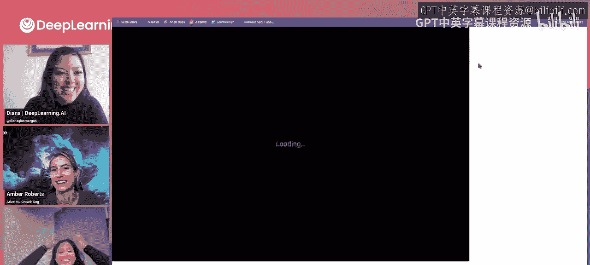
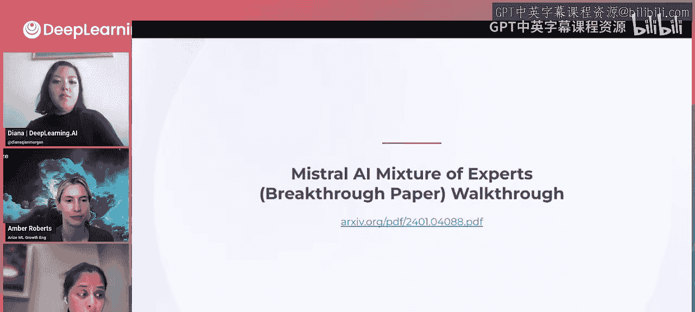

# 吴恩达《如何高效阅读AI论文｜How To Read AI Research Papers Effectively》中英字幕 - P1 - GPT中英字幕课程资源 - BV1Kw4m1d76P

Hey everyone， my name is Diana Chan Morgan and I run all things community here at deep learningning。

AI Today we have a very special event and topic on how to read AI's research papers effectively。😊。

This session will be recorded and the slides will be sent out afterwards for all the links to the papers discussed in the session。

 you can find them in the video description and for any questions for the speakers。

 we have dropped the So link in the chat for you to vote on which questions you want answered the most。

😊，For today's session， according to a recent survey。

 over 23s of developers and machine learning teams are planning production deployments of LLM apps in the next 12 months or as fast as possible。

And 14% are already in production， given the rapid rate of progress and constant drumbeat of new foundational models。

 orchestration frameworks and open source libraries。

 it can be difficult to find the time to digest and read the dizzying array of cutting edge AI research papers hitting archive a task has never been critical。

 more critical， however， as the time between academic discovery and industry application moves from years to weeks how can teams discover and read AI research papers quickly without losing nuance with an eye towards pragmatic application while balancinguncing real- worldor challenges。

In this session we will digest multiple academic papers in real time， and like I said。

 all the links can be found in the video description。For our event partner today we have ariseIS。

 AISise AI is an AI observability and LLM evaluation platform， the company's LLM observability tools。

 including its popular task- based LLM evaluation libraries and tools for troubleshooting LLM traces and spans。

 rag and prompt iteration are count on every by top enterprises。

Now I'd like to introduce our first speaker， Ana Dennaen， Hey Ana， happy to have you here。

Hey thanks so much for having us we're really excited to be here hi everyone my name' is at Parna one of the founders here at ARIise and I run product here myself I come from a technical background so was an engineer mental engineer for many years where I built and deployed models and you know felt the pain myself of having to actually manage them in the real world which is what got us to build arise rise it's never been observability and valuation has never been more important especially in the age of LMs and generative so excited and super excited to be working in this space。

😊，Absolutely happy to have you here， and now I'd love to introduce Amber， welcome。Hi。

 thanks for having us Diana， my name is Amber， I'm an ML growthrowth lead at ariseIise and I primarily work on bringing the almost like developer advocacy angle making sure folks can understand how to implement observability into their own models and I come from an academic background I was an astronomer and I kind of transition into this new role of data science which was a new role in like 2017 and from there going into like machine learning and really wanting to know like why why do teams retrain like every two weeks or every six months like why this arbitrary number and I wanted to fully like understand the kind of responsible AI angle and how to observe their models in production so that they could retrain only when is necessary or when things start breaking in production。

Absolutely， well we're super excited to have you here today。

 so many of our community are here with us to learn more about you know， how can they get caught up。

 how can they learn what's hot， what's happening， how to put it into production so I'll let you guys take it away and we'll dive into it。

Perfect， thank you。 I will share my screen。どっち？How to take it out of presentation mode to share。

We all know tech is hard， right， yep， classic。

I can see it now， Amber， perfect。Awesome， well let me jump in and give you guys a little bit of an overview of what we're going to cover today and hopefully you guys get a lot out of this today so first off we'll do a quick overview of why you should read research papers not just you know the data scientists on your team not just the CTO or the leaders why should you specifically read research papers we'll go into a quick overview of how do you find the right papers to read there's just so many coming out so we'll point you to some quick resources that we use people we follow great places to find good content give you a quick overview of the different types of papers。

 not all papers are the same so some of them are going be slightly give you an overview versus some of the more interesting ones you're seeing people deep dive on Twitter are more of the breakthrough paper so。

We'll walk through a couple examples of survey papers， datas benchmarks。

 and then the so-called breakthrough papers and then we'll actually do a little live paper reading so you guys can see how we break down a paper。

 what's important to take away， what's in background knowledge you might how do you go dig into that background knowledge and then lastly jump into you yourself can contribute to the growing space of research。

Awesome， let's go to the next slide。Why should you read research papers I mean in the last year so much has happened in this pace in this space of AI I mean literally for those of us who are even in the field。

 the pace is insane from。You know， everything from GT4 launching to now you're seeing really。

 really viable rivals in the market with Cla Opus3， Google Gemini。

 you're seeing not just all these happening in the world of text。

 but also you're starting to see GT the vision come out you're starting to seeing it many of you have probably seen the demo of Soa。

 which is really， really cool to see everything from midjoourney。

 I mean the pace is moving really fast， not just on the research side。

 but we're also seeing the pace move on how people are starting to build applications on top of these。

 and with just how fast the pace is moving， the best way we've found to stay on top of the field to really know which foundational models to be using。

 which ones what the boundaries of you know what should you be doing around things like instruction fine tuning。

 you really want to stay on top of the field。read the research papers directly from the facts itself and I think being able to do that in a really。

 really efficient quick way is going to help you stay on top of the field。

So and this is just another， you know， why do it I mean really。The AI market sizes。

Just going up as is your typical you know right axis。

 everything is going up type of side but we're seeing a lot not just on the research side a lot of investment obviously from the foundational model teams but also from organizations starting to deploy and build these applications you know maybe last year you were seeing a lot more Twitter demos we're now actually starting to see real applications and products being built on on top of this everything from applications like chat to purchase customer support chat bos to really complex use cases that areing powering revenue for organizations so it's happening。

It's happening also on the research side。This is just a little view of the number of papers actually AI papers and archive has been actually going exponentially over the last especially 24 months。

 we've been feeling it， just keeping on top of all the papers in the space and so there's a lot happening in the field right now。

Whi just means that you yourself will probably， you know， as people are consuming it。

 there's a lot to then have to communicate back and keep everyone else updated and so having that skill to do it yourself is going to be immensely valuable。

And to you， Am。Great。Perfect so and just a few resources on like how you can get started。

 I know Diana is putting in the papers that we'll be talking about and the deep dive paper so those will be available but in terms of like how we find those papers we have a lot on socials so we're constantly looking at LinkedIn X Slack Discord YouTube following AI newsletters attending paper reading events。

 paper reading events have gotten bigger arise like we do biweek paper readings as well and then meetups so going to meetups like discussing these papers and then different websites I would say things like Forbes AI Venbe are really good for if you're in industry and you want to know like what other companies are leveraging and someone on our team said that they actually just ask GP for for papers on a given topic so you can try that approach。

And you will be having access to these slides， so don't worry about like screenshoting or taking these all down now。

 but just some people that we follow on Twitter who are on kind of the cutting edge of the research that is coming out in the field。

All right， one maybe note to add on that just just going back。

 I think we've been seeing you probably agree Amber but。

Twitter is where people are discussing this right now we're seeing people drop you paper summaries or the latest papers that they're reading and kind of dissect it and having that conversation online so definitely I'd say you know even if you're not not a favorite person it's been a great place to learn and like Amber mentioned there's a lot of awesome paper reading resources so I think Amberlink one of them which is the YouTubeber yaic these awesome there's a lot of great deep dives on papers but there's also like I mentioned we do biweekly paper readings latent space is another one that does really awesome paper reading so find a paper reading community because even if it's one every two weeks that's one more than you're probably doing yourself。

Awesome thankspartna and Apartna and I wanted to add in those resources because we had already gotten questions leading up to this event about where do you even get started on finding these papers besides just kind of entering in keywords and archive so those are some great options and a lot of the time we're not just finding those papers from archive ourselves but we follow people who fully commit and look at archive every day looking for those breakthrough papers or the diamond in the rough type papers and when you're looking through all these papers what you might start noticing is they fall into certain categories so Parna and I have divided the papers that we find into three categories which are surveys benchmarks and data sets and then breakthrough papers now there's probably more categories there's definitely more subcategories but as a general sense when you find a paper it's likely to fit in to these categories if it's being talked about and if it has a lot of promising promising results。

So surveys give a detailed overview of a certain topic。

 they provide a summary spread of where the field is right now in a specified area and normally they say survey on them。

 these papers tend to be very long， very detailed and in terms of what your goal is for reading these types of papers。

 it's to understand kind of just what's happening in the field and to look for trends and patterns if you're in the area of AI research where you want to learn more about AI research looking for trends and patterns from these surveys is key because you'll know where most of the research is focused and what people are spending most time effort and money on in terms of research categories。

 but also you might be able to understand if there's an area that's not very wellexd and then you can start like kind of diving deeper into those opportunities。

And then to learn broad overview of the space and how it's being evaluated。

 so if you're looking for like so you can look for benchmark and data sets those papers are great but if you want kind of an overview of all the benchmarks and evaluations that are being released then it's great to have a survey paper because they're going to try get their hands on every model and every evaluation metric that they can in order to compare these different models what you're not going to try to do is get a technical deep dive into a specific model those are more commonly from technical reviews and you're not expecting to be introduced to any like new or novel idea those tend to come through like the breakthrough papers that we'll get into later。

😊，If you're in the area of AI， you've probably heard of RAG or retrieval augmented generation。

 we're not going to be going to in depth into this paper。

 but if you saw this survey and you are implementing RAG or you're considering a RAG implementation。

 essentially implementing RAG gives context to provides context to your LLM so that when maybe a user interacts with your LLM application system。

 they get very specific responses。And so if you're looking at a survey that's focused on retrieval augment to generation。

 you want to be looking at the different techniques being used and where it fits into this space。

 you're not going to use a survey to look at different techniques or like advanced RaG methods or advanced evaluation methods or RAG failure points。

 those are going to more likely come from benchmarking papers。

 but understanding where something like RaG would fit into the space when you already have other optimization methods like prompt engineering。

 fine tuning surveys are great for understanding where a certain field is going and where subfields kind of fit in overall to a larger area。

 like where RAG fits in overall to generative AI。One of the most popular surveys that came out this came out September 2023 the survey for large language models。

 if you checked out this paper， tell us what you thought about it in the chat again。

 not going in depth into this paper because it is 90 pages and you do tend to want to go into something like a survey of large language models for specific reasons these surveys are great incredibly comparison but again like even once these surveys are out there's。

ThisThis field has just been moving so fast as Ana mentioned earlier。

 like the pace is incredible so there's a lot of models that are now being used and tested that weren't available in September 2023 and even though that's just like a bit over six months。

 it's huge and puts a lot of these models that have been looked at kind of on the back burner of a lot of people's minds。

So for the survey oh yeah， Ona maybe yeah no just one thing maybe to add if you're you know。

 I'm just noticing some of the folks in the slido asking questions like what are good papers to read。

 how do you know what are credible survey papers actually are great spot to you know。

 they kind of pick out the。The key ones that。Surt on other great areas of research they give you that bit of lineage that you're seeing in this image right now like okay the discoveries made here were then later brought on over here and later brought on over here and so they do give you this sense of you know what were the key milestones and breakthroughs to get to where we are right now they're not going to be on the cutting cutting edge you know have the latest breakthrough that happened a month ago you might if it came out a month ago but I think。

I think that's the tradeoff is you get caught up really and we'll do this actually when we go to the Mistral paper sometimes there'll be terms that you don't know or those papers will actually refer back to survey papers to say hey。

 we're not going to go into this but if you want to get an overview go look at this so just for those folks of you who are asking in the So。

These are great places just to start。Kind of the papers that quote unquote， made it。Yeah。😊。

Absolutely thanks for that like upon saying like this is a great place for anyone to start and kind of why we're talking about survey papers first。

 even though kind of the breakthroughs come out first and then the benchmarking and then they end up in a survey the surveys give you just an overall layout and whether you're it doesn't matter if you're an AI engineer just someone interested in this space it gives you a great overview of kind everything that happened and I think it covers a year and a half of models and everything that's kind of advanced in that field and really makes you see just how far we've come like just reading this paper and I'm like oh theres this paper from a few years ago like no it it's just what's been happening and what can happen in six months and a really fast field and so just kind of like takeaways like you would read this paper a lot of times because if you're using one of these LMs or you're thinking about using one of these LLMs being able to。

Look at the comparison and a lot of different comparisons is great like if you're a team that's debating open and closed source capabilities or you're debating like how you know how should you maybe train up your own language model or how or some of these models pre-trained because they're going to give you the most information they can obviously like they're not going to know everything about the pretraining because that information is not out there for the closed source models but comparing pretraining data curation and prompting methods and then even though these don't go in depth into the architectures they do mention like like which models are like encoder decoder or decoder only in the size and the different parameters so you can see that side by side for those comparisons and then who I see reading survey papers that don't often read like the in depth research papers are kind of teams that are managing budgets and looking at comparative costs compute。

😊，the hardware components， those are really important and they're mentioned because kind of breakthrough papers and benchmarking。

 you're trying to get the best performance as possible。

 but the surveys tend to look at performance as well as all the other factors that go into like enterprise large language models。

😊，And then being able to review the comparative capacities and evaluations and what's great is all the benchmarking and data sets you could want are available in that survey。

 so they're going to try and do every benchmarking method that they can put that in the paper and then you can actually replicate those tasks and those results yourself on any model that you choose。

😊，And you do that by leveraging these benchmarking and data papers upon anything else you wanted to add before we go into benchmarking and data sets。

No that's awesome thanks， thanks for covering the yeah and feel free folks。

 if there's any questions on the。Survey papers to keep dropping them in the slido we'll definitely go through all of them at the end。

Yeah so yeah we'll have them up and we do have a good amount of time for questions I think after we get through the breakout the breakthrough paper so keep that in mind and we can go through papers retroactively so benchmarking papers are used to introduce a data for testing or to introduce a new evaluation approach on a data so some really popular benchmarks that we've seen are the MMLU so this is how well LLMs can multitask hellawag so kind of testing common sense truthful AI essentially checks against spreading of misinformation and then there's image ones as well so chart QA is benchmark for Q&A but with charts and visuals。

😊，And breaking down benchmarking papers like the goals of a benchmarking paper is that you want to see like can I use this can I use this to evaluate a new data set or can I see the capabilities of this model i'm using like what I have better insight into this model and can I learn the limitations of the model based on what I'm evaluating so this is really comparing the like once you've selected a model or if you're in the process of selecting seeing what the outputs are so considering how to even expand on certain benchmark capabilities I put this one in because that's sometimes a goal when I'm reading benchmark papers just to see if like the evaluation metric is one I would use and if it's not like。

😊，Is it is it slightly like more similar to something I could use like if I changed it out just a little bit or added a bit more data or modified the data。

 would it be a better metric for my own use case and then non goalss again this isn't introducing new capabilities they're not like introducing a new model or new architecture this is benchmarking that architecture and non goalss detailed model breakdown so you're not going to get like you'll see when we go through the mixtureal paper you're not going to get that kind of breakdown。

If you go back actually one slide amber the one more actually。

 so this is actually a screenshot from the Gemini technical report and。

What what you'll see on that one is basically they did a number of comparisons of themselves I think we just left out that part of the screenshot。

 but themselves and then some of the other model providers on these。

Benchmark benchmark so mluu you see hello swag in there each one of these benchmarks that you see in these technical reports have their own paper it's it's like the equivalent you can think about it is like I don't know the in the you know if you guys are all familiar with。

With the imagenet data set that that's really popular in the computer vision space it introduces some of them will introduce a data set most of them will will introduce a data and then we'll introduce kind of a way to you know what's the。

What's the way to evaluate across that data set and what does that test actually mean so。

Especially in the LM space， there's there's kind of a lot of。I'd say right now。

People starting to feel like， you know， there's definitely these benchmark data sets， but。

They're kind of public and owned so are the LLMs themselves trained on this data set is it part of their training data。

 I mean there's is it truly running these tasks blind or is this actually being part of the training data is something that I think a lot of us in the space wonder right now just given that the data sets are open。

Exactly， and being able to test these is why so many leaderboards are coming out like the open LLM and chatbot arena becoming increasingly popular where you can test different large language models and specifically looking at open source large language models to be able to test against apart I mentioned you know this happened first in the image world like looking at like the imagenet competitions which really benefited deep learning research and computer vision。

 but yeah benchmarks are essentially that next step you take after you get a breakthrough paper when you hear big claims and it might be a technical report it might be published by the team that built it it might not be but if you're getting a breakthrough kind of publishing。

 you want to be able to see like is it actually living up to the hype。

 is there a way to kind of demystify some of that hype a bit。😊。

And so yeah you guys are probably also sorry just one more thing to add on that last slide so if you guys have all you guys have probably seen this。

 but this is actually from Huging case the OpenLM leader board you guys can all go check it out today will' drop the link but it's literally a leaderboard that has the latest open source foundational models that are coming out and then it has the metrics that you guys just saw us go through MMLu the hella swag yes that's a real metric truthful QA all of these are actually metrics and you'll see how these foundational models are actually stacking up against those metrics and the point of this is just this is when you have all these foundational models each one of them can just report their own results oh it did great on XYZ but what a data set paper it's just so important because it's。

It's kind of the only standardized way that we can look at the performance of these models and see how good it is。

 so even though yes， they might have its flaws of we don't know if they trained on that data set or we don't know how truly blind it was it's kind of the best approach that we have right now to know like is Lama 7b better than Nal or better than GPT4 so it's been super helpful in that way。

Awesome yeah try out the L and leader boards for yourself great way to also stay involved in the community like if you're working with these models and just kind of showing like what you or your team have've been creating so we're not gonna to get into each one of these papers but yeah as the parent I said like each one of those metrics has its own papers because it's the data set and goes into the full discussion of how that data set was curated but Heaswag is essentially trying it's trying to test your common sense so trying to complete the sentence because these it's like 70000 questions and only one right answer so multiple choice。

 only one right answer and the other three answers are adversarally generated so they don't make any sense so when this Heasg benchmark came out in 2023 it's testing against a lot of the different large language。

😊，Moels because the human ability is about 95%， so 70，000 questions。

 human ability like 95% because maybe they misread a question or like't didn't understand one of the questions。

😊，And that's great right you're able to kind of test against this。

 but what happens when you know GP4 is now pretty much at the human capability for these metrics and this is。

😊，Pretty much critical thinking around benchmarking because the finish line always moves。

 especially when these models are getting more and more performant and just getting better and better so even though you know some of these you know results don't make any sense for like for the question of like a woman is outside with a bucket in a dog the dog is running around trying to avoid the bath she she gets the dog wet and then it runs away again or does she jump into the bathtub with the dog so being able to get to human level completion isn't always going to be enough and so that's why these benchmarks keep coming out and they keep getting more and more advanced。

So we've pretty much discussed these for like why reading a benchmark paper。

 you want to use that you want to use that benchmark in your own work， you want to compare it。

 you want to look at cost performance， and potentially modify that benchmark better for your use case。

 for example， hella swag now that GBBT4 is getting 95% same as the human capabilities。

 you might need to make those questions a bit more difficult in order to accurately test that especially when these other foundational models are getting closer and closer to that level of success。

What to look out for so we talk about reading these papers like when you see a benchmark like the things to be a little bit critical of like you know thinking about bias in the data set when working with these。

Text models and working with something that could be a little bit subjective checking to see if there's one definitive answer MMu has been getting a bit of feedback that sometimes there's not a single definitive answer to one of their questions and so it's like not always like the best option。

Or sometimes there's not enough context provided with the question and so it becomes really difficult to answer like if you say。

I think I think one of the examples was asking about like a mortality rate。

 if you don't give enough background context on the demographic， the age， natural causes of death。

 then the LLM might hallucinate and so that that's just kind of a bit of information about it。

 and then if you're seeing benchmarks around kind of the mathematical explanations and equations。

 if they got the answer right， but the process is wrong， like they got the answer right。

 but they got it the wrong way， like does it count， and this is kind of the show your work。

 show your explanation aspect because you don't want these language models essentially mesmerizing memorizing the answer。

 so it does demystify these LLMs a bit but just keep in mind like the capabilities of benchmarks and sometimes these data sets like they're not always perfect。

 but they are an amazing way to start understanding the capability。Of LLms and again。

 you can replicate these evaluation tasks on any model that you choose partna。

 anything on this until we go into the paper the breakthrough papers。Yeah， I mean I think you know。

 in just a note by replicate you probably won't rerun the actual you know entire data set itself。

 there are already public results， but I think it's more what we're just trying to get at is。

You know these data sets and these evaluation metrics might give you a general sense。

 but you might want to modify or pick a smaller subtask that's more important to the application you're building and so you might these are slightly all more model EVs。

 which are slightly different than task evalals which is more of what we see application builders doing in the LLM space so。

Model evals just help you pick the LLM use the existing results they've probably provided to do that the task evals I think give you slightly more is it actually going to work on your task that you have and you can you know I think learn from some of the stuff that the benchmark papers do to build your own。

Awesome， right apart， take us through breakthrough papers。Cool， all right。

 so for those of you who have been waiting for this one。

 this is this is probably when you guys are all seeing that goes mentioning the papers on Twitter and。

The discussions that are happening in the space right now。

 a lot of the paper readings are probably on these type of breakthrough papers these are the ones that。

Is getting all the hype right now and there's a lot of and and the reason for it is there's a lot of breakthrough papers coming out so some examples of them will drop these again the slides and the and the links to all of them but。

😊，There's been a lot of breakthrough papers of course， on the foundational models。

 but then also just some on the architectures itself。

 so we'll go through a bit of those today and we'll just do an example paper reading。

And maybe near the next slide， Amber， yep。I think just you know。

 some high level key points on this is the thing you're trying to do when you read a breakthrough paper。

And for some folks who have been asking this question and the slido。

 how do you distinguish routine a， you know？Good paper and a bad paper， which one's to spend time on。

I think just what are you trying to read if you're trying to learn about a novel area or novel idea。

 just just first confirm that it actually is a breakthrough paper it's not。

like a benchmark or a survey paper and then if it is a breakthrough paper what's the novel idea that's really being introduced this is the key thing that we're trying to take away when we're reading a paper and we'll go through this in thestral mystral paper and the most important thing is what's the novel idea and then。

What does that mean so what so they discovered something or they found some new approach for how you can get x yz it's faster it's better performance what does that actually imply is there more applications that can be built on top of it I think that's kind of the the what and the why does it matter is kind of the two big things that we're trying to take away when we read this paper。

You probably in these papers， it will not give you the full， you know。

 if there's a term you don't know or there's， you know。

 it relies on some previous breakthrough paper， it's not going to give you a whole deep dive on an overview of the。

 you know， like you read。Today we'll go through the Mistral the Mial of experts paper and you'll see that they just link out to other papers so they're not going to give you the full explained version of what it is and it's also might not give you all the details on the exact tests that they ran we're seeing that as a trend lately they don't talk about the data we'll go through that in the Mial paper but it really is the what and the why does it matter that really try to come through in these papers so with that。

I'm going to actually go ahead and。Share my screen here。嗯。Do that。嗯。Let's see。If I can。Share。

This screen over here， okay。Can you all see this， yes， apparently we could see it。Okay， oh。

 it's not the so the whole screen or just some part of it。It's part of it。

 but I think if you zoom in， like， yeah， we could see that。That make it go wider， I guess yeah。

 it's wider there。Okay， let me just confirm on。Okay， it's it's wider now okay。

 let's go through it and then if you guys have any issues with the the sizing of it。

 I'm happy to zoom in more on on the paper itself。Okay。

 so this is the mixture of experts paper if you guys now came out by the French startup。And they are。

 I'd say， probably building the most。Open of the open Lms foundational model。

 So this one's actually under。It's even more than I'd say the stability AI when this one's under the Apache license and so this one's been getting a lot of stir actually in the ecosystem because it's performance。

For being a much smaller model is really， really impressive。So first off。

 what we do is we're going through a paper is I always just start with the abstract and the intro itself to first figure out what the heck this paper is even talking about。

First off you'll see you know they're introducing， they're going to mention this here。

 they're introducing Miral 7B， it's a sparse mixture of experts model。

 you'll notice he said it has the same architecture as Mitral 7B， which is another paper actually。

And they briefly mentioned kind of some of the architecture。

 which we'll get into which is the novel part of what they're actually adding and then they confirm that basically with the changes that they made it vastly outperforms Lama 270b on math cogeneration and multilingual benchmarks and so clearly what they're getting at is hey。

We've changed some core things in the architecture of this foundational model and because of this。

 it's led to some better performance on XYZ areas， they've also released this is the other key part a model that's fine- tuneed specifically to follow instructions so this is the mixture 87B instruct and they mentioned that this one actually surpasses even GPT5 2。

5 tuurbo Claude Pro Lama 270b on on following instructions and so this is kind of you know as I' we were talking about what are the key key takeaways when you're reading this paper where they're going to go through they're going to talk about the architecture of this model。

And then they're going to probably talk about the results that this model had on specific data sets and compare kind of those results to these other top contending kind of foundational models。

So that's kind of their the goal of this paper。when I read this in the fact that they spent a big chunk of it talking about okay here's what doing the difference of each layer being eight feet layers as I'm looking to this I'm like okay they're actually going to talk about the architecture of their model and so to me I know immediately this isn't a survey paper this isn't a benchmark paper they're going to get in the depth of this and then it's probably a quote unquote some of you guys asked on Sdo a very relevant paper to me because you know I'm in the space of you looking and comparing all these different foundational models we see all of our customers using them so understanding kind of where it does better where it doesn't what they did in the architecture is really important to me so that's kind of the reasoning I would jump in。

Let me keep going here。Just confirming Amber you can see I'm scrolling down to the introduction section absolutelyute awesome I just don't have the streamyard kind of on on me right now so of like based some folks questions just how because like we we chose this paper we knew this was going like how did we know like how did you know that this was going to be a paper that basically we wanted to talk about like in the breakthrough session like how did you find it and what were the key things that helped you understand that it was in that category。

Yeah good good point I mean to be honest for all of y'all the。There's。

There's a lot of hype around this paper so first i'd say is like external social attention being given to certain papers and if you follow the the Twitter folks that will you know we shared earlier on the call you'll notice all of them have like talked about or reshahared this paper or have had a discussion about it I'd say。

😊，As you read more and more papers。There's。Things in the papers that。

You'll start to be able to weed out which ones。Our。You know。

 really going to stick around on which ones maybe。The breadth of that discovery wasn't that or the breadth of the depth of that discovery wasn't that important I think it's just a the more and more you keep reading these steps of a Reg strike known as oh well this one really all it did was apply it to a new application or you know it took this and it。

YouIt only took it XYZ further think。In this specific case， I mean， clearly it's making big claims。

 it's beating you GPT。3。5 on a much， much smaller you know model itself。

 so that's really really it doesn't even use all of the tokens or sorry all of the actual。

You know feed forward blocks yeah exactly and so it's it's really only using two experts to process the entire token and so even though the token has access yeah to all of the 47 billion parameters it's really only using 13 billion I mean it's really that that's kind of one big takeaway I guess as as you're reading the abstract of it。

And then to be honest， I'd say the best answer to that question is probably。

The people you follow will kind of probably start highlighting them and so that might be a good place to start as you guys are first trying to build your own foundation of papers also the paper readings will typically highlight the ones that everyone's talking about so。

Yeah， it's。You know， the reason I say that is sometimes there are and we'll we'll go through it as we go through this paper reading。

 there are papers that were like really awesome when they released but they didn't get that kind of attention and then it wasn't until later where it's like oh actually this paper made that claim so far back。

But。You just you really probably are a researcher in this space if you're going and reading at that depth。

Yeah， and that's just like one question there there're 100 so I'll just let you keep going but yeah we're also we're not saying and Miroll is it saying like Mireels not saying like they invented this this was already invented before。

Yeah， yeah， yeah and we'll go into that。So first off， what。

 you know the introduction of the paper basically goes through and we'll read some of this together。

You'll see they presented87B， it outperforms。It only uses this is a subset of the parameters for every token that allows for faster inference speed at low batch sizes and higher through at larger batch sizes。

 this is the key part of the you know overview of the architecture where it says the decoder only feet forward block picks up from a set of eight distinct groups of parameters at each layer for every token the network chooses two of these groups the experts and combines our output addedly and so here。

You know， the what in this paper is kind of like the tlDr you're going to find in the intro section they've kind of already told you the tlDR is basically a。

Mixture of experts， which is what the mixture of paper is it's got a faster inference。

Already the pre training of this， I go down， I'll mention this， the pre training of this。

wa actually faster you can mention that it demonstrates superior capabilities。

 this is what they're going to go through and then they also talk about instruct which is going to be the specific fine tuned model that does better on actually following instructions so。

We already kind of heard the TLDR of what this paper is going to focus on。

The next thing we care about is the architectural detail。

 so this is the actual depth of the paper itself。And for those of you， you'll notice here。

 this is where they'll sometimes do it， says we'll present a brief overview of the mixture of experts later for more in depth review C12。

And they actually started actually even the architectural details with it's based on transformer architecture。

 they link you out to a paper and uses the same modifications as link you to another paper。

 and this is all kind of what they assume is pre knowledgeledge itself。

So they're not even going to go into what a mixture of experts actually is。

This is actually where as a reader， you might actually want to decide， okay， I don't actually。

 if you don't have that background knowledge that's in the first paragraph。

 this actually means you should probably go get that background knowledge if you really want to understand what was the level jump that this paper did。

And so with that， I'm going to actually jump over to another screen。Let me share this one over here。

And people are asking like if you use any like additional tools when going through these papers。

 I will say for some folks that arise like using like like plug in you can even plug things into like GPT models and say like explain this to me。

 you can use a GitHub like coppit， you can rerun the source code like a lot of times looking at well depending on what it is。

 but sometimes you can they give you an option to like kind of run a version of it。

 if you have access to like an API key from a certain model。

 but those are really helpful being able to like use external tools to just verify。

 sometimes the math， sometimes like the explanation and having them as a secondary tool。Yeah。

 yeah yeah let me try to keep going to this because I know we only have like。

Another 10 minutes or so， and then we'll definitely jump into some of the questions here。

I'm going to just hop over to sharing this from Google here just to hop between the papers just easier so this is the architecture section you notice that they mentioned okay well it's based on transformer architecture uses the same modifications if you don't know what a mixture of experts is well the first place that you might want to start。

Which is super super helpful and they actually link this in this paper actually mixture of experts started with this paper back in 1991。

Where they first first introduced what is a mixture of experts this is actually a really great diagram of it and what it is you'll see high level diagram here is that basically for every input there's some kind of gating network that essentially decides which expert to basically pass it to and that is essentially what decides。

Which one will be generating the output itself？This is the very first paper that actually you know introduced this。

 this is probably what you would call the OG breakthrough paper itself and then post that there was actually a lot of other work so and again there's probably even a whole。

Survey this is a survey paper actually on sparse expert models in deep learning。

 you can see this one's actually from the Google team。

 but in this one they actually go through and they really explain the differences is's kind of again difference between a dense model difference between a sparse model and then they actually go through for example。

 we're probably not going have time to go through all this but the actual for every input itself。

How does it decide which expert to actually get passed through and so these are actually all linked within the mixture paper itself and so if you're reading a paper。

And you get stuck on a certain section or you don't understand it the links that they have are actually super super helpful and sometimes finding your own survey paper or finding your own where did。

You know where did this actually start it' helpful just so you have the base knowledge to understand what this paper specifically is adding or contributing to that research Yeah and so in this case I was just gonna to say like you know before even you know doing the deep dive apparently did you look like you know if you just like look through kind of this this paper for like things that jump out of you because yeah well there's so many questions yeah maybe we just talk about like what we notice because for me I honestly go to graphs first like after I read the title after I read the abstracts I probably look at conclusions but a lot of times the graphs are the first thing and I thought can you go to the first like like they have like one benchmarking。

Graph in your because。I think we all also like read papers a little bit differently i'm definitely the a visual learner and so like first you're seeing like okay things are looking pretty good I know that I think the reasoning they use hellello swag and hellellowa can get 95% human and GP for is getting like 95% so' seeing things a little bit lower and that's just kind of like what I first takeaway you go a little bit lower thereparna。

😊，Yeah。Yeah and yeah， Andber maybe I'll do another just two minutes of the paper and then yeah I'll probably jump through the questions I agree there' there's quite a lot coming in。

Maybe the big takeaway for for all of y'all is sometimes the paper reading will require going to previous papers to actually understand it。

 I guess we won't have time to get through the mixture of experts。

 but the key key takeaway this is actually from a previous paper is that instead of。An actual。

 you know， so in something like a， let me go to a good image。嗯。

Actually this one's fine this is actually a good good view into it there's the gating network and basically decides which experts to pass it through before you know so for every token it gets converted into an embedding。

 the embedding then gets passed forward through the attention mechanism and then instead of the feed forward blocks there's actually the mixture of experts layer and the mixture of experts is essentially instead of each token going through its own feed forward block it essentially decides to go through one or two experts。

 the key thing is you know you have to figure out。What are the right experts to pass it through This is all just kind of pre knowledge that existed and this team kind of just borrowed from so they all of this is just the pre knowledge of how actually the mixture of experts and all of that work in their key paper the main thing that。

They're doing is essentially the and they don't mention all of this actually is they are definitely using sparse mixture of experts so not all of the actual。

You know the the gating vector itself is very very sparse so this is actually what's determining which expert to pass it to and so this is a key part that's important in this paper and then。

The distinction between the total parameter account versus the sparse parameter account is kind of a key distinction they make between what did the model actually use versus what was actually provided to it the rest of this is all just kind of you know how did they actually get a drawing scale they used expert parallelism this is another technique and the rest of the paper you'll notice go straight into results。

If you are just not aware of all the you know word。

this is a lot of background knowledge i'd say go start you know this is a great way to add papers to your reading list just to go back through each of the links that they provide。

 add them， understand them。You could also， if you're just trying to get the gist of a paper。

 just jump to the results section so in this case。This is kind of what what Amber was saying sometimes she'll just jump straight here and in this case what they did was they got straight to the results they compared Miroll tollma against the popular benchmark tests that Amberbro was just going through and you can actually see the performance of Lama versus Mi across all of these different benchmarks itself and so you can go through you can read what are the actual results itself so here you can see Lama3。

5 Mi 87B and then there's a deep analysis of basically the results this is actually the bulk of the paper they don't spend a lot of time。

In the architecture section at all， the this is actually really， really sparse compared to a lot of。

Papers， you know， in the past， just like half of page to a page on the architecture but。

The majority of this is actually spent on the result discussing where it's better you'll notice that they have a section on multilingual benchmarks so。

And this is probably the only bit where they actually mentioned the training data at all in this。

 they said they significantly upsampled the portion of multilingual data during pre training。

 this is why Mi performs well on multilingual benchmarks。Compared to you know。

 the Lama 270b model itself， and so you can you know they're not giving away a lot at all actually on the actual architecture of the paper they're spending most of it on the results of it in here。

And I think and I kind of laughed at the one go up Ana the yeah。

Like this image here so first yeah they don't tell us anything about the data they give us like it's this type of data so no information about the data it's great that it's you know it's publicly available great license but for this like this is essentially a benchmark like what we were talking about earlier and it's all green so it's you know like what does this really tell you if it's all100% like at this for me this graph doesn't really give me anything like if something is all green like you want to be able to see kind of differentiations in it so if it's kind of like not giving you that you need to probably change your benchmarks。

😊，The perplexity option like it's great like it's great like oh yeah we can add 30。

000 tokens and the perplexity like isn't going up at the end like essentially we're not losing information but we do see that the best information like once you get past 10。

000 like a context window it kind of falls flat and then maybe apparently we just do like kind of takeaways for like what what does this mean for like future models in terms of like speed parameter count parameter count throughput。

Yeah， I mean， I think the the biggest takeaway is for。Most people is， well， a mixture of experts。

 sparse mixture of experts is performance wise doing pretty well。Which is， you know。

 they're showing the performance metrics across here。 So that's kind of one big takeaway。

 The inference is faster。 They have a bunch of tests on that。 And then， you know。

 we didn't totally get to it， but they do do a decent amount on instruction fine tuning and they talk about where it's not as。

You know where it's not as good， which is really important。As you're reading and going through this。

 you know we had to kind of rush through this one but。In a lot of the paper readings。

What people spend time on mostly is they'll discuss the architecture， talk about the big takeaway。

 but then。Really the important part at the end of this is where is it。You know。

 for something like this where they do a deep analysis of the routing analysis。

 which is which of those experts to actually pass it through that's a really really， you know。

 this is probably a next new area of research that people could go into so for example。

A deep thing that a lot of these mixture of experts folks have been talking about is does each expert get good about specific domains like does it go to one expert about mathematics or biology and they ran this test and they said。

It's actually not about the topic itself。We don't observe obvious patterns in the assignment of experts based on the topic。

 but what they notice is that the router does exhibit some structured syntactic behavior and so if it's things related to archive papers or things related to GitHub or have code in them。

 then you'll notice that they get sent to a specific you know there's some slight preference over what expert ID that they get sent to and this is actually something that some of the other papers。

I don't know i'll be able to pull it up fast enough of this one this is another paper that they actually link to in this they mentioned that in theirs they also notice this kind of which experts it gets mapped to becomes really really it's not about the domain but more about kind of how the data looks like and so this could end up totally being its own research area a whole area to go dive into to help understand you know what what to do。

嗯。With that， I know we're running out of time， so maybe we'll just do the last couple slides。

 I mean I think。Definitely。Come to paper readings。Start reading I think some of the popular ones and then。

I think you'll start to build up kind of your rapid you know your your list of breakthrough papers that you'll want to go through and then lastly。

 I think another great place to be learning is actually like I was mentioning on on Twitter but。

There's a lot of people actually share all of these learnings on linkednkedIn and Twitter we do so ourselves actually this is some research we've i've dropped myself on you know testing the different LLMs on how will they do at retrieval Greg K actually release the first needle and a haystack test he's a great person to follow but this。

Pace the pace of the space is moving so fast that we're noticing that。

You know we're seeing a lot more people do research as they're building applications and then just sharing those research results out via Twitter linkededIn etc cetera。

 blog posts and they might not be 100% perfect you know there might not be as much deep deep rigor as you know the traditional research space is but for those of you who are actually building applications don't think you only have to read the research from the research papers there's probably a lot that you are figuring out yourself as you're building that's what sharing and。

Or we're kind of communicating back to the community。

Anything else you'd add there Amber No awesome thanks Apartna and yeah if you guys join paper readings you'd get like the kind of the full breakdown yeah that one was you know it's a little record for breakthrough paper but hopefully you got like some of like the main concepts there and I like that other people were putting in the chat how they read papers like title abstract thin conclusion then graphs and so just having different methods there's not one scientific way to read a research paper but yeah having some tools that were listed being able to have the discussions are are great options for paper readings。

Perfect well thank you so much we do have time just for a couple of questions I kind of I know there are so many questions but I kind of want to dive into maybe things that' will help everyone at any stage so the first one I want to ask is how much time do you set aside for reading papers in your day job or what would you recommend right there's so much to keep up with you gave a lot of insights and frameworks but how much time or maybe a day of the week that you would set aside？

😊，Yeah， I mean I think it kind of depends for myself。

 I mean there's some weeks where there's a lot of stuff that has come out and we will go in and just jump in on catching up and reading those papers I think if。

When you're trying to read a paper it's not totally like a linear process。

 I think some of the folks in the chat have mentioned that too is you know when you're doing a paper reading that's kind of how people will go through it。

 but when you're actually reading it by yourself you might hop off go read another paper go learn some background information come back and that process can take。

Longer than actually just reading a paper end to end。And so I think that。Yeah， I think that that's。

Probably more of。It's hard to say it's not like I take aside two hours or an hour every day to go do it it's like based on the interest of paper and then you can kind of go down a rabbit rabbit hole of reading papers yeah there's definitely the rabbit hole effect where you read one paper it cites seven other papers and you're kind of going through it I will say like when。

When I read papers for in terms of like how much time you decide it depends on the paper a lot of the time。

 like if a certain paper comes out， I might spend more time reading it like sometimes you could tell within like the first five minutes that it's not gonna be something that would be useful to you and if kind of put of other you don't see people really talking about it and you don't get much from the results like just kind go and like look at the results if you're not really getting much from it there's there's no need to spend an hour reading that paper I feel like when I read papers I put on my like。

It's called like the devil's advocate like you know when you're just kind of going through each thing i'm like I don't believe it like everything is prove it to me that's my mindset so if I see something that I just don't don't buy and they're like oh well you know it's Apache 2。

0 but we're not going to tell you where the data comes from it's a little like okay you know it's an interesting concept there but yeah I try to find fault within papers which may not always be the right thing to do but my big thing is I want to take away like if this is useful to what I'm doing and so like survey papers are pretty neutral but breakthrough papers and benchmarks are not neutral so you kind of have to go in with the mindset like I'm not gonna believe this unless you like really prove it to me and then you try like break everything down。

Absolutely I think that we only have time for one more question i'm hoping guys have maybe an answer of recommendation how can I develop the broader skill set that researchers have does lead code help。

😊，I don't know if LAP code specifically is going to help with reading research。

 it's just more for practicing code and I think we'll hopefully you leave it for interviews。😊，I mean。

I guess。You know， depends on what you're trying to do if you're actually trying to become a researcher。

I mean a lot of them spend in multiple years， I think both of us were in grad programs where we just spend a lot of that reading papers and then trying to contribute back to research and so it's。

You know。The big one I'd say is just try to。You know， consume research papers regularly。It is。

It is not easy and I think that's kind of the hard thing is that staying on top of the field just takes takes time out of it and I think each person also has their own approach for reading and consuming deep technical content so I think reading the research papers but then also there's a way to use it some people are also hands on kind of learners and stuff if there's ways to use the libraries you know when they publish you know there's some。

😊，You know， great actually open source。Versions of。You know， the tool format paper， for instance。

 and so you can actually go in and try out。The open source work that sometimes they'll release and try at those libraries and that's kind of a way to actually get hands on experience。

Yes。I would say lead code probably doesn't help because we could have extensions that can solve those problems now from LLM so just yeah。

 like anything just。Do it like just try a few times and you'll get better at it。

 especially if you're in the paper discussions and if you ask yourself like what would you change。

 what would you add and if you could start thinking critically about these papers。

 then you have all the skills that you need to go through AI research papers。

Absolutely perfect well thank you so much Amber and Aparna this has been a really great session I know a lot of people got so many insights from this and I hope they all read a paper in the next week you know from what you had said so thank you again and thanks everyone for joining we'll have an event very soon thanks everyone bye thanks。

😊。