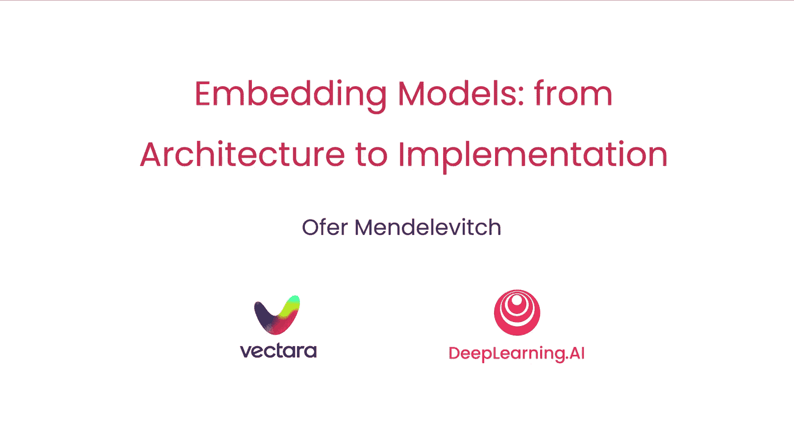
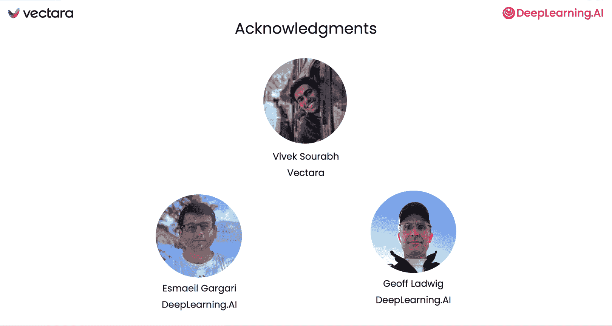

# 吴恩达《嵌入模型：从架构到实现｜Embedding Models： from Architecture to Implementation》中英字幕 - P2：2.embedding.zh_en - GPT中英字幕课程资源 - BV1Jb421J72z

Welcome to embedding models from architecture to implementation built in partnership with Vara embedding models create the embedding vectors that make it possible to build semantic or meaning based retrieval systems。

 This course will describe their history， detailed technical architecture and implementation。

 This is a technical course， and so will focus on the building blocks rather than the applications。😊。

You may have heard of embedding vectors being used in generative AI applications。

 These vectors have an amazing ability to capture the meaning of a word or phrase。

 You might have used embedding models to create these vectors。

 but how did these models actually work to help us dig into this。

 I'm delighted to introduce Amin Ahmad Victorctors cofounder and Op Mendlovich。

 who is the company's head of developer relations。 Thanks Andrew。

 so glad to be here and Victorctorara， we've built our own embedding models to support different ragG systems。

😊，So we have had to dig into how to select， build and train them In this course we will share some of the key technical details with you That sounds great creating a model that can produce a vector that represents the meaning of a words is a challenging problem you would want to make use of the large volume of existing text as training data but how do you go about doing that Well one idea was use the words around the target word as clues take the word tree。

A text training sentence might say something like the leaves on the tree are green。

 and another sentence might say the branches on the tree are dropping and so the words that occur near the word tree tells you something about what means。

If you were to have millions of sentences like that。

 then you might get a decent sense or get some sense of what the word3 means This approach was made popular by an embedding model called word tove by Thomas Mioffch Gregrado and Jeff most of them which might former teammates like Google Bra and Word tove was a model that was trained on natural language to predict the word based on a few words on either side of it Short after an approach called by Stanford University's Jeff Pennton social and Chris Maning further improved the wordve by simplifying the math needed for learning embeddings increasing the context window around the word to produce more accurate embeddings previously involved the use of recurrent neural networks like LSTms the introduction of transformers in 2017 change that。

 allowing feed4 neural networks which are much more efficient to train than recurrent networks to process sequential data effectively the model released the following year used deep transformer networks trained on a simple fill in the。

word task to gain a deep understanding of language。

 Uhering in the modern era of NLP and setting the stage for systems like GT。

 which followed shortly after and you can also go beyond words the longer chunks of text like phrases or sentences in a retrieval system。

 you might want to generate an embedding vector for a query sentence in compare it to vectors of response sentences and it turns out that you can fine tune these powerful word embedding models to evaluate sentences as well and you how exactly in this course you will first learn about where and how embedding models are used。

Then you learn about BRT， this is an example of a bidirectional transformer。

V is applied in many applications but here we will focus on its use in retrieval you will then learn how to build and use a contrastive loss to train a dual encoder model that is perfect for RAG applications。

 it has an encoder trained for queries and a separate encoder trained for responses。

 you will see all of this in practice。Many people have worked to create this course。

 I'd like to thank Vi Vk Surb from Vara and from Deep Bnida AI Eshma Gagari and Jeff Ladwig also contributed to this course The first lesson will start off with an overview of embedding models in retriever systems。

That sounds great。 Let's go into the next video and get started。

