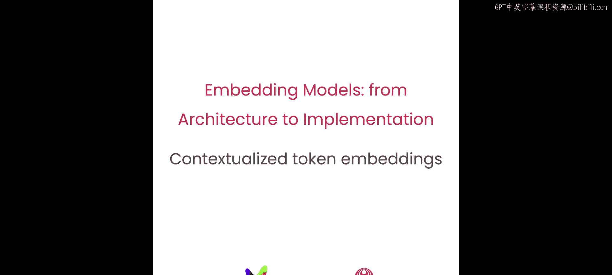
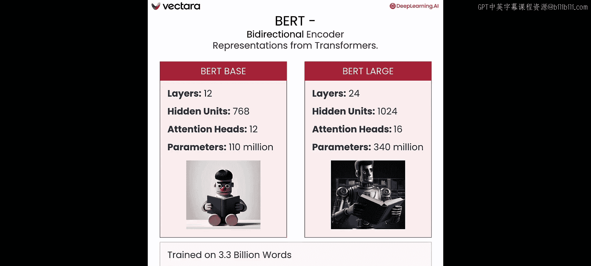
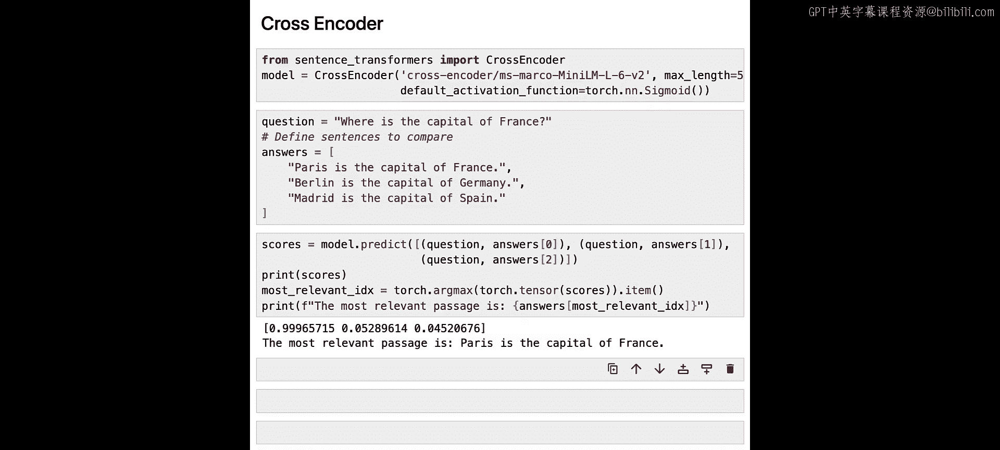

# 吴恩达《嵌入模型：从架构到实现｜Embedding Models： from Architecture to Implementation》中英字幕 - P3：3.L2 - Contextualized Token Embeddings.zh - GPT中英字幕课程资源 - BV1Jb421J72z

In this lesson， you will learn about the importance of contextualized token embeddings and how transformer models and specifically Bt pioneer the ability to learn contextualized token embeddings。

 which are used in sentence embedding models。

All right， let's get to it。In the previous lesson you learn about word vector embeddings here you see a sample word Yoda and its embedding vector using a word embedding model。

 Mo like word to V and glove give you the embeddings that capture the semantic meaning of each word。

 You can use these embeddings to find similarity between words。

But there is a problem with word embedding models。 They don't understand the context。

 Here you see two different sentences。 They use the word a bat in two different contexts。

 Word embedding models like word to V will not be able to separate these words by their context using these models。

 You will have the same vector embeddings。So the problem is contextualized word embeddings In 2017。

 a paper entitledAttention is All You need， introducedtro the transformformer architecture to natural language processing。

 This was the breakthrough that led to large language models。

 but along the way also solved the problem of contextualized word embeddings。 Let me show you how。

The transformer architecture was originally designed for translation tasks and thus had two components and an encoder and a decoder。

 The input of the encoder is a sequence of words or tokens。

 and the output is a sequence of continuous representations。 The output of the decoder is， again。

 words or tokens。And this is how a translation task would work。

 The encoder would take in a phrase in one language and would produce output vectors that represented the meaning of the input phrase to produce these vectors。

 the encoder could attend to tokens there were to the left or the right of any given token。

In contrast， the decoder operates a token at a time and considers the predicted token so far。

 along with the outputs of the encoder。 The decoder predicts the first word the This is fed around to the input。

 Now， the decoder considers the encoder input and a previously generated token and predicts man and so on。

 a token at a time。To recap， the encoder attends to tokens to the left and right of the output it is producing。

 This results in the encoder output vectors being the contextualized vectors we are looking for。

 In contrast， the decoder only attends to the inputs to the left。

But transformers with attention were used for more than translation tasks。

 The most famous implementation is the LLMs like GPT2， GPT3 and GPT4。

 which use a decor only architecture， and of course。

 Bt an encoder only transformer model which is heavily used as a component in sentence embedding models。

Let's talk a little bit more about Bert。 It was built in two sizes。

 Bt base with 12 transformer layers and 110 million parameters。

 and Bt large with 24 layers and 340 million parameters。 Bert was pretrained on 3。

3 billion words and is often used with an additional task specific fine tuning step。

The bird model was pretrained on two tasks。 One task is called masked language modeling or MlM。

 Here is an example。 The inputs are sentences that start with a special token called C Ls and end with a separator token or S E P。

15% of the input words are masked。 The model is trained to predict those masked words。 Now。

 I'm calling these words， but in reality， these words are tokens。 We'll talk more about that later。

 This task is critical， as this is where the model learns to produce contextualized vectors based on the surrounding words。

The second task was next sentence prediction or NSP。 In this task。

 the model predicts if one sentence is likely to follow another。 So， for example。

 if sentence A is the men went to the store and sentence B is he bought a gallon milk。

 the out predictionion is true。 On the other hand， if sentence A is the men went to the store。

 and sentence B is penguins are flightless birds。 that one would be a no。

 It isn't likely that B follows a。 So this task trains the model to understand the relationship between two sentences。

After the ptraining， you can apply the idea of transfer learning to Bt and adapt it to specific tasks via fine tuning such as classification。

 named entity recognition or question answering。 One specific task of interest to us in this course is what is known as cross encoder。

  specifically， this is a type of classifier where the input consists of two sentences。

 separated by a special S P token。 The classifier is then asked to determine the semantic similarity between those two sentences。

All right， let's see all these concepts in code。So to get started with this notebook first。

 I'm going to import this and ignore some of the warnings。

And then we're going to import some libraries we're going to use in this notebook。Specifically。

 you see we have some a bird tokenizer and a bird model from the transformer library。

 as well as some others， so let's import those。Okay， so first。

 let's load the word embeddings from Gve and you can also use Word to V， if you like， as shown here。

 but it's just too large for our learning platform so you can use it on your own machine later on。

 So we load these and then let's take a look at one of the words just to see what the word embedding actually looks like。

 This might take a while for the model to load。Now let's take a look at an example word。

 we'll look at the word king and look at the shape of the embedding models。

 it's a 100 dimensional vector， now you can take the word vector for the word king and also look at what it actually looks like so limiting here to only 20 of the first numbers you see that it's just float numbers and we have as we've seen 100 of these here。

Okay， so let's do a little visualization， so we're going to pick a bunch of words here as shown here。

 and then we're going to pick those embedding vectors into an array。

And because these vectors are high dimensional， we're going to use PCA to reduce it to two dimensions so we can actually visualize it。

 So we'll do that here。Now you can take these PCA vectors and visualize them into dimension。

 you can see that there are clusters of words in different parts of this graph， and for example。

 words and their vectors that are close in their semantic meaning appear in a close proximity to each other like this。

One cool thing about this is that these are truly vectors and you can do algebraic operations with them like we see here。

The word closest to king minus the embedding of men and plus the embedding of woman is the embedding for queen。

 and you can see that the similarity score between that algebraic operation and queen is very。

 very close。You should try this yourself， it's actually really cool， for example。

 instead of king minus men plus woman， you can try Paris， minus France。

 plus Spain and see what you get。Okay， so let's compare our word embeddings to the contextualized embeddings from B。

 So first in this cell， we load the tokenizer for bird and the model for B。

 and well create a little function here to help us get the actual embeddings given a sentence and a word。

 so I will'll run that。So let's look at an example。 I have two sentences here。

 One says the bat flew out of the cave at night， and the other one is he swung the bat and hit the home run。

 Now the word bat is really where we're interested to look。

 and we're going to compute the embeddings of the word bat once as it is relates to sentence one and in that context。

 And the second time as it relates to second2。 and then we're going to use the more static word embedding from the word embedding model glove。

 So let's run this。So when you run this， you can see now for yourself that the word bat has embeddings in context of sentence 1 that look like this。

 whereas the same word bad in a context of sentence 2 looks very different Now these are the glove embeddings for that word which are not contextual and we can see also the cosine similarity between the bird embeddings in different contexts are 0。

45 or 46 in this case， So they're very different whereas the cosine similarity between the word at itself。

 of course， is one because it's exactly the same embeddings。

We've discussed how BRT can be used as a cross encoder。

 let's take a look at a specific cross encoder that was fine tune on the MS Marco dataset set of question answer pairs。

 it's a passage retrieval task， we load this model and now we can define a question and some possible answers。

And now we just run the model on the question and the answers were defined。 andvoa。

 we see that the best answer is the correct best answer for this question。

 Paris is the capital of France。 Awe， I encourage you to try this for yourself with other questions and other answer options and see how a well trained cross en quarter truly understand semaning meaning of questions and answers。

So in this lesson， you saw that word embedding models like word to V and glove do not capture the context of words in a sentence and how the bird embeddings are able to capture that context。

 But contextualized word embeddings are not sentence embeddings。 In the next lesson。

 you will learn how you can go from contextualized word embeddings to a full sentence embedding model。

 All right， see you there。😊。

