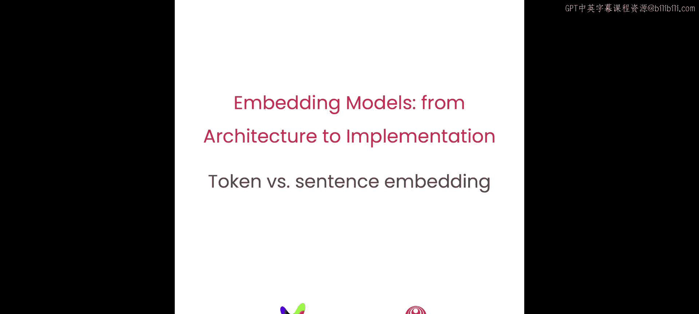
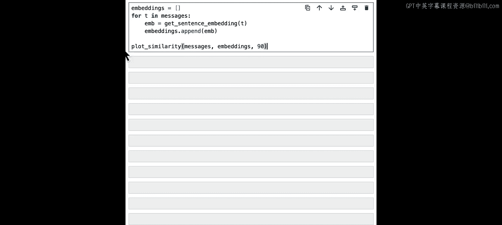
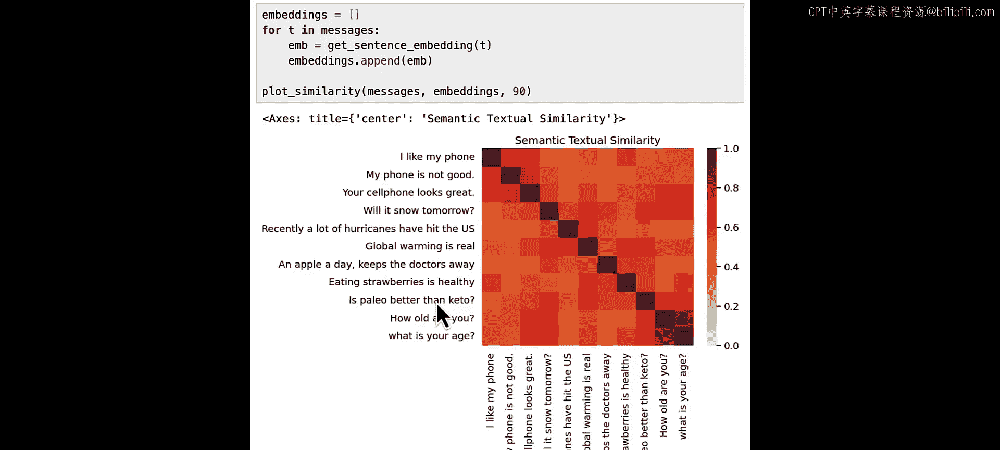
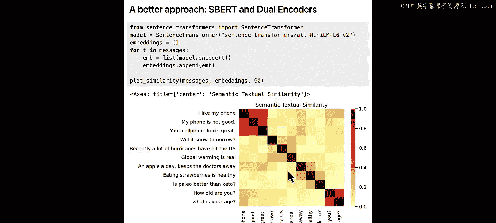
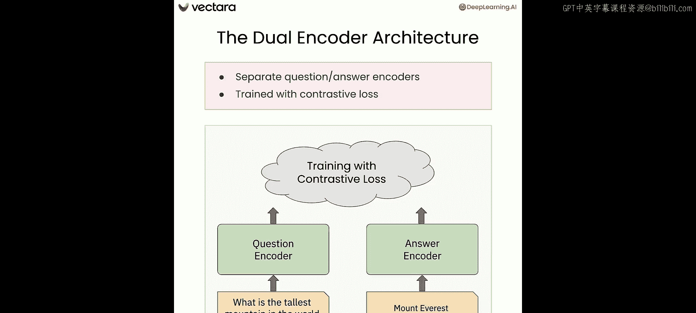

# 吴恩达《嵌入模型：从架构到实现｜Embedding Models： from Architecture to Implementation》中英字幕 - P4：4.L3 Token vs. Sentence Embeddings.zh - GPT中英字幕课程资源 - BV1Jb421J72z

In this lesson， you will learn about sentence embeddings。

 how early and naive attempts to create them failed。

 and what led to the successful approach of using a dual encoder architecture for sentence embeddings。

All right， let's go。

So far we've discussed words and tokens interchangeably， in reality， NLP systems deal with tokens。

 and a token can be a word， but it doesn't always have to be that。 For example。

 here we have the sentence we love training the learning networks。

 we can tokenize it into whole words in English and assign each word and integer value like 23 or 112。

 etc ce。 subword organization means that a token is not always a complete word。

 but can be a subword or any sequence of characters When tokenizing you define a vocabulary of possible words or subword and break out to text according to this vocabulary。

 The result is that each sentence is presented by sequence of integer values。

 Common tokenization techniques are used in LLms and embedding models are usually subword tokenizers like Bpe also known as byte pair encoding wordpiece or a recently popular variant called sentence piece。

Let's see how token embeddings work in BRT， which has a vocabulary of about 30。

000 tokens and an embedding dimension of 768。 The tokenizer input sentence is preended with a special first token called Cs。

 and then all tokens are converted to token embeddings。

 Think of this first level of embeddings as fixed token embeddings that focus on the word itself only the output of each encoder layer in Bt also provides embeddings for each token in the input sequence。

 but these embeddings now integrate information about the rest of the sentence。

 So we call them contextualized embeddings as we've seen before。 and as we go from layer to layer。

 these representations become better and better at integrating context from the whole sentence。

After the success of using word embeddings like word tove or love。

 the next question researchers explored was， can we create embedding vectors for sentences such as cosine similarity or dot product similarity in an embedding space represents semantic similarity between sentences。

 Initial attempts were naive。 Some try taking the output embeddings of the last layer of a transform model of all tokens in the sentence and averaging those out。

 This is also known as mean pooling。 Others try just using the embeddings of the C L S token as the representative of the sentence。

 This approaches all failed， Let's see this in practice。😊。

So let's ignore some of the warnings and then I'm going to import some libraries we would need here like Pyor。

 sip Pi， Seaborn， and again our bird model and tokenizer。

So here we have the model name we're going to use Bt based uncased and we're loading the tokenizer and the model for that and then we have this helper function which essentially performs the mean pooling operation on the sentence embeddings What it does is it takes the sentence and encodes it into tokens。

 creates the attention mask， runs it through the bird model gets the output embeddings and then the last hidden state that's the last layer of the birdRT model and it takes this and does this operation here which is the mean pool to get to the final output of this function。

Now the second function I'm going to set up here is just a helper function to compute cosine similarity of a matrix。

 so the matrix is rows， every row is certain features of a certain vector or certain sentence。

 and as you can see with cosine similarity， we have to do the normalization of each vector or each row and then just compute the dot product of them。

The last function you will use here is plot similarity。

 which will be able to create a heat map for you when you want to visualize the similarity matrix between every pair of sentences。

 so it uses Cborn， the SNS package and does the heat mapap according to the labels and the features that we have。

So let's try a couple things here we have a few messages or sentences that we will use and you see some about smartphones。

 some about weather， etc。Okay so here you take each one of these messages in its variable T。

 you compute its mean pool embedding and calculate this for all the messages。

 and then what you'll do is you'll take these embeddings and plot the similarity a heat map and let's see what that looks like so you can see that this heat map shows the similarity between each sentence and each other sentence and we can see that most of it is red and orange。

 which is really high similarity， which doesn't make sense。

 these sentences don't have the same semantic meaning， which means that mean pool doesn't work。

Now you can do this in another way here we have this data called the STS benchmarkmark dataset that has already a lot of sentences or sentence pairs。

 sentence1 and sentence 2， so if you load this data set and you can see some of the sentences here。

 they also have a score that shows this is the ground truth score of whether these two sentences are similar in what's their similarity score。

And now you will use this Sm2 sentences function to compute the mean pooling of bird embeddings on the SDS sentence examples。

 we will use 50 example data set here just to speed it up。

 but you can change this variable later and try any number of subset of the SDS data set。

So now you can print the scores and as you can see， the numbers here are pretty high。

 the mean pooling of the bird score bird embeddings is high。

 which indicates that this approach considers all these pairs of sentences to be very。

 very similar to each other， which again demonstrates the fact that mean pool of bird embedding。

 doesn't really work for sentences。Another way you can look at this is through Pearson correlation by computing the Pearson correlation between the ground truth scores and the mean pooling scores of B and doing that you can see that the pearson correlation is very low。

 which indicates it's not correlated。 these two types of scores are not correlated and the PVL is also significant。

 So again， another indication of the fact that this is not a viable approach。

You saw that mean pooling doesn't work， so now you can try a pre-trained sentence embedding model to see how one that is trained works。

 This one is called all mini LM L6v2 and now you're going to look at through all these messages that we had before and plot the same heat map and as you can see here this looks a lot better you have some sentences that are similar here but for the most part the similarity is much more accurate and reflects the fact that a lot of these sentences are not similar to each other。

Now you can run the same approach on the SDS data set and create a third column called mini LM score。

 So when you do that。You will see that we have this third column here with a scores created by the good dual encoder model。

 and for example， if we look at this example here， you can see that Grand truth score and the miniLM score are very close and they're both thinking of this is not related as much。

 whereas again the mean pooling score thinks everything is pretty much similar and very high score。

And if you compute a Pearson correlation in this case。

 you can see that the Pearson correlation is much higher。

 which means that these scoress and these scoress correlate much better as we would expect。

I would encourage you to play with some other examples in the S data set and see for yourself how sentence similarity works for different sentence pairs。

Real progress in research around sentence embeddings was initially made with the introduction of universal sentence encoder at Google around 2018。

 based on the original transformformer architecture。 In fact。

 our founder Ammin has been part of the original team behind universal sentence encoder。

 Sbert was the first model that was trained on data that included pairs of sentences。

 The work on SBt in 2018 quickly led to more innovation in the following years with additional design such as DPR sentence T5 E5 and Colbert and many others。

Now， let me explain a subtle but important consideration when building sentence encoders。

 There are two possible goals。 The first is pure sentence similarity。 For example。

 if you want to use embeddings to find similar items。

 The second is to rank relevant sentences as responses to a question。 For example， in ragg。

 They are not the same goal。 Let's look at an example data set with four text chunks shown here as a1 to a4。

 And our question is， what is the tallest mountain in the world。 If you use pure similarity。

  clearly， a1 is exactly the same as the question。 So the similarities highest or equal to1。

 And thus， this result， a1 will be ranked highest。 but that's not really what you want。

 you want to answer a2 Mount Everest is the tallest to be selected。

This led to the dual encoder or byr architecture， we have two separate encoders。

 the question encoder and the answer encoder， and the model is trained using a contrastive loss。

To sum up in this lesson， you saw firsthand how mean pooling of birdbeddings does not work for sentence embeddings and how a pretrained sentence embeddings model like Min L M L6 does a much better job。

 You might be curious to know how to build these dual encoder models。

 That's exactly what you will learn in the next lesson。 See you there。

