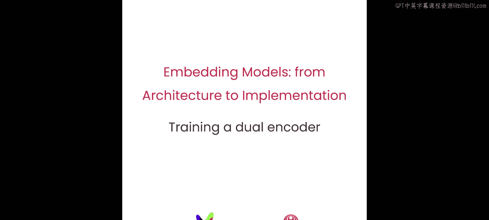
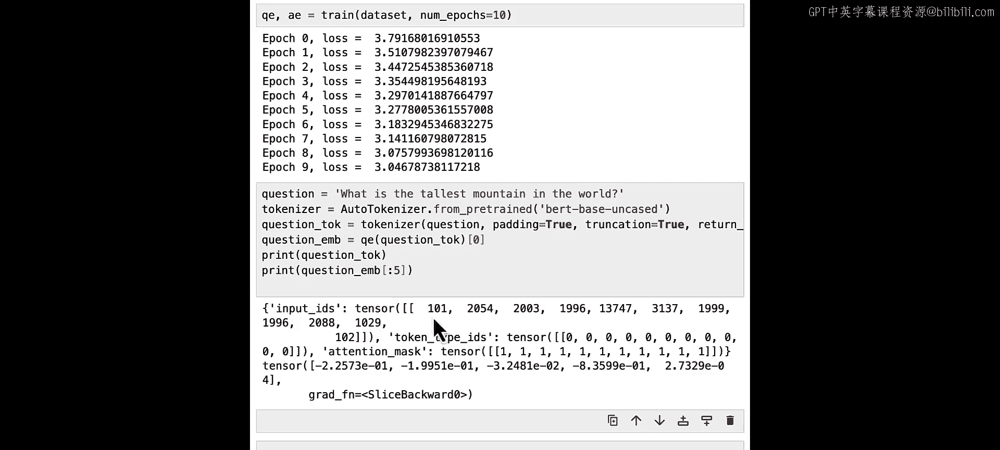
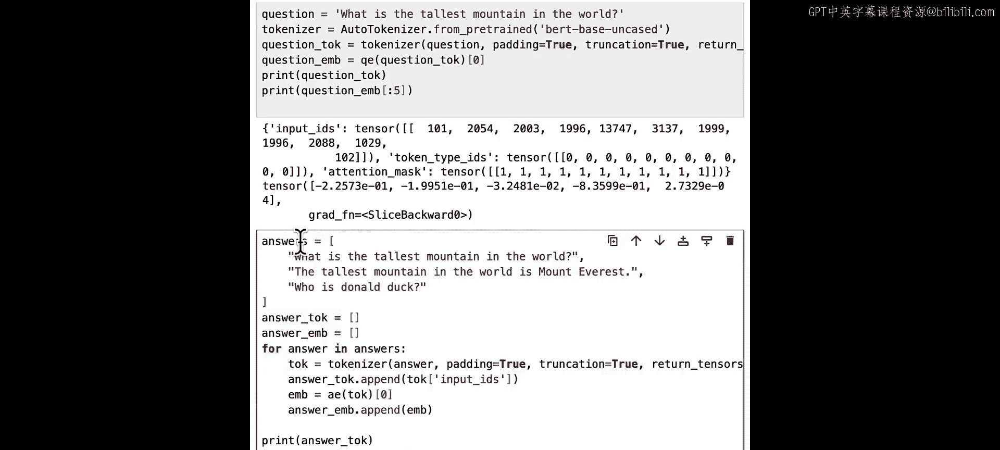
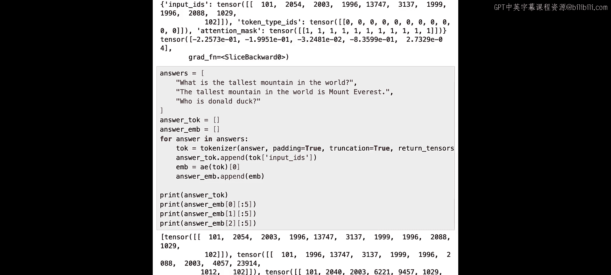
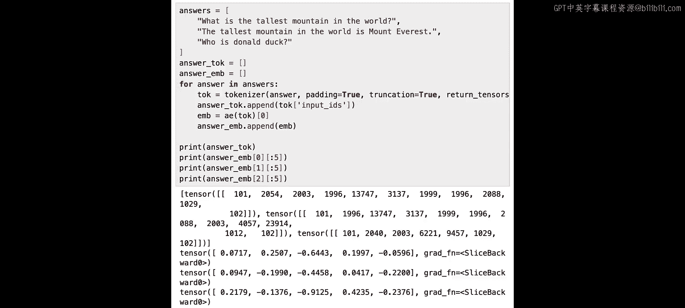

# 吴恩达《嵌入模型：从架构到实现｜Embedding Models： from Architecture to Implementation》中英字幕 - P5：5.L4 Training a Dual Encoder.zh - GPT中英字幕课程资源 - BV1Jb421J72z

This lesson is all about understanding the internals of the dual Ender。

 in this lesson you will learn how to build a dual encoder in Pytetororch and how to train it using a data set of question answer pairs。

Okay， let's dive in。

Let's look at the details of the dual encoder architecture for training sentence embedding models。

 we will train two independent birdrs， one is associated with the question and one with the answers During training we use the CLS embedding vector from the last layer of each birdr model as the vector embedding representing the question or answer respectively。

 the dot product similarity between them represents the semantic match。

 a high value means the answer is semantically relevant for the question and a low value means it is not。

The dual encoder architecture utilizes a contrastive loss。

 The idea behind contrastive loss is to ensure that embeddings of similar or positive pairs of data points are closer together in the embedding space While representations of dissimilar or negative pairs are further apart。

 The loss function encourages the model to maximize similarity between embeddings of positive pairs and minimize similarity between negative pairs。

 In our context， a positive pair will include the embedding of a question and its correct answer。

 and a negative pair is set up as a question and any other answer considered wrong in the batch。

Let's take a look at an example here we have four pairs of questions and answers and a similarity matrix computed between each question and each answer for Q1。

 we would like our model to predict a1 as the most likely for Q2 we would like the model to predict a2 is the most likely and so on so when a single loss based on this4x4 matrix that becomes smaller as the soft max values on the diagonal get closer to 1 and the rest closer to 0。

To do this in pytorch， we use a little trick that involves the cross entropy loss function。

 resulting in one specific form of contrastive loss that works really well in practice In code we set the target argument of the cross entropy loss function to be 01 to etc until n minus1 where n is the batch size This tells the cross entropy loss that the correct class in this case answer for each row。

 which is the question is the one that's associated with it。 the diagonal In other words。

 that a1 is the correct class for Q1 A2 is the correct class for Q2 and so on In this way we use cross entropy loss to match our desired goal of the contrastive loss the use of the softm in the loss function encourages the exponent of Si the similar between question I and answer I to be large which means high similarity for correct pairs and the exponent of Sj or I andj。

Are not the same to be small， which is exactly what we want with contrastive learning。

 Let's see all of this in code。So we will ignore warnings as we usually do。

 and we import some other libraries from Transformer， from Pandas and NI here。

To get more intuition about how to compute contrastive loss using this cross entropy loss trick that we talked about。

 you will now define a data frame， a 4 by4 data frame similar to what we saw in the slides。

And this is our contrastive loss function that given the data computes the actual loss using cross entropy loss。

Now recall that a cross entropy loss applies the softmax operator on each row， in other words。

 this forces the sum of exponent in each row to be close to one， let's see an example。

 and if we sum these softmax values in each row， we consider they all do sum to one。

Now I want you to run a little experiment here， you take this four by4 matrix and run four rounds of a simple operation。

 you add to the diagonal 0。5 every time and you decrease from the other non- diagonal values 0。02。

 so you increase the values on the diig diagonal and reduce the values everywhere else。

Now what happens is is you see that the diagonal keeps growing every iteration and the non- diagonal values keep lowering and the loss computed through this contrastive loss with the cross entropy keeps reducing and that's exactly the behavior we wanted to have with our contrastive loss that it forces the diagonal be closer and closer to higher values and these to be closer to zero。

Cool， so now that we've seen how contrastive loss work with cross entropy。 Let's look at the encoder。

 and the encoder has a bunch of different subcomps here， which we're going to go through。

 So in this example。 we use a batch size of 32， an embedding size of 5。

12 and an output embedding size of 128。 It's not a lot of code。

 but it packs a lot of important details。 The first step is the Nn embedding model you see here。

 Take in individual tokens or integer values， and mapping them into token embeddings。

 The input is 32 by your sequence length。 and the output is 32 times the sequence length times 512。

 Since every token is represented by 512 dimensional embedding vector。

 The embeddings are then process by the Nn transformer encoder layer shown here。

 Here we just use 8 attention heads and。😊，3 layers instead of the 12 layers， for example。

 in the bird model for simplicity， but the structure is the same。

 the output here is a contextualized embedding vector for each vector in the sequence。

 So it's really 32 by sequence length times512 in bird。

 the Cs token is a special token learns a rough embedding of the whole sentence。

 So our encoder uses the embedding of the Cs as input to the next step。 Finally。

 we project the learn embedding of the Cs token through an additional and in projection layer that learns an additional transformation into a potentially smaller size output embedding dimension。

 which is 128。 This is not strictly necessary， but allows us to reduce the overall embedding size at the output of the encoder and saves a memory。

 So our final output is 32 by 128。 and this is our final contextualized embedding。Okay。

 so now we have our encoder and let's see how the training works。

 so we'll build a function to do the training loop first let's define our parameters for the training。

 we have an embedding size of 512， the output embedding of 128。

 will define a max sequence size in this case for 64 and a batch size of 32。Next。

 you can define this question and answer encoders， first you define the tokenizer。

 in this case we take the birth base on case， tokenizer and define these two encoders。

 one is for the question and one is for the answer。

Now you load the data set with your data loader here。

 you define the optimizer to be your typical atom optimizer with the parameters of both the question encoder and the answer encoder and a learning rate of e to the minus5 and define the loss function。

 which is our cross entropy loss。So now how do you build a training loop。

 you first iterate through the data order in batches of 32， this line takes the question and answer。

 a batches that separates them out and creates the tokenization of each of the questions and each of the answers。

Using these tokenized outputs， you can compute the question embedding and the answer embedding using the question encoder or the answer encoders you defined above。

Now comes the computation of a similarity scores， and theres a really cool Py or1 liner that does this。

 just dot product of the embeddings。And here' is where you compute the contrastive loss using this cross entropy trick。

 So again， the target needs to be 0，1，2， etctera， all the way up to the shape of the question embedding。

 which is 32。 So up to 31 in this case。 and this is the loss using the loss function cross entropy loss with this similarity scores and the target。

 and we add this particular loss in this iteration to running loss we're gonna used to keep computing and see how the loss is progressing over time。

 final step， you will have to take in any training loop is， of course。

 run the optimizer step and the back propagation to get the learning to actually do its magic。

 and this happens in a loop over all of your data set in this iteration once the iteration is finished you want to return the question quarterr and the answer and record the way they were trained with their weights back so we can use them for inference So that's really our。

For training。So you've seen how the training loop works。

 but this was just one iteration through the data set and in deep learning networks we want to run multiple iterations。

 so let's change this function a little bit。 We'll use the same starting point with all the setup。

And then we're going to add an additional loop outside of it that runs through a number of epochs defining this function。

 So we do this again and again， multiple epochs to continue training over time。Alright。

 that's exciting so we have our training loop， let's train。

 We're going to use a data that has some samples of questions and answers。

 we're going to have this external class called My data that essentially loads it into uponnda's data frames and makes it available。

 let's load this data and see here are some of the questions here are some of the answers。

So now you can just call the train function on the dataset you loaded with the number of epos and get the training started。

 this is a long process and it might take a while， but what we will see is the printout of the loss that is gained after every one of these epochs。

Okay， so training finished。 and as you can see， the loss is not too low。

 but remember we only did 10 epos。 We used 300 examples， which is very small。

 And this in itself is a really small models。 So it's just meant to show you an example to play with。

 And if you have a bigger machine， you can run it with much bigger parameter sets and many more epochs to see much better result。

 and I encourage you to do that。Having said that just for the sake of the exercise。

 let's look at what we got so you can take a question like what is the tallest mountain in the world。

 tokenize it and use the model that was just trained that you got here from the training as output on this token and what you get is again these are the tokens and these are the embeddings。

And if you create a bunch of potential answers and do a similar run。

 you will see some interesting things here again。 The first answer here is the same as our question。

 What is the Ts mountain in the world and you can see the tokens appear to be exactly the same。

 which is what we'd expect。 However， the embeddings here are using the answer encoders。

 and you can see that the embedding values here are not the same as the value you have here for the same question。

 This is exactly because of the reason that the question encoder and the answer encoders are not the same encoder。

 they have different weights and they're trained to be different in the form that we discussed。

And if you compute the similarity， the dot product between those two。

 you can see that the question it's the same as the answer does come up as the highest match with the highest level of dot product。

 which is what we would expect， given that the model was trained for just 10 epochs is very small and doesn't have a lot of data to train on。

 so that's fine。So what did we cover in this lesson you saw how the encoder is built using Pytorrch modules and then step by step how the training loop works。

 this was an example with a small scale model and only trained on 10 epos with a small dataset in the next lesson you'll see a fully trained question answering model and how this works well to provide a full benefit of retrieval for RAG see you there。

