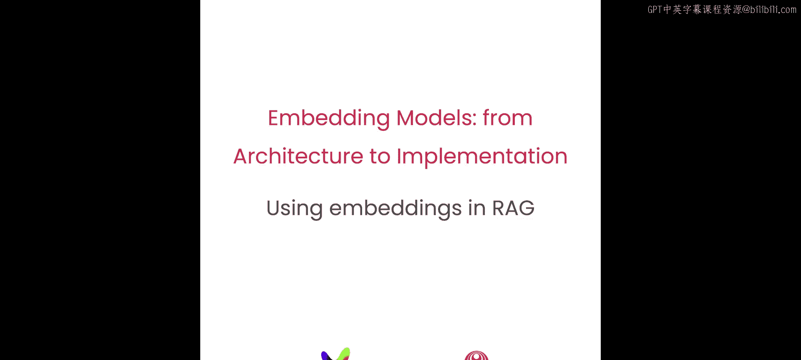
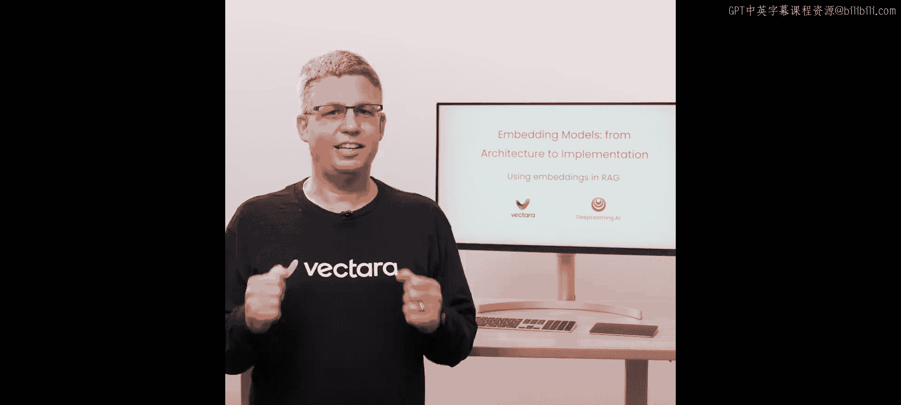
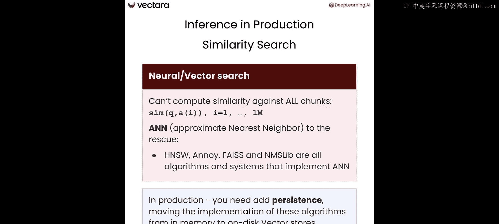
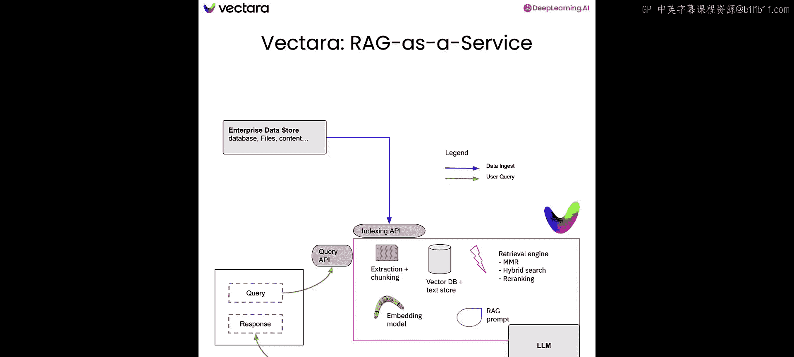

# 吴恩达《嵌入模型：从架构到实现｜Embedding Models： from Architecture to Implementation》中英字幕 - P6：6.L5 Inference.zh - GPT中英字幕课程资源 - BV1Jb421J72z

In this lesson you will learn about using sentence embedding models in production and how the two different encoders。

 the question encoder， and the answer encoders are used in a retrieval pipeline。

 such as in a ragG system。

All right， let's go。

Okay， so we trained a dual encoder embedding model now we have two encoders ready to go the question encoder and the answer encoder。

 as we can see here during ingest， we encode each text chunk using the answer encoder and store a resulting vector embedding into the vector database。

Then when user issues a query， we use the question encoder to generate the query embedding vector that vector is then used to retrieve the matching facts or text segments that are sent to the LLM as part of the RA flow。

How do we find the matching chunks of text after the question embedding have been computed。

 The naive approach would just compute similarity between the question embedding in all answer embeddings。

 but that is computationally heavy and may take too long for a real production system。 Thankly。

 we have quite a few limitationss of approximately nearest neighbors or ANN algorithms like HNSW。

 annoy phase and others。 These algorithms approximate nearest neighbor searches with high accuracy but significantly lower compute time。

 they are widely used for this task。 Most ANN algorithms are in memory。

 So when you implement this in production and for very large data set。

 you have the additional requirement to implement your ANN approach using a persistent data store on disk。

Let's see all this in the code。So in this notebook we first remove the warnings and we're going to import as always a bunch of packages we're going to use specifically I want you to note these new two packages called DPR context encoder and DPR question encoder we'll use those for the dual encoder we're going to load that's been pretrained you'll also need the cosine similarity matrix function from the other lab it's exactly the same thing just the helper function to compute similarity。

So let's put together an example here we have five different potential answers and a question。

 what is the tallest mountain in the world？Now you can take this model called allmin LML6。

 which is a pure similarity model， compute the question embedding of the question。

 and then compute the answer embedding for each of the answers and then compute similarity between the question and each of these answers When you do this you will see that the best answer。

 the one that's closest in terms of similarity is the same one that is the question。

 what is the talls mountain in the world and the similarity is actually 1。

0 that's what we would expect。Contrast that with a dual encoder that has a different answer encoder and questionr。

 in this case we use the DPR fully pretrained model for this purpose。After loading the model。

 we can compute the tokens of the question again and embedding of the question and as you can see heres some of the embeddings printed here and the size of the embedding is a 768 dimensional vector。

So now you can do the same with the answers， you take each answer， tokenize it。

 use the answer encoder in this case to get the answer embedding。

 compute similarity and figure out what the best answer is and drum rolls， yay。

 we got the right answer， the question that was exactly the same as the answer。

 this answer zero did not get the highest core and the best answer we' got is exactly what we wished for。

 the tallest mount in the world is Mount Everest。Okay so now taking a step back。

 let's look at the full rag pipeline During ingest， the blue lines， we take input documents or text。

 we chunk it and use the answer encoder to encode these chunks into embedding vectors。

 then store this into the vector database， upon receiving a user query， the green lines。

 we use the question encoder to get the question embedding and then use ANN to retrieve the most relevant chunks of text。

 those are then included as context in their prompt and send to the LLM which generates the desired response。

In practice， there are a few ways you can go about building a rag pipeline。

 you can code it yourself from scratch， you can use one of the do it yourself frameworks like Linkchain or Lama Index。

 or you can use a rag as a service platform like Victorara。

 which does most of the heavy lifting for you。So in this lesson。

 you saw how to use the question encoder and answer encoder in a production rag pipeline and the importance of A&N algorithms to make the latency of retrieval acceptable。

 We will conclude the course in the next lesson and explain how a two stage retrieval pipeline works。

 See you there。

