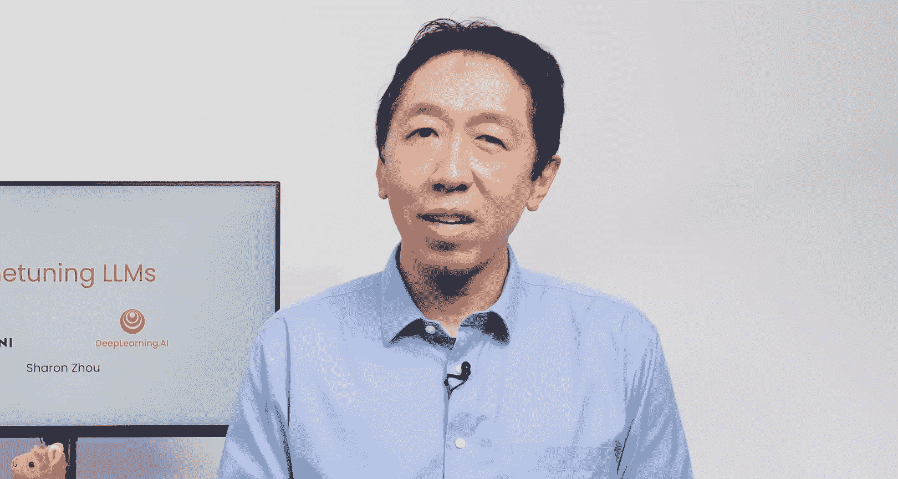
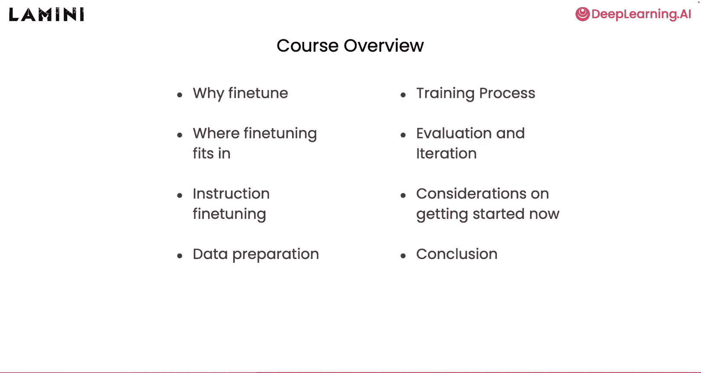
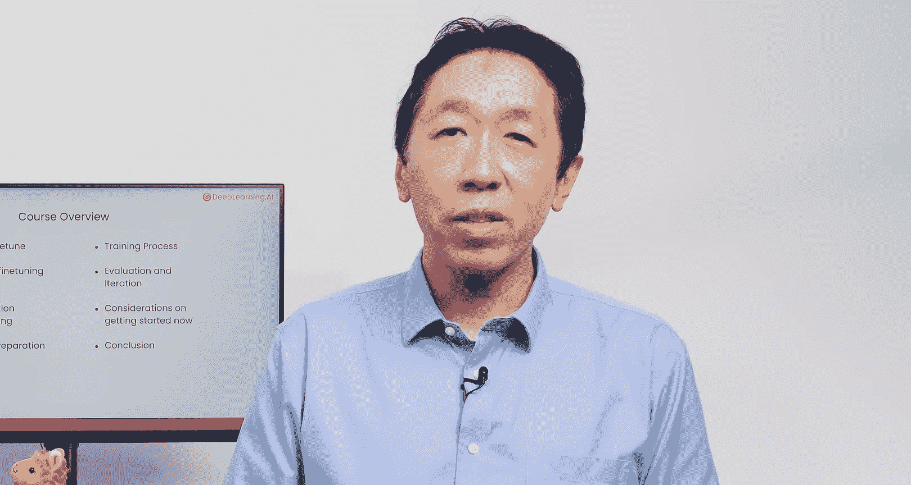
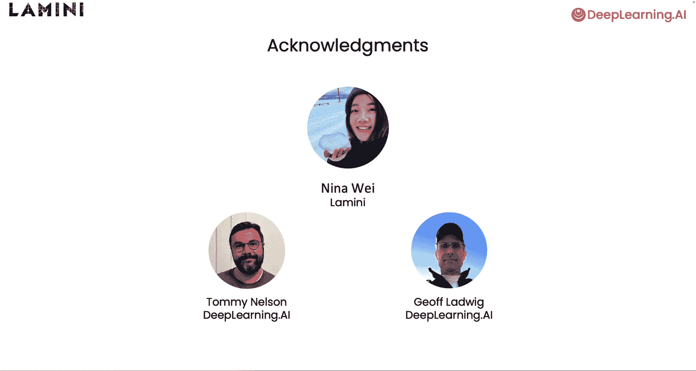

# 吴恩达《微调大型语言模型》｜ Finetuning Large Language Models（中英字幕） - P1：SC-Fine_Tuning_C1_Intro.zh_en - GPT中英字幕课程资源 - BV1Rz4y1T7wz

Welcome to fine tuning La language models taught by Sharon Jo。 Really glad to be here。

 When I visit with different groups， I often hear people ask。

 how can I use these large language models on my own data or on my own task。😊。

Whereas you might already know about how to prompt a large language model。

 this course goes over another important to fine tuning them。Specifically， how to take。

 say an open source LM and further train it on your own data。

While writing a prompt can be pretty good at getting an LM to follow directions to carry out a task like extracting keywords or classifying text as positive or negative sentiment。

If you fine tune， you can then get the LM to even more consistently do what you want。

 And I found that prompting an LM to speak in a certain style。

 like being more helpful or more polite or to be succinct versus verbose to a specific certain extent。

 that can also be challenging。Fine tuning turns out to also be a good way to adjust an LOM's tone。

 People are now aware of the amazing capabilities of chat GBT and other popular LLMs to answer questions about a huge range of topics。

😊，But individuals and companies would like to have that same interface to their own private and proprietary data。

 One of the ways to do this is to train an LLM with your data。 Of course。

 training a foundation LLM takes a massive amount of data。

 maybe hundreds of billions or even more than a trillion words of data and massive GPU compute resources but with fine tuning。

 you can take an existing LM and train it further on your own data。 So in this course。

 you'll learn what fine tuning is when it might be helpful for your applications。

 how fine tuning fits into training， how it differs from prompt engineering or retrieval augmented generation alone。

 and how these techniques can be used alongside fine tuning。

 you'll dive into a specific variant of fine tuning that's made GBBT3 into chat GBT called instruction fine tuning。

 which teaches in LLM to follow instructions。 Finally。

 you'll go through the steps of fine tuning your own LLM preparing the data。

Training the model and evaluating it all in code。

This course is designed to be accessible to someone familiar with Python。

But to understand all the code， it will help to further have basic knowledge of deep learning。

 such as what the process of training a neural network is like and what is， say， a train test split。

A lot of hard work has gone into discourse。 we'd like to acknowledge the whole laminni team and Nina Wei in particular on design。

 as well as on the deep learning AI side， Tommy Nelson and Jeff Ludwig。

In about an hour or so， through this short course， you gain a deep understanding of how you can build your own L M through fine tuning and existing L M on your own data。

 Let's get started。