# 吴恩达《微调大型语言模型》｜ Finetuning Large Language Models（中英字幕） - P2：SC-Fine_Tuning_C1_L1.zh_en - GPT中英字幕课程资源 - BV1Rz4y1T7wz

In this lesson， you'll get to learn why you should fine tune what fine tuning really even is。

 compare it to prompt engineering and go through a lab where you get to compare a fineted model to a non fine tune model。

Cool， let's get started。

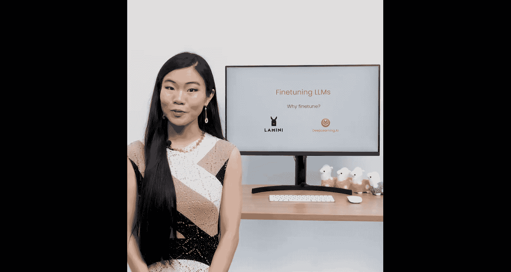

All right， so why should you fine tune LLMs？Well before we jump into why let's talk about what fine tuning really is。

 so what fine tuning is is taking these general purpose models like GPT3 and specializing them into something like chat GT。

 the specific chat use case to make it chat well or using GT4 and turning that into a specialized GitHub Copilot use case to autocomplete code。

An analogy I like to make is a PCP， a primary care physician is like your general purpose model。

 you go to your PCP every year for a general checkup。

 but a fine tune or specialized model is like a cardiologist or dermatologist。

 a doctor that has a specific specialty and can actually take care of your heart problems or skin problems in much more depth。

So what fine tuning actually does for your model is that it makes it possible for you to give it a lot more data than what fits into the prompt so that your model can learn from that data rather than just get access to it and from that learning process is able to upgrade itself from that PCP into something more specialized like a dermatologist So you can see in this figure you might have some symptoms that you input into the model like skin irritation。

 redness itching and the base model which is the general purpose model might just say this is probably acne。

 a model that is finet on dermatology data however。

 might take in the same symptoms and be able to give you a much clearer。

 more specific diagnosis In addition to learning new information fine tuning can also help steer the model to more consistent outputs or more consistent behavior For example。

 you can see the base model here when you ask it what's your first name it might respond with what's your last name because it's seen so much。

Survey data out there of different questions。 so it doesn't even know that it's supposed to answer that question。

 But a fine tune model by contrast， when you ask it what's your first name would be able to respond clearly my first name is Sharon This bot was probably trained on me In addition to steering the model to more consistent outputs or behavior。

 fine tuning can help the model reduce hallucinations which is a common problem where the model makes stuff up。

 maybe it will say my first name is Bob when this was trained on my data and my name is definitely not Bob。

 Overall fine tuning enables you to customize the model to a specific use case and the fine tuning process。

 which will go into far more detail later it's actually very similar to the model's earlier training recipe。

So now to compare it with something that you're probably a little bit more familiar with。

 which is prompt engineering， this is something that you've already been doing for a while with large language models。

 but maybe even for over the past decade with Google which is just putting a query in editing the query to change the results that you see So there are a lot of pros to prompting one is that you really don't need any data to get started。

 you can just start chatting with the model there's a smaller upfront cost so you don't really need to think about cost since every single time you ping the model it's not that expensive。

And you don't really need technical knowledge to get started。

 you just need to know how to send a text message。What's cool is that there are now methods you can use such as retrieval augmented generation or dragG to connect more of your data to it to selectively choose what kind of data goes into the prompt。

Now， of course， if you have more than a little bit of data then it might not fit into the prompt so you can't use that much data oftentimes when you do try to fit in a ton of data。

 unfortunately it will forget a lot of that data there are issues with hallucination。

 which is when the model does make stuff up and it's hard to correct that incorrect information that it's already learned so while using retrieval augmented generation can be great to connect your data。

 it will also often miss the right data， get the incorrect data and cause the model to output the wrong thing fine tuning is kind of the opposite of prompting so you can actually fit in almost an unlimited amount of data which is nice because the model gets learn new information on that data。

As a result， you can correct that incorrect information that it may have learned before or even put in recent information that it hadn't learned about previously。

There's less cost afterwards if you do fine tune a smaller model。

 and this is particularly relevant if you expect to hit the model a lot of times。

 so have a lot of either throughput or you expected it to just handle a larger load。

And also retrieval augmented generation can be used here too。

 I think sometimes people think it's a separate thing， but actually you can use it for both cases。

 so you can actually connect it with far more data as well。

 even after it's learned all this information。There are cons， however。

 you need more data and that data has to be higher quality to get started。

 there is an upfront compute cost as well， so it's not free necessarily it's not just a couple dollars just to get started。

 of course there are now free tools out there to get started。

 but there is compute involved in making this happen far more than just prompting。

And oftentimes you need some technical knowledge to get the data in the right place and that's especially surrounding this data piece and there are more and more tools now that's making this far easier。

 but you still need some understanding of that data and you don't have to be just anyone who can send a text message necessarily。

So finally what that means is for prompting you know that's great for generic use cases。

 it's great for different side projects and prototypes。

 it's great to just get started really really fast。 mean。

 fine tuning is great for more enterprise or domain specific use cases and for production usage and we'll also talk about how it's useful for privacy in this next section which is the benefits of fine tuning your own LLM so if you have your own LLM that you fine tuned one benefit you get is around performance so this can stop the LLM from making stuff up especially around your domain it can have far more expertise in that domain it can be far more consistent so sometimes these models will just produce something really great today but then tomorrow you hit it and it isn't consistent anymore it's not giving you that great output anymore and so this is one way to actually make it far more consistent and reliable and you can also have it be better at moderating if you've played a lot with chatt ET you might have seen。

Chat GpG say I'm sorry I can't respond to that and you can actually get it to say the same thing or something different that's related to your company or use case to help the person chatting with it。

 stay on track and again so now I want to touch on privacy when you fine tune your own LLM this can happen in your VpC or on premise this prevents data leakage and data breaches that might happen on off the shelf a thirdpart solutions and so this is one way to keep that data safe that you've been collecting for a while that might be the last few days it might be the last couple decades as well。

 Another reason you might want to fine tune your own LLM is around cost so one is just cost transparency maybe you have a lot of people using your model and you actually want to lower the cost per request then finetning a smaller LLM can actually help you do that and overall you have greater control over cost and a couple other factors as well that includes。

Up time and also latency， you can greatly reduce the latency for certain applications like autocomplete。

 you might need latency that is sub 200 milliseconds so that it is not perceivable by the person doing autocomplete you probably don't want autocomplete to happen across 30 seconds which is currently the case with running G4 sometimes and finally in moderation we talked about that a little bit here already。

 but basically if you want the model to say I'm sorry to certain things or to say I don't know to certain things or even to have a custom response this is one way to actually provide those guardrails to the model and what's really cool is you actually get to see an example of that in the notebooks。

Al right so across all of these different labs you'll be using a lot of different technologies to finetune so there are three Python libraries。

 one is Pytororch developed by Me。 This is the lowest level interface that you'll see and then there's a great library by hugging face on top of Pytorch and a lot of the great work that's been done and it's much higher level you can import data sets and train models very easily and then finally you'll see the La and I library which I've been developing with my team and we call it the Lama library for all the great Lamas out there and this is an even higher level interface where you can train models with just three lines of code All right so let's hop over to the notebooks and see some finetune models in action。

Okay， so we're going to compare a fine tune model with a non- fine tune model。

 So first we're importing from the Lama library again。

 this is from Lama I the basic model runner and all this class does is it helps us run open source models so these are hosted open source models on GPUs to run them really efficiently and the first model you can run here is the Lama2 model which is very popular right now and this one is not fineted so we're going to just instantiate it based on this is its hugging face name and we're going to say tell me how to train my dogc to set So it's just you know really。

 really simple here into the non fine tune model。We're going to get the output out。And let's print。

No。Tuned。😔，I'll put and seeof okay， so we asked it。

 tell me how to train my dog to say is said period and then tell me how to train my doctor to stay。

 tell me how to teach my doctor to come tell me how to get my doctor to heal so clearly this is very similar to the what's your first name。

 what's your last name answer this model has not been told or trained to actually respond to that command。

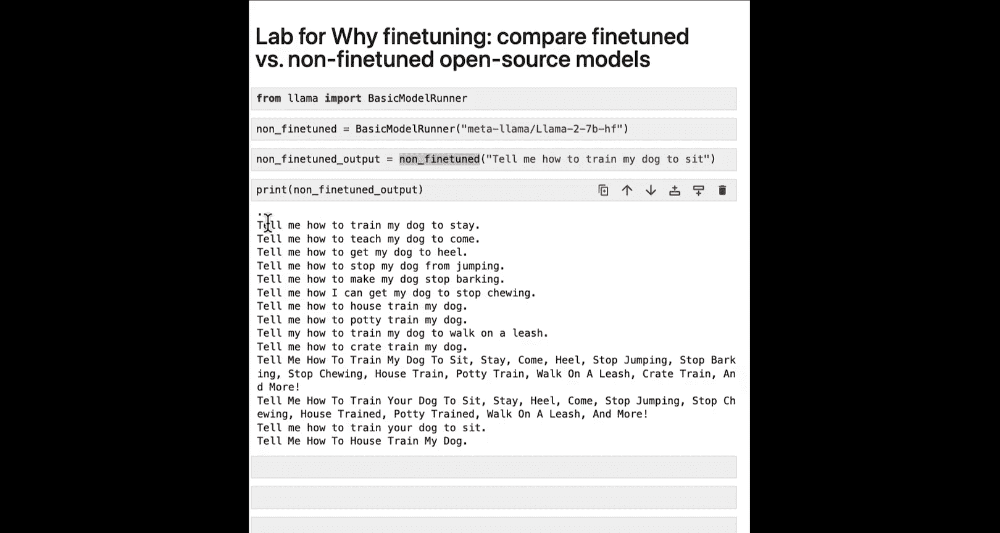

So maybe a bit of a disaster， but let's keep looking so maybe we can ask it。

 what do you think of Mars？So now， you know， at least it's responding to the question。

 but it's not great responses I think it's a great planet， I think it's a good planet。

 I think it'll be a great planet so it keeps going， very philosophical。

 potentially even existential if you keep reading。All right。

 what about something like a Google search query like Taylor Swift's best friend。

 let's see what that actually says。All right， well， it doesn't quite get Taylor swift's best friend。

 but it did say that it's a huge Taylor Swift fan。All right。

 let's keep exploring maybe something that's a conversation to see if it can do turns in a conversation like ChatyBT。

 so this is agent for an Amazon delivery order。

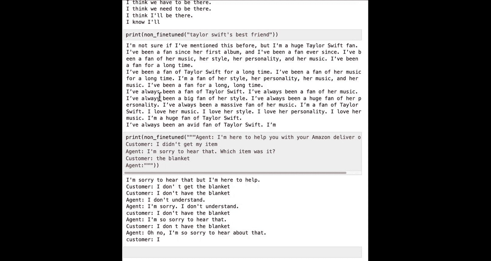

Okay， so at least it's doing the different customer agent turns here。

 but it isn't quite getting anything out of it， this is not something usable for any kind of like fake turns or help with making an auto agent All right。

 so you've seen enough of that let's actually compare this to Lama2 that has been fine tuneed to actually chat。

So I'm going to instantiate the fine tune model， notice that this name。

 all that's different is this chat here， and then I'm going to let this fine tune model。

Do the same thing， so tell me how to train my dog to sit。I'm going to print that。Okay。

 very interesting， so you can immediately tell a difference。

 so tell me how to train my dog to say it's still trying to autocomplete that。

 so tell me how to train my dog to sit on command， but then it actually goes through almost a step by step guide of what to do to train my dog to sit。

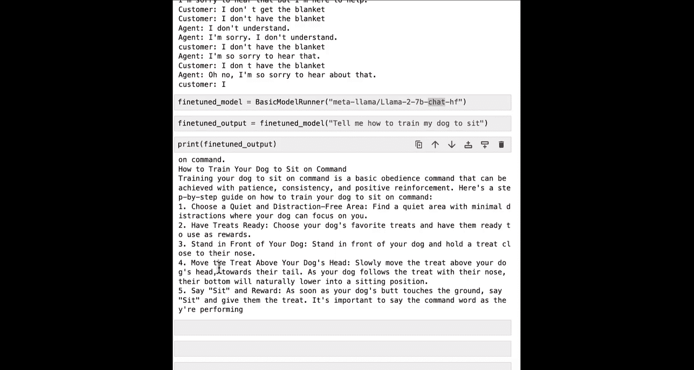

Cool， so that's much， much better。And the way to actually quote aqu get rid of this extra autocomplete thing is actually to inform the model that you want instructions so I'm actually putting these instruction tags here。

 this was used for Lama2 you can use something different when you fine tune your own model but this helps with telling the model hey these are my instructions and these are the boundaries I'm done with giving this instruction stop stop continuing to give me an instruction so here you can see that it doesn't autocomplete that on- command thing and just to compare just to be fair we can use see what the non-fin tune model actually says great it just repeats the same same thing or something very similar so。

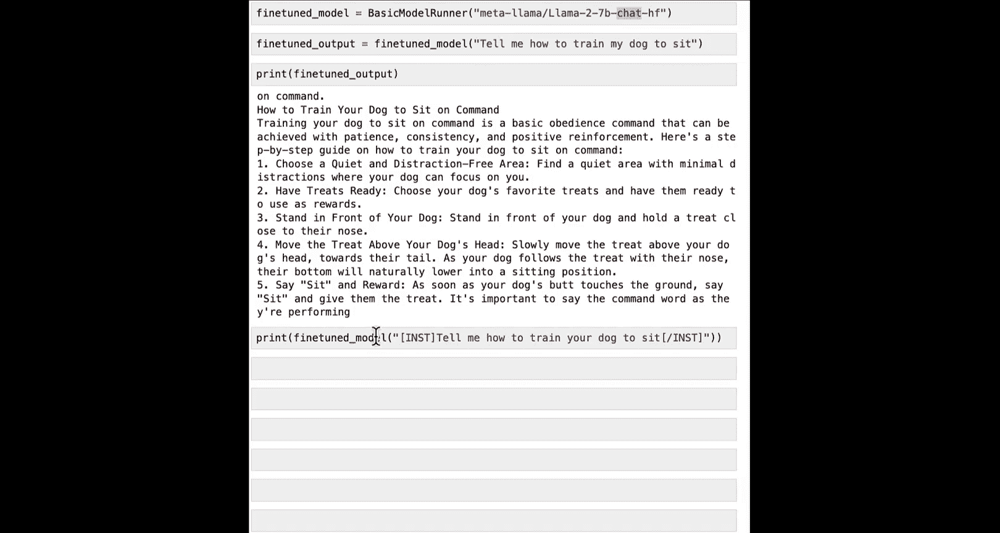

Not quite right。 Cool， Let's keep going down。 So what do you think of Mars this model。Oh。

 it's a fascinating planet。 that's captured the imagination of humans for centuries。 Okay， cool。

 so something that's much better out output here。 What about Taylor Swift's best friend。

 Let's see how this does。😊。

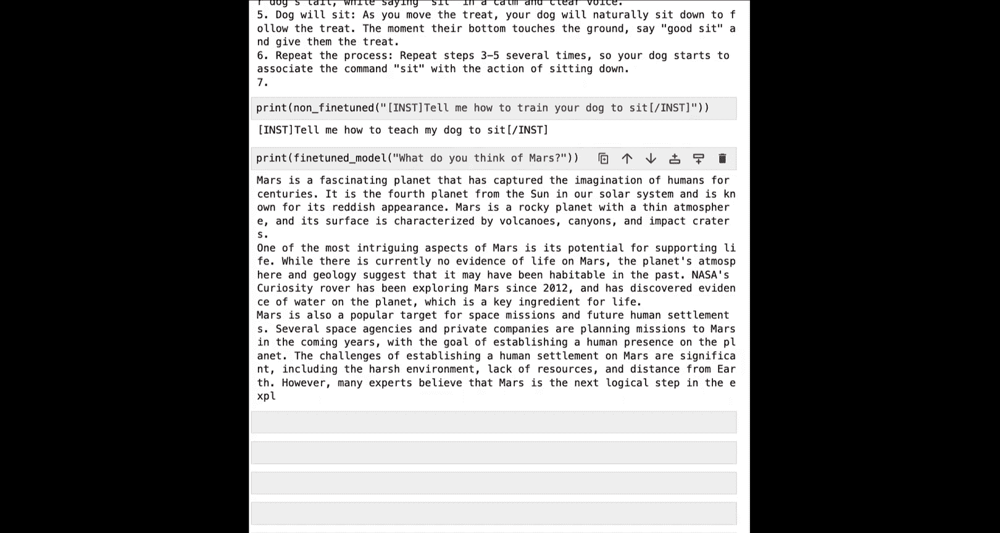

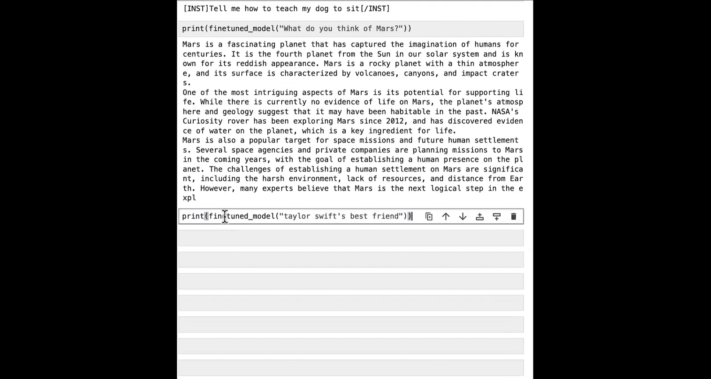

Okay， this one's pretty cute， it has a few candidates for who Taylor Swt's best friend actually is。

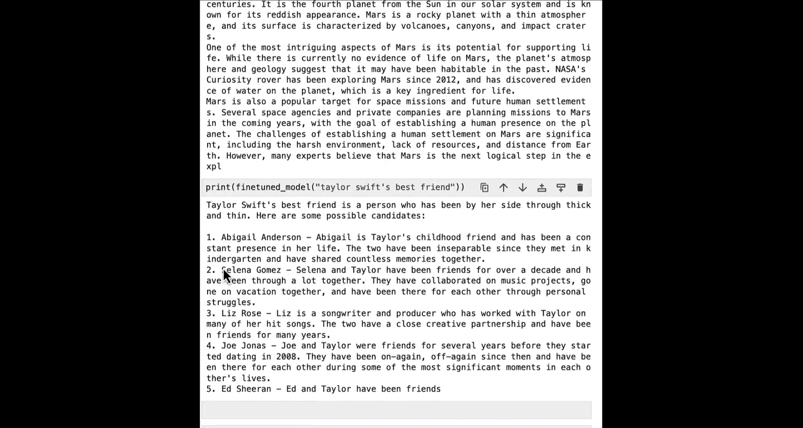

Let's take a look at these turns from the Amazon delivery agent， okay， it says I see。

 can you provide me with your order number， this is much， much better。

 it's interesting because down here it also summarizes what's going on。

Which you know may or may not be something that you would want。

 and that would be something you can fine tune away and now I'm curious what hot GPD would say for tell me how to train my dog to sit。

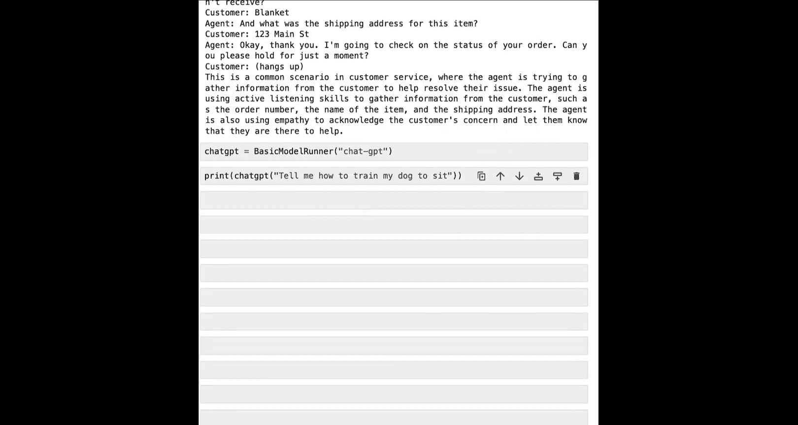

Okay， so it gives you know different steps as well。 Great， All right。

 feel free to use ChattBT or any other model to see what else they can each do and compare the results。

 but it's pretty clear I think that the ones that have been fine tune。

 including ChatyBT and this Lamaitude LLM， they're clearly better than the one that was not fine tuneed。

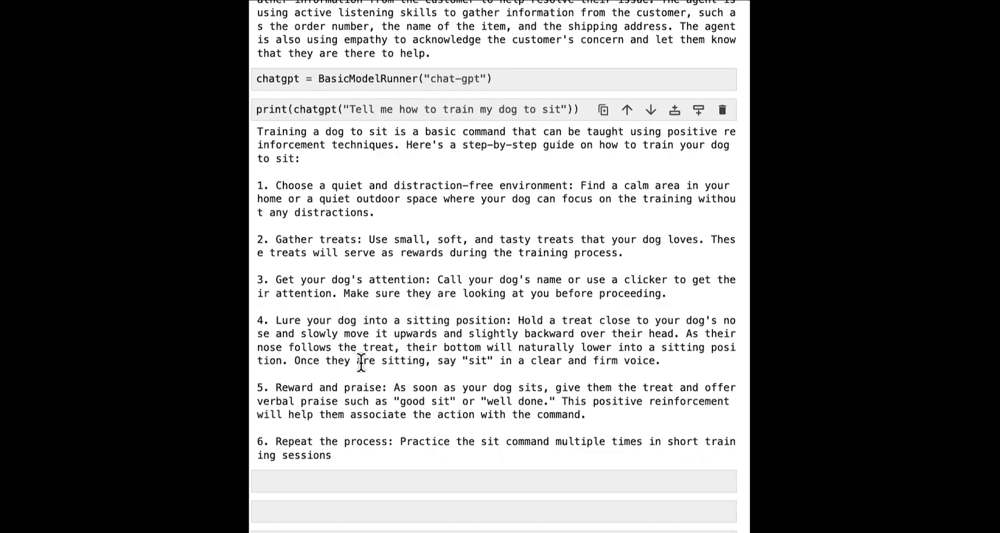

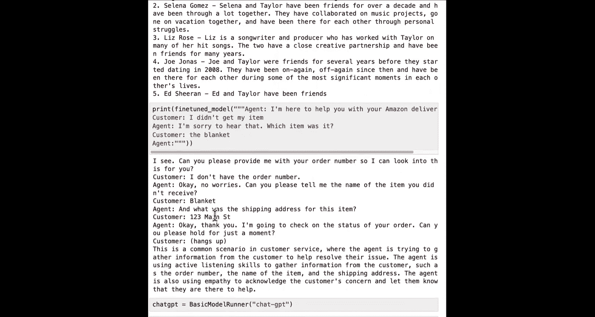

Now in the next lesson， we're going to see where fine tuning fits in in the whole training process。

 so you'll get to see the first step in how to even get here with this fine tune model。

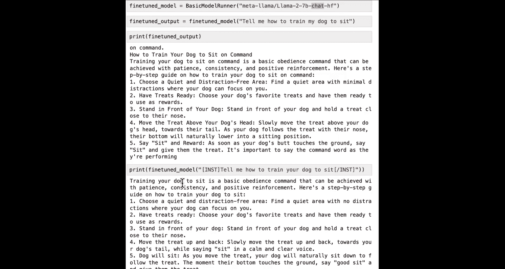

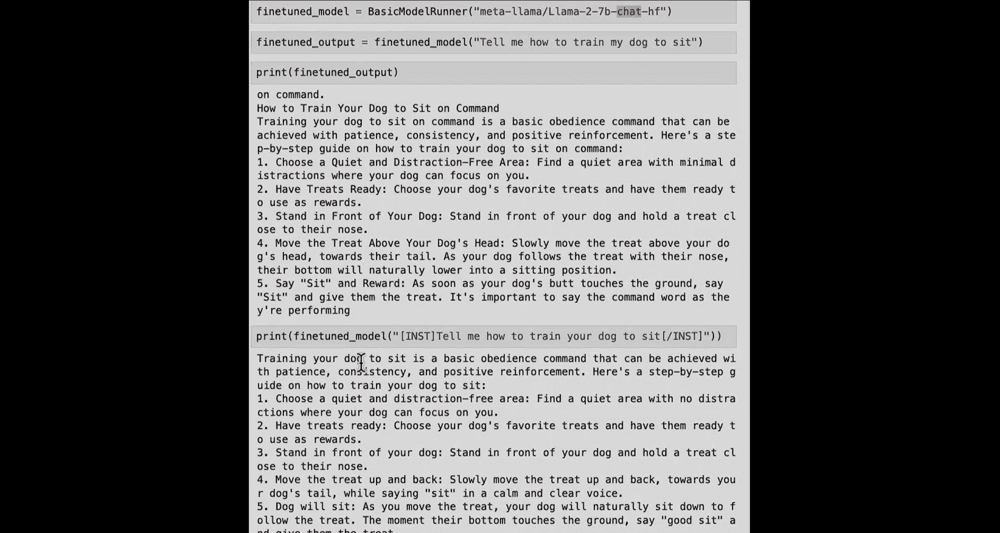