# 吴恩达《微调大型语言模型》｜ Finetuning Large Language Models（中英字幕） - P3：SC-Fine_Tuning_C1_L2.zh_en - GPT中英字幕课程资源 - BV1Rz4y1T7wz

In this lesson you'll learn about where fine tuning really fits into the training process。

 it comes after a step called pretraining， which you'll go into a little bit of detail on。

 and then you'll get to learn about all the different tasks you get to apply fine tuning to。

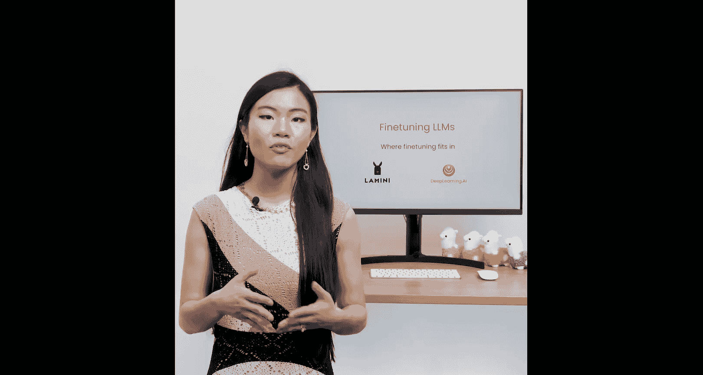

All right， let's continue。Allright， let's see where fine tuning fits in。

 First let's take a look at pretraining。 This is the first step before fine tuning even happens and it actually takes a model at the start that's completely random it has no knowledge about the world at all so all its weights if you're familiar with weights are completely random it cannot form English words at all。

 it doesn't have language skills yet and the learning objective it has is next token prediction or really you know in a simplified sense it's just the next word prediction here so you see the word once and so we want it to now predict the word upon but then you see the LLM just producing SD Xation point exlamation point at so just really far from the word upon so that's where it's starting。

But it taking in and reading from a giant corpus of data often scraped from the entire web。

 we often call this unlabeled because it's not something that we've structured together。

 we've just scraped it from the web， I will say it has gone through many。

 many cleaning processes so there is still a lot of manual work to getting this data set to be effective for model pre-training and this is often called self-supervised learning because the model is essentially supervising itself with next token prediction。

 all it has to do is predict the next word， there aren't really labels otherwise。

Now after training here you see that the model' is now able to predict the word upon or the token upon and it's learned language。

 it's learned a bunch of knowledge from the internet。

 so this is fantastic that this process actually works in this way and it's amazing because all it is is just trying to predict the next token and it's reading the entire internet's worth of data to do so Now okay maybe there's an asterisk on entire internet data and data scrape from the entire internet the actual understanding and knowledge behind this is often not very public people don't really know exactly what that data looks like for a lot of the close source models from large companies。

 but there's been an amazing open source effort by Luther AI to create a data called the pile which you'll get to explore in this lab and what it is is that it's a set of 22 diverse data scraped from the entire internet here you can see in this figure there's four。

Scorre seven years so that's Lincoln's Gettysburg address there's also Lincoln's carrot cake recipe and of course also scrape from Pubmeded there's information about a different medical texts and finally there's also code and here from GitHub so it's a set of pretty intellectual datas that's curated together to actually infuse these models with knowledge now this pretraining step is pretty expensive and time consuming is actually expensive because it's so time consuming to have the model go through all of this data go from absolutely randomness to understanding some of these texts know putting together a carrot cake recipe while also writing code while also knowing about medicine in the Gettysburg address Okay so these pretrainbased models are great and they're actually a lot of them that are open source out there but you it's been trained on these datas from the web and it might have this geography homework you might see here on the left where。

It asks what's the capital of India， what's the capital of Kenya。

 what's the capital of France in it all you know in a line without seeing the answer。

 So when you then input what's the capital of Mexico。

 the LM might just say what's the capital of Hungary。

 as you can see that it's not really useful from the sense of a chatbot interface。

So how do you get it to that chatbot interface Well fine tuning is one of those ways to get you there and it should be really a tool in your toolbox So pretraining is really that first step that gets you that base model and when you add more data in not actually as much data you can use fine tuning to get a fine- tuneed model and actually even a fineted model you can continue adding a fine tuning steps afterwards So fine tuning really is a step afterwards you can use the same type of data you can actually probably scrape data from different sources and curate it together which you'll take a look at in a little bit so that can be this quote unquote unlabeled data but you can also curate data yourself to make it much more structured for the model to learn about and I think one thing that's key that differentiates fine tuning from pretraining is that there's much less data needed you're building off of this base model that has already learned so much knowledge and basic language skills that you really just taking it to the next。

You don't need as much data so this really is a tool in your toolbox and if you're coming from other machine learning areas that's fine tuning for discriminative tasks。

 maybe you're working with images and you've been fine tuning on INe you'll find that the definition for fine tuning here is a little bit more loose and it's not as well defined for generative tasks because we are actually updating the weights of the entire model not just part of it which is often the case for fine tuning those other types of models so we have the same training objective as pre-training here for fine tuning next token prediction and all we're doing is changing up the data so that it's more structured in a way and the model can be more consistent in outputting and mimicking that structure。

And also， there are more advanced ways to reduce how much you want to update this model。

 and we'll discuss this a bit later。So exactly what is fine tuning doing for you so you're getting a sense of what it is right now。

 but what are the different tasks you can actually do with it Well one giant category I like to think about is just behavior change you're changing the behavior of the model you're telling it exactly in this chat interface we're in a chat setting right now we're not looking at a survey so this results in the model being able to respond much more consistently it means the model can focus better。

 maybe that could be better for moderation for example and it's also generally just teasing out its capabilities so here it's better at conversation so that it can now talk about a wide variety of things versus before we would have to do a lot of prompt engineering in order to tease that information out fine tuning can also help the model gain new knowledge and so this might be around specific topics that are not in that base pre-trained model this might mean correcting old and correct information so maybe there's more updated recent information that you want。

The model to actually be infused with， and of course。

 more commonly you're doing both with these models。

 so oftentimes you're changing the behavior and you want it to gain you knowledge。

So taking it a notch down so tasks for fine tuning。

 it's really just text in text out for LLMs and I like to think about it in two different categories so you can think about it one as extracting text so you put text in and you get less text out So a lot of the work is in reading and this could be extracting keywords。

 topics you might be routing based on all the data that you see coming in you route the chat for example。

 to some API or otherwise different agents are here like different agent capabilities and then that's in contrast to expansion so that's where you put text in and you get more text out so I like to think of that as writing and so that could be chatting。

 writing emails， writing code and really understanding your task exactly the difference between these two different tasks or maybe you have multiple tasks that you want to fine tune on is what I found to be the clearest indicator of success So if you want to succeed at fine tunening in the model is getting clear on what tasks。

You want to do and clarity really means knowing what's you a good what good output looks like。

 what bad output looks like， but also what better output looks like So when you know that something is doing better at writing coder doing better at routing a task that actually does help you actually fine-t this model to do really well All right so if this is your first time fine tuning I recommend a few different steps So first identify a task by just prompt engineering a large LLM and that could be chat GBT for example。

 and so you're just playing with chat GT like you normally do and you find some you know tasks that it's doing okay at so not great but like not horrible either so you know that it's possible within the realm of possibility but it's not the best and you want to do much better for your task so pick that one task and just pick one and then number four get some inputs and outputs for that task so you put in some tasks and you got some text out get inputs where you put in text and get text out and outputs。

Of those for this task and one of the golden numbers I like to use is 1000 because I found that that is a good starting point for the amount of data that you need and make sure that these inputs and outputs are better than the okay result from that LLM before you can't just generate these outputs necessarily all the time and so make sure you have those pairs of data and you'll explore this in the lab to this whole pipeline here start out with that and then what you do is you can then finet a small LLM on this data just to get a sense of that performance bump and then so this is only if you're first time this is what I recommend。

 So now let's jump into the lab where you get to explore the data that was used for pretraining versus for fine tuning so you understand exactly what these input output pairs look like so we're going to get started by importing a few different libraries so we're just going to run that and the first library that we're gonna to use is the datas library from hugging face and they have this great function called low data where you can just pull a data from on their hub。

And be able to run it。So here I'm going to pull the pretraining dataset set called the pile that you just saw a little bit more about and here I'm just grabbing the split which is train versus test and very specifically I'm actually grabbing streaming equals true because as data is massive。

 we can't download it without breaking this notebook so I'm actually going to stream it in one at a time so that we can explore the different pieces of data in there。

So just loading that up and now I'm going to just look at the first five。

 so this is just using it tools。

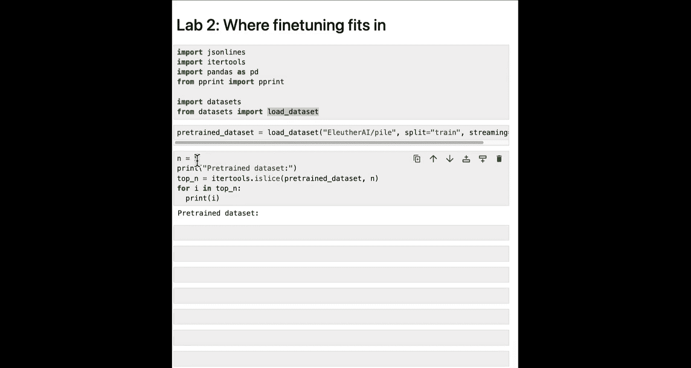

Great。Okay， so you can see here in the pretrain data。

 there's a lot of data here that looks kind of scraped。 So， you know。

 this text says it is done and submitted。 you can play survival of the T Cs on Android。

 And so that's one example。 And let's see if we can find another one here。

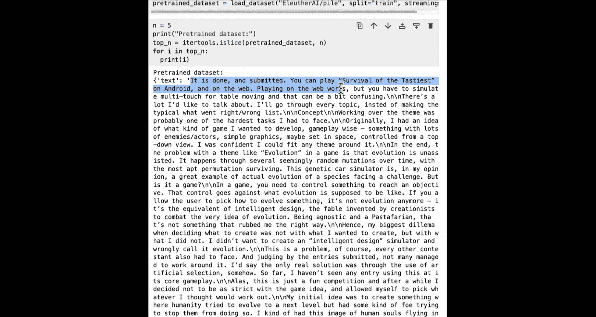

Here is another one， so this is just code that was scraped， XML code that was scraped。

 so that's another data point。

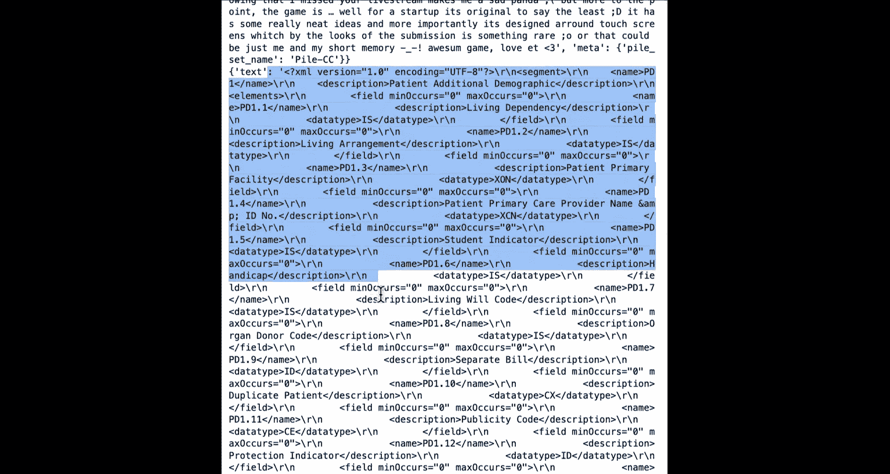

Here'll see an article content， you'll see this topic about you know Amazon announcing a new service on AWS and then here's about know Grand slam fishing charter so this is which is a family business so this is know just a hodgepodge of different data sets scraped from essentially the internet and I kind of want to contrast that with fineta data that you'll be using across the different labs we're grabbing a company data set of question answer pairs you know scraped from an FAQ and also put together about internal engineering documentation and it's called Lamini docs it's about the company Lamini and so we're just going to read that JSON file and take a look at what's in there。

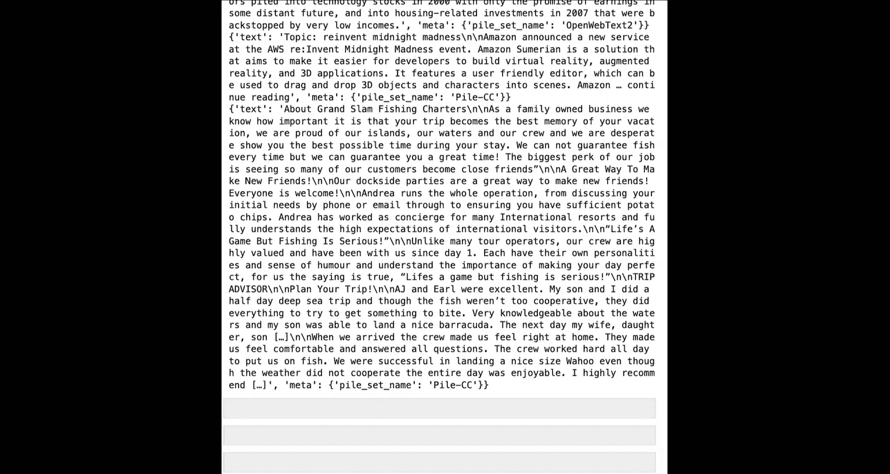

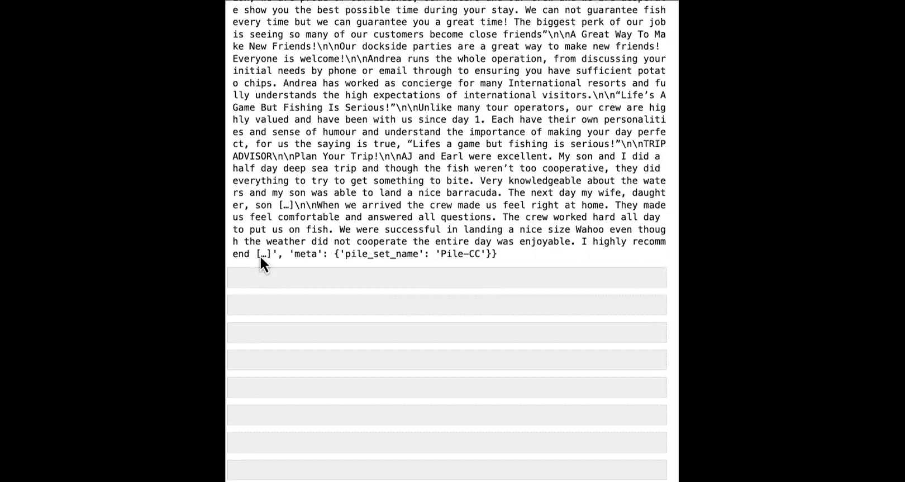

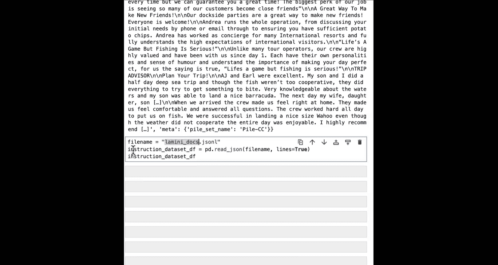

Okay so this is much more structured data right so there are question answer pairs here and it's very specific about this company so the simplest way to use this data is to concatenate actually these questions and answers together and serve that up into the model so that's what I'm going to do here I'm going to turn that into a diic and then I'm going to see what actually concatenating one of these looks like。

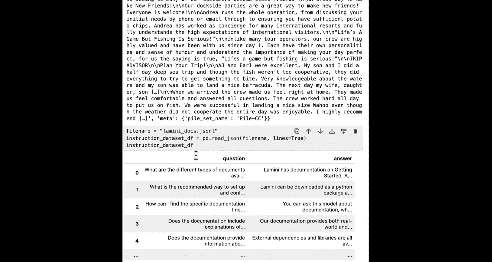

So， you know， just concatenating the question and directly just giving the answer after it right here。

And of course you can prepare your data in any way possible。

 I just want to call out a few different common ways of formatting your data and structuring it so question answer pairs。

 but then also instruction and response pairs， input output pairs just being very generic here。

 also just you can actually just have it since we're concatenating it anyways as' just text that you saw above with the pile。

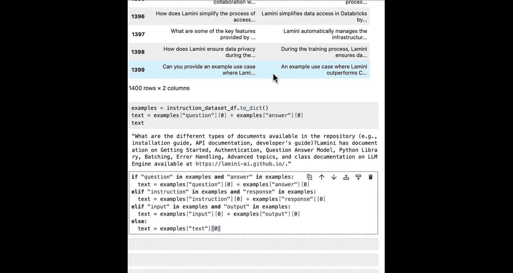

All right， so concatenating it， you know that's very simple。

 but sometimes that is enough to see results。 sometimes it isn't so you'll still find that the model might need just more structure to help with it and this is very similar to prompt engineering actually so taking things a bit further you can also process your data within an instruction following in this case question answering prompt template and here's a common template note that there's a pound pound pound before the question type of markers so that that can be easily used as structure to tell the model to expect what's next。

 it expects a question after it sees that for the question and it also can help you postpro the model's outputs even after it's been fine-tuned so we have that there so let's take a look at this prompt template in action and see how that differs from the concatenated。

Question and answer so here you can see how that's how the prompt template is with the question and answer neatly done there and often it helps to keep the input and output separate so I'm actually going to take out that answer here and keep them separated out because this helps us just using the data easily for evaluation and for you know when you split the data into trade and test so now what I'm going to do is put all of this you know apply all of this template to the entire data set。

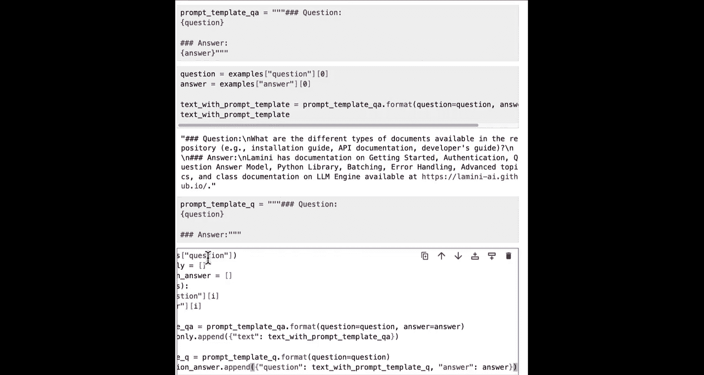

So just running a for loopbe over it and just hydrating the prompt。

 so that is just you know adding that question and answer into this with F string or dot format stuff here with Python。

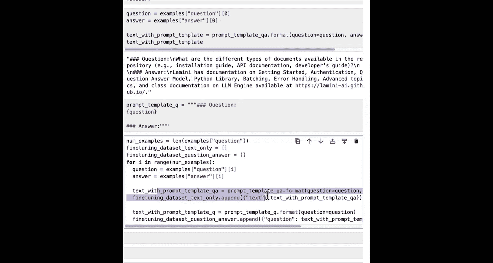

Allright， so let's take a look at。The difference between that text only thing。

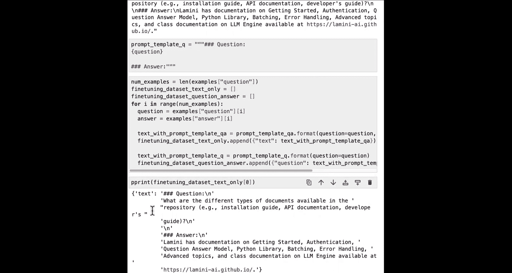

And the question answer for that。Cool， so it's just text only。

 It's all concatenated here that you're putting in。 And here is just question answer。

 much more structured。 And you can use either one。 But， of course。

 I do recommend structuring it to help with evaluation。That is basically it。

 the most common way of storing this data is usually in JSON Line files。 So JONL files do JNL。

 it's basically just， you know each line is a JSON object and that's it。

 And so just writing that to file there。 you can also upload this data onto hugging face shown here because you'll get to use this later as well and you get to pull it from the cloud like that。

Next， you'll dive into a specific variant of fine tuning called instruction fine tuning。

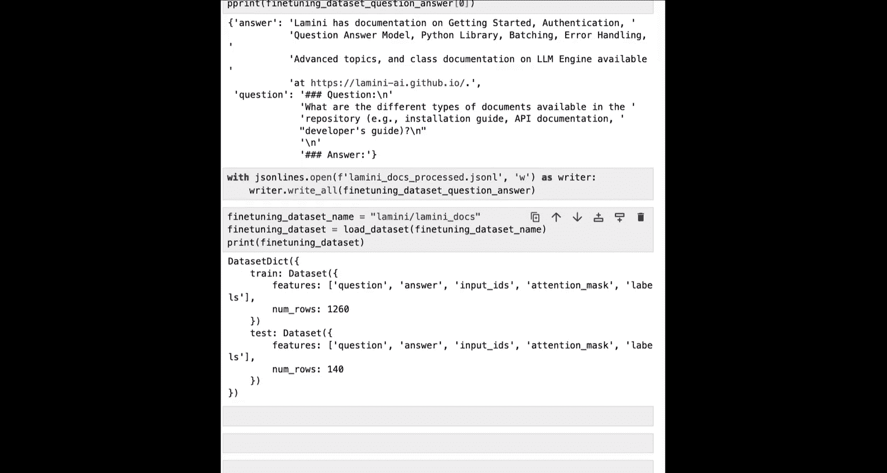