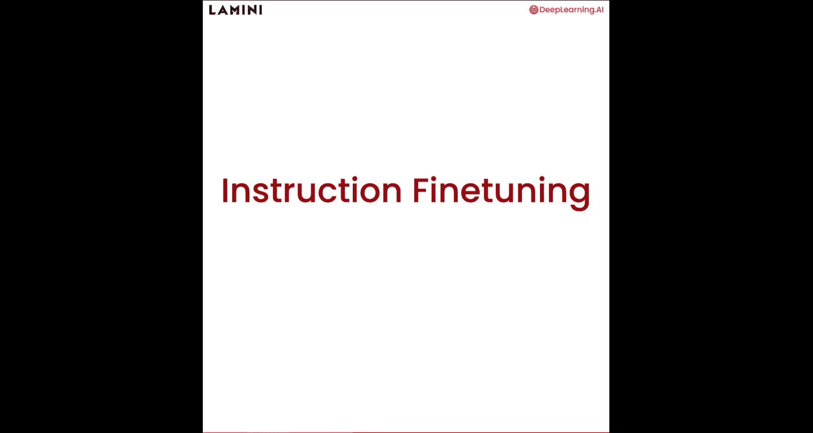
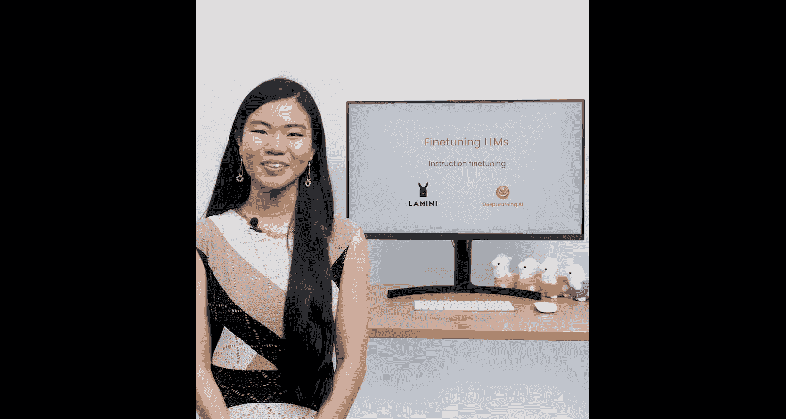
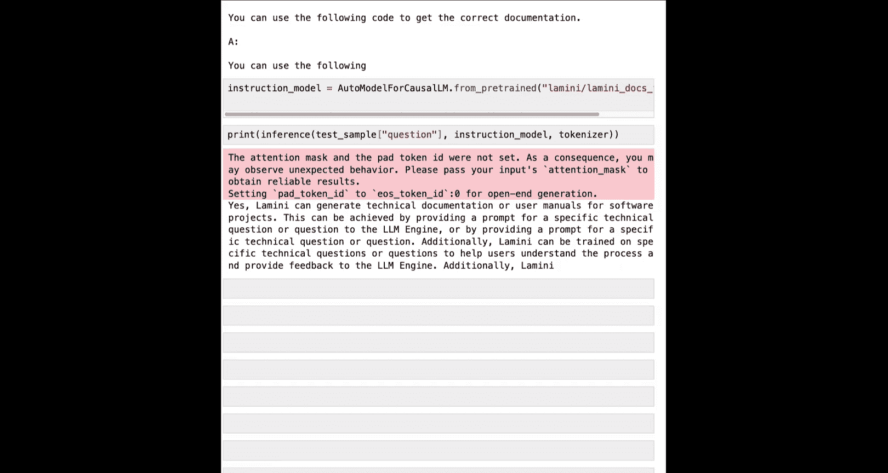
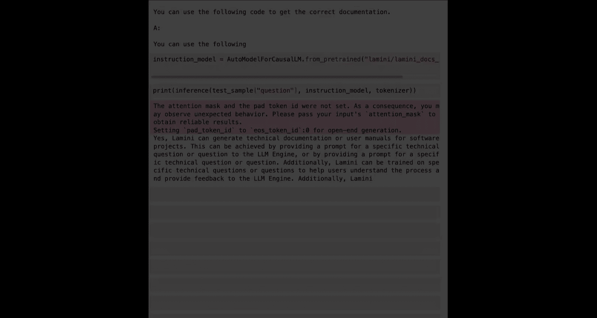

# 吴恩达《微调大型语言模型》｜ Finetuning Large Language Models（中英字幕） - P4：SC-Fine_Tuning_C1_L3.zh_en - GPT中英字幕课程资源 - BV1Rz4y1T7wz

In this lesson， you'll learn about instruction fine tuning。

 a variant of fine tuning that enabled GT3 to turn into chat GT and give it its chatting powers。

 Okay， let's start giving chatting powers to all our models。

Okay so let's dive into what instruction fine tuning is In fine tuning is a type of fine tuning there are all sorts of other tasks that you can do like reasoning routing co-pilot which is writing code chat different agents but specifically instruction fine tuning which you also may have heard as instruction tune or instruction following LLMs teaches the model to follow instructions behave more like a chatbot and this is a better user interface to interact with a model as we've seen with chat GT this is the method that turned GT3 into chat GT which dramatically increased AI adoption from just a few researchers like myself to millions and millions of people so for the data set for instruction following。

 you can use a lot that already exists readily available either online or specifically to your company and that might be FAQs。

 customer support conversations or slackck messages it's really。

This dialo data or just instruction response data sets Of course， if you don't have data， no problem。

 you can also convert your data into something that's more of a question answer format or instruction following format by using a prompt template so here you can see you know read me my be able to be converted into a question answer pair you can also use another LLM to do this for you there's a technique called AlPAca from Stanford that uses chat GBT to do this and of course you can use a pipeline of different open source models to do this as well。

Cool， so one of the coolest things about fine tuning I think is that it teaches this new behavior to the model and while you know you might have fine tuning data on what's the capital of France。

 Paris because these are easy question answer pairs that you can get you can also generalize this idea of question answering to data you might not have given the model for your fine tuning data but that the model had already learned in its preexisting pre-training step and so that might be code and this is actually findings from the chatGBT paper where the model can now answer questions about code。

 even though they didn't have question answer pairs about that for their instruction fine tuning。

 and that's because it was really expensive to get programmers to go label data sets where they ask questions about code and write the code for it So an overview of the different steps of fine tuning are data prep training and the evaluation of course after you evaluate the model you need to prep the data again to improve it。

 it's a very iterative process to improve the model。

And specifically for instruction fine tuning and other different types of fine tuning。

 data prep is really where you have differences， this is really where you change your data。

 you tailor your data to the specific type of fine tuning。

 the specific task of fine tuning that you're doing。And training and evaluation is very similar。

 So now let's dive into the lab where you get a peak at the alpaca dataset for instruction tuning。

 you'll also get to compare models again， that have been instructiont versus haven't been instructiontd and you'll get to see models of varying sizes here So first importing a few libraries the first one that is important is again。

 this load data function from the dataset library。 and let's load up this instructiont dataset and this is specifying the alpaca data and again。

 we're streaming this because its actually a hefty fine tuning data not as big as the pile of course。

You're going to load that up。And just like before with the pile。

You're going to take a look at a few examples。All right， so unlike the pile。

 it's not just text in that set here it's a little bit more structured。

 but it's not as clear cut as just question answer or pairs。And what's really。

 really cool about you this is that the authors of the Alpaca paper。

 they actually had two prompt templates because they wanted the model to be able to work with two different types of prompts and two different types of tasks essentially and so one is an instruction following one where there is an extra set of inputs。

 for example， the instruction might be add two numbers and the inputs might be first number is three。

 the second number is four and then there's prompt templates without input which you can see in these examples sometimes it's not relevant to have an input so it doesn't have that so these are the prompt templates that are being used。

And so again， very similar to before， you'll just hydrate those prompts。

And from them across the whole data， and let's just print out one pair to see what that looks like。

Cool， so that's input output here and you know how it's hydrated into the promso it ends with response。

 and then it outputs this response here。Cool and just like before you can write it to a JSON Lines file。

 you can upload it to Huging FaceHub if you want， we've actually loaded it up at Lamini/ alpaca so that it's stable。

 you can go look at it there and you can go use it Okay great so now that you have seen what that instruction following dataset looks like。

I think the next thing to do is just remind you again on this tell me how to train my dog to sit prompt on different models。

So the first one is going to be this Lama 2 model that is again， not instruction tuned。

We're going run that， tell me how to train my dog to sit Okay， it starts with that period again。

 H just says this， so remember that before and then now we're going to compare this to again。

 the instruction tune model。Right here。Okay， so much better it's actually producing different steps。

And then finally， I just want to share chat toBT again。

 just so you can have this comparison right here， great。

Okay so that is a much larger set of models ChatyBT is quite large compared to the Lama2 models those are actually 7 billion parameter models。

 ChaybutTs rumor to be around 70 billion so very large models you're also going to explore some smaller models so one is that 70 million parameter model and here I'm loading up these models this is not super important yet you'll explore this a bit more later but I'm going to load up two different things to process the data and then run the model and you can see here the tag that we have here is a Luther AI/ Pthia70 million this is a 70 million parameter model that has not been instructiontd。

I'm going to paste some code here as a function to run inference or basically run the model on text。

We will go through these different sections of what exactly is going on in this function throughout the next few labs。

Cool， so this model hasn't been fine tuned。 It doesn't know anything specific about a company。

 but we can load up this company data again from before。

 So we're going to give this model a question from this data probably just the first sample from the test set for example and so we can run this here The question is can Lamin I generate technical documentation or user manuals for software projects and the actual answer is yes。

 Lamin I can generate technical documentation and user manual for software projects and it keeps going but the model's answer is I have a question about the following。

 how do I get the correct documentation to work A I think U did to use the following code etc。

 So it's quite off of course， it's learned English and it got the word documentation in there。

 So and it kind of understands maybe that we're in a question answer setting because it has a there for answer but it's clearly quite off and so it doesn't quite understand this data in terms of the knowledge and also doesn't understand the。

haor that we're expecting from it so it doesn't understand that it's supposed to answer this question Okay so now compare this to a model that we've now fine tuned for you but that you're actually about to fine tune for instruction following and so that's loading up this model and then we can run the same question through this model and see how it does and it says yes。

 Lim and I can generate technical documentation or user manual for software projects etc and so this is just far more accurate than the one before and it's following that right behavior that we would expect。

Okay， great， so now that you've seen what an instruction following model does exactly。

 the next step is to go through what you saw peak of， which is that tokenizer。

 how to prep our data so that it is available to the model for training。

