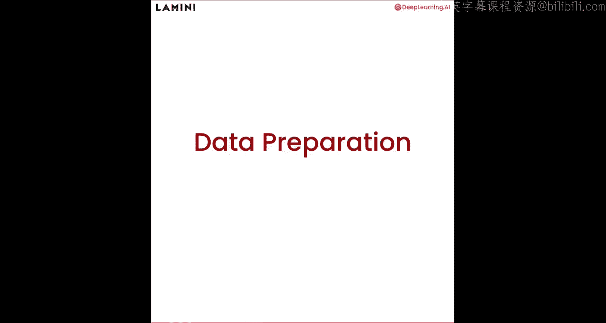
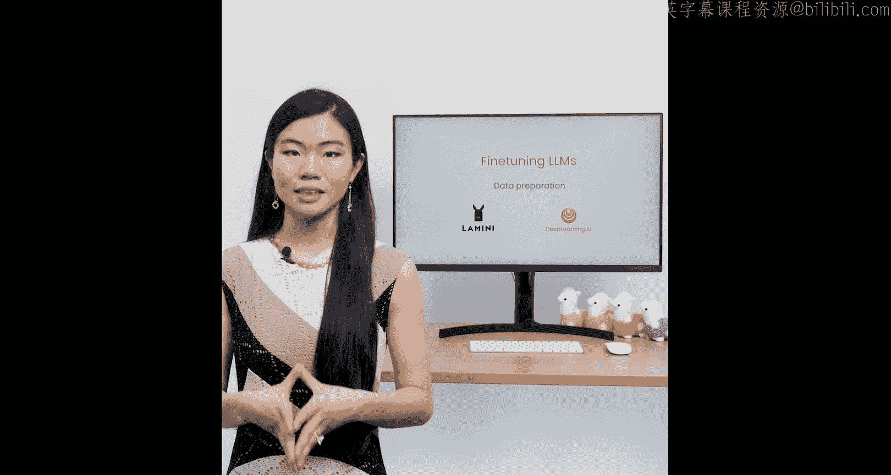
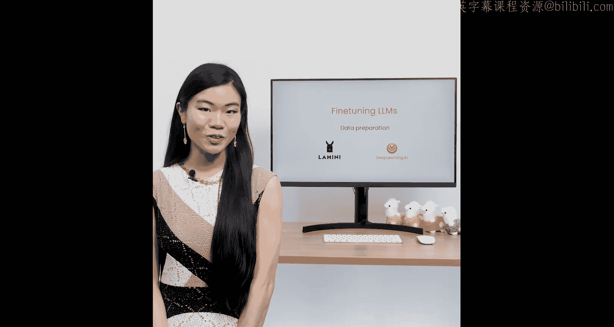
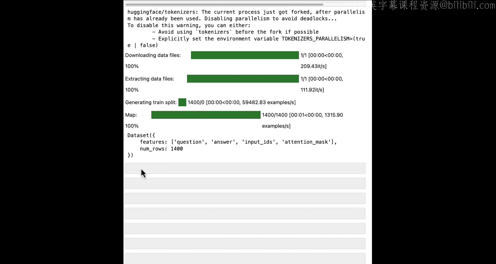
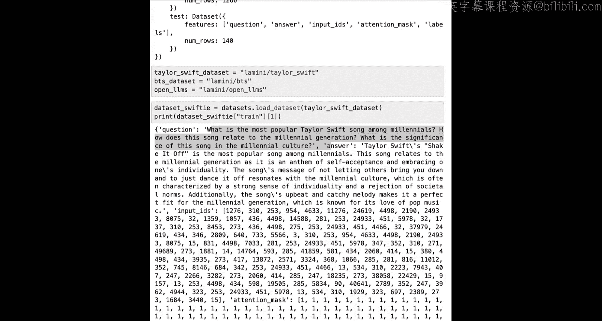

# 吴恩达《微调大型语言模型》｜ Finetuning Large Language Models（中英字幕） - P5：SC-Fine_Tuning_C1_L4.zh_en - GPT中英字幕课程资源 - BV1Rz4y1T7wz

Now after exploring the data that you'll be using， in this lesson。

 you'll learn about how to prepare that data for training。

All right， let's jump into it。

So next on what kind of data you need to prep， well there are a few good best practices。

 so one is you want higher quality data and actually that is the number one thing you need for fine tuning rather than lower quality data what I mean by that is if you give it you garbage inputs it'll try to parrot them and give you garbage outputs so giving really high quality data is important。

Next is diversity so having diverse data that covers a lot of aspects of your use case is helpful。

 if all your inputs and outputs are the same。 then the model can start to memorize them and if that's not exactly what you want then the model will start to just only spout the same thing over and over again so having diversity in your data is really important next is real or generated I know there are a lot of ways to create generated data and you've already seen one way of doing that using an LLM but actually having real data is very。

 very effective and helpful most of the time especially for those writing tasks and that's because generated data already has certain patterns to it。

 you might have heard of some services that are trying to detect whether something is generated or not and that's actually because there' are patterns and generated data that they're trying to detect and as a result if you train on more of the same patterns it's not going to learn necessarily new patterns or new ways of framing things and finally I put this last because actually in。

Machine learning applications having way more data is important than less data。

 but as you actually just seen before pretraining handles a lot of this problem。

 Pretraining has learned from a lot of data， all from the Internet。

 And so it already has a good base understanding it's not starting from zero。

 And so having more data is helpful for the model but not as important as the top three and definitely not as important as quality。

 So first， let's go through some of the steps of collecting your data。

 So you've already seen some of those instruction response pairs So the first step is collect them。

 The next one is concatenate those pairs or at a prompt template。 you've already seen that as well。

 the next step is tokenizing the data adding padding or truncating the data。

 So it's the right size going into the model。 and you'll see how to tokenize that in the lab。

So the steps to preppping your data is one collecting those instruction and response pairs。

 maybe that's question answer pairs， and then it's concatenating those pairs together。

 adding some prompt template like you did before， the third step is tokenizing that data in the last step is splitting that data into training and testing now in tokenizing what does that really mean well tokenizing your data is taking your text data and actually turning that into numbers that represents each of those pieces of text it's not actually necessarily by word it's based on the frequency of common character occurrences and so in this case one of my favorites is the ING token which is very common in tokenizers and that's because that happens in every single Jron so in here you can see fine tuning IG so every single verb in the J fine tuning or tokenizing all has ING and that maps onto the token 278 here and when you decode it with the same tokenizer it turns back into the same text。

Now there are a lot of different tokenizers and the tokenizer is really associated with a specific model for each model as it was trained on it。

 and if you give the wrong tokenizer to your model。

 it'll be very confused because it will expect different numbers to represent different sets of letters and different words。

 so make sure you use the right tokenizer and you'll see how to do that easily in the lab。Cool。

 so let's head over to the notebook。Okay， so first we'll import a few different libraries and actually most important one to see here is the auto tokenizer class from the Transformers's library by HugingFace and what it does is amazing it automatically finds the right tokenizer for your model and you just specify what the model is so all you have to do is put the model a name in and this is the same model name that you saw before which is a 70 million Pythium based model。

Okay， so maybe you have some text that says， you know， hi， how are you？

So now let's tokenize that text， so put that in。Boom， so let's see what encoded T is。All right。

 so that's different numbers representing text here。

 tokenizer outputs a dictionary with input IDs that represent the tokens so I'm just printing that here。

 and then let's actually decode that back into the text and see if it actually turns back intoH how are you？

Cool， awesome。 it turns back into high。 how are you。 So that's great。 Allright， so when tokenizing。

 you probably are putting in batches of inputs。 So let's just take a look at a few different inputs together。

 So there's high。 how are you。 I'm good。 and yes， So putting that list of text through。

 you can just put it in a batch like that into the tokenizer。 you get a few different things here。

 So here's high。 how are you again。 I'm good and smaller。 And yes， is's just one token。😊。

So as you can see these are varying in length actually something that's really important for models is that everything in a batch is the same length because you're operating with fixed- size tensors and so the text needs to be the same so one thing that we do do is something called padding padding is a strategy to handle these variable length encoded text and for our padding token you have to specify you what number you want to represent four padding and specifically we're using zero which is actually the end of sentence token as well so when we run padding equals true through the tokenizer you can see the yes string has a lot of zeros padded there on the right just to match the length of this highhow use string。

Your model will also have a max length that it can handle and take in so it can't just fit everything in and you've played with prompts before and you've noticed probably that there is a limit to the prompt length and so this is the same thing and truncation is a strategy to handle making those encoded text much shorter that fit actually into the model So this is one way to make it shorter so as you can see here I'm just artificially changing the max length to three setting truncation to true and then seeing how it's much shorter now for hi how are you It's truncating from the right so it's just getting rid of everything here on the right Now realistically actually one thing that's very common is you know you're writing a prompt maybe of your instruction somewhere and you have a lot of the important things maybe the other side on the right and that's getting truncated out so you know specifying truncation side to the left actually can truncated the other way so this really depends on your task and realistically for padding and truncation。

You want to use bolt， so let's just actually set both in there。

 so truncation is true and paddings true here。And just printing that out so you can see the zeros here。

 but also getting truncated down to three。Great， so that was really a toy example。

 I'm going to now paste some code that you did in the previous lab on prompts so here it's loading up the data set file with the questions and answer is putting it into the prompt hydrating those prompts all in one go so now you can see one data point here of question and answer so now you can run those tokenizer on just one of those data points So first concatenating that question with that answer and then're running it through the tokenizer I'm just returning the tensors as a nu array here just to be simple and running it with just padding and that's because I don't know how long these tokens actually will be and so what's important is that I then figure out the minimum between the max length and the tokenized inputs Of course you can always just pad to the longest you can always pad to the max length and so that's what that is here。

And then I'm tokenizing again with truncation up to that max length。So let me just print that out。嗯。

And just specify them from the dictionary and cool。 So that's what the tokens look like。 Alright。

 so let's actually wrap this into a fullfledge function so you can run it through your entire data set。

 So this is again， the same thing happening here that you already looked at， grabbing the max length。

 setting the truncation side。 So that's a function for tokenizing your data set。😊。

And now what you can do is you can load up that data set。

There's a great map function here so you can map the tokenized function onto that data set and you'll see here I'm doing something really simple so I'm setting batch sides to one。

 it's very simple， it is going to be batched and dropping last batch true。

 that's often what we do to help with mixed sides inputs and so the last batch might be a different size。

Co。Great， and then so the next step is to split the data set。 So first。

 I have to add in this labels columns as for hugging face to handle it。

 And then I'm going to run this。

Train test split function and I'm going to specify the test size as 10% of the data so of course you can change this depending on how big your data set is shuffles true so I'm randomizing the order of this data set I'm just going to print that out here so now you can see that the dataset has been split across training and test set 140 for a test set there。

And of course， this is already loaded up in Huging face like you had seen before。

 so you can go there and download it and see that it is the same。

So while that's a professional dataset it's about a company， maybe this is related to your company。

 for example， you could adapt it to your company。 we thought that might be a bit boring。

 it doesn't have to be。 so we included a few more interesting datas that you can also work with and feel free to customize and train your models for these instead。

 one is for Taylor Swift ones for the popular band BTS and one is on actually open source large language models that you can play with and just looking at one data point from the Tat data let's take a look。

 All right what's most popular Taylor So song among millennials。

 how does a song relate to the millennial generation。

 okay so you can take a look at this yourself and yeah these data sets are available via Huging face。

And now in the next lab， now that you've prepped all this data tokenized it。

 you're ready to train the model。

