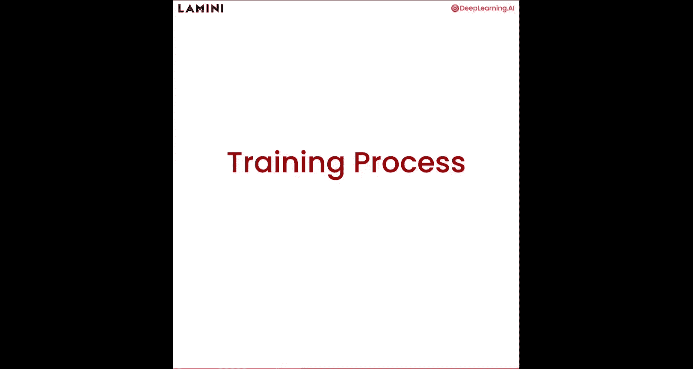
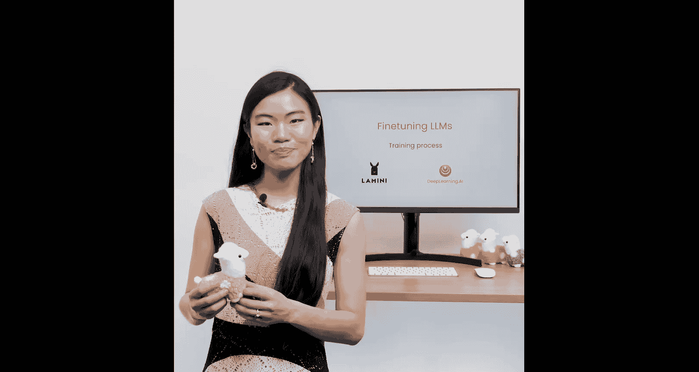
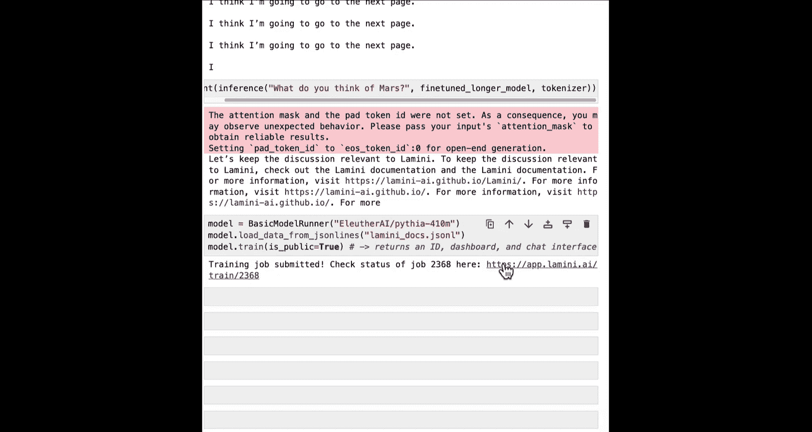
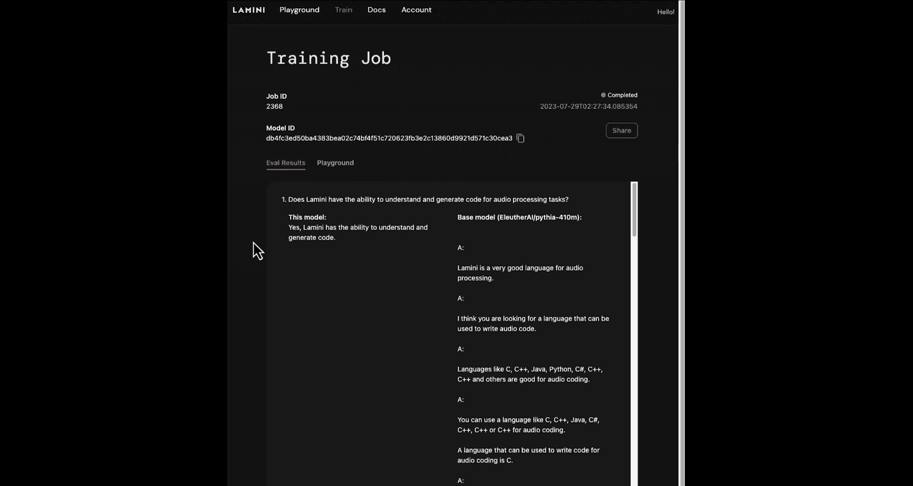
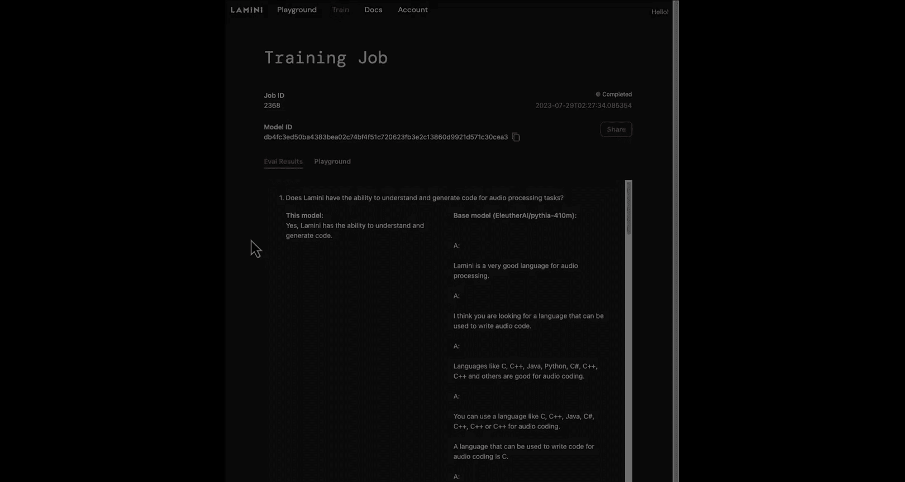

# 吴恩达《微调大型语言模型》｜ Finetuning Large Language Models（中英字幕） - P6：SC-Fine_Tuning_C1_L5.zh_en - GPT中英字幕课程资源 - BV1Rz4y1T7wz

In this lesson， you'll step through the entire training process and at the end see the model improve on your task。

 specifically for you to be able to chat with it。

All right， let's jump into it。All right， training in LLM what does this look like so the training process is actually quite similar to other neural networks so as you can see here you know the same setup that we had seen the LLM predict SD exclamation point exclamation point at what's going on well first you add that training data up at the top then you calculate the lawsuit predict something totally off in the beginning predict the loss compared to the actual response it was supposed to give that's a upon。

And then you update the weights you backpro through the model to update the model to improve it。

 such that in the end， it does learn to then output something like a pawn。

There are a lot of different hyperparameters that go into training LLMs。

 we won't go through them very specifically， but across a few that you might want to play with is learning rate。

 learning rate scheduler and various optimizer hyperparameters as well。Allright。

 so now diving a level deeper into the code So these are just general chunks of training process code in pytorch So first you want to go over the number of epochs and epoC is a pass over your entire data so you might go over your entire dataset multiple times then you want to load it up in batches so that is those different batches that you saw when you're tokenizing data so that's sets of data together and then you put the batch through your model to get outputs you compute the loss from your model and you take a backward step and you update your optimizer so now that you've gone through every step of this lowlel code and pitorch we're actually going go one level higher into hugging face and also another level higher into the Lama library by La and I just to see how the training process works in practice in the lab so let's take a look at that so first up is seeing how the training process has been simplified over time quite a bit with higher and higher level interfaces that pi。

ch code you saw man， I remember running that during my PhD Now there are so many great libraries out there to make this very easy One of them is the Laminai Lama library and it's just training your model in three lines of code that's hosted on an external GPU and it can run any open source model and you can get the model back and as you can see here it's just requesting that 410 million parameter model you can load that data from that same JSON lines file and then you just hit model train。

And that returns a dashboard， a playground interface。

 and a model ID that you can then call and continue training or run with for inference。Al right。

 so for the rest of this lab， we're actually going to focus on using the Pythia 70 million a model。

 You might be wondering why we've been playing with that really small， tiny model。

 And the reason is that it can run on CPU nicely here for this lab so that you can actually see the whole training process go。

But realistically， for your actual use cases， I recommend starting with something a bit larger。

 maybe something around a billion parameters， or maybe even this 400 million one if your task is on the easier side。

Cool， so first up， I'm gonna to load up all of these libraries and one of them is a utilities file with a bunch of different functions in there。

 some of them that we've already written together on the tokenizer and others you should take a look at for just logging and showing outputs。

 So first let's start with different configuration parameters for training。

 So there are two ways to actually you know import data， you've already seen those two ways。

 So one is just not using hug face necessarily， you just specify a certain data path another one you could specify a hugging face path。

 and I'm here I'm using a boolean value， use hugging face to specify whether that's true。

 we include both for you here so you can easily use it。 Again。

 we're gonna use this smaller model so that it runs on CPU So this is just 70 million parameters here。

 And then finally I'm gonna put all of this into a training config。

 which will be then past onto the model just to understand you know what the model name is and the data is。

Great， so the next step is the tokenizer， you've already done this in the past lab。

 but here again you are loading that tokenizer and then splitting your data。

So here's just the training and test set and this is loading it up from Huging face next just loading up the model you already specify the model name above so that's 70 million parameter Pthia model I'm just going to specify that as the base model which hasn't been trained yet Next an important piece of code if you're using a GPU this is Ptorch code that will be able to count how many coupa devices is basically how many GPUs you have and depending on that if you have more than zero of them that means you have a GPU so you can actually put the model on GPU otherwise it'll be CPUU in this case we're going to be using CPUU you can see select CPUU device。

All right， so just to put the model on that GPU or CPUU， you just have to do the model。To device。

 very simple。 so now this is printing out the what the model looks like here。

 but it's putting it on that device。All right so putting together steps from the previous lab。

 but also adding in some new steps is inference， So you've already seen this function before。

 but now stepping through exactly what's going on。 So first your tokenizing that text coming in。

 you're also passing in your model so that's the model here and you want the model to generate based on those tokens Now the tokens have to be put onto the same device so that you know if the model is on GPU for example you need to put the tokens on GPU as well so the model can actually see it。

 and then next there's an important max input tokens and max output tokens here as parameters for specifying you know how many tokens can actually be put into the model as input and then how many do you expect out we're setting this to 100 here as a default but feel free to play with this make it longer so it generates more note that it does take time to generate more so expect a difference in the time it takes to generate。

Next， the model does generate some tokens out and so all you have to do is decode it with that tokenizer just like you saw before and here after you decode it。

 you just have to strip out the prompt initially because it's just outputting both the prompt with your generated output and so I'm just having that return that generated text answer so great this function you're gonna be using a lot so first up is taking a look at that first test set question and putting it through the model and try not to be too harsh and I know you've already kind of seen this before so again the model is answering this really weird way that you've seen before it's not really answering the question which is here and the correct answer is here。

Okay so this is what training is for。 so next you're gonna to look at the training arguments。

 So there are a lot of different arguments。 First key in on a few。

 so the first one is the max number of steps that you can run on the model so this is just max number of training steps。

 We're going to set that to three just to make it very simple just to walk through three different steps。

 what is a step exactly a step is a batch of training data And so if your batch size is one is just one data point if your batch size is 2000 it's 2000 data points。

 next is the trained model name so what do you want to call it so here I'm calling it the name of a data plus you know the max steps here so that we can differentiate it if you want to play with different max steps and the word steps。

 something I also think is the best practice that's not necessarily shown here is also to put the timestamp on the training model because you might be experimenting with a lot of them Okay cool So I'm now going to show you。

Big list of different training arguments， there are a lot of good defaults here and I think the ones to focus on is Mac steps。

 this is probably going to stop the model from running past those three steps that you specified up there and then also the learning rate。

There are a bunch of different arguments here， I recommend that you can dive deeper into this if you're curious and be able to play with a lot of these argumentss。

 but here we're largely settingt these as good defaults for you。

Next we've included a function that calculates the number of floating point operations for the model and so that's just flops and understanding the memory footprint of this base model。

 so here it's just going to print that out here， this is just for your knowledge just to understand what's going on and we'll be printing that throughout training。

And I know we said that this was a tiny， tiny model， but even here。

 look how big this model is here with 300 megabytes。

 so you can imagine a really large model to take up a ton of memory。

 and this is why we need really high performing large memory GPUs to be able to run those larger models。

Next you load this up in the trainer class， this is a class we wrapped around hugging faces main trainer class basically doing the same thing。

 just printing out things for you as you train， and as you can see you put a few things in。

 the main things are the base model， you put in max steps。

 the training arguments and of course your data sets you want to put in there。

And the moment you've been waiting for， it is training the models you just do trainer。trainin。

And let's see it go， okay。Okay so as you can see it printed out a lot of different things in the logs namely the loss。

 if you run this for more steps， even just 10 steps， you'll see the loss start to go down All right。

 so now you've trained this model， let's save it locally so you can have a save directory maybe specifying that output dear and the final as you know a final checkpoint and then all you could do is train our。

afe model。And let's see it saved right here。So awesome， great work now that you've saved this model。

 you can actually load it up by just saying you know this auto model again from pretrained and the save directory and you just have to specifyify local files equals true so it doesn't pull from the Huging face hub in the cloud and what it' called this slightly fineted model or fine-ted slightly model。

And then I'm going to put this on the right device， again。

 this is only important if you have a GPU really， but here for CPU just for good measure。

And then let's run it， let's see how it does， so let's see how it does on the test set again and or test data point again and then just run inference。

 again， this is the same inference function that you've run before。Cool， so is it any better。

 not really， and is it supposed to be not really， It's only gone through a few steps。

 So what should it have been， Let's just take a look at that exact answer。 So it's saying， yes。

 La and I can generate technical documentation user manuals。 So it's it's very far from it。

 It's actually very similar still to that base model。Okay but if you're a patient。

 what could it look like so we also finetd a model for far longer than that so this model was only trained on three steps and actually in this case three data points out of 1260 data points in the training data so instead we actually fine tuned on the entire data set twice for this Lamin I docs finetune model that we uploaded to Huging face that you can now download and actually use and if you were to try this on your own computer it might take half an hour or an hour depending on your processor of course if you have a GPU it could just take a couple minutes。

So let's run this。Okay， this is a much better answer and it's comparable to the actual target answer。

 but as you can see here at the end， it still starts to repeat itself additionally in laminni。

 so it's not perfect， but this is a much smaller model and you could train it for even longer too。

And now just to give you a sense of what a bigger model might do。

 this one was trained to be maybe a little bit less robustbo and repetitive， this is what a bigger 2。

8 billion fine tune model would be and this is running the Lama library with the same basic model runner as before so here you can see yes La and I can generate a technical documentation or user manuals。

Okay， great。 So one other thing that's kind of interesting in this dataset that we use to fine tune that you can also do for your data sets is doing something called moderation。

 encouraging the model to be to actually not get too off track。

 and if you look closely at the examples in its data， which we're about to do。

 you'll see that there are examples that say let's keep the discussion relevant to Laminni。

I'm going loop through the data here to find all the data points that say that so that you can go see that yourself。

 So this is how you might prepare your own data。 And as a reminder。

 this is very similar to Chat EptT。 Sorry， I'm in AI and I can't answer that。

 So they're using a very similar thing here。 So you can see you know questions like why do we shiver when we're cold and it says let's keep the discussion relevant to Lamin I。

So there are a bunch here， they're actually 37， we're printing the count。

So if you bring back that base Pythia assembly0 million model that was not fine tuned at all and ask it。

 what do you think of Mars， it's going to be。Really， you know if I think I'm going to the next page。

 which is a little bit interesting， but if you use this fine tune longer model that has been trained with this data set to help it be more moderated。

 then let's see what it says， it says let's keep the discussion relevant to Lamin I so it's been taught to actually behave in this way and taught to have moderation as part of it。

In addition to moderation， this model was actually trained to also get the person more on track in the conversation so points it to the documentation to take a look at the fact that there isn't anything about Mars。

Okay， cool。 So you saw all of that。 That looks amazing。 It looks great。

 Something that's cool is that you can actually train this model on GPUus that are hosted。

 So hosted externally。 And it's just a few lines of code。 And in this case， it's free。

 So this is the Pthia 70 million model。 you can train it on something larger here for the free tier up to 410 million。

 you can load up the same data as before。 And then you just have the hit model that train。

 We're gonna specify。😊，That this can be public。As well， and then so you just have to hit that。Great。

 so now there's a training job submitted so you can now check the status of the job here at this link you can also sign up for Laminni and to be able to get your own API key to run your own models and check the statuses of all your training jobs more privately。

Okay， so here are the evaluation results from the training of this model。

 So first here you can see a lot of different questions being asked here and the base model is really off here on the right。

 but on the left is this finet model。 So does La andni have the ability to understand and generate code for audio processing task this finet model is able to answer this question very nicely it's able to answer a bunch of these questions really nicely actually so。

Here and here。While the one on the right is this base 400 million parameter model and is just producing garbage。

 there are a bunch of other things here as well so you can see you know model ID。

 this model ID is what you'll be using through the basic model runner so that you can easily run inferences on this model as if you were just putting in the Lama 2 name or this Pythia 410 million name in there。

And finally， you can share this with other people there are playgrounds that you can play with docs and things about your account where you can get your own API key。

 Okay， so now that you've seen the massive improvement that training has done on these models。

 we're going to move on to evaluating them。

